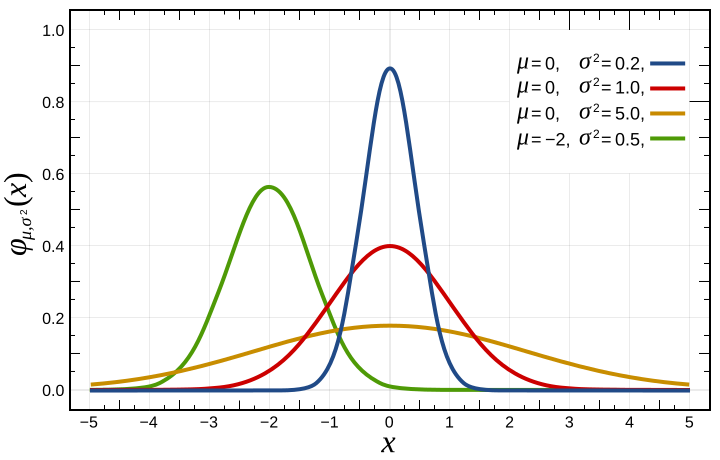

# 概率论、分布与期望

这篇回答一个问题：概率论里的随机变量、分布、条件概率、期望、方差、似然和贝叶斯，为什么会成为机器学习的共同语言。

AI 模型面对的不是确定世界。文本、图像、用户请求、机器人环境和训练数据都有不确定性。概率论让我们能描述“可能发生什么”“多可能”“在什么条件下可能”。

## 随机变量：把不确定结果变成可计算对象

随机变量 \(X\) 不是“随机的数字”这么简单，而是把随机实验的结果映射成数值或类别。比如：

| 随机变量 | 可能取值 |
| --- | --- |
| 下一个 token \(X_t\) | 词表里的某个 token |
| 图像标签 \(Y\) | cat、dog、car 等类别 |
| 机器人动作 \(A_t\) | 连续关节角或离散动作 token |
| 奖励 \(R_t\) | 成功、失败、分数或人类偏好 |

模型训练时，很多公式其实是在说随机变量之间的关系。

## 分布：可能性的形状

离散随机变量用概率质量函数 \(p(x)\) 描述，连续随机变量用概率密度 \(p(x)\) 描述。

{ width="620" }

<small>图源：[Wikimedia Commons: Normal Distribution PDF](https://commons.wikimedia.org/wiki/File:Normal_Distribution_PDF.svg)。原图展示正态分布概率密度。本站用它说明：分布不是一个点，而是一整片可能性的形状；均值、方差和尾部都会影响模型判断。</small>

连续分布里，某个点的密度 \(p(x)\) 不是“取到这个点的概率”。真正的概率来自区间积分：

\[
P(a\le X\le b)=\int_a^b p(x)\,dx
\]

这也是为什么扩散模型、VAE、概率流 ODE 会把概率密度、积分和连续时间放在一起。

公式里的 \(p(x)\) 是密度，\([a,b]\) 是你关心的区间。连续变量“刚好等于某个点”的概率通常为 0，所以要问区间概率。比如模型预测机器人末端误差 \(X\) 近似服从正态分布时，我们更关心 \(P(|X|\le 1\text{cm})\)，而不是 \(P(X=0)\)。

## 期望：在分布下取平均

期望写成：

\[
\mathbb{E}_{X\sim p}[f(X)]
=
\sum_x p(x)f(x)
\]

连续情形是：

\[
\mathbb{E}_{X\sim p}[f(X)]
=
\int p(x)f(x)\,dx
\]

这两行的差别只在 \(X\) 是离散还是连续。下标 \(X\sim p\) 告诉你样本来自哪个分布，\(f(X)\) 是你对样本计算的量。期望不是某一次样本的结果，而是“按分布长期抽样后的平均”。

训练里常见的目标：

\[
\mathbb{E}_{(x,y)\sim\mathcal{D}}
\left[
\ell(f_\theta(x),y)
\right]
\]

意思是：从数据分布 \(\mathcal{D}\) 里抽样，计算模型损失，再取平均。mini-batch 训练只是用有限样本近似这个期望。

后面看预训练时，可以把 \((x,y)\) 理解成“上下文和下一个 token”，\(\ell\) 理解成交叉熵。代码里一个 batch 只给出几十到几千个样本，所以训练得到的是期望的噪声估计。这也是为什么数据顺序、batch size、packing 和采样策略会影响训练稳定性。

## 方差：估计有多抖

方差描述随机变量围绕均值的波动：

\[
\mathrm{Var}(X)=\mathbb{E}[(X-\mathbb{E}[X])^2]
\]

RL 里的 policy gradient 方差大，是因为一次 trajectory 的 return 受很多随机因素影响；batch size 变大通常能降低估计噪声；baseline 和 advantage 也可以看成降低方差的工具。

## 条件概率：知道一件事后，另一件事的可能性

条件概率写成：

\[
P(A\mid B)=\frac{P(A,B)}{P(B)}
\]

语言模型的核心就是条件概率：

\[
p_\theta(x_t\mid x_{<t})
\]

它表示：在给定过去 token 的条件下，下一个 token 的分布。VLA 里也会写：

\[
\pi_\theta(a_t\mid o_{\le t}, l)
\]

表示：给定历史观测和语言指令，动作的分布。

竖线右边永远要认真读。\(p_\theta(x_t\mid x_{<t})\) 只允许看过去 token；如果训练时 mask 错了，让模型看到 \(x_{t+1}\) 或答案位置，loss 会变好，但生成时会露馅。VLA 里的 \(o_{\le t}\) 也一样，它声明策略能看见到当前为止的观测历史，而不是未来画面。

## 贝叶斯：用证据更新信念

贝叶斯公式写成：

\[
P(H\mid E)
=
\frac{P(E\mid H)P(H)}{P(E)}
\]

其中 \(H\) 是假设，\(E\) 是证据。它说的是：先有先验 \(P(H)\)，看到证据 \(E\) 后，用 likelihood \(P(E\mid H)\) 更新成后验 \(P(H\mid E)\)。

一个机器人例子：\(H\) 是“杯子在桌子左侧”，\(E\) 是相机看到的图像证据。先验 \(P(H)\) 来自地图或上一帧估计，\(P(E\mid H)\) 衡量如果杯子真在左侧，看到这张图的可能性，后验 \(P(H\mid E)\) 就是融合观测后的新信念。世界模型里的 belief state 和 latent posterior 都有这种味道。

在机器学习里，贝叶斯思路会出现在：

| 场景 | 贝叶斯语言 |
| --- | --- |
| 潜变量模型 | 看到 \(x\) 后推断隐藏原因 \(z\) |
| 机器人定位 | 用传感器观测更新位姿信念 |
| 不确定性估计 | 区分模型不知道和数据本身随机 |
| 世界模型 | 根据观测历史更新 latent state |

## 似然：模型解释数据的能力

似然常写成：

\[
p_\theta(x)
\]

如果把 \(\theta\) 看成变量，它衡量的是“在当前参数下，观察到数据 \(x\) 有多合理”。最大似然训练就是让真实数据在模型下尽可能可能。

语言模型交叉熵和负对数似然紧密相关：

\[
\mathcal{L}_{\text{NLL}}
=
-\log p_\theta(x)
\]

概率越高，loss 越小；概率越低，loss 越大。

## 常见误读

| 误读 | 更稳的理解 |
| --- | --- |
| 概率高就一定会发生 | 概率描述可能性，不保证单次结果 |
| softmax 概率就是真实置信度 | 它是模型分布，可能未校准 |
| 期望就是实际样本平均 | 样本平均只是对期望的估计 |
| likelihood 和 probability 完全一样 | 数学形式相同，但关注对象不同：概率固定模型看数据，似然固定数据看参数 |

## 读完以后怎么判断

看到概率公式，先找随机变量、条件和分布来源。问清楚样本从哪里来，模型允许看见什么，期望是用真实分布还是 mini-batch 近似。后面的训练、生成、评估和 RL 公式都会因此清楚很多。

## 相关阅读与下一步

- 站内下一步：[概率、潜变量与生成模型](../foundations/probability-latent-variables-and-generative-models.md)。
- 站内下一步：[数据与数据集基础](../foundations/data-and-dataset-basics.md)。
- 外部材料：[Dive into Deep Learning: Probability](https://d2l.ai/chapter_preliminaries/probability.html)。
