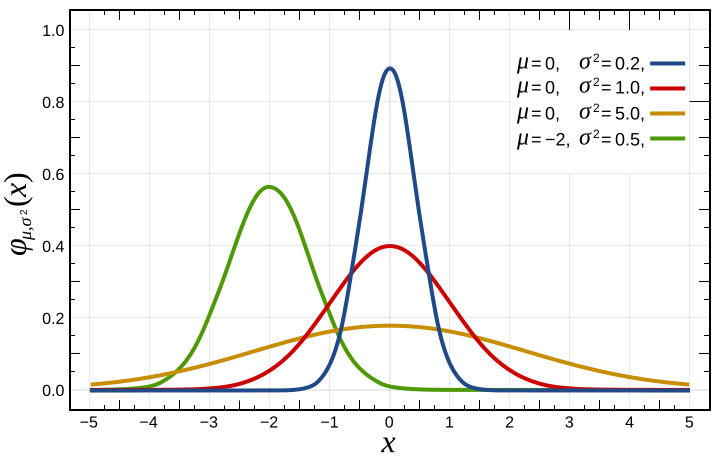

# 概率论、分布与期望

短任务通常比长任务容易成功。如果只报告成功率，却不说明抽到了多少长任务，数字就可能随采样方式改变。本文用一张“任务长度×成功结果”的联合概率表，连续计算条件概率、期望、方差和似然。

每次计算都要保留两个信息：随机抽的对象是什么，当前已知的条件是什么。把它们写清楚，比把多个概率名词单独背下来更有用。

## 联合分布保留了哪些关系

设请求类型 \(T\) 有短请求 S 和长请求 L，运行结果 \(Y\) 为成功 1 或失败 0。假设联合分布为

| 联合事件 | 成功 Y=1 | 失败 Y=0 | 行和 |
| --- | --- | --- | --- |
| 短请求 T=S | 0.72 | 0.08 | 0.80 |
| 长请求 T=L | 0.12 | 0.08 | 0.20 |
| 列和 | 0.84 | 0.16 | 1 |

每格是两件事同时发生的概率。对一行求和，得到边缘概率 \(P(T=S)=0.8\)；对成功列求和，得到 \(P(Y=1)=0.84\)。求和会丢掉一部分关联信息，只有总体成功率84%，无法还原长请求的成功率。

一般地，离散联合分布满足 \(p(t,y)\ge0\)、\(\sum_{t,y}p(t,y)=1\)。边缘化就是对不再关心的变量求和。连续变量则把求和换成积分。

## 条件概率怎样重新归一化

已知请求是长请求后，样本范围缩小到第二行。成功概率是

\[
P(Y=1\mid T=L)=\frac{P(Y=1,T=L)}{P(T=L)}=\frac{0.12}{0.20}=0.6.
\]

同理，短请求成功率为0.9。分母把选定条件下剩下的概率重新归一化，条件事件概率为零时，不能直接使用这个比例定义。

反过来，已知失败，属于长请求的概率为

\[
P(T=L\mid Y=0)=\frac{0.08}{0.16}=0.5.
\]

长请求只占全部请求的20%，却占失败请求的一半。这不是矛盾，两个概率固定的信息不同。贝叶斯公式就是把同一个联合事件用两个方向分解

\[
P(T=L\mid Y=0)
=\frac{P(Y=0\mid T=L)P(T=L)}{P(Y=0)}.
\]

在这里，先验为0.2，失败的似然为0.4，证据概率为0.16，后验为0.5。模型推断也使用这种逻辑，但只有在似然和先验适合实际数据时，得到的后验才有相应可信度。

独立要求 \(p(t,y)=p(t)p(y)\)。本例短请求成功的联合概率0.72，与 \(0.8\times0.84=0.672\) 不同，所以二者不独立。看到统计依赖还不能判断因果，需要进一步说明数据生成方式，见[因果与分布偏移](causality-counterfactual-and-distribution-shift.md)。

## 概率密度可以大于1

离散变量在一个取值上可以有非零概率；具有密度的连续变量通过区间积分计算概率

\[
P(a\le X\le b)=\int_a^b p(x)\,\mathrm dx.
\]

令 \(X\) 在 `[0,0.1]` 上均匀分布，密度为10。区间 `[0.02,0.05]` 的概率是 \(10\times0.03=0.3\)，整个区间的概率仍为1。密度大于1完全合法，它带有与变量单位相反的量纲，不能当作某个点发生的概率。

{ width="620" }

<small>图源为 [Wikimedia Commons](https://commons.wikimedia.org/wiki/File:Normal_Distribution_PDF.svg)。曲线高度是密度，区间下的面积才是概率。</small>

常见高斯分布 \(\mathcal N(\mu,\sigma^2)\) 用均值描述中心、方差描述尺度。真实数据可能有偏斜、多峰或重尾，使用高斯是建模假设，不能由“有均值和方差”推出数据一定服从高斯。

## 期望平均的是一个函数

离散变量的期望为

\[
\mathbb E[f(X)]=\sum_x p(x)f(x).
\]

它允许先对结果计算成本、收益或损失，再按发生概率加权。以成功指示变量 \(Y\in\{0,1\}\) 为例，\(\mathbb E[Y]=P(Y=1)=0.84\)。某次运行只能成功或失败，期望0.84不是一种中间运行状态。

全期望公式把联合分布拆成两层平均

\[
\mathbb E[Y]=\mathbb E_T[\mathbb E[Y\mid T]]
=0.8\times0.9+0.2\times0.6=0.84.
\]

若部署后长短请求各占一半，而各自成功率保持不变，总成功率变成0.75。模型本身没有改变，评测分布改变就能改变总体指标。因此报告平均分时，应同时说明样本构成和权重。

<a id="条件化与重新设计抽样是两种操作"></a>

只考察长请求是在原分布内做条件化；主动把长短请求各抽一半则改变了测试分布。这两种操作回答不同问题。如果均衡测试集用于估计原部署总体，应对分层成功率重新使用原来的0.8与0.2权重。

训练的总体风险也是期望

\[
R(\theta)=\mathbb E_{(X,Y)\sim P}[\ell(f_\theta(X),Y)].
\]

用有限数据计算的样本平均是估计量。若样本分布和目标分布不一致，增加样本数可以让估计更稳定地接近错误的分布平均，不能自动消除偏差。

## 方差怎样传到样本平均

方差定义为 \(\operatorname{Var}(X)=\mathbb E[(X-\mathbb E[X])^2]\)。对成功指示变量，有 \(Y^2=Y\)，所以

\[
\operatorname{Var}(Y)=p-p^2=p(1-p).
\]

取 \(p=0.84\)，方差为0.1344。对100次独立同分布试验，样本成功率的方差为0.001344，标准误约为0.03666。真实任务中不知道 \(p\)，通常用估计值或更合适的区间方法，详见[采样与估计](sampling-estimation-and-calibration.md)。

独立性在这里有明确作用。一般地

\[
\operatorname{Var}\!\left(\frac1n\sum_iX_i\right)
=\frac1{n^2}\left[\sum_i\operatorname{Var}(X_i)
+2\sum_{i<j}\operatorname{Cov}(X_i,X_j)\right].
\]

同一段视频的相邻帧、同一场景的连续机器人尝试，可能高度相关。把它们全部当独立样本，会漏掉协方差项，低估估计波动。

## 零协方差为何不保证独立

协方差为 \(\operatorname{Cov}(X,Y)=\mathbb E[(X-\mu_X)(Y-\mu_Y)]\)。它描述两个变量的线性共同变化，正值表示常同向偏离均值。

取 \(X\) 等概率落在 `-1,0,1`，并定义 \(Y=X^2\)。有 \(\mathbb E[X]=0\)、\(\mathbb E[Y]=2/3\)、\(\mathbb E[XY]=\mathbb E[X^3]=0\)，因此协方差为零。但知道 \(X=0\) 就确定 \(Y=0\)，它们显然不独立。Pearson相关为零也只排除这种线性共变；只有额外的特殊分布条件下才能推出更强结论。

随机向量的协方差矩阵为

\[
\Sigma=\mathbb E[(X-\mu)(X-\mu)^\top].
\]

对角线记录各坐标方差，非对角线记录相关方向。取 \(\Sigma=\begin{bmatrix}1&0.8\\0.8&1\end{bmatrix}\)，沿 \((1,1)/\sqrt2\) 的方差为1.8，沿 \((1,-1)/\sqrt2\) 的方差为0.2。两个坐标标准差都为1，并不意味着所有方向的不确定性相同。机器人位置误差或latent扰动需要保留哪些方向，取决于后续任务。

## 固定数据后，概率表达式成为似然

设成功概率参数为 \(p\)，观察到10次独立试验中的8次成功和2次失败。对一条已经固定顺序的观测序列，似然为

\[
L(p)=p^8(1-p)^2.
\]

如果只记录成功次数，还需要乘二项式系数，但这个与 \(p\) 无关的常数不改变最大似然估计。取对数并求导，得到 \(8/p-2/(1-p)=0\)，所以估计 \(\hat p=0.8\)。

此时变化的是参数 \(p\)，数据已经固定。似然不是参数的概率分布；若希望计算参数后验，还要指定先验并归一化。这个区别也适用于神经网络的 \(p_\theta(x)\)，同一个表达式可以作为数据密度或作为参数的似然函数，取决于固定谁、比较谁。

## 直接验证这些数字

```python
import math
joint = [[0.72, 0.08], [0.12, 0.08]]
p_success = sum(row[0] for row in joint)
p_long_given_failure = joint[1][1] / sum(row[1] for row in joint)
se = math.sqrt(p_success * (1 - p_success) / 100)
print(p_success, p_long_given_failure, round(se, 6))
```

输出约为 `0.84 0.5 0.036661`。相同的条件平均思路会进入[价值函数](../reinforcement-learning/mdp-value-bellman.md)，最大似然会进入[生成模型目标](latent-likelihood-and-generative-objectives.md)。

## 参考资料

- [Dive into Deep Learning 的概率章节](https://d2l.ai/chapter_preliminaries/probability.html)介绍概率、条件概率与期望。


- [D2L 概率基础](https://github.com/d2l-ai/d2l-zh/blob/e6b18ccea71451a55fcd861d7b96fddf2587b09a/chapter_preliminaries/probability.md)，对照联合、边缘与条件概率的区别。
