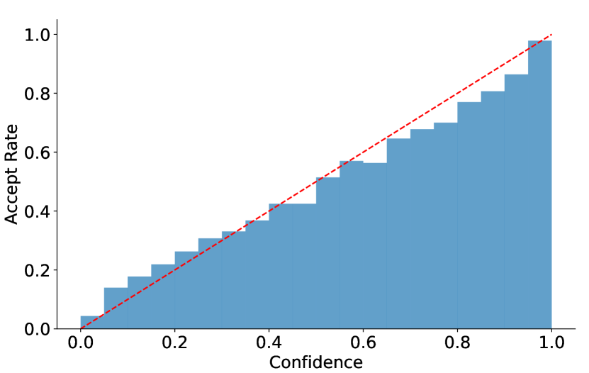

# 采样、估计与概率校准

模型在100次测试中成功80次，80%只是一个估计。换一批任务会怎样？如果测试任务与部署比例不同，平均还代表什么？模型自己说的80%把握，又是否和这项成功率是一回事？

先把一次测试写成随机变量 \(X\)，成功记为 \(f(X)=1\)，失败记为0。我们想估计部署分布p下的 \(\mu=\mathbb E_p[f(X)]\)，实际只有有限样本。后面的均值、区间、重加权和校准，都需要保留这个抽样对象。

## 样本均值的波动来自哪里

若 \(X_1,\dots,X_n\) 独立同分布，样本均值 \(\hat\mu=n^{-1}\sum_i f(X_i)\) 是无偏估计。单次结果的方差为 \(\sigma^2\) 时，均值的方差为 \(\sigma^2/n\)，标准误为 \(\sigma/\sqrt n\)。

Bernoulli成功事件的方差是 \(p(1-p)\)。用观测比例0.8代入，100次试验的近似标准误为0.04。要把它减半，样本数需增加到400，而不是200。增加数据降低随机波动，不会纠正一直偏向简单任务的采样偏差。

同一个机器人episode里的相邻帧、同一个用户的多条请求往往相关，不能当成独立试验。总体方差还包含协方差项。按独立episode或用户组织评估与重采样，比仅增加帧数更符合真实不确定性。

## 置信区间不是给真值分配概率

频率学派95%置信区间表示在相同抽样规则下反复构造区间，长期约95%的区间覆盖固定真值。观察到这一批数据以后，不能不加贝叶斯模型就解释为“真值有95%概率在本区间”。

简单Wald区间 \(\hat p\pm1.96\sqrt{\hat p(1-\hat p)/n}\) 在小样本或靠近0/1时可能很差。Wilson区间令 \(z=1.96\)，中心与半宽为

\[
c=\frac{\hat p+z^2/(2n)}{1+z^2/n},\quad
r=\frac{z\sqrt{\hat p(1-\hat p)/n+z^2/(4n^2)}}{1+z^2/n}.
\]

80/100的区间约为(0.7112,0.8666)。即使10/10全部成功，区间下界仍约0.7225，数据不足以证明真实成功率是100%。Wilson仍依赖二项抽样设定，不会修复样本相关或测试集污染。

```python
import math
for successes,n in [(80,100),(10,10)]:
    p,z = successes/n,1.96
    den = 1+z*z/n
    center = (p+z*z/(2*n))/den
    radius = z*math.sqrt(p*(1-p)/n+z*z/(4*n*n))/den
    print(round(center-radius,4),round(center+radius,4))
```

## 两个模型用相同样本比较

如果A和B都在同一批任务上测试，应保存每题差值 \(d_i=f_B(X_i)-f_A(X_i)\)，而非只保留两个平均分。对差值做bootstrap能保留配对关系；若任务按用户或episode相关，应整体重采样这些组。

Bootstrap从已有样本中有放回重采样，再重算指标，近似估计该数据来源下的波动。它无法创造原数据没有覆盖的失败类型，也不能把偏置judge变成真实评价。重复训练种子的波动与固定模型在测试集上的抽样波动，是另外两个来源，报告时应区分。

## 当样本来自另一个分布

设目标分布 \(p=(0.8,0.2)\)，实际抽样分布 \(q=(0.5,0.5)\)，两种任务损失为 \(f=(0,10)\)。目标均值为2，直接平均q样本却趋向5。

只要q覆盖所有对目标有贡献的区域，就可用重要性权重

\[
w(x)=p(x)/q(x),\qquad
\mathbb E_p[f]=\mathbb E_q[wf].
\]

本例权重为(1.6,0.4)，加权项是(0,4)，q下平均为2。普通重要性估计 \(n^{-1}\sum_iw_if_i\) 在相关条件下无偏；自归一化估计 \(\sum_iw_if_i/\sum_iw_i\) 是比值，有限样本通常有偏，但可能更实用。

若只采到第二种任务，自归一化结果是10，仍远离2。权重不创造没采到的样本。某些权重极大时，估计还会被少数样本主导；常用诊断 \(ESS=(\sum_iw_i)^2/\sum_iw_i^2\)，它描述权重集中程度，不自动等于考虑全部时间相关后的真实有效样本量。

## Baseline减少的是梯度估计波动

策略梯度用 \(f(X)\nabla\log p_\theta(X)\) 估计参数方向，减去适当baseline后期望可以不变，因为 \(\mathbb E[\nabla\log p_\theta(X)]=0\)。这是一个特殊的控制变量结构，不能在普通成功率均值里随意减去常数还声称均值不变。

给定状态时，baseline不能依赖当前动作，才能直接使用常见无偏推导。具体伯努利数值见[梯度估计](../foundations/gradient-estimators-and-training-signals.md)。无偏不保证低方差，baseline选得差也可能增大波动。

## 模型说80%把握时，怎样检查

概率校准问的是预测概率与频率是否对应。收集一组预测置信度接近0.8的样本，如果其中仅60%正确，模型在这组样本上过度自信。整体成功率80%并不意味着校准良好，例如它可能对所有样本都声称99%把握。

ECE把预测分桶，计算各桶平均置信度与正确率之差的绝对值，再按桶样本数加权。它依赖分桶方式、样本量和采用的置信度定义；同一桶内相反方向的误差也可能抵消。比较校准时还可使用proper scoring rule，如Brier score和负log似然，但它们同时受区分能力影响。

例如两个桶各50个样本，平均置信度分别0.9和0.6，正确率分别0.8和0.6，ECE为 \(0.5|0.9-0.8|+0.5|0.6-0.6|=0.05\)。这个5%是所选分桶的加权差，不是所有单个预测都只错5%。

分布变化后，原来的校准关系可能失效。风险敏感应用需要在目标来源、关键任务组和实际决策阈值附近重新检查。

{ width="820" }

<small>图源：[EAGLE-2](https://arxiv.org/abs/2406.16858)，Figure 6。</small>

横轴是 draft confidence，纵轴是相应分桶的实际接受率，红线表示二者相等。蓝色柱形在部分区间偏离红线。它展示该实验中置信度与接受率的关系；换模型、采样协议或任务后，需要重新测量。

## 从估计回到使用方式

如果关心排序，相关系数或排名指标可能更合适；若关心是否能执行一个动作，成功概率与失败代价更重要。投机解码的接受率、机器人成功率、judge胜率虽然都是比例，分母和事件却不同，不能跨任务直接比较。

每个数字至少需要能还原样本来源、计数单位、权重和重复机制。数学区间只对这些约定内的不确定性负责。

## 参考入口

- [D2L 概率与期望](https://github.com/d2l-ai/d2l-zh/blob/e6b18ccea71451a55fcd861d7b96fddf2587b09a/chapter_preliminaries/probability.md)，均值和方差都应对应一个明确的随机抽样过程。

[评测基础](../foundations/data-splits-metrics-and-evaluation-basics.md)把配对比较与生成协议放到具体任务中。
