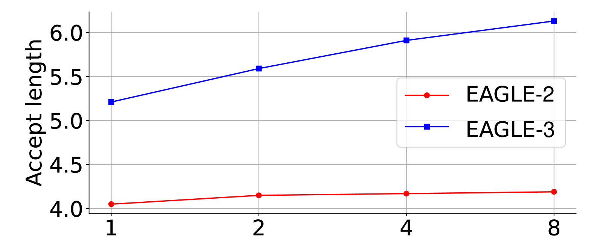

# 缩放律、幂律与实验曲线

假设验证损失可近似写成 \(L(N)=1+2N^{-1/2}\)。增加模型规模会降低可减少的部分，却无法越过常数1。这个简单函数可以算出双倍规模的收益，再说明拟合、外推和预算分配各自依赖哪些假设。

它是一条教学曲线，不是给任意模型套用的经验参数。真正缩放实验需要固定数据和训练设定，并报告拟合支持的范围。

## 幂律：规模变大时按固定指数变化

常见缩放律可以写成：

\[
L(N)=aN^{-\alpha}+b
\]

这里 \(N\) 可以是参数量、数据量、计算量或测试时 token 数；\(L(N)\) 是 loss 或 error；\(a\) 是尺度系数，\(\alpha\) 是缩放指数，\(b\) 是不可继续下降的底部误差。

在 \(a>0,\alpha>0\) 的假设下，扩大资源会降低剩余误差 \(L-b\)。N翻倍后，剩余误差乘上 \(2^{-\alpha}\)。取 \(\alpha=0.5\)，它变成原来的约0.7071；要让剩余误差减半，需要把N增到4倍。\(\alpha\) 越大，在固定倍数扩展下的相对下降越快，不能简单说成“收益越差”。

例如教学曲线 \(L(N)=2N^{-1/2}+1\)，N为1、4、16时，L为3、2、1.5。每增加4倍资源，离拟合下限1的差距减半。这里b是该拟合模型的渐近项，有限实验未必足以确认它就是任务真正不可约误差。

## log-log 图：把幂律看成直线

对幂律取对数：

\[
\log(L-b)
\approx
\log a-\alpha \log N
\]

在 log-log 图上，幂律关系会接近直线，斜率大约是 \(-\alpha\)。这就是为什么很多 scaling law 图喜欢用对数坐标：它能把“按指数缩放”的趋势变成更容易读的直线。

读 log-log 图时要避免一个视觉陷阱：同样的水平距离代表倍数变化，不是加法变化。从 \(10^6\) 到 \(10^7\) 和从 \(10^9\) 到 \(10^{10}\) 在图上可能一样宽，但实际资源规模完全不同。

{ width="760" }

<small>图源：[EAGLE-3](https://arxiv.org/abs/2503.01840)，Figure 1 相关 scaling law 图。这里的重点是：读缩放曲线时要看横轴代表什么资源、纵轴代表什么收益、斜率是否稳定，以及外推是否仍在数据支持范围内。</small>

## 边际收益：继续加资源还值不值

对上述幂律，\(\mathrm dL/\mathrm dN=-a\alpha N^{-\alpha-1}\)，绝对边际收益随规模增大而减小。但实际预算可能同时分配给参数N与数据D。设

\[
L(N,D)=E+AN^{-\alpha}+BD^{-\beta},\qquad C=kND.
\]

固定计算预算C后，代入 \(D=C/(kN)\)，令导数为零，得到

\[
\alpha A N^{-\alpha}=\beta B D^{-\beta}.
\]

这平衡两类资源的边际贡献。若 \(\alpha=\beta=1,A=B=1,k=1,C=100\)，最优点为 \(N=D=10\)，超出E的损失为0.2；取 \(N=20,D=5\) 则为0.25。只增加模型而挤掉数据，不一定改善结果。真实缩放律的系数和计算关系必须由对应实验拟合，不能把本例数字用于预测真实训练。

读曲线时先问：

| 问题 | 为什么重要 |
| --- | --- |
| 横轴是什么 | 参数、数据、FLOPs、采样步数、测试时 token，意义完全不同 |
| 纵轴是什么 | loss、accuracy、speedup、acceptance length、human preference 不能混读 |
| 是否对数坐标 | 线性视觉直觉在 log 坐标下容易误判 |
| 点的范围多大 | 只在小范围拟合的曲线不能随便外推 |
| 是否有误差条 | 没有方差就难判断差异是否可靠 |

## 插值和外推：曲线支持到哪里

如果实验点覆盖 \(10^8\) 到 \(10^{10}\) tokens，在这个区间内读趋势更像插值；把同一斜率推到 \(10^{13}\) tokens，就是外推。外推会遇到几类风险：

| 风险 | 例子 |
| --- | --- |
| 数据分布变了 | 低质量数据比例上升，scaling 指数变差 |
| 瓶颈转移 | 算法 speedup 到某点后被内存、调度或网络卡住 |
| 指标饱和 | benchmark 接近上限后，loss 下降不再转成任务收益 |
| 训练 recipe 变了 | 学习率、batch、token mixture 或后训练不再可比 |

所以论文里的 fitted line 不是许愿线。更稳的写法是：在观测范围内支持某个趋势；超过范围时只能作为假设，需要新实验验证。

## 固定计算预算时，两个规模不能独立增加

若成本近似正比于ND，且预算固定为100，令 \(D=100/N\)。假设可减少损失为 \(2N^{-1/2}+8D^{-1/2}\)，代入得 \(2N^{-1/2}+0.8N^{1/2}\)。对N求导并令零，得到N=2.5、D=40。

这里数据项系数更大，最优分配因而偏向数据，与前面的对称例子不同。系数或指数变化，最优分配也会变化；成本若还包含attention、通信或数据处理，也会改变约束。缩放律提供可验证的分配假设，不能脱离拟合与系统成本直接给预算答案。

## Pareto frontier：不能只看一个指标

很多系统论文同时优化质量、延迟、显存、吞吐和成本。Pareto frontier 表示：在当前候选里，没有另一个方案能在所有指标上都更好。

更准确地说，支配要求所有指标都不差且至少一个严格更好。假设质量越大越好、延迟越小越好，A为 `(80分,20ms)`，B为 `(82分,30ms)`，C为 `(79分,25ms)`。A支配C，A与B互不支配。若产品要求延迟不超过25ms，B即使最高分也不满足约束。

Pareto边界只针对已比较的候选、指标和测量条件。漏掉显存或并发条件，可能改变实际可用集合。

## Ablation：一次只拆一个因素

消融实验的目标是回答“这个模块有没有贡献”。理想消融只改变一个因素：

\[
\Delta
=
\mathrm{score}_{\text{full}}
-
\mathrm{score}_{\text{without module}}
\]

去掉模块后训练预算、超参、数据流或系统开销也可能变化，因此要声明控制了什么。还要考虑模块交互。教学例子中，基线70分，加A为72，加B为71，两者都加为76。交互项为

\[
76-72-71+70=3.
\]

只从完整模型移除A，下降5分；从基线添加A，上升2分。两者回答不同条件下的贡献，不应硬说A有一个固定的“5分价值”。2×2实验能区分主效应与交互，多个seed和配对评测则帮助区分真实差异与随机波动。

## 曲线斜率和拐点：机制可能在变

训练 loss 曲线突然变平，可能是学习率、数据质量、模型容量或优化瓶颈；speedup 曲线突然饱和，可能是新瓶颈从 compute 转到 I/O 或调度；test-time scaling 曲线拐头，可能说明更多 token 开始带来噪声或重复推理。

所以曲线不是装饰。它常常比单点表格更能揭示机制：方法在哪个区间有效，在哪个区间开始失效。

## 读曲线时同时看误差和成本

曲线上的点如果来自单次 run，可能只是随机波动。训练曲线可用平滑窗口帮助观察趋势，但平滑不能替代多个seed来估计运行间不确定性；评测曲线应给出适当的置信区间；系统曲线最好报告硬件、batch、prompt/output 长度和并发分布。

还要把收益除以成本看。一个方法让 score 从 70 到 72，但计算量增加 4 倍；另一个方法从 70 到 71，但几乎免费，二者服务的产品区间可能完全不同。Pareto frontier 的意义是在给定预算下选最合适的点，而不是只看最高分。

- [D2L 模型选择](https://github.com/d2l-ai/d2l-zh/blob/e6b18ccea71451a55fcd861d7b96fddf2587b09a/chapter_multilayer-perceptrons/underfit-overfit.md)，用独立验证与控制变量判断拟合收益。
## 继续读

继续看[研究闭环](../training/research-loop-from-hypothesis-to-evidence-1123-2351.md)和[评测与消融方法](../training/evaluation-and-ablation-methodology.md)。
