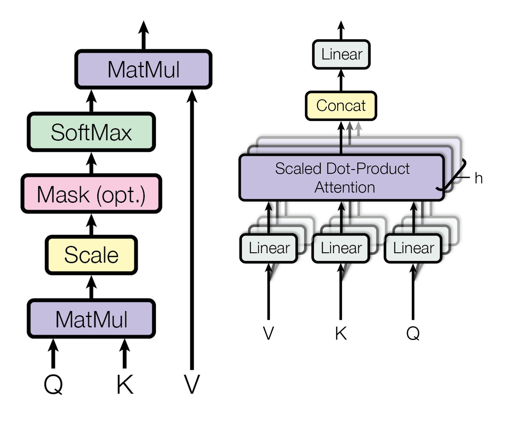

# 序列、位置编码与注意力掩码

为什么输入 `[BOS,A,B]` 的第三个位置预测的是 `EOS`，而不是再次预测 `B`？一段 `[BOS,A,B,EOS]` 同时包含输入和标签，错位、可见性、位置与缓存只要有一处偏一位，模型仍可能运行，却会学到错误条件。

Attention的行对应query，列对应key。先明确这两个轴，三角mask、位置旋转和KV追加的含义才一致。

## 序列索引：把对象按时间或顺序排起来

一个长度为 \(T\) 的序列可以写成：

\[
x_{1:T}=(x_1,x_2,\ldots,x_T)
\]

自回归模型把联合概率拆成逐步条件概率：

\[
p(x_{1:T})
=
\prod_{t=1}^{T}p(x_t\mid x_{<t})
\]

这里 \(x_{<t}\) 表示第 \(t\) 步之前的全部历史。读这行公式时，重点是方向性：模型每一步根据前缀分布生成下一个 token，而不是一次性猜完整句子。EAGLE、vLLM、PagedAttention、长视频 token 训练和世界模型 rollout 都在不同层面处理这条“逐步展开”的链。

如果是视频世界模型，\(x_t\) 可能是一帧、一个 latent 或一组视觉 token；如果是机器人，\(x_t\) 可能和动作 \(a_t\) 交错出现：

\[
(o_1,a_1,o_2,a_2,\ldots,o_T)
\]

这时顺序不仅代表时间，还代表因果接口：动作应该影响后续观测，而不应该偷看未来观测。

## 注意力：每个位置从哪些位置取信息

Scaled dot-product attention 写成：

\[
\operatorname{Attention}(Q,K,V)
=
\operatorname{softmax}
\left(
\frac{QK^\top}{\sqrt{d_k}}+M
\right)V
\]

这里 \(M\) 是 mask 矩阵。没有 mask 时，每个 query 都可以和所有 key 交互；有 mask 时，被禁止的位置会加上很大的负数，让 softmax 后权重接近 0。

{ width="760" }

<small>图源：`Attention Is All You Need`，Figure 2，已本地化。原图展示 scaled dot-product attention 和 multi-head attention 的计算路径。这里的重点是：mask、scale、softmax 和 value 加权决定序列信息流的数学接口。</small>

## Causal mask：不能让未来泄漏到过去

预测目标token \(x_t\) 时只能使用 \(x_{<t}\)，但实现中常把输入与标签错开一位。输入 `[BOS,A,B]` 对应标签 `[A,B,EOS]`，输入位置0的隐藏状态预测A，位置1预测B，位置2预测EOS。因此每个输入位置可以读取自己，causal mask写成

\[
M_{ij}=
\begin{cases}
0, & j\le i \\
-\infty, & j>i
\end{cases}
\]

其中 \(i\) 是输入query位置，\(j\) 是key位置。对三个位置，允许矩阵为

\[
A=\begin{bmatrix}1&0&0\\1&1&0\\1&1&1\end{bmatrix}.
\]

如果所有未遮挡attention logits相等，归一化后的权重为

\[
P=\begin{bmatrix}1&0&0\\1/2&1/2&0\\1/3&1/3&1/3\end{bmatrix}.
\]

令标量value为 \((2,4,9)\)，输出为 \((2,3,5)\)。位置1只能混合BOS和A的信息，得到3；如果误用全可见mask，它会读取B的value，训练时泄漏了当前要预测的答案。

padding mask禁止把填充位置当作可用key，loss mask决定哪些标签进入损失，二者作用不同。prompt可以不计算损失，但其表示仍应被回答token读取。把两篇文档拼在一条序列中且要求独立训练时，还需要按文档隔开的block-causal mask，并在边界处理标签移位；单纯去掉padding不能阻止跨文档读取。

这也是为什么论文里会反复强调 attention mask。Self-Forcing、EAGLE-3、Bagel、RingAttention、MagiAttention 等方法如果 mask 设计错了，模型可能在训练时偷看未来，或者在推理时让不同候选分支互相泄漏信息。

## 位置编码：同一个 token 在不同位置意义不同

纯 attention 只看内容相似度。如果不给位置信息，序列 \((A,B)\) 和 \((B,A)\) 很容易被混淆。位置编码就是给每个位置一个坐标。

经典正弦位置编码写成：

\[
\operatorname{PE}_{(pos,2i)}
=
\sin\left(\frac{pos}{10000^{2i/d}}\right)
\]

\[
\operatorname{PE}_{(pos,2i+1)}
=
\cos\left(\frac{pos}{10000^{2i/d}}\right)
\]

这里 \(pos\) 是位置，\(i\) 是特征维度编号。不同维度使用不同频率的正弦和余弦，让模型同时感知短距离和长距离关系。

RoPE在每一对特征上施加二维旋转。记

\[
R(\phi)=\begin{bmatrix}\cos\phi&-\sin\phi\\\sin\phi&\cos\phi\end{bmatrix},\quad
q_i'=R(i\omega)q_i,\quad k_j'=R(j\omega)k_j.
\]

因为 \(R(i\omega)^\top R(j\omega)=R((j-i)\omega)\)，点积成为

\[
(q_i')^\top k_j'=q_i^\top R((j-i)\omega)k_j.
\]

相对位置差进入了匹配分数。例如 \(q_i=k_j=(1,0)\)、\(\omega=\pi/2\)，同位置分数为1，相差一个位置为0，相差两个位置为-1。实际模型为多对维度选择不同频率，以表达多种距离尺度；上述单频例子只用于核对旋转。

相对形式不保证任意长度外推都正确。频率、训练位置范围和内容分布共同影响效果。复用KV时也必须保留对应的位置语义；把带有旧位置旋转的key直接挪到新位置，会改变点积，除非实现按相应约定重新变换。

## Temperature：把 logits 变成更尖或更平的分布

模型先输出 logits \(z_i\)，再通过 softmax 变成概率：

\[
p_i
=
\frac{\exp(z_i/\tau)}
{\sum_j \exp(z_j/\tau)}
\]

\(\tau\) 是 temperature。较小的 \(\tau\) 会让最大 logit 更突出，生成更确定；较大的 \(\tau\) 会让分布更平，生成更多样。

取两个logits \((2,0)\)。温度1得到概率约 \((0.8808,0.1192)\)，温度2得到 \((0.7311,0.2689)\)，温度0.5得到 \((0.9820,0.0180)\)。温度必须为正；所谓温度0通常是API对贪心选择的特殊约定，不能直接代入除法。

投机采样的接受率取决于草稿与目标分布是否接近，不能只看温度或目标熵。若草稿分布为 \(q\)、目标为 \(p\)，标准单token接受规则的平均接受概率为 \(\sum_x\min(p(x),q(x))\)。两者完全相同时，即使分布很平，接受率也为1；若低温让它们各自集中到不同token，接受率反而可能更低。具体算法还要核对是否使用同一套温度和截断后的概率。

## 训练一行与生成一步如何对齐

训练输入位置B的输出分布用于预测EOS。生成时若上下文已经是`[BOS,A,B]`，读取最后一个位置的分布，就在做同一个条件预测。若错误地读取A的位置，得到的是“预测B”的分布，会产生看似合理却错一位的行为。

KV中保存的是已经处理过的输入位置，不包括尚未送入网络的候选token。采样出EOS后通常直接结束；采样出普通token后，下一轮才为它计算新K/V。具体运行时可以批处理或预分配缓存，但逻辑上的已计算长度与已输出长度仍应区分。

## KV cache：序列历史的可复用记忆

decode 第 \(t\) 步时，新 token 只产生一个新的 query，但它要读所有历史 key/value。于是每层都缓存：

\[
K_{1:t},V_{1:t}
\]

KV cache 的数学意义是“历史序列已经被投影成可被未来 query 读取的记忆”。工程意义是显存和带宽账本。PagedAttention、KVSlimmer、MLA、GQA/MQA 和长上下文服务都在问：这些历史 \(K,V\) 怎样存、怎样读、能不能压缩。

- [LLMs from scratch 的切片与因果注意力](https://github.com/rasbt/LLMs-from-scratch/blob/cdbd33e6d57a71e20ea31434841095fac50cecd8/ch04/01_main-chapter-code/gpt.py)，对照input_chunk、target_chunk与mask轴。

继续阅读：[Transformer、Tokenization 与注意力](../foundations/transformer-attention-and-tokenization.md)把两位置手算扩展到多头和 cross-attention；[缓存、路由与投机解码](../inference/caching-routing-and-speculative.md)把位置语义放回批处理和 KV 生命周期。
