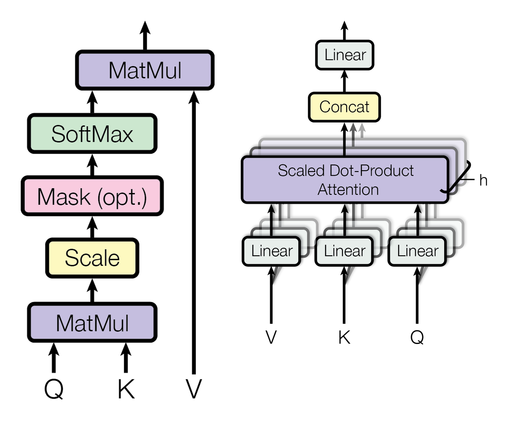

# 序列、位置编码与注意力掩码

token 序列、位置编码、causal mask、attention mask、temperature 和 KV cache 共同定义序列模型的信息流、位置感和生成概率。语言、视频和机器人轨迹都可以按顺序展开，只是元素分别是 token、帧或 patch、状态和动作；序列数学关心第 \(t\) 个元素能看见谁、怎样知道自己在什么位置、生成下一个元素时概率怎样变化。

## 序列索引：把对象按时间或顺序排起来

一个长度为 \(T\) 的序列可以写成：

\[
x_{1:T}=(x_1,x_2,\ldots,x_T)
\]

自回归模型把联合概率拆成逐步条件概率：

\[
p(x_{1:T})
=
\prod_{t=1}^{T}p(x_t\mid x_{<t})
\]

这里 \(x_{<t}\) 表示第 \(t\) 步之前的全部历史。读这行公式时，重点是方向性：模型每一步根据前缀分布生成下一个 token，而不是一次性猜完整句子。EAGLE、vLLM、PagedAttention、长视频 token 训练和世界模型 rollout 都在不同层面处理这条“逐步展开”的链。

如果是视频世界模型，\(x_t\) 可能是一帧、一个 latent 或一组视觉 token；如果是机器人，\(x_t\) 可能和动作 \(a_t\) 交错出现：

\[
(o_1,a_1,o_2,a_2,\ldots,o_T)
\]

这时顺序不仅代表时间，还代表因果接口：动作应该影响后续观测，而不应该偷看未来观测。

## 注意力：每个位置从哪些位置取信息

Scaled dot-product attention 写成：

\[
\operatorname{Attention}(Q,K,V)
=
\operatorname{softmax}
\left(
\frac{QK^\top}{\sqrt{d_k}}+M
\right)V
\]

这里 \(M\) 是 mask 矩阵。没有 mask 时，每个 query 都可以和所有 key 交互；有 mask 时，被禁止的位置会加上很大的负数，让 softmax 后权重接近 0。

{ width="760" }

<small>图源：`Attention Is All You Need`，Figure 2，已本地化。原图展示 scaled dot-product attention 和 multi-head attention 的计算路径。这里的重点是：mask、scale、softmax 和 value 加权决定序列信息流的数学接口。</small>

## Causal mask：不能让未来泄漏到过去

语言模型训练第 \(t\) 个 token 时，只能使用 \(1,\ldots,t-1\) 的历史。一个 causal mask 可以抽象成：

\[
M_{ij}=
\begin{cases}
0, & j\le i \\
-\infty, & j>i
\end{cases}
\]

其中 \(i\) 是当前 query 位置，\(j\) 是被读取的 key 位置。\(j>i\) 表示未来位置，因此被遮掉。

这也是为什么论文里会反复强调 attention mask。Self-Forcing、EAGLE-3、Bagel、RingAttention、MagiAttention 等方法如果 mask 设计错了，模型可能在训练时偷看未来，或者在推理时让不同候选分支互相泄漏信息。

## 位置编码：同一个 token 在不同位置意义不同

纯 attention 只看内容相似度。如果不给位置信息，序列 \((A,B)\) 和 \((B,A)\) 很容易被混淆。位置编码就是给每个位置一个坐标。

经典正弦位置编码写成：

\[
\operatorname{PE}_{(pos,2i)}
=
\sin\left(\frac{pos}{10000^{2i/d}}\right)
\]

\[
\operatorname{PE}_{(pos,2i+1)}
=
\cos\left(\frac{pos}{10000^{2i/d}}\right)
\]

这里 \(pos\) 是位置，\(i\) 是特征维度编号。不同维度使用不同频率的正弦和余弦，让模型同时感知短距离和长距离关系。

RoPE 可以理解为把位置写成旋转：位置越靠后，query/key 在二维子空间里旋转得越多。它的好处是，点积天然带上相对位置信息。因此 DeepSeek-V3、LWM、长上下文模型和多模态序列模型经常会讨论 RoPE \(\theta\)、context extension 和位置外推。

## Temperature：把 logits 变成更尖或更平的分布

模型先输出 logits \(z_i\)，再通过 softmax 变成概率：

\[
p_i
=
\frac{\exp(z_i/\tau)}
{\sum_j \exp(z_j/\tau)}
\]

\(\tau\) 是 temperature。较小的 \(\tau\) 会让最大 logit 更突出，生成更确定；较大的 \(\tau\) 会让分布更平，生成更多样。

投机解码论文读 temperature 时要特别小心：temperature 会改变下一个 token 分布，也会改变 draft token 的 acceptance rate。低温请求更可预测，draft 更容易连续猜中；高温请求更随机，候选树需要更多分支才可能覆盖目标分布。

## KV cache：序列历史的可复用记忆

decode 第 \(t\) 步时，新 token 只产生一个新的 query，但它要读所有历史 key/value。于是每层都缓存：

\[
K_{1:t},V_{1:t}
\]

KV cache 的数学意义是“历史序列已经被投影成可被未来 query 读取的记忆”。工程意义是显存和带宽账本。PagedAttention、KVSlimmer、MLA、GQA/MQA 和长上下文服务都在问：这些历史 \(K,V\) 怎样存、怎样读、能不能压缩。

## 常见误读

| 误读 | 更稳的理解 |
| --- | --- |
| mask 只是实现细节 | mask 定义了信息能否流动，错了会改变训练目标 |
| 位置编码只是给 token 加编号 | 位置编码决定模型怎样比较距离、顺序和长上下文外推 |
| temperature 只是生成风格参数 | 它直接改变概率分布，也影响 acceptance、评测和复现 |
| KV cache 只是缓存 | 它是历史序列的 attention 记忆，也是长上下文成本的主要来源 |

## 读完以后怎么判断

看到 sequence、position、RoPE、mask、temperature 或 KV cache，先问：当前 token 能看见哪些历史，位置信息怎样进入 attention，生成概率是否被 temperature 改写，历史 \(K,V\) 是否被完整保存或近似压缩。这个问题链会支撑长上下文、投机解码、多模态序列和世界模型 rollout 论文。
