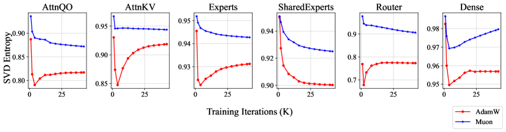
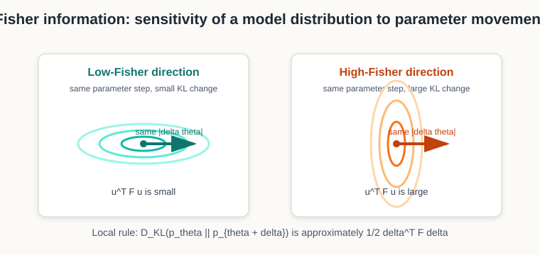

# 谱分解、二阶近似与低秩结构

特征值、SVD、谱能量、Hessian、Taylor 近似和低秩结构用来分析方向结构和扰动敏感度。谱分解看矩阵能量集中在哪些方向，二阶近似看 loss 或模型分布对小扰动有多敏感。

## 特征值：一个方向被放大多少

如果一个方阵 \(A\) 满足：

\[
Av=\lambda v
\]

那么 \(v\) 是特征向量，\(\lambda\) 是特征值。

这行公式的意思是：矩阵 \(A\) 作用在方向 \(v\) 上时，没有把它转到别的方向，只是把它缩放了 \(\lambda\) 倍。如果 \(|\lambda|>1\)，这个方向会被放大；如果 \(|\lambda|<1\)，这个方向会被压缩；如果 \(\lambda<0\)，方向还会翻转。

后面看动态系统、RNN、世界模型 rollout 或 optimizer 稳定性时，特征值经常在背后起作用：某些方向反复被放大，误差就会越来越大。

## SVD：把任意矩阵拆成方向、强度和方向

奇异值分解写成：

\[
W=U\Sigma V^\top
\]

逐项读：

| 符号 | 含义 |
| --- | --- |
| \(V^\top\) | 先把输入投到一组右奇异方向上 |
| \(\Sigma\) | 每个方向乘以一个奇异值，表示这个方向有多重要 |
| \(U\) | 再把结果转到输出空间的一组左奇异方向上 |

如果少数奇异值很大，很多奇异值很小，说明矩阵主要依赖少数方向。这就是低秩近似、LoRA、谱分析、KV 压缩和某些优化器分析的共同底座。

{ width="760" }

<small>图源：[Muon is Scalable](https://arxiv.org/abs/2502.16982) 相关图，已本地化于 Muon 论文精读。原图用 SVD entropy 比较矩阵谱能量分布。这里的重点是：看矩阵时除了大小，也要看能量是否集中在少数谱方向。</small>

## 谱能量：信息是不是集中在少数方向

如果奇异值是 \(\sigma_1,\sigma_2,\dots,\sigma_r\)，可以把每个方向的相对能量看成：

\[
p_i=\frac{\sigma_i^2}{\sum_j\sigma_j^2}
\]

这里 \(p_i\) 像一个概率分布：第 \(i\) 个谱方向占总能量多少。若 \(p_1,p_2\) 很大，说明能量集中；若很多 \(p_i\) 都差不多，说明信息分散。

KVSlimmer、低秩适配、剪枝和量化论文经常会问类似问题：Key、Value、权重矩阵或 activation 的信息，是不是集中在少数方向？如果是，压缩更可能安全；如果不是，粗暴压缩会丢掉细节。

## Newton-Schulz 迭代：用矩阵乘逼近正交化

Muon 这类优化器论文里会出现 Newton-Schulz iteration。它常用于近似矩阵的 polar factor 或 inverse square root，让一个矩阵更接近“列方向正交”的形状。

一个常见的 Newton-Schulz 风格更新可以写成：

\[
X_{k+1}
=
\frac{1}{2}X_k(3I-X_k^\top X_k)
\]

在合适归一化和谱条件下，如果 \(X_k^\top X_k\) 接近 \(I\)，这个迭代会把它进一步推向 \(I\)。直觉上，它用一串矩阵乘法修正方向之间的相关性。

真正实现里，论文可能使用不同阶数、多项式系数或归一化策略。读 Muon 时不必先背每个系数，先抓住一点：Newton-Schulz 是一种便宜的矩阵正交化近似，适合放进 GPU 友好的优化器步骤里。

## Taylor 展开：用局部近似看扰动影响

一元函数在 \(x\) 附近的二阶 Taylor 展开是：

\[
f(x+\Delta x)
\approx
f(x)+f'(x)\Delta x+\frac{1}{2}f''(x)(\Delta x)^2
\]

这行式子说：扰动后的函数值，可以用当前值、一阶变化和二阶弯曲近似。

多元 loss 对参数扰动 \(\Delta\theta\) 的近似是：

\[
\mathcal{L}(\theta+\Delta\theta)
\approx
\mathcal{L}(\theta)
+g^\top\Delta\theta
+\frac{1}{2}\Delta\theta^\top H\Delta\theta
\]

其中 \(g=\nabla_\theta\mathcal{L}\) 是梯度，\(H=\nabla_\theta^2\mathcal{L}\) 是 Hessian。第一阶项告诉你往哪个方向会让 loss 变；第二阶项告诉你这个方向有多弯、多敏感。

## Hessian：二阶敏感度矩阵

Hessian 的元素是：

\[
H_{ij}
=
\frac{\partial^2\mathcal{L}}
{\partial\theta_i\partial\theta_j}
\]

如果 \(H_{ij}\) 很大，说明参数 \(\theta_i\) 和 \(\theta_j\) 的联合扰动会明显影响 loss。剪枝、量化、KV 合并和二阶优化里常用 Hessian 或近似 Hessian 判断“改这里会不会伤质量”。

后续例子：KVSlimmer 这类 KV cache 压缩论文会用 Hessian 近似来衡量合并 Key/Value 后输出误差的二阶影响。真正工程难点是：完整 Hessian 太贵，所以论文会尝试把二阶信息化简成 forward-pass 中可计算的量。

## Fisher 信息：概率模型里的二阶敏感度

先从一个样本 \(x\) 的 log probability 看起。模型参数是 \(\theta\)，模型分布是 \(p_\theta(x)\)。对 log probability 求参数梯度：

\[
s_\theta(x)
=
\nabla_\theta \log p_\theta(x)
\]

这个 \(s_\theta(x)\) 叫 **score**。这里的 score 指概率密度的局部方向，不是“分数越高越好”的排名分；它在问：如果沿某个参数方向动一点，模型给这个样本的 log probability 会怎样变化。

Fisher 信息矩阵常写成：

\[
F
=
\mathbb{E}
\left[
s_\theta(x)s_\theta(x)^\top
\right]
\]

逐项读：

| 符号 | 含义 |
| --- | --- |
| \(s_\theta(x)\) | 当前样本对参数的 log-probability 梯度 |
| \(s_\theta(x)s_\theta(x)^\top\) | 这个样本认为哪些参数方向一起敏感 |
| \(\mathbb{E}[\cdot]\) | 对样本分布取平均，可能是模型分布、真实数据分布或校准集 |
| \(F\) | 概率模型在当前参数附近的局部敏感度矩阵 |

如果只看一个方向 \(u\)，Fisher 给出的敏感度是：

\[
u^\top F u
=
\mathbb{E}
\left[
\left(u^\top s_\theta(x)\right)^2
\right]
\]

这行式子衡量沿方向 \(u\) 移动参数时，模型分布会变化多少，而不是只看这个方向的梯度大小。如果 \(u^\top F u\) 很大，同样大小的参数扰动会让模型概率分布变很多；如果它很小，这个方向对分布相对不敏感。

先做一个可以手算的二分类例子。设模型只有一个 logit 参数 \(\theta\)，输出正类概率：

\[
p=\sigma(\theta)
\]

标签 \(y\in\{0,1\}\) 服从 Bernoulli 分布，log probability 是：

\[
\log p_\theta(y)
=
y\log p+(1-y)\log(1-p)
\]

对 logit \(\theta\) 求导，score 恰好是：

\[
s_\theta(y)
=
\frac{\partial}{\partial\theta}\log p_\theta(y)
=
y-p
\]

因此单参数 Fisher 是：

\[
F
=
\mathbb E_{y\sim\operatorname{Bernoulli}(p)}[(y-p)^2]
=
p(1-p)
\]

当 \(p=0.5\) 时，\(F=0.25\)；当 \(p=0.99\) 时，\(F=0.0099\)。若两处都把 logit 改动 \(\Delta\theta=0.1\)，局部 KL 近似分别为：

\[
\frac{1}{2}F(\Delta\theta)^2
=
0.00125
\quad\text{和}\quad
0.0000495
\]

这和 sigmoid 的形状一致：在 \(p=0.5\) 附近，logit 动一点会明显重新分配两类概率；在 \(p=0.99\) 的饱和区，同样的 logit 步长对分布影响较小。这里比较的是 **logit 参数空间里的同样步长**；如果换成直接用概率 \(p\) 做参数，Fisher 的数值会随参数化改变，但它表达的局部分布距离不变。

{ width="760" }

<small>图源：自绘示意图。左右两边的参数步长一样，但高 Fisher 方向对应更大的局部 KL 变化。读自然梯度、Fisher 近似 Hessian、量化误差敏感度时，都可以先用这个图建立直觉。</small>

Fisher 为什么算“二阶”？关键在 KL 的局部展开。对很小的参数扰动 \(\Delta\theta\)，有：

\[
D_{\mathrm{KL}}
\left(
p_\theta
\;\|\;
p_{\theta+\Delta\theta}
\right)
\approx
\frac{1}{2}
\Delta\theta^\top F \Delta\theta
\]

这和 Taylor 展开里的二阶项非常像。区别是：Hessian 通常描述 loss 曲面怎么弯，Fisher 描述“模型分布”在参数空间里怎么变。Fisher 给参数空间加了一把尺子：两个参数向量欧氏距离一样远，不代表它们对应的模型分布一样远。

在最大似然或交叉熵训练里，还有一个常见关系：

\[
F
=
-
\mathbb{E}
\left[
\nabla_\theta^2
\log p_\theta(x)
\right]
\]

这个等式需要一些正则条件，也依赖期望到底取自哪里。它解释了为什么很多论文会说“用 gradient / Fisher 近似 Hessian”：完整 Hessian 太贵，于是用每个样本的 score 外积，或者它的 diagonal / block 近似，来获得一个更便宜的二阶敏感度信号。

一个小例子：语言模型在上下文 \(c\) 下预测下一个 token \(y\)，log probability 是 \(\log p_\theta(y\mid c)\)。如果某个权重方向的 Fisher 很大，说明沿这个方向稍微改参数，就会显著改变模型对正确 token 或候选 token 的概率分配。做量化、剪枝、KV 合并或 LoRA 初始化时，这种方向就更“贵”，误差不能随便放大。

自然梯度也来自这个直觉。普通梯度默认参数空间的欧氏距离有意义，而自然梯度会考虑“不要让输出分布变太猛”：

\[
\Delta\theta_{\text{natural}}
\propto
F^{-1}g
\]

其中 \(g=\nabla_\theta \mathcal{L}\)。高 Fisher 的方向会被压小，低 Fisher 的方向可以走得相对大一些。自然梯度用 KL / 分布变化来重新度量“这一步到底有多大”。

后面读论文时常见三种版本：

| 名称 | 常见写法 | 要问的问题 |
| --- | --- | --- |
| 理论 Fisher | \(\mathbb{E}_{x\sim p_\theta}[s_\theta(x)s_\theta(x)^\top]\) | 期望是不是来自模型自身分布 |
| empirical Fisher | \(\frac{1}{n}\sum_i s_\theta(x_i)s_\theta(x_i)^\top\) | 样本来自训练集、校准集还是当前 batch |
| diagonal / block Fisher | 只保留对角线或局部块 | 省掉了哪些参数耦合关系 |

所以 Fisher 最容易踩坑的地方是：不要把它当成“精确 Hessian 的另一个名字”。Hessian 可以有非凸方向，Fisher 由外积平均得到，天然是半正定的；完整 Fisher、经验 Fisher、diagonal Fisher 的含义也不一样。读 KVSlimmer 里 “gradient / Fisher 近似 Hessian”，或读低比特 LoRA 里用 Fisher 衡量量化残差重要性时，都要先问：score 来自哪个输出概率，期望来自哪批数据，矩阵近似保留了哪些方向耦合。

## 低秩和二阶近似在论文里怎么用

| 论文主题 | 用到的通用数学 |
| --- | --- |
| Muon / 优化器 | 矩阵谱、Newton-Schulz 正交化、奇异值分布 |
| KVSlimmer / KV 压缩 | 谱同质性、Hessian 二阶误差 |
| LoRA / 低秩适配 | 用少数谱方向表达参数更新 |
| 剪枝 / NAS | Taylor 近似估计删除某结构的 loss 变化 |
| 量化 | 误差在 Hessian / Fisher 敏感方向上会被放大 |

## 常见误读

| 误读 | 更稳的理解 |
| --- | --- |
| 奇异值小的方向一定没用 | 小方向可能承载长尾知识或安全边界 |
| Hessian 精确才有用 | 很多论文只需要可用的局部敏感度近似 |
| Fisher 就是样本梯度平方的另一个名字 | 理论 Fisher、empirical Fisher 和它们的 diagonal / block 近似使用不同期望与结构，不能混写 |
| 低秩一定省且不伤质量 | 低秩省参数和带宽，但会改变表达空间 |
| 二阶方法一定比一阶方法好 | 二阶信息贵，近似质量和系统开销都要算 |

## 读完以后怎么判断

看到谱图、SVD、Hessian、Fisher 或 Taylor 近似时，先问：它在分析哪个对象的方向结构，扰动是什么，误差衡量在哪里，近似是否便宜到能放进真实系统。这样读 Muon、KVSlimmer、剪枝、量化和低秩论文会稳得多。

## 外部材料

- [Natural Gradient Works Efficiently in Learning](https://direct.mit.edu/neco/article/10/2/251/6143/Natural-Gradient-Works-Efficiently-in-Learning)。
- [Limitations of the Empirical Fisher Approximation for Natural Gradient Descent](https://papers.neurips.cc/paper_files/paper/2019/hash/46a558d97954d0692411c861cf78ef79-Abstract.html)。
