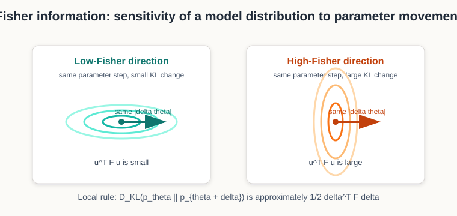
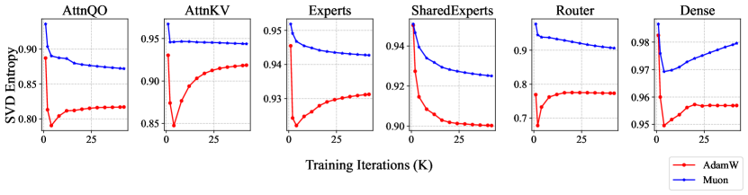

# 谱分解、低秩与二阶敏感度

矩阵中的大数、小数并不直接告诉我们哪些方向重要。SVD描述一个线性变换怎样放大不同方向；Hessian描述损失对扰动的曲率；Fisher描述概率分布对参数扰动的敏感度。它们都用矩阵，但衡量的对象不同。

从 \(W=\operatorname{diag}(3,1)\) 出发。它把第一个坐标放大三倍，第二个保持不变。如果只保留最大的奇异方向，会发生什么？

## SVD留下的是哪一种最佳近似

奇异值分解 \(W=U\Sigma V^\top\) 先用V确定输入方向，再按奇异值缩放，最后用U确定输出方向。它适用于矩形矩阵；特征分解 \(Av=\lambda v\) 则讨论方阵保持方向不变的向量，二者不能混为一个操作。

本例奇异值是3和1，截断为 \(W_1=\operatorname{diag}(3,0)\)。原矩阵平方Frobenius范数为10，保留9，相当于保留90%的平方谱能量。截断SVD最小化给定秩下的未加权Frobenius误差，也有谱范数意义的最优性；这个目标并不包含具体数据或任务。

对输入(1,0)，压缩输出完全不变；对(0,100)，原输出(0,100)被变成零。如果任务依赖第二个方向，即使它只占10%谱能量，也可能不能删除。

## 输入分布与任务曲率怎样改变重要性

对列向量约定，误差 \(E=W-W_1\) 的输出平方误差期望为 \(\mathbb E\|Ex\|^2=\operatorname{tr}(E\mathbb E[xx^\top]E^\top)\)。输入二阶矩会重新给各方向加权。若还关心下游损失，就要继续传播到任务目标。

在参数 \(\theta\) 附近，损失二阶展开为

\[
L(\theta+\delta)\approx L(\theta)+g^\top\delta+\frac12\delta^\top H\delta,
\quad g=\nabla L,\ H=\nabla^2L.
\]

取 \(L(x,y)=\frac12(2x^2+2xy+2y^2)\)，Hessian为 `[[2,1],[1,2]]`。原点梯度零，扰动(0.1,0.1)增加损失0.03，(0.1,-0.1)只增加0.01。两者长度相同，对角近似却都会预测0.02，丢掉了坐标之间的耦合。

这解释了剪枝和量化为何会使用二阶近似。它们试图估计扰动落在哪些昂贵方向上，但神经网络的Taylor展开只在局部有效。当前梯度不为零时，不能直接删去一阶项；多个删除相互作用时，独立重要性相加也可能不准。

## Fisher给概率分布加上一把局部尺子

定义参数score为 \(s_\theta(y)=\nabla_\theta\log p_\theta(y)\)，理论Fisher为

\[
F=\mathbb E_{Y\sim p_\theta}[s_\theta(Y)s_\theta(Y)^\top].
\]

它是外积平均，所以半正定。在适当正则条件下，局部KL满足

\[
\mathrm{KL}(p_\theta\|p_{\theta+\delta})\approx\tfrac12\delta^\top F\delta.
\]

Bernoulli模型用logit参数 \(\theta\)，令 \(p=\sigma(\theta)\)，score为 \(y-p\)，Fisher为 \(p(1-p)\)。在p=0.5处，同样logit步长0.1的局部KL约0.00125；p=0.99处约0.0000495。饱和区里同一logit变化引起的概率重新分配更小。

{ width="760" }

<small>本站示意图。固定的是参数步长，比较的是输出分布变化。换参数化会改变Fisher数值，但相容变换后的局部距离保持一致。</small>

## 为什么经验Fisher不等于理论Fisher

若在p=0.9的模型上只观察到标签1，数据score平方平均是0.01，而理论Fisher对模型自己的0/1结果取平均，得到0.09。条件模型可以从数据抽输入x，但理论Fisher仍需对 \(y\sim p_\theta(\cdot\mid x)\) 平均。

等式 \(F=-\mathbb E[\nabla^2\log p]\) 也要求模型分布期望和交换积分求导等条件。经验梯度外积、损失Hessian和理论Fisher不能无条件互换。一般非凸Hessian可能有负特征值，Fisher不会。

自然梯度按这把局部分布尺子缩放方向，常用带阻尼形式 \(\Delta\theta=-\eta(F+\lambda I)^{-1}g\)。它仍依赖局部近似，有限步长下不保证KL严格落在某个阈值内。

## Newton–Schulz怎样改变奇异值

优化器还可能直接调整一个矩阵的谱形状。对于满列秩的高矩阵X，一个常见polar迭代为

\[
X_{k+1}=\tfrac12X_k(3I-X_k^\top X_k).
\]

若先将奇异值缩放到(0,1]，每个奇异值按 \(s\leftarrow s(3-s^2)/2\) 迭代并趋近1。0.5先变0.6875，再约0.868774、0.975300。零奇异值永远是零，不能凭此恢复秩；宽矩阵最多行正交，不能要求不可能的满列正交。

实际Muon实现可能用不同多项式系数、转置和有限迭代次数。这里推导解释的是一类Newton–Schulz机制，不表示所有实现都执行同一个三次式，也不等于求Hessian逆矩阵。

```python
s = .5
for _ in range(3):
    s = s*(3-s*s)/2
    print(round(s,6))
for dx,dy in [(.1,.1),(.1,-.1)]:
    print(round((2*dx*dx+2*dx*dy+2*dy*dy)/2,6))
```

输出前三项为0.6875、0.868774、0.9753，后两项为0.03、0.01。它们分别检验谱迭代和二阶方向差异。

## 谱图应该怎样读

若定义 \(p_i=\sigma_i^2/\sum_j\sigma_j^2\)，可用熵描述平方谱能量是否集中；本例p=(0.9,0.1)，熵约0.325083 nat。有些论文对奇异值本身归一化，数值含义就不同。谱熵也不等于语义信息量。

{ width="760" }

<small>图来自[Muon is Scalable](https://arxiv.org/abs/2502.16982)的已有本地材料。应沿原论文定义读取SVD entropy，不能直接把本文的平方谱定义套到图上。</small>

低秩适配限制的是更新 \(\Delta W=AB\)，最终 \(W_0+AB\)仍可满秩。将低秩更新、低秩压缩、谱整形和二阶预条件分开，才不会把使用相似矩阵工具的方法当成同一种优化。

## 参考资料

- [Natural Gradient Works Efficiently in Learning](https://direct.mit.edu/neco/article/10/2/251/6143/Natural-Gradient-Works-Efficiently-in-Learning)介绍自然梯度。
- [Limitations of the Empirical Fisher Approximation](https://papers.neurips.cc/paper_files/paper/2019/hash/46a558d97954d0692411c861cf78ef79-Abstract.html)讨论经验Fisher的适用边界。
- [模型压缩、剪枝与结构搜索](../foundations/model-compression-pruning-and-nas-basics.md)将扰动近似用于具体删除决策。
## 继续读

继续看[优化器 kernel 与 FP8 训练](../operators/fp8-training-and-optimizer-kernels.md)和[数值、显存与运行时基础](../foundations/numerics-memory-and-runtime-basics.md)。
