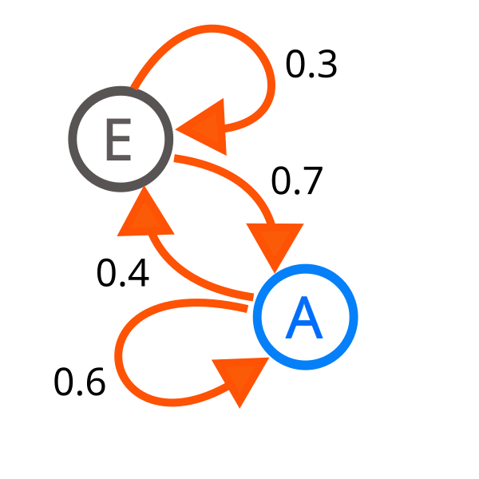

# 随机过程与马尔可夫性

假设明天的天气只依赖今天是晴天还是雨天，用一个2×2转移矩阵就能预测多天后的分布。如果今天的天气看不见，只看见有人带伞，还需要将观测变成对天气的信念。

同一个例子会从可观测马尔可夫链走到隐藏状态推断。它展示“状态足够”究竟意味着什么，也解释为什么一张观测图像未必能直接当作动力学状态。

## 随机过程：一串随时间变化的随机变量

一个离散时间随机过程可以写成：

\[
X_0,X_1,X_2,\dots
\]

这里每个 \(X_t\) 都是时间 \(t\) 的状态或观测。比如：

| 过程 | \(X_t\) 代表什么 |
| --- | --- |
| 自回归文本 | 第 \(t\) 个 token |
| 视频预测 | 第 \(t\) 帧或 latent |
| 机器人任务 | 第 \(t\) 步状态 |
| 扩散采样 | 第 \(t\) 个噪声水平下的样本 |

## 马尔可夫性：未来只需要当前状态

马尔可夫性常写成：

\[
P(X_{t+1}\mid X_t,X_{t-1},\dots,X_0)
=
P(X_{t+1}\mid X_t)
\]

意思是：如果当前状态 \(X_t\) 已经包含了足够信息，那么预测下一步不需要再看更早历史。关键是历史信息已经被当前状态总结，而不是历史不重要。

逐项读这行式子：

| 部分 | 含义 |
| --- | --- |
| \(X_{t+1}\) | 下一步状态 |
| \(X_t\) | 当前状态 |
| \(X_{t-1},\dots,X_0\) | 更早历史 |
| 左边 | 已知全部历史时预测下一步 |
| 右边 | 只已知当前状态时预测下一步 |

等号成立的前提是：\(X_t\) 已经把对未来有用的历史信息压进来了。比如棋盘游戏的完整棋盘状态通常接近马尔可夫；但机器人只有一张 RGB 图时，遮挡背后的物体没有被状态表示出来，就很难满足马尔可夫性。

## State 是对有用历史的压缩

在决策问题里，把选择当前动作 \(A_t\) 之前可见的历史明确记作：

\[
H_t=(O_0,A_0,R_0,\dots,A_{t-1},R_{t-1},O_t).
\]

它包含当前观测 \(O_t\)，但不包含尚未选择的 \(A_t\)。一个充分的状态 \(S_t\) 应让未来在给定当前状态和动作后，与这段更早历史条件独立：

\[
P(S_{t+1},R_t\mid S_t,A_t,H_t)
=
P(S_{t+1},R_t\mid S_t,A_t).
\]

这行式子的含义是：所有会影响下一状态和奖励的历史信息，都已经压进 \(S_t\)。因此，Markov property 是“给定充分状态后的条件独立”；它不要求系统没有记忆。状态可以是物理世界的完整描述，也可以是从观测历史构造的统计量；单帧 observation 只有在它确实保留了预测未来所需的信息时，才可直接当作 state。

例如仓库机器人当前相机画面看不到货架后的叉车，但过去几帧记录了叉车的行进方向。丢掉历史的单帧图像不是充分状态；把位置、速度和遮挡信息汇总后的表示才更接近 state。state、observation 与交互数据流的边界见 [Agent、环境与训练闭环](../reinforcement-learning/rl-agent-environment-loop.md)。

{ width="520" }

<small>图源：[Wikimedia Commons: Markovkate 01](https://commons.wikimedia.org/wiki/File:Markovkate_01.svg)。原图展示状态之间按概率转移的马尔可夫链。这里的重点是：马尔可夫过程的核心是状态和转移概率，下一步由当前状态分布决定。</small>

## 转移概率：从一个状态到另一个状态

离散状态下，转移概率可以写成：

\[
P_{ij}=P(X_{t+1}=j\mid X_t=i)
\]

所有 \(P_{ij}\) 可以组成转移矩阵。每一行通常加起来为 1，因为从当前状态出发，下一步总要落到某个状态。

如果天气只有 `晴` 和 `雨` 两个状态，一个转移矩阵可以写成：

\[
P=
\begin{bmatrix}
0.8 & 0.2\\
0.4 & 0.6
\end{bmatrix}
\]

第一行表示今天晴时，明天0.8概率继续晴、0.2概率下雨；第二行表示今天雨时，明天0.4概率转晴、0.6概率继续雨。这里使用行向量表示状态分布，因此 \(\mu_{t+1}=\mu_tP\)。已知今天晴，\(\mu_0=(1,0)\)，明天分布为 \((0.8,0.2)\)，后天为

\[
\mu_2=(0.8,0.2)P=(0.8\times0.8+0.2\times0.4,\;0.8\times0.2+0.2\times0.6)
=(0.72,0.28).
\]

后天下雨有两条互斥路径，先晴后雨和先雨后雨，概率相加得到0.28。若问“明后天都下雨”，则沿同一条路径相乘，得到 \(0.2\times0.6=0.12\)。路径概率与某时刻的边缘概率由此区分。

平稳分布满足 \(\mu_*=\mu_*P\)。令晴天概率为 \(u\)，有 \(u=0.8u+0.4(1-u)\)，所以 \(\mu_*=(2/3,1/3)\)。从此分布初始化，任一时刻的边缘分布保持不变，但相邻天气仍相关，因为 \(P(\text{明天雨}\mid\text{今天雨})=0.6\ne1/3\)。平稳性不等于独立性，也不等于马尔可夫性。

在世界模型里，常见写法是：

\[
p_\theta(z_{t+1}\mid z_t,a_t)
\]

这比普通马尔可夫链多了动作 \(a_t\)：下一步不仅取决于当前状态，也取决于你做了什么。

后面读 Dreamer 或机器人世界模型时，这行式子的关键是 \(a_t\)。如果替换动作后 \(z_{t+1}\) 几乎不变，模型可能只是视频先验很强，却没有学到可用于规划的动作因果。

## Trajectory：一整条路径

强化学习里一条轨迹常写成：

\[
\tau=(s_0,a_0,r_0,s_1,a_1,r_1,\dots)
\]

它记录了状态、动作、奖励随时间展开的过程。policy gradient 里的目标：

\[
J(\theta)=\mathbb{E}_{\tau\sim\pi_\theta}[R(\tau)]
\]

意思是：按当前策略 \(\pi_\theta\) 采样轨迹，最大化平均回报。

## MDP：把状态、动作、奖励和转移放进一个框架

马尔可夫决策过程通常由五元组组成：

\[
(\mathcal{S},\mathcal{A},P,R,\gamma)
\]

| 符号 | 含义 |
| --- | --- |
| \(\mathcal{S}\) | 状态空间 |
| \(\mathcal{A}\) | 动作空间 |
| \(P(s'\mid s,a)\) | 转移概率 |
| \(R(s,a)\) | 奖励函数 |
| \(\gamma\) | 折扣因子 |

这里先把 MDP 看成“状态、动作、转移、奖励、折扣”放在一起的框架。Bellman 方程是这个框架上的核心递推：当前价值可以拆成眼前奖励和未来价值。完整的 value、Q、TD error、advantage、PPO 和 GRPO，会在 [价值函数、策略梯度与强化学习目标](value-policy-and-rl-objectives.md) 里展开。

如果 \(\gamma=0\)，系统只看眼前奖励；如果 \(\gamma\) 接近 1，系统会更重视长期后果。后面读 RLHF、PPO 或 VLA 闭环恢复时，很多差异都来自“奖励什么时候出现”和“未来价值怎么估”。

## 从 MDP 到 POMDP

MDP 假设 agent 可以基于 Markov state 决策；POMDP，也就是部分可观测马尔可夫决策过程，则区分环境内部的潜在状态和 agent 收到的观测。潜在状态仍按 Markov dynamics 演化：

\[
S_{t+1}\sim P(\cdot\mid S_t,A_t),
\qquad
O_t\sim O(\cdot\mid S_t).
\]

第一项描述动作作用下的状态转移，第二项是一个简化的、与动作无关的 observation model，描述潜在状态怎样生成当前观测。若观测还依赖刚执行的动作，更一般的索引约定是：

\[
O_{t+1}\sim Z(\cdot\mid S_{t+1},A_t).
\]

agent 只看到观测，看不到完整的潜在状态；遮挡、传感器噪声或缺失变量会让同一个观测对应多个可能状态。

一种严格的状态表示是 belief state：\(b_t(s)=P(S_t=s\mid H_t)\)，即根据观测和动作历史维护“当前可能处于哪些潜在状态”的分布。工程系统也常用有限历史窗口、recurrent hidden state 或 latent world model 来近似这份摘要：历史窗口直接保留最近证据，循环状态学习压缩长期信息，latent world model 则学习能预测动作后果的内部状态。它们都试图恢复对未来有用的信息，但并不自动保证得到真正充分的 Markov state。交互中的 POMDP 例子见 [Agent、环境与训练闭环](../reinforcement-learning/rl-agent-environment-loop.md)，latent state 的实现脉络见 [RSSM、Dreamer 与规划](../world-models/rssm-dreamer-and-planning.md)。

### 观测到新证据后，怎样更新belief

继续使用天气模型，假设我们无法直接看天气，只能看到某人是否带伞。设雨天带伞概率为0.9、晴天为0.2，且给定当天状态后，带伞观测不再依赖更早历史。当前belief为晴雨各0.5，先用转移预测明天

\[
\bar b_{t+1}=(0.5,0.5)P=(0.6,0.4).
\]

看到带伞后，将预测概率乘以观测似然，再归一化

\[
b_{t+1}(\text{雨})=\frac{0.4\times0.9}{0.6\times0.2+0.4\times0.9}=0.75.
\]

这一步并未把不确定性抹掉，而是把雨天概率从0.4更新为0.75。一般形式为

\[
b_{t+1}(s')\propto Z(o_{t+1}\mid s',a_t)
\sum_sP(s'\mid s,a_t)b_t(s).
\]

预测阶段使用动作与动力学，校正阶段使用新观测，两者缺一不可。若动力学或观测模型错误，belief也会系统性偏离真实状态。循环网络的隐藏向量可以学习近似这种摘要，但“用了RNN”本身不能证明它等价于正确后验。

## 一个belief怎样替代整段观测历史

在已知隐藏马尔可夫模型中，belief \(b_t(s)=p(s_t=s\mid o_{1:t})\) 先用转移预测，再乘观测似然并归一化。这个分布就是历史对下一步预测的充分摘要，无需每次重读全部带伞记录。

神经网络的有限维latent通常只是学习到的摘要，不能仅因它叫state就保证充分。若两个不同速度的物体产生同一张位置图像，单帧位置会把它们混在一起，下一时刻预测却不同；增加历史或速度估计才可能区分。

## 为什么马尔可夫性在 AI 里常常是近似

真实世界很少真的只靠当前观测就能决定未来。比如机器人看到桌面图像，但不知道杯子背后有没有障碍；语言模型看到当前上下文，但可能缺少外部事实；世界模型的 latent state 如果压缩过度，也可能丢掉未来需要的信息。

语言模型的最后一个token通常不满足一阶马尔可夫性，例如相同的“银行”之前可以出现不同上下文，导致下一个词分布不同。若把完整前缀定义为状态 \(S_t=x_{1:t}\)，追加一个token就构成状态更新；这是通过扩大状态恢复信息，而非证明语言只依赖最后一个词。有限上下文截断、压缩memory或删减KV可能再次丢失信息。

在上述两状态例子里，下面的代码直接验证预测和观测校正。

```python
P = [[0.8, 0.2], [0.4, 0.6]]
def predict(b):
    return [sum(b[i]*P[i][j] for i in range(2)) for j in range(2)]
print(predict(predict([1.0, 0.0])))
prior = predict([0.5, 0.5])
weighted = [prior[0]*0.2, prior[1]*0.9]
print([v/sum(weighted) for v in weighted])
```

结果分别为约 `(0.72,0.28)` 和 `(0.25,0.75)`。


- [D2L 条件概率](https://github.com/d2l-ai/d2l-zh/blob/e6b18ccea71451a55fcd861d7b96fddf2587b09a/chapter_preliminaries/probability.md)，每次观测更新仍是联合概率乘法与归一化。
