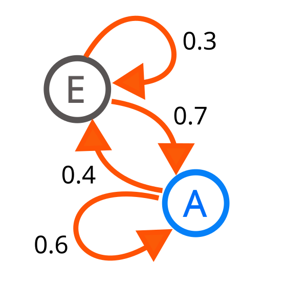

# 随机过程与马尔可夫性

这篇回答一个问题：马尔可夫、转移概率、trajectory、MDP、rollout 这些词到底在说什么。

当随机变量按时间排成一串，就有了随机过程。语言模型生成 token、机器人执行动作、世界模型预测未来、扩散模型逐步去噪，都可以看成某种过程。

## 随机过程：一串随时间变化的随机变量

一个离散时间随机过程可以写成：

\[
X_0,X_1,X_2,\dots
\]

这里每个 \(X_t\) 都是时间 \(t\) 的状态或观测。比如：

| 过程 | \(X_t\) 代表什么 |
| --- | --- |
| 自回归文本 | 第 \(t\) 个 token |
| 视频预测 | 第 \(t\) 帧或 latent |
| 机器人任务 | 第 \(t\) 步状态 |
| 扩散采样 | 第 \(t\) 个噪声水平下的样本 |

## 马尔可夫性：未来只需要当前状态

马尔可夫性常写成：

\[
P(X_{t+1}\mid X_t,X_{t-1},\dots,X_0)
=
P(X_{t+1}\mid X_t)
\]

意思是：如果当前状态 \(X_t\) 已经包含了足够信息，那么预测下一步不需要再看更早历史。这里的关键不是“历史不重要”，而是“历史已经被当前状态总结了”。

逐项读这行式子：

| 部分 | 含义 |
| --- | --- |
| \(X_{t+1}\) | 下一步状态 |
| \(X_t\) | 当前状态 |
| \(X_{t-1},\dots,X_0\) | 更早历史 |
| 左边 | 已知全部历史时预测下一步 |
| 右边 | 只已知当前状态时预测下一步 |

等号成立的前提是：\(X_t\) 已经把对未来有用的历史信息压进来了。比如棋盘游戏的完整棋盘状态通常接近马尔可夫；但机器人只有一张 RGB 图时，遮挡背后的物体没有被状态表示出来，就很难满足马尔可夫性。

## State 是对有用历史的压缩

在决策问题里，可以把到当前为止的历史记作 \(H_t\)。一个充分的状态 \(S_t\) 应让未来在给定当前状态和动作后，与更早历史条件独立：

\[
P(S_{t+1},R_t\mid S_t,A_t,H_t)
=
P(S_{t+1},R_t\mid S_t,A_t).
\]

这行式子不是说历史从未发生过，而是说历史里所有会影响下一状态和奖励的信息，都已经压进 \(S_t\)。因此，Markov property 是“给定充分状态后的条件独立”，不是“系统没有记忆”。状态可以是物理世界的完整描述，也可以是从观测历史构造的统计量；单帧 observation 只有在它确实保留了预测未来所需的信息时，才可直接当作 state。

例如仓库机器人当前相机画面看不到货架后的叉车，但过去几帧记录了叉车的行进方向。丢掉历史的单帧图像不是充分状态；把位置、速度和遮挡信息汇总后的表示才更接近 state。state、observation 与交互数据流的边界见 [Agent、环境与训练闭环](../reinforcement-learning/rl-agent-environment-loop.md)。

{ width="520" }

<small>图源：[Wikimedia Commons: Markovkate 01](https://commons.wikimedia.org/wiki/File:Markovkate_01.svg)。原图展示状态之间按概率转移的马尔可夫链。本站用它说明：马尔可夫过程的核心是状态和转移概率，下一步由当前状态分布决定。</small>

## 转移概率：从一个状态到另一个状态

离散状态下，转移概率可以写成：

\[
P_{ij}=P(X_{t+1}=j\mid X_t=i)
\]

所有 \(P_{ij}\) 可以组成转移矩阵。每一行通常加起来为 1，因为从当前状态出发，下一步总要落到某个状态。

如果天气只有 `晴` 和 `雨` 两个状态，一个转移矩阵可以写成：

\[
P=
\begin{bmatrix}
0.8 & 0.2\\
0.4 & 0.6
\end{bmatrix}
\]

第一行表示今天晴时，明天 0.8 概率继续晴、0.2 概率下雨；第二行表示今天雨时，明天 0.4 概率转晴、0.6 概率继续雨。世界模型里的 latent transition 也是类似问题，只是状态空间变成了高维连续 latent，转移还会受动作影响。

在世界模型里，常见写法是：

\[
p_\theta(z_{t+1}\mid z_t,a_t)
\]

这比普通马尔可夫链多了动作 \(a_t\)：下一步不仅取决于当前状态，也取决于你做了什么。

后面读 Dreamer 或机器人世界模型时，这行式子的关键是 \(a_t\)。如果替换动作后 \(z_{t+1}\) 几乎不变，模型可能只是视频先验很强，却没有学到可用于规划的动作因果。

## Trajectory：一整条路径

强化学习里一条轨迹常写成：

\[
\tau=(s_0,a_0,r_0,s_1,a_1,r_1,\dots)
\]

它记录了状态、动作、奖励随时间展开的过程。policy gradient 里的目标：

\[
J(\theta)=\mathbb{E}_{\tau\sim\pi_\theta}[R(\tau)]
\]

意思是：按当前策略 \(\pi_\theta\) 采样轨迹，最大化平均回报。

## MDP：把状态、动作、奖励和转移放进一个框架

马尔可夫决策过程通常由五元组组成：

\[
(\mathcal{S},\mathcal{A},P,R,\gamma)
\]

| 符号 | 含义 |
| --- | --- |
| \(\mathcal{S}\) | 状态空间 |
| \(\mathcal{A}\) | 动作空间 |
| \(P(s'\mid s,a)\) | 转移概率 |
| \(R(s,a)\) | 奖励函数 |
| \(\gamma\) | 折扣因子 |

在这篇里，MDP 只需要先看成“状态、动作、转移、奖励、折扣”放在一起的框架。Bellman 方程是这个框架上的核心递推：当前价值可以拆成眼前奖励和未来价值。完整的 value、Q、TD error、advantage、PPO 和 GRPO，会在 [价值函数、策略梯度与强化学习目标](value-policy-and-rl-objectives.md) 里展开。

如果 \(\gamma=0\)，系统只看眼前奖励；如果 \(\gamma\) 接近 1，系统会更重视长期后果。后面读 RLHF、PPO 或 VLA 闭环恢复时，很多差异都来自“奖励什么时候出现”和“未来价值怎么估”。

## 从 MDP 到 POMDP

MDP 假设 agent 可以基于 Markov state 决策；POMDP，也就是部分可观测马尔可夫决策过程，则区分环境内部的潜在状态和 agent 收到的观测。潜在状态仍按 Markov dynamics 演化：

\[
S_{t+1}\sim P(\cdot\mid S_t,A_t),
\qquad
O_t\sim O(\cdot\mid S_t).
\]

第一项描述动作作用下的状态转移，第二项描述潜在状态怎样生成当前观测。agent 只看到 \(O_t\)，看不到完整的 \(S_t\)；遮挡、传感器噪声或缺失变量会让同一个观测对应多个可能状态。

一种严格的状态表示是 belief state：\(b_t(s)=P(S_t=s\mid H_t)\)，即根据观测和动作历史维护“当前可能处于哪些潜在状态”的分布。工程系统也常用有限历史窗口、recurrent hidden state 或 latent world model 来近似这份摘要：历史窗口直接保留最近证据，循环状态学习压缩长期信息，latent world model 则学习能预测动作后果的内部状态。它们都试图恢复对未来有用的信息，但并不自动保证得到真正充分的 Markov state。交互中的 POMDP 例子见 [Agent、环境与训练闭环](../reinforcement-learning/rl-agent-environment-loop.md)，latent state 的实现脉络见 [RSSM、Dreamer 与规划](../world-models/rssm-dreamer-and-planning.md)。

## 为什么马尔可夫性在 AI 里常常是近似

真实世界很少真的只靠当前观测就能决定未来。比如机器人看到桌面图像，但不知道杯子背后有没有障碍；语言模型看到当前上下文，但可能缺少外部事实；世界模型的 latent state 如果压缩过度，也可能丢掉未来需要的信息。

所以很多系统会用历史窗口、RNN state、KV cache、memory token 或 belief state 来让“当前状态”更接近马尔可夫充分状态。

## 常见误读

| 误读 | 更稳的理解 |
| --- | --- |
| 马尔可夫就是只看一步 | 它是说当前状态已经总结了历史，不是历史没用 |
| MDP 只属于游戏 | 机器人控制、RLHF、任务规划都能借用 MDP 语言 |
| rollout 越长越真实 | 长 rollout 会放大模型误差和不确定性 |
| open-loop 预测好就能规划 | 规划还需要动作真的影响未来状态 |

## 读完以后怎么判断

看到马尔可夫、trajectory、rollout、MDP 或 Bellman，先问：状态里包含什么，动作是否进入转移，奖励或目标在哪里，长时间误差会不会累积。这个问题链会直接支撑强化学习、世界模型和具身智能文章。

## 相关阅读与下一步

- 站内下一步：[MDP、价值函数与 Bellman](../reinforcement-learning/mdp-value-bellman.md)。
- 站内下一步：[世界模型中的强化学习](../reinforcement-learning/rl-for-world-models.md)。
- 站内下一步：[RSSM、Dreamer 与规划](../world-models/rssm-dreamer-and-planning.md)。
