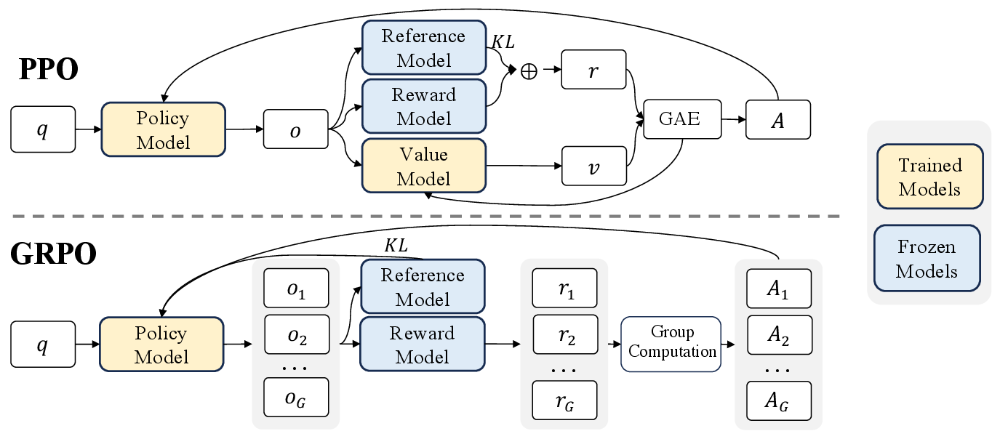

# 价值函数、策略梯度与强化学习目标

一条两步轨迹得到奖励(1,2)，折扣率0.9。它可以产生完整回报、TD残差、GAE和策略梯度，但这些量不是同一个数字。本文沿这一条轨迹计算，说明何时使用真实终止、何时需要bootstrap，以及优势怎样影响动作概率。

所有期望都需要说明由哪个策略、哪些状态和动作产生。实现中的一个mean，可能同时决定按时间、轨迹或token的权重，不能把归约细节藏在符号后面。

## Return：一条轨迹最后值多少钱

从位置 \(t\) 开始的相对折扣回报为

\[
G_t=\sum_{k=0}^{T-t-1}\gamma^k r_{t+k},\qquad 0\le\gamma\le1.
\]

两步奖励为 \((1,2)\)，折扣为0.9，则 \(G_1=2\)、\(G_0=1+0.9\times2=2.8\)。同一笔终局奖励，对更早的动作折扣更多。有限终止任务可以使用 \(\gamma=1\)；无限持续任务需要额外条件保证和或期望存在，常用有界奖励及 \(\gamma<1\)。

稀疏奖励意味着许多轨迹得到相同或接近零的反馈。增加value head可以估计未来结果，但不会凭空产生正确奖励；改写奖励函数还可能改变目标任务，必须说明新增奖励鼓励什么行为。

## Value 和 Q：把未来压成一个数

给定策略 \(\pi\)，定义

\[
V^\pi(s)=\mathbb E_\pi[G_t\mid s_t=s],\qquad
Q^\pi(s,a)=\mathbb E_\pi[G_t\mid s_t=s,a_t=a].
\]

V平均了当前动作和之后所有随机性；Q先固定当前动作，再平均后续。两者满足

\[
V^\pi(s)=\sum_a\pi(a\mid s)Q^\pi(s,a).
\]

假设某状态有两个动作，策略各选一半，动作价值分别为4和2，那么状态价值为3。换成以0.9概率选第一个动作，状态价值就变成3.8。价值既依赖环境与奖励，也依赖后续策略，不能把某个critic输出当成状态永远不变的属性。

单条轨迹的return是一次随机实现；V和Q是分布上的期望，critic则是对这些期望的近似。三者不能混写。

## Bellman：价值可以递推

从回报拆出第一项，有 \(G_t=r_t+\gamma G_{t+1}\)。对后续取条件期望，得到

\[
V^\pi(s)=\mathbb E_{a\sim\pi,\,(r,s')\sim P}
[r+\gamma V^\pi(s')\mid s].
\]

这里写联合转移 \(P(r,s'\mid s,a)\)，允许奖励也随机。真正终止状态的后续价值设为零。对采样转移及当前估计 \(V_\phi\)，TD误差为

\[
\delta_t=r_t+\gamma b_tV_\phi(s_{t+1})-V_\phi(s_t),
\]

其中 \(b_t=0\) 表示任务真正终止，其他可继续自举的转移取1。假设两步轨迹上的估计为 \(V_\phi(s_0)=0.5,V_\phi(s_1)=0.8\)，第二步结束任务。则

\[
\delta_0=1+0.9\times0.8-0.5=1.22,\qquad
\delta_1=2-0.8=1.2.
\]

一步TD把下一个状态的当前估计当作部分监督，这叫bootstrap。它可以很早更新，但误差也来自当前critic。若只是采集器达到长度上限，环境任务还未终止，通常保留最后观测的bootstrap；若时间限制本身就是任务定义的一部分，则应把剩余时间纳入状态并按真正终止处理。不能把所有`truncated`都当作一种数学事件。

## 多步回报和 λ-return：在一阶 TD 与整条轨迹之间折中

未跨过真正终止时，n步目标为

\[
G_t^{(n)}=\sum_{k=0}^{n-1}\gamma^k r_{t+k}+\gamma^nV_\phi(s_{t+n}).
\]

到真正终止时，末尾bootstrap为零。在两步例子中，\(G_0^{(1)}=1.72\)，\(G_0^{(2)}=2.8\)。前者依赖估计0.8，后者使用实际终局奖励2。

剩余有 \(H\) 步的有限段，lambda-return需要把最后一项的尾部权重保留下来

\[
G_t^\lambda=(1-\lambda)\sum_{n=1}^{H-1}\lambda^{n-1}G_t^{(n)}
+\lambda^{H-1}G_t^{(H)}.
\]

权重之和为1。取 \(\lambda=0.95,H=2\)，得到 \(0.05\times1.72+0.95\times2.8=2.746\)。若把无限和直接截成两项却忘记尾项，权重不再归一化。\(\lambda=0\) 回到一步目标，\(\lambda=1\) 使用整个有限段的回报，段末是否仍bootstrap由终止语义决定。

长回报可以减少对critic的依赖，但往往增加采样方差。使用学到的世界模型生成回报时，还会累积模型偏差，不能把“更长”一概视作更准确。

## Advantage：这个动作比平均水平好多少

真实优势定义为

\[
A^\pi(s,a)=Q^\pi(s,a)-V^\pi(s).
\]

前面的两动作例子中，Q为4和2、V为3，优势为1和-1。第二个动作绝对回报仍是正的，但比该状态下策略平均选择差，因此优势为负。

实践中常用GAE近似优势

\[
\hat A_t=\delta_t+\gamma\lambda c_t\hat A_{t+1}.
\]

\(c_t\) 表示是否可以继续累积同一段轨迹的下一项。它与TD里的bootstrap mask职责不同，不能跨episode重置把新轨迹的优势接进来；采集片段末尾也须停止递推，即使该处保留价值bootstrap。

两步例子从后向前计算，\(\hat A_1=1.2\)，\(\hat A_0=1.22+0.9\times0.95\times1.2=2.246\)。加回 \(V_\phi(s_0)=0.5\)，得到2.746，与上面的lambda-return相同。这个等价需要相同的value、折扣、边界与索引约定。

## Policy gradient：让更好动作更可能发生

明确以轨迹起点的折扣回报为目标

\[
J(\theta)=\mathbb E_{\tau\sim\pi_\theta}\left[\sum_{t=0}^{T-1}\gamma^tr_t\right].
\]

环境转移不依赖策略参数时，轨迹概率对参数的梯度来自策略概率。利用log-derivative和未来奖励的因果关系，可得

\[
\nabla_\theta J
=\mathbb E\left[\sum_t\gamma^t\nabla_\theta\log\pi_\theta(a_t\mid s_t)G_t\right].
\]

外层 \(\gamma^t\) 对应从起点计的折扣，G内部从当前位置计折扣。也可以把时间权重吸收到折扣状态分布中，但必须同时声明期望的采样分布。实际代码常对采集到的时间步直接平均、或使用 \(\gamma=1\)；不能只删掉一个因子却声称目标和估计完全没变。

给定状态时，减去不依赖当前采样动作的基线不会改变期望梯度，因为

\[
\mathbb E_{a\sim\pi}[b(s)\nabla\log\pi(a\mid s)]
=b(s)\nabla\sum_a\pi(a\mid s)=0.
\]

取基线V，就得到优势形式。若回报2和4都不减基线，两个被采样动作都会在各自样本更新中受到增加概率的激励，只是强度不同；“低于其他样本就自动降低概率”需要基线或其他相对比较机制。共享参数也意味着一次更新会同时影响多个状态和动作。

## PPO 和 GRPO：控制更新步子

PPO把采集策略固定为 \(\pi_{\rm old}\)，定义动作概率比

\[
\rho_t(\theta)=\frac{\pi_\theta(a_t\mid s_t)}{\pi_{\rm old}(a_t\mid s_t)}.
\]

用 \(\rho\) 表示比值，避免与奖励r混淆。PPO-Clip最大化的样本代理项为

\[
\min\big(\rho_t\hat A_t,
\operatorname{clip}(\rho_t,1-\epsilon,1+\epsilon)\hat A_t\big).
\]

取 \(\epsilon=0.2\)。正优势 \(\hat A=2\) 时，比值从1升至1.2，代理项从2升至2.4；继续升至1.5仍为2.4，失去继续鼓励该方向的收益。负优势 \(\hat A=-2\) 时，比值降到0.8，代理项为-1.6；再降到0.5仍为-1.6。若反而升到1.5，代理项为-3，错误方向继续受惩罚。

这截断了特定方向的代理收益，没有把参数投影进可行集。其他样本、共享参数和多轮优化仍可能让某个比值超出区间，因此PPO不保证硬概率比边界，也不保证整体KL小于阈值。

GRPO用同一问题下的一组回答奖励构造相对信号。一个常见形式为

\[
\hat A_i=\frac{R_i-\bar R}{\operatorname{std}(R_{1:G})+\epsilon}.
\]

若四个奖励为 \((0,0,1,1)\)，采用总体标准差，忽略极小epsilon后得到 \((-1,-1,1,1)\)。如果全组奖励相同，中心化后为零，epsilon只防止除零，不会创造区分好坏的信息。这是组内相对估计，不自动等于每个token状态的真实 \(A^\pi\)。std定义、token/序列归一化和KL计算都可能随实现变化。

{ width="760" }

<small>图源为站内已保存的DeepSeek-R1技术报告相关图。图中比较带critic的PPO流程与组内奖励比较流程；具体训练约定需结合对应论文与实现。</small>

## 一个正优势怎样改变伯努利策略

假设某状态选动作1的概率是 \(p=0.25\)，参数为logit，且采到动作1、固定优势为2.246。负策略损失 \(-A\log p\) 的logit梯度为 \(-A(1-p)=-1.6845\)，梯度下降会提高该动作概率。若同样动作的优势为负，方向相反。

这里把优势视为固定权重，没有通过critic重新求导。PPO还会乘新旧概率比并按优势符号选择clipping分支，所以同一个样本进入截断区后可能停止贡献部分改进激励；这不等于所有参数更新都被硬截断。

## KL penalty：别离参考策略太远

若采用最大化约定，可以写成

\[
J_{\rm reg}=\mathbb E[R]-\beta D_{\rm KL}(\pi_\theta\|\pi_{\rm ref}).
\]

若代码最小化loss，通常取相反符号，KL项变成正号。KL仍需要说明是在什么状态分布上、对token条件分布还是整条序列分布计算。单个采样log-ratio可以为负，只有适当分布下的期望才是对应KL。

参考策略用于惩罚偏离，旧策略用于校正采集概率，这两个模型角色不同。固定 \(\beta\) 表示收益与偏离的软折中，不能保证KL永不超过某值；KL较低也不保证没有奖励漏洞。应同时检查任务成功、奖励构造和失败样本，详见[语言模型强化学习](../reinforcement-learning/llm-rlhf-rlvr-and-grpo.md)。

## 一个可执行的回报与优势计算

```python
rewards = [1.0, 2.0]
values = [0.5, 0.8, 0.0]
bootstrap = [1.0, 0.0]
continuation = [1.0, 0.0]
gamma, lam = 0.9, 0.95
advantages = [0.0, 0.0]
carry = 0.0
for t in reversed(range(2)):
    delta = rewards[t] + gamma*bootstrap[t]*values[t+1] - values[t]
    carry = delta + gamma*lam*continuation[t]*carry
    advantages[t] = carry
print(advantages)  # [2.246, 1.2]
print([advantages[t] + values[t] for t in range(2)])  # [2.746, 2.0]
```

代码中的两个mask在这个终止例子里相同；保留它们各自的名字，是为了在片段截断和episode重置时处理不同职责。它验证上述数值链，没有训练策略，也没有验证真实环境收益。


- [Spinning Up 策略梯度推导](https://github.com/openai/spinningup/blob/038665d62d569055401d91856abb287263096178/docs/spinningup/rl_intro3.rst)，把每条轨迹概率展开后，再使用reward-to-go与baseline。
