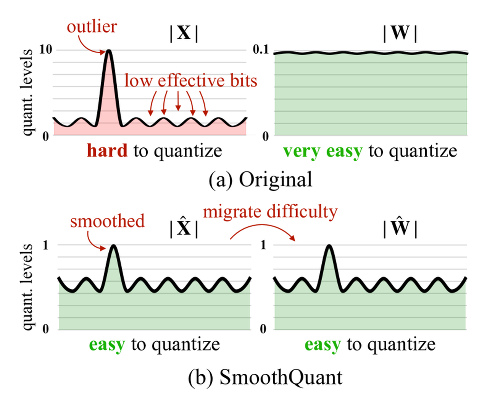

# 激活离群值：为什么量化常常败在 activation 上

量化听起来像一个存储问题：把 FP16/BF16 权重换成 INT8/INT4，显存立刻下降。但真正让低比特部署翻车的，往往不是权重，而是 activation。权重在推理前已经固定，可以离线统计、分组、搜索；activation 是每个 prompt、每张图、每段上下文现场产生的动态张量。校准集没有覆盖到的输入，可能在某一层某几个通道上突然出现很大的数值，这就是 activation outlier。

这篇只回答一个问题：**一个很少出现的大数，为什么会让一整层低比特量化变差？**

## 量化不是把数变小，而是给数分格子

均匀量化可以写成：

\[
q=\mathrm{clip}\left(\mathrm{round}\left(\frac{x}{s}\right)+z,\ q_{\min},q_{\max}\right)
\]

这里 \(x\) 是原始实数，\(s\) 是 scale，\(z\) 是 zero-point，\(q_{\min}\) 和 \(q_{\max}\) 是整数可表示范围。读这行式子时不要先背符号，先想成“给实数轴铺格子”：先用 \(s\) 决定每个格子多宽，再把 \(x\) 四舍五入到最近的整数格子，最后把越界的值裁掉。

反量化是：

\[
\hat{x}=s(q-z)
\]

\(\hat{x}\) 表示低比特整数还原回来的近似值。误差可以写成：

\[
e=x-\hat{x}
\]

这个误差来自三处：rounding 会把相邻实数吸到同一个格子；clipping 会把超出范围的值压到边界；后续矩阵乘又会把前一层误差沿着权重方向传播。低比特并不神秘，它本质是在问：有限的整数格子应该分给谁？

## 一个 outlier 如何拉粗整层 scale

对称量化里，一个最常见的 scale 选择是：

\[
s=\frac{\max(\lvert x\rvert)}{q_{\max}}
\]

其中 \(\max(\lvert x\rvert)\) 是这一组 activation 的最大绝对值，\(q_{\max}\) 是整数端最大正值。假设大多数 activation 都在 \([-2,2]\)，但某个通道偶尔出现 \(30\)。如果用 INT4，\(q_{\max}=7\)，那么：

\[
s=\frac{30}{7}\approx4.29
\]

这意味着每个整数格子宽约 4.29。主体区域 \([-2,2]\) 总宽度只有 4，几乎装不下两个格子；很多本来不同的小值，量化再反量化后会变得几乎一样。问题不是 outlier 本身占多少比例，而是它决定了 scale，scale 又决定了普通值还有多少分辨率。

所以“不裁掉任何大值”并不总是安全。保住 outlier 会让主体区域的 rounding error 变大；裁掉 outlier 会制造 clipping error。量化方法的核心工作，就是在这两种错误之间找到对任务最不伤的折中。

## 为什么大模型特别容易有 activation outlier

LLM 和 VLM 的 activation outlier 常常不是随机噪声，而是模型结构和输入分布共同造成的。

| 来源 | 直觉 | 量化后果 |
| --- | --- | --- |
| 残差连接 | 多层信息反复相加，少数方向会持续放大 | 个别 hidden channel 变成 scale 决定者 |
| LayerNorm/RMSNorm | 归一化控制整体幅度，不保证每个通道都温和 | 通道之间 range 差异仍然很大 |
| 稀有 token 和格式 | 代码、数字、表格、特殊符号会触发长尾路径 | 干净校准集看不到线上尖峰 |
| 长上下文 | 后半段 token 的注意力和残差信息不同于短 prompt | KV cache 和 hidden states 分布漂移 |
| 多模态输入 | 图像小字、表格、UI、机器人状态分布异质 | 视觉 connector 或动作头局部掉点 |

[LLM.int8()](https://arxiv.org/abs/2208.07339) 的重要观察之一就是：大模型里会出现对模型质量很关键的 outlier feature dimensions。它的 mixed-precision decomposition 思路，是把少数 outlier 维度隔离出来用 16-bit 处理，大部分普通值仍走 8-bit。这个设计背后的判断很朴素：不要让少数尖峰污染整组普通值的量化格子，也不要粗暴删除可能重要的尖峰。

## 粒度越细，outlier 影响越局部

设某层 activation 为：

\[
X\in\mathbb{R}^{B\times T\times d}
\]

这里 \(B\) 是 batch，\(T\) 是序列长度，\(d\) 是 hidden dimension。量化 \(X\) 时，scale 可以按整张量、按通道、按 group、按 token 动态计算。粒度越粗，一个 outlier 影响的范围越大；粒度越细，scale 元数据和 kernel 复杂度越高。

| 粒度 | 怎么选 scale | 优点 | 代价 |
| --- | --- | --- | --- |
| per-tensor | 整个张量共用一个 scale | 简单，kernel 友好 | 一个 outlier 影响全体值 |
| per-channel | 每个 hidden channel 一个 scale | 适合通道 range 差异大 | scale 更多，布局更复杂 |
| group-wise | 每组通道一个 scale | 精度和开销折中 | group size 会影响质量和速度 |
| dynamic per-token | 按当前输入现场统计 | 更适应长尾输入 | 统计和 Q/DQ 开销可能吃掉收益 |

这也是为什么“同样是 INT8”不能直接比较。一个 per-tensor 静态 INT8 和一个 per-channel 动态 INT8，数值风险、kernel 路径、延迟结构都不是一回事。

## 校准真正选的是线上分布的影子

静态量化需要校准集。校准不是随便喂几条样本，而是用一小批代表性输入估计线上会遇到的 range、scale、zero-point、截断阈值和敏感层。

常见校准目标包括：

| 目标 | 公式或读法 | 适合什么 |
| --- | --- | --- |
| MSE | \(\min \|x-\hat{x}\|_2^2\)，直接压数值误差 | 层输出或中间张量误差可解释时 |
| KL divergence | 让量化前后分布更接近 | 概率分布或分类头附近 |
| 输出误差 | \(\min \|XW-\hat{X}\hat{W}\|^2\)，关注 matmul 后结果 | 线性层端到端误差更重要时 |
| 任务代理损失 | 用 perplexity、准确率、字段级指标选配置 | 生产部署和多任务模型 |

最小 MSE 不一定带来最高任务质量。比如财务 VLM 里，普通问答样本上误差很小，但复杂发票的小数点、跨页金额、税率字段全部变差，原因可能是校准集没有覆盖高分辨率表格和低清扫描件。对这类模型，校准集应该按任务桶覆盖：短问答、长上下文、代码、表格、数学、多模态小字、工具返回、拒答样本和高风险失败样本。

## SmoothQuant 的关键：把难度从 activation 迁移到 weight

线性层输出是：

\[
Y=XW
\]

SmoothQuant 使用一个对角缩放矩阵 \(D\)，把它改写为：

\[
Y=(XD^{-1})(DW)
\]

这两行式子表达的是等价变换：\(D^{-1}\) 缩小 activation 中难量化的通道，\(D\) 再把对应权重通道放大，乘积 \(XW\) 的数学结果不变。为什么这样有用？因为权重 \(W\) 是静态的，放大后的权重可以离线量化、离线检查；activation \(X\) 是动态的，线上每次请求都变，最难救。SmoothQuant 的价值就是把“动态 outlier 的麻烦”搬一部分到“静态权重的麻烦”上。

{ width="730" }

<small>图源：[SmoothQuant: Accurate and Efficient Post-Training Quantization for Large Language Models](https://arxiv.org/abs/2211.10438)，Figure 2。原图表达：activation outlier 会拉大量化范围，使主体值只剩很少有效 bit；SmoothQuant 通过等价缩放把部分量化难度从 activation 迁移到 weight。本站读法：左边看 scale 为什么被尖峰决定，右边看缩放后普通 activation 如何重新获得分辨率。</small>

SmoothQuant 不是万能的。它更适合 W8A8 这类希望 activation 也低比特的场景；如果部署栈只支持 weight-only INT4，或者 kernel 没有把 Q/DQ 和 matmul 融合好，端到端收益可能不如理论显存账漂亮。

## KV cache 也是 activation 问题

长上下文推理里，KV cache 的显存近似为：

\[
\mathrm{KV\ Memory}\approx2\times L\times B\times T\times H_{\text{kv}}\times d_h\times \mathrm{bytes}
\]

这里 \(L\) 是层数，\(B\) 是 batch，\(T\) 是上下文长度，\(H_{\text{kv}}\) 是 KV heads，\(d_h\) 是每个 head 的维度。公式读法很直接：上下文越长，KV cache 线性增长；把 bytes 从 2 降到 1 或更低，长上下文服务立刻省显存。

但 KV cache 是注意力的记忆。如果 K/V 的量化误差改变 attention logits，模型可能表现为引用错位、needle retrieval 失败、长文档后半段幻觉、数学推导中断。KV 量化不是只看平均 perplexity，还要看长上下文检索、跨段引用、代码定位、表格查数和高风险样本回放。

## 部署时按三个问题做决策

第一，outlier 是不是集中在少数层或少数通道？如果是，可以考虑 per-channel/group-wise、outlier channel 高精保留、SmoothQuant、rotation/shift 或 mixed precision；如果不是，可能需要提高 bit 或改校准集。

第二，线上输入是不是比校准集更长、更杂、更多模态？如果是，静态 scale 会很脆弱。要把长上下文、代码、表格、截图、工具返回、机器人失败恢复这类长尾样本放进校准和回归。

第三，kernel 是否真的支持目标量化形态？量化收益不只来自模型文件变小，还来自低比特 GEMM、Q/DQ 融合、KV cache 布局、batching 和调度。如果 trace 里 Q/DQ、动态统计或格式转换占了太多时间，低比特可能只是把显存问题换成延迟问题。

## 外部精读

- [SmoothQuant 论文](https://arxiv.org/abs/2211.10438)：最适合理解 activation smoothing 为什么是等价变换。
- [LLM.int8() 论文](https://arxiv.org/abs/2208.07339)：理解 outlier feature dimensions 和 mixed-precision decomposition。
- [Hugging Face Quantization Concepts](https://huggingface.co/docs/transformers/main/quantization/concept_guide)：部署侧量化概念整理。
- [MIT HAN Lab SmoothQuant 项目](https://github.com/mit-han-lab/smoothquant)：看实现、校准和模型支持情况。

## 阅读结论

activation outlier 的要害不是“有几个异常值”，而是“谁决定 scale”。低比特量化把连续数轴切成有限格子，outlier 会把格子拉粗，让主体区域失去分辨率。理解这一点后，SmoothQuant、LLM.int8、KV cache quant、混合精度和校准集选择就不是一堆孤立技巧，而是在解决同一个问题：把有限的数值表示能力分给真正影响任务质量的地方。
