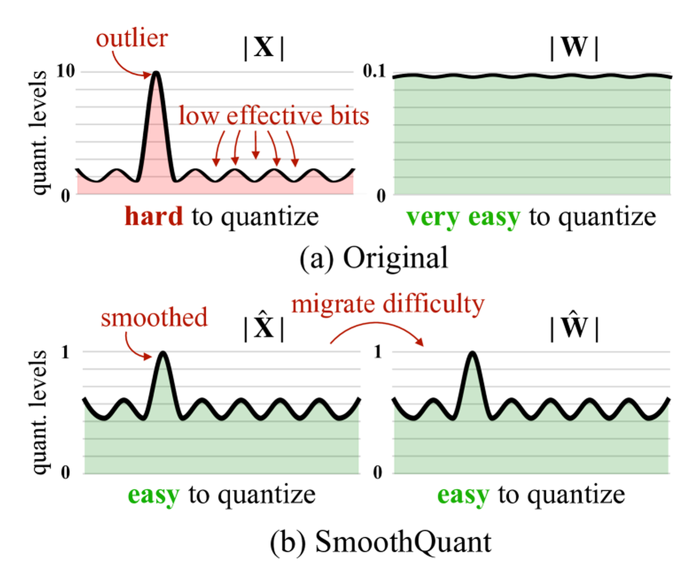

# 激活离群值怎样改变量化格距

某层激活为 `[0.2, 0.4, 1.0, 30.0]`。如果一整个张量共享 scale，最后的 30 会影响前三个普通数的精度。校准就是在实际输入产生的张量上决定范围、尺度和粒度，并验证这种决定是否适用于未见过的输入。

## 同一组数有两种很不同的误差

采用 $[-7,7]$ 的对称教学量化器。为完整容纳 30，选 $s=30/7\approx4.286$。前三个数除以 s 后都不到半格，舍入成 0；30 则恢复为30。平方误差和为 $0.2^2+0.4^2+1^2=1.2$。

若改用 $s=1/7$，前三个数恢复为约 `[0.143,0.429,1.0]`，普通值更清楚了，30 却被截为1，单这一项平方误差就达到841。可见“忽略 outlier 能提高精度”需要说明提高了谁的精度、用什么分布和指标衡量。

```python
values = [0.2, 0.4, 1.0, 30.0]
for s in [30 / 7, 1 / 7]:
    restored = [s * max(-7, min(7, round(x / s))) for x in values]
    squared_error = sum((a - b) ** 2 for a, b in zip(values, restored))
    print(restored, squared_error)
```

这四个数的平方误差按元素等权。真实任务关心的却可能是下一层输出，某个通道还会乘上权重。截断范围应根据选定的层输出或任务指标搜索，不能仅凭直方图好看。

## 先辨认大值沿哪一维出现

把激活写成 $X\in\mathbb R^{N\times d}$，N 是 token 数，d 是通道数。若大值只出现在一条输入的许多通道，per-token scale 可能比 per-tensor 更合适。若某个通道在许多输入上都偏大，按通道缩放更直接。若大值随输入变化且没有稳定模式，静态通道统计的帮助就有限。

每种细分都增加元数据和计算。Per-token 动态量化要在请求到达后做归约；per-group 权重量化增加 scale 读取；只有 kernel 支持相应布局时，这些选择才可能带来系统收益。

## 平滑会把压力转给另一侧

设一条输入 $x=[1,30]$、权重 $w=[2,0.1]^\top$，输出为5。取 $D=\operatorname{diag}(1,10)$，变换后输入为 `[1,3]`，权重为 `[2,1]`，输出仍为5。

激活最大值从30降到3，权重第二个通道则扩大10倍。SmoothQuant 的实际实现利用校准激活与权重范围选择尺度，并折叠进归一化和线性层。量化发生之后才产生新的误差，必须同时评估两侧。不能在实际网络上只缩激活、漏掉对应权重。

## 校准集怎样覆盖部署输入

先按真实输入类型和长度抽样，保留普通请求的主要分布，再为少见但代价高的情况建立单独分层。例如代码、表格和多轮工具结果可以各留一组。校准时可调整这些组的权重，报告时仍应分别展示自然流量加权结果和关键小组结果。

若一味塞入极端输入，可能让 scale 始终被极端范围主导，损害普通请求；若只抽平均请求，又可能完全看不到失效范围。需要比较候选校准配比的独立验证结果。

校准、选配置和最终测试承担不同用途。看过测试结果后不断改 scale，相当于把测试集也用来调参。应固定最终测试输入，另外保留新的时间切片，检查上下文长度或领域变化后范围是否漂移。

## 误差出现后怎样找到第一处偏离

固定同一批输入，先比较浮点与模拟量化模型的对应层输入、输出，再比较真实 kernel 输出。若模拟量化已经偏离，检查范围和粒度；若模拟接近、打包后突然偏离，检查 zero point、scale 轴和布局。最后在任务输出上判断这点数值变化是否有实际影响。

层误差能帮助定位，不能直接给出任务损失的通用阈值。某个输出头前的细小扰动可能改变离散选项，另一个层里较大的误差可能被后续归一化缓和。

{ width="730" }

<small>图源：[SmoothQuant: Accurate and Efficient Post-Training Quantization for Large Language Models](https://arxiv.org/abs/2211.10438)，Figure 2。原图表达：activation outlier 会拉大量化范围，使主体值只剩很少有效 bit；SmoothQuant 通过等价缩放把部分量化难度从 activation 迁移到 weight。读图重点：左边看 scale 为什么被尖峰决定，右边看缩放后普通 activation 如何重新获得分辨率。</small>

## 对照源码与延伸阅读

- [SmoothQuant 的尺度计算与折叠](https://github.com/mit-han-lab/smoothquant/blob/c61476d728e42ae0d8a35e7e78494edcac3237b5/smoothquant/smooth.py)
- [AWQ 如何实际收集校准激活](https://github.com/mit-han-lab/llm-awq/blob/d6e797a42b9ef7778de8ee2352116e0f48a78d61/awq/quantize/pre_quant.py)
