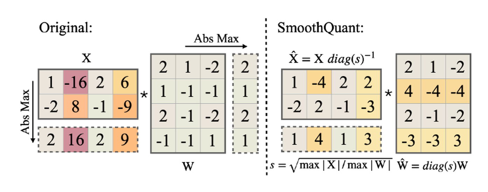

# 量化方法与数值格式对照

选择前先写清对象。压权重、压激活、压KV和减少微调状态，解决的是不同预算。下面的表按职责比较，不把算法名称当作质量排行榜。

| 名称 | 它规定或改变什么 | 需要的数据或训练 | 输出后还要确认什么 |
| --- | --- | --- | --- |
| 直接舍入PTQ | 训练后选择范围、scale和码值 | 权重本身；激活量化通常需范围统计 | 截断误差、输出误差、可用kernel |
| GPTQ | 利用校准输入相关性补偿权重量化误差 | 代表性校准输入 | 分组、阻尼、排列与packing兼容 |
| AWQ | 利用激活搜索通道缩放与截断 | 校准输入及块输出比较 | 等价变换、scale布局、WQLinear执行 |
| SmoothQuant | 在激活与权重之间迁移范围 | 激活通道统计 | 所有分支等价、W/A精度和部署布局 |
| QAT | 前向模拟量化并继续训练可训练参数 | 训练数据与近似反向规则 | 模拟量化是否对齐真实kernel |
| QLoRA | 冻结量化底座，训练低秩adapter | 微调数据 | 底座身份、adapter路径和合并后误差 |

QAT是训练制度，GPTQ/AWQ是PTQ方法，QLoRA描述微调结构；三者不处在同一条“谁更先进”的轴上。可组合性由具体实现决定。

## W4A16 仍然缺哪些信息

W和A分别表示权重与激活的数值路径。W4A16只给出位数概况，仍需补充码本、group size、zero point、scale dtype、packing、累加方式与未量化模块。

| 表示 | 需要特别分清的地方 | 主要可能收益 |
| --- | --- | --- |
| 均匀INT4/INT8 | 码值范围、对称性、分组、zero point | 存储和带宽；原生计算收益取决于kernel |
| FP8 | 具体浮点格式、scale约定、块布局与累加 | 支持路径上的容量、带宽或矩阵计算 |
| NF4 | 非均匀码本索引与块尺度 | 冻结权重的紧凑表示，常见于QLoRA |
| KV低精度 | K/V各自粒度、页布局、写入和读取尺度 | 长上下文驻留容量与读取带宽 |

## 用一个需求挑选候选

若BF16权重放不下而输入激活预算较小，可先比较weight-only候选。若大batch矩阵乘占主要时间，且目标硬件有成熟W/A低精度路径，再评估激活量化。若权重已能放下、并发仍被历史状态挤满，则先算KV预算。若目的是在有限显存下微调，转到QLoRA的训练状态分析。

这些是筛选候选的方法。最终结论需要同一模型、同一输入、相同质量约束及明确版本的实验，不能从表中推导固定速度倍数或统一质量顺序。

详细计算见[量化数学](symbols-and-minimal-math.md)、[三种PTQ方法](ptq-gptq-awq-smoothquant.md)、[QLoRA](qlora-and-quantized-training.md)与[运行时](quantization-runtimes-and-frameworks.md)。

{ width="820" }

<small>图源：[SmoothQuant](https://arxiv.org/abs/2211.10438)，Figure 5。原图表达把激活中的 outlier 难度迁移到权重侧，使 W8A8 更容易部署；读图重点是把量化方法对照表里的 PTQ/GPTQ/AWQ/SmoothQuant/FP8 分到不同瓶颈。它不能证明 SmoothQuant 比所有方法更好，只解释一类激活 outlier 处理思路。</small>

## 对照源码与延伸阅读

- [GPTQ 实际补偿流程](https://github.com/IST-DASLab/gptq/blob/2d65066eeb06a5c9ff5184d8cebdf33662c67faf/gptq.py)
- [QLoRA 实际加载与训练设置](https://github.com/artidoro/qlora/blob/7f4e95a68dc076bea9b3a413d2b512eca6d004e5/qlora.py)

## 一次量化改动要经过哪些层

量化不是在模型文件上运行一个“压缩”按钮。至少要经过四层，每层都可能把收益或误差改写掉：

```text
浮点模型
  -> 选择量化对象（W / A / KV / optimizer state）
  -> 估计范围或校准统计
  -> 插入 fake-quant 或 quant/dequant 节点
  -> 转换成目标布局与 packing
  -> lower 到真实 kernel / backend
  -> 在固定质量与负载下验收
```

例如 PTQ 可能在 Python 图里出现了 `quantize -> linear -> dequantize`，但目标 backend 没有融合对应模式，最后仍然以浮点 kernel 计算。此时模型字节数可能下降，端到端速度却没有改善。验收时要同时检查图、权重布局、kernel 名称和实际吞吐。

## 当前 PyTorch 主线如何理解

PyTorch 的旧 eager/FX 量化接口仍可在旧项目中看到，但官方文档已经把新的开发集中到 `torchao`，并将 PT2E 量化迁移到 torchao。对学习者来说，应把“算法”和“执行流程”分开记：

| 流程 | 典型阶段 | 适用问题 |
| --- | --- | --- |
| torchao eager / weight-only | 在模块参数上应用量化 | 快速尝试权重压缩、低比特微调或 serving 原型 |
| PT2E PTQ | `export -> prepare_pt2e -> calibration -> convert_pt2e -> lower` | 需要基于图模式、激活统计和目标 backend 的部署 |
| PT2E QAT | `export -> prepare_qat_pt2e -> train -> convert_pt2e` | PTQ 误差过大、需要通过训练适应量化噪声 |
| 自定义 backend quantizer | 由 backend 决定可识别模式和 lowering | 新硬件、新布局或定制 kernel |

PT2E 的 `prepare` 不是“已经得到加速模型”。它主要插入观察和量化节点；校准或 QAT 后的 `convert` 仍需要交给目标 backend lowering。一个教程示例若只运行到 `convert`，应明确它验证的是图变换，不是部署速度。

## 用一个标量看见舍入误差

设一个张量范围为 ([-1.0,1.0])，用对称 INT4 表示 15 个步长，则可取

\[
s=\frac{1.0}{7}\approx0.142857,
\qquad q=\operatorname{clip}(\operatorname{round}(x/s),-7,7),
\qquad \hat x=q\,s.
\]

输入 (x=0.51) 时，(q=4)，重建值约为 (0.5714)，误差约 (0.0614)。如果把范围扩大到 ([-4,4]) 而仍只使用同样的 15 个步长，0.51 的量化间隔变成 (4/7)，小值的相对误差会明显增加；如果范围缩得太小，较大的离群值又会被截断。

这就是校准的实际矛盾：范围覆盖更多值，步长变粗；范围缩小，离群值被裁剪。per-channel、group-wise、SmoothQuant 或非均匀码本改变的是误差如何在通道或块之间分配，不是取消误差。

## 质量验收不能只看 perplexity

给出一个模型质量分数还不够。量化验收至少分三层：

| 层 | 最小检查 | 能说明什么 | 不能说明什么 |
| --- | --- | --- | --- |
| 数值 | 权重/激活误差、校准分布、NaN/Inf | 量化路径是否按预期工作 | 真实任务是否可靠 |
| 离线任务 | perplexity、分类/检索、固定 prompt 集、长上下文 | 在固定数据上的质量变化 | 线上负载速度与错误率 |
| 部署系统 | p50/p95、tokens/s、显存、kernel 回退、错误率 | 端到端是否值得部署 | 其他硬件与请求分布 |

多模态和 VLA 还应分别测视觉编码、语言输出、动作接口与闭环成功率。一个量化方案可能保持文本 perplexity，却让视觉 token 的对齐或动作坐标误差变坏。量化对象和评测桶要一一对应。

## 用决策树选择候选

```text
主要问题是权重放不下？
  ├─ 是：先比较 weight-only PTQ / GPTQ / AWQ / NF4
  └─ 否：继续看真正瓶颈
主要问题是 KV 随上下文增长？
  ├─ 是：单独评估 KV 低精度、页布局和长上下文质量
  └─ 否：继续看矩阵计算
主要时间在 GEMM，目标硬件有成熟 W/A 低精度 kernel？
  ├─ 是：评估 W8A8、FP8 或目标 backend 的 PT2E 流程
  └─ 否：先查 kernel 是否融合，别先假设降位会加速
PTQ 误差超过阈值？
  ├─ 校准和分组仍可改善：先做敏感层分析
  └─ 仍不够：考虑 QAT 或保留敏感层高精度
```

这个树只用于缩小候选。最终选择仍需要同一模型、同一请求集、相同 warm-up、相同质量阈值和明确的软件版本。

## 记录一次可复现量化实验

```yaml
model_commit: <immutable commit>
quant_method: awq
weight_bits: 4
activation_dtype: bf16
group_size: 128
scale_dtype: fp16
calibration_set: calib-v3
backend: <runtime and version>
kernel_path: <observed kernel name>
quality_eval: <dataset and script commit>
latency_eval: <arrival trace and warmup>
decision: keep / reject / keep with sensitive layers in bf16
```

其中 `kernel_path` 和 `backend` 不应留空。量化论文中的算法名称不能替你确认当前 runtime 是否真的走了相同的实现。

## 来源与改编说明

- [PyTorch PT2E Quantization / torchao 文档](https://docs.pytorch.org/ao/stable/pt2e_quantization/index.html)提供 `export`、`prepare_pt2e`、校准、`convert_pt2e` 和 backend lowering 的当前流程。文档版本会变化，示例中的 API 需按目标环境重新验证。
- [PyTorch Quantization in Practice](https://pytorch.org/blog/quantization-in-practice/)用于解释 scale、zero-point、校准、per-tensor/per-channel、PTQ 与 QAT；其旧版接口说明不能直接替代当前 torchao API。
- [GPTQ](https://arxiv.org/abs/2210.17323)、[AWQ](https://arxiv.org/abs/2306.00978)、[SmoothQuant](https://arxiv.org/abs/2211.10438)分别提供误差补偿、激活感知权重缩放和 outlier 迁移的原始依据；它们的硬件速度数字不能直接横向比较。

## 自测

1. 为什么 `convert_pt2e` 成功后仍不能说明真实 kernel 已经使用 INT8 或 FP8？
2. 量化范围扩大和缩小分别会带来哪两种误差？
3. W4A16 里的 W 和 A 各指什么，为什么它不说明 KV 的精度？
4. 如果模型大小下降 40%，但 p95 延迟不变，你会优先检查权重布局、dequant 开销、kernel 融合还是请求排队？请说明证据顺序。
