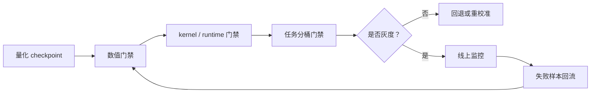

# 量化评测与部署清单

量化工作最常见的问题，不是“没有方法”，而是离线评测太乐观、线上指标没对齐、精度和系统收益没有同时看。

!!! note "读法定位"
    这页先回答“量化评测与部署清单”在「量化」里的位置：它解决什么局部问题，依赖哪些前置，最后会影响哪类工程或研究判断。
    **前置**：先懂张量、线性层和基本推理成本；遇到 FP8、KV Cache、outlier 时回前置页补概念。 必要时先回 [量化入口](index.md)、[基础知识](../foundations/index.md) 或 [术语表](../glossary/index.md)。
    **主线关系**：把数值格式、误差来源、校准/训练方法、kernel 和服务部署连成一条效率链，而不是只比较 bit 数。

因此这一页给出一个更像 checklist 的结构，帮助把量化从论文实验推进到真实部署。

可以把量化上线前的判断拆成三层：`数值门禁` 看模型还能不能稳定工作，`系统门禁` 看显存、吞吐、延迟是否真的改善，`业务门禁` 看高价值任务有没有不可接受退化。

!!! note "初学者先抓住"
    量化上线要同时过三道门：数值还准不准、系统是否真的更省、更快，业务关键任务有没有掉到不可接受。只过其中一道都不够。

!!! example "有趣例子：换轻量轮胎"
    车变轻不代表更适合上路。还要看刹车距离、雨天抓地、载重和高速稳定性。量化也是：模型文件小了，还要确认质量、延迟和风险场景。

## 先明确量化目标

不同项目做量化，目标可能完全不同：单机放得下、吞吐提升、成本下降、边端部署、继续可训练。

如果目标不先写清楚，后面的评测很容易失焦。

### 1.1 推荐先写成一句话

例如：“把 70B 模型压到单机可部署，但复杂任务允许回退到高精版本”；“在不伤害财务字段抽取正确率的前提下，把显存占用降到原来的 60%”；“优先释放长上下文并发，而不是追求单请求极限速度”。

这种表达会迫使团队把收益和边界一开始就说清楚。

## 离线评测应至少覆盖三类指标

| 指标类型 | 重点 |
| --- | --- |
| 质量指标 | accuracy / F1 / pass@k、长链推理成功率、结构化抽取正确率 |
| 系统指标 | 显存、latency、throughput |
| 稳定性指标 | 长上下文退化、多轮一致性、P95 / P99 |

### 2.1 建议质量指标做分桶

如果你只看平均分，很容易低估量化的真实副作用。建议至少分桶比较短输入和长输入、普通问答和长链推理、自然语言和代码 / 表格 / OCR、常见任务和高风险任务。

### 2.2 多模态和 VLA 额外应看什么

若量化对象是 VLM 或 VLA，还应专项评估 grounding 精度、文档数字一致性、动作平滑性与恢复率，以及长时闭环漂移。

## 校准集必须贴近真实流量

这是很多量化失败的根源。如果校准数据和真实线上请求差很远，例如全是短句、没有长文档、没有代码、没有表格，那么线上表现往往会显著退化。

### 3.1 校准集不是越大越好，而是越贴近越好

比起再多加一些普通样本，更有价值的是确保校准集中有长上下文、复杂格式、多模态长尾输入和线上高价值难例。

校准集真正要代表的是“最怕出错的输入分布”，而不是“平均输入分布”。

## 要显式检查哪些能力最容易掉

通常量化后，最先掉的不是普通闲聊，而是长链推理、长上下文一致性、代码精确性、文档抽取和工具调用格式稳定性。

所以评测不能只看平均分。

### 4.1 再加两个常被忽略的点

还要额外看 `拒答和安全边界` 以及 `输出格式稳定性`。量化后模型有时更容易乱答，而不是更稳；在 JSON、函数调用和 agent 场景里，轻微量化误差也可能被放大成解析失败。

## 部署前 checklist

部署前建议逐项确认：量化方案与 kernel 兼容，serving 框架支持对应张量格式，显存节省在真实 batch / context 下仍成立，cache 没成为新瓶颈，关键业务任务已验证。

这张图把量化上线变成闭环：数值对齐只是第一关，runtime 是否真命中低比特 kernel 是第二关，业务桶是否不退化是第三关。上线后还要把失败样本回流到校准集和回归集。

### 5.1 建议补的四项

还应补充四项：是否保留高精回退路径，哪些层或模块仍保留高精，多模型路由时是否改变了整体负载分布，监控中能否区分量化版本与非量化版本。

## 部署后 checklist

上线后建议持续观测命中哪些长尾错误、P95 / P99 是否上升、长上下文任务是否比离线更差、用户侧失败是否集中在某几类请求。

### 6.1 建议建立的线上专项观察项

专项观察项包括：复杂任务是否更频繁升级到大模型，是否新增某类格式解析失败，是否在某些客户或模态上集中退化，是否因显存释放而真实提升了并发。

如果这些观察项没有正向收益，量化很可能只是“理论节省”，而非“系统节省”。

## 推荐的发布结论写法

量化版本发布前，建议固定写一段：

`在目标任务 A/B/C 上，量化版本相对高精版本的质量变化为 X，显存变化为 Y，吞吐变化为 Z。高风险场景包括 ...，已配置的回退路径为 ...，因此建议以 ... 范围灰度发布。`

这会逼你把收益、风险和回退方案同时说清楚。

## 一个实际例子

假设你量化了一个企业文档 VLM。离线平均准确率只掉了 0.6%，看起来不错，但分桶后发现普通单页文档几乎不掉，跨页表格掉 3.8%，OCR 噪声页掉 5.1%，财务数字一致性错误率翻倍。

与此同时，线上显存节省让并发提高了 35%。这时最合理的结论不是简单说“量化成功”或“量化失败”，而是：

普通文档路径可以灰度，高风险财务路径必须保留高精模型，后续还需要针对复杂表格做专项校准和混合精度保护。

## 世界模型 / VLA 的额外发布表

| 路径 | 量化前后必须对比 | 为什么 |
| --- | --- | --- |
| 视频 latent | object permanence、长 horizon drift | 低精缓存可能让状态遗忘 |
| action head | action L2、jerk、闭环成功率 | 小误差会被控制放大 |
| risk head | near-miss recall、ECE、false negative | 风险低估比平均掉点更危险 |
| rollout KV | counterfactual ranking、长时一致性 | KV 误差会改变规划排序 |
| runtime | kernel hit rate、dequant 次数、fallback | 文件小不代表端到端快 |

## 本页结论

量化是否成功，不能只由“离线平均精度下降多少”决定。真正的标准应是：

**在目标业务上，是否用可接受的质量损失，换到了真实可用的系统收益。**

## 工程收束

量化评测要把精度损失、硬件路径、量化格式、KV 影响和回退方案放在同一张上线判断里。最容易踩坑的是只看少数 benchmark、忽略长尾任务、回退链路没演练；更稳的验收方式是按任务桶比较 full precision 对照，把量化格式和 runtime 绑定，并写清灰度范围与回滚门槛。

这页可以作为发布前的最后一页门禁：若某个量化方案无法说明收益来自哪里、风险落在哪些桶、回退如何触发，就不应该直接进入主线流量。

量化发布结论也应进入版本记录，方便后续模型、runtime 或硬件升级时复查当初的收益边界。

!!! tip "下一站"
    - 回到本专题入口：[量化](index.md)，确认这页在整条路线中的位置。
    - 按导航顺序继续：[index](../training/index.md)。
    - 概念或符号卡住时，先查 [术语表](../glossary/index.md)，再回到当前页。
