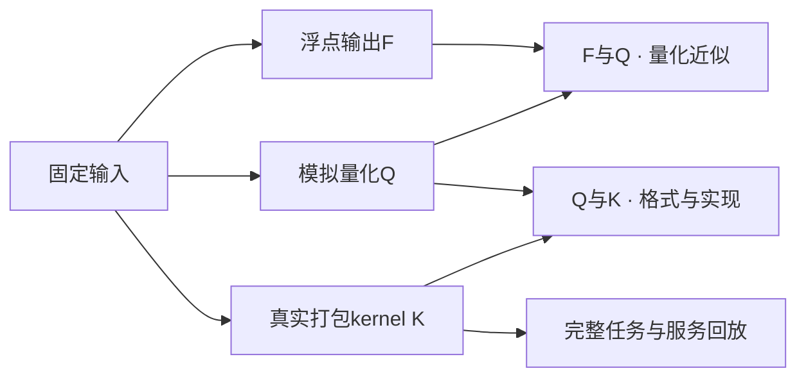

# 量化对照实验怎样定位问题

一份模型文件变小，只证明磁盘表示发生了变化。下面按固定输入从浮点参考走到真实服务，把数值近似、格式错误与系统开销分开。此页用于查验实验，不要求读者把每个项目都变成一门课程。

## 最小对照从三条路径开始

对同一层和同一输入，保存浮点输出F、模拟量化输出Q、真实打包kernel输出K。

| 比较 | 主要回答的问题 | 偏差出现时先查 |
| --- | --- | --- |
| F与Q | 量化本身改变了多少计算 | 范围、scale粒度、校准、截断 |
| Q与K | 部署实现是否符合模拟约定 | packing、轴、zero point、累加dtype |
| 全模型F与K | 局部误差怎样影响最终任务 | 输出边界、长上下文、采样与输入类型 |

绝对误差 $|F-Q|$ 与相对误差 $|F-Q|/(|F|+\epsilon)$ 各有用途。参考值接近0时相对误差可能很大，应同时看幅度与实际输出。容差应根据dtype和算法选定，不能用一个阈值覆盖所有层。

<!-- systems-workflow-visual -->

两组局部对照先区分近似误差与执行错误，最后再判断完整任务是否满足要求。

## 校准、选择和测试各留一份数据

校准集用于估计scale、激活统计或补偿；验证集用于比较bit数、group size等配置；最终测试集保留到配置固定后。输入按长度、领域或模态分层，既报告自然分布加权结果，也单独报告关键小组。

同一模型的量化前后比较尽量配对相同输入，并固定解码设置。采样本身有随机性时，还需重复运行或给出不确定性范围。不要把一次随机输出翻转自动归因到量化。

## 服务计时从明确边界开始

分别测冷启动和预热后的稳态，把加载、编译、格式转换归入实际发生的阶段。Prefill记录输入长度与TTFT，decode记录历史长度、batch和TPOT；并发测试还要记录到达率、输出长度和队列。

若文件小了但延迟没有下降，先看实际kernel和转换，而不是立刻调校准数据。若单层kernel变快但服务尾延迟变差，再看batch构成、fallback与排队。这两类问题需要不同证据。

## 一份足够复现的结果记录

保留模型与tokenizer身份、量化工具版本、校准输入标识、scale/分组配置、目标设备与runtime版本。结果至少包含峰值显存、实际执行路径、质量变化和固定负载下的延迟分布。

遇到失败时保存最小输入以及F/Q/K三个输出，就能继续缩小范围。只有浮点参考和失败截图，无法区分算法误差与打包错误。AWQ分开的模拟与真实转换函数提供了一个可参照的实现边界。

<small>图源：[SmoothQuant](https://arxiv.org/abs/2211.10438)。原图表达 activation outlier 可以通过等价缩放迁移到权重侧，让 W8A8 更可行；读图重点是：量化验收必须确认误差补偿、校准数据、runtime kernel 和业务分桶同时成立。它不能证明所有任务都适合 W8A8，也不能替代真实线上 P95/P99 与质量回归。</small>

## 对照源码与延伸阅读

- [pseudo_quantize 与 real_quantize 的对照入口](https://github.com/mit-han-lab/llm-awq/blob/d6e797a42b9ef7778de8ee2352116e0f48a78d61/awq/quantize/quantizer.py)
