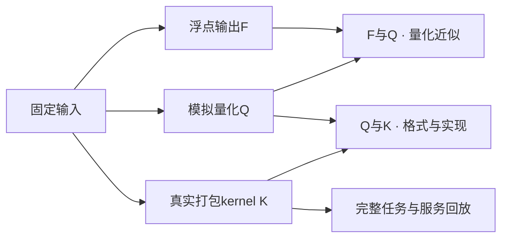
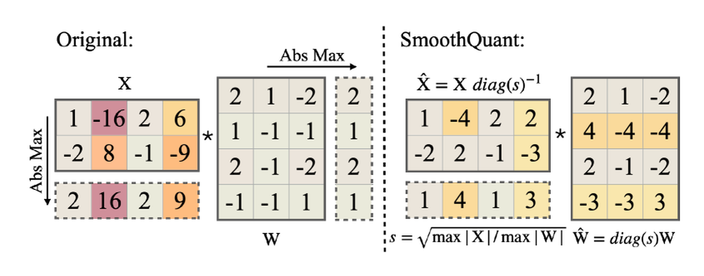

# 量化对照实验怎样定位问题

模型文件变小以后，怎样知道真正的 kernel 用上了低比特路径，质量和 P95 也没有越过门槛？把固定输入从浮点参考走到真实服务，依次对照数值近似、格式错误、回退路径和系统开销，才能回答这个问题。

## 最小对照从三条路径开始

对同一层和同一输入，保存浮点输出F、模拟量化输出Q、真实打包kernel输出K。

| 比较 | 主要回答的问题 | 偏差出现时先查 |
| --- | --- | --- |
| F与Q | 量化本身改变了多少计算 | 范围、scale粒度、校准、截断 |
| Q与K | 部署实现是否符合模拟约定 | packing、轴、zero point、累加dtype |
| 全模型F与K | 局部误差怎样影响最终任务 | 输出边界、长上下文、采样与输入类型 |

绝对误差 $|F-Q|$ 与相对误差 $|F-Q|/(|F|+\epsilon)$ 各有用途。参考值接近0时相对误差可能很大，应同时看幅度与实际输出。容差应根据dtype和算法选定，不能用一个阈值覆盖所有层。

<!-- systems-workflow-visual -->


两组局部对照先区分近似误差与执行错误，最后再判断完整任务是否满足要求。

### 一个四元素例子怎样把三条路径分开

假设浮点参考输出为 `F = [1.0, 0.5, -0.25, 8.0]`。模拟量化使用 scale `0.5`，得到 `Q = [1.0, 0.5, 0.0, 8.0]`；真实 kernel 的解包顺序写错后得到 `K = [1.0, 0.0, -0.5, 8.0]`。这里 `F-Q` 主要反映低比特近似，`Q-K` 则暴露出打包或轴顺序问题。若只比较 `F-K`，两个来源会叠在一个总误差里，难以决定应该改校准还是改 kernel。

可以把偏差写成逐元素记录，而不是只保存一个平均值。

| index | F | Q | K | F-Q | Q-K |
| ---: | ---: | ---: | ---: | ---: | ---: |
| 0 | 1.00 | 1.00 | 1.00 | 0.00 | 0.00 |
| 1 | 0.50 | 0.50 | 0.00 | 0.00 | 0.50 |
| 2 | -0.25 | 0.00 | -0.50 | -0.25 | 0.50 |
| 3 | 8.00 | 8.00 | 8.00 | 0.00 | 0.00 |

这只是教学数字，不是某个量化格式的精确编码。它展示了为什么要保留最小输入、scale、packed bytes 和三个输出。真正排查时再补充 dtype、group size、zero point、累加精度与 kernel 名称。

## 校准、选择和测试各留一份数据

校准集用于估计scale、激活统计或补偿；验证集用于比较bit数、group size等配置；最终测试集保留到配置固定后。输入按长度、领域或模态分层，既报告自然分布加权结果，也单独报告关键小组。

同一模型的量化前后比较尽量配对相同输入，并固定解码设置。采样本身有随机性时，还需重复运行或给出不确定性范围。不要把一次随机输出翻转自动归因到量化。

对于生成模型，固定输入还应覆盖不同上下文长度。短 prompt 可能只触发权重误差，长 prompt 才会暴露 KV、位置编码或累积误差。可以把验证样本分成 `short`、`medium`、`long` 三桶，记录每桶的 logit 差、困惑度或任务质量。若只有长桶明显退化，优先检查缓存和位置相关路径，而不是重新量化所有层。

## 服务计时从明确边界开始

分别测冷启动和预热后的稳态，把加载、编译、格式转换归入实际发生的阶段。Prefill记录输入长度与TTFT，decode记录历史长度、batch和TPOT；并发测试还要记录到达率、输出长度和队列。

若文件小了但延迟没有下降，先看实际kernel和转换，而不是立刻调校准数据。若单层kernel变快但服务尾延迟变差，再看batch构成、fallback与排队。这两类问题需要不同证据。

## 一份足够复现的结果记录

保留模型与tokenizer身份、量化工具版本、校准输入标识、scale/分组配置、目标设备与runtime版本。结果至少包含峰值显存、实际执行路径、质量变化和固定负载下的延迟分布。

遇到失败时保存最小输入以及F/Q/K三个输出，就能继续缩小范围。只有浮点参考和失败截图，无法区分算法误差与打包错误。AWQ分开的模拟与真实转换函数提供了一个可参照的实现边界。

一个能长期复用的结果目录可以按下面的结构保存。文件名中带上模型、量化配置和运行版本，避免后续把不同实验的输出混在一起。

```text
run-2026-11-10/
  manifest.json          # model, tokenizer, runtime, device, git commit
  calibration.jsonl      # input ids or stable sample ids
  scales/                # scale, zero point, group size and axis
  layer-diffs.parquet    # F/Q/K errors by layer and bucket
  task-results.json       # quality by task, length and seed
  service-trace.json     # TTFT, TPOT, queue, kernel and fallback
```

`manifest.json` 还应记录没有测到的条件，例如没有图片输入、没有多卡通信或没有长上下文。这样下一次回归能知道是配置变了，还是覆盖范围仍然不足。



<small>图源：[SmoothQuant](https://arxiv.org/abs/2211.10438)。原图表达 activation outlier 可以通过等价缩放迁移到权重侧，让 W8A8 更可行；读图重点是：量化验收必须确认误差补偿、校准数据、runtime kernel 和业务分桶同时成立。它不能证明所有任务都适合 W8A8，也不能替代真实线上 P95/P99 与质量回归。</small>

## 对照源码与延伸阅读

- [pseudo_quantize 与 real_quantize 的对照入口](https://github.com/mit-han-lab/llm-awq/blob/d6e797a42b9ef7778de8ee2352116e0f48a78d61/awq/quantize/quantizer.py)
- [本站的 F/Q 逐行回放](../assets/examples/quantization/ptq_layer_reconstruction.py)，用于先检查输出误差记账，再接入目标 runtime

## 把验收拆成三个门

**数值门**检查 F/Q/K 三条路径的误差和有限值；**任务门**检查固定输入、长度、模态和解码条件下的质量分桶；**系统门**检查冷启动、稳态、P95/P99、峰值显存、fallback 和实际 kernel。任意一门失败，都不能用另一门的好结果遮盖。

三个门可以用一次小型回归串起来。先从验证集中抽取一批固定样本，保存浮点输出和量化配置；随后只替换一个模块，重复 F/Q/K 对照；最后在同一并发和输出长度下跑服务。若 Q 已经偏离而 K 只复现了 Q，问题在量化配置或校准；若 Q 接近但 K 偏离，问题更像 packing、轴或累加 dtype；若两者都接近而任务失败，才去看长上下文、解码和输入分布。

验收表还应留一列“没有测到什么”。例如只跑文本短输入，不能覆盖图片分块；只测平均延迟，不能覆盖排队造成的 P99；只看字符准确率，不能覆盖动作轨迹的累计偏差。把缺口写出来，下一次补测才有明确目标。

**来源与改编说明**：[SmoothQuant](https://arxiv.org/abs/2211.10438)提供激活离群值迁移的机制背景，[AWQ quantizer](https://github.com/mit-han-lab/llm-awq/blob/d6e797a42b9ef7778de8ee2352116e0f48a78d61/awq/quantize/quantizer.py)提供模拟/真实转换的实现边界。自测时为一个 F/Q/K 偏差写出最先要查的三个字段。

继续阅读：[激活离群值与校准策略](activation-outliers-and-calibration-strategies.md)解释 scale 和校准集怎样影响 F/Q 偏差；[量化 runtime 与框架](quantization-runtimes-and-frameworks.md)把单层对照接到实际 kernel、fallback 和服务模式。
