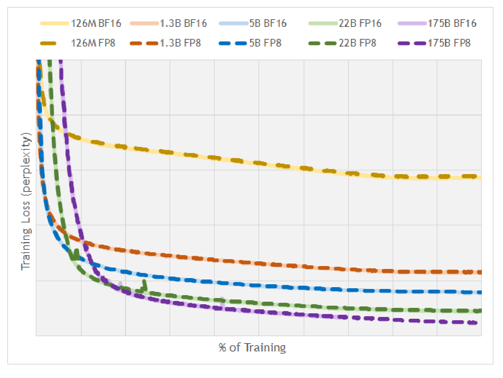

# FP8 与混合精度推理：它不是一个 dtype 开关

FP8 在服务里的价值，不是把全模型粗暴改成 8 bit，而是把最吃带宽、最适合 Tensor Core 的大块矩阵计算放到低精度路径上，同时把归一化、softmax、残差、输出头、KV cache、坐标或动作头这些敏感位置留在更高精度或更谨慎的量化策略里。

所以判断 FP8 值不值得上，先别问“能不能压到 8 bit”。更该问四件事：热路径是不是 GEMM 或 HBM 带宽瓶颈；硬件和 runtime 是否真的命中 FP8 kernel；scale、amax、累加和 fallback 是否可观测；质量回归是否覆盖长上下文、多模态、工具调用或动作安全这类高风险桶。

## 先问瓶颈在哪

FP8 省的是每个元素的字节数，也可能提高 GEMM 吞吐。但服务系统不一定因此端到端变快。prefill 往往更像大矩阵吞吐问题，FP8 projection 和 MLP 更容易兑现收益；decode 可能卡在 KV cache 读写、调度、batch 形状、采样和网络输出上，只有权重 GEMM 变快不一定能明显降低 TPOT。

这也是为什么 FP8 评估要分开看 TTFT、TPOT、throughput、P95/P99、显存峰值和 kernel trace。若 trace 里大量 fallback 到 BF16，或者低精度 kernel 只覆盖冷路径，理论压缩就不会变成线上收益。

| 系统位置 | FP8 更可能有效 | 需要小心的原因 |
| --- | --- | --- |
| Linear / MLP / attention projection | 大块 GEMM 和激活搬运成本高 | shape 不合适或 kernel 不支持时可能 fallback |
| KV cache | 长上下文显存压力大 | scale 校准、注意力质量和 backend 支持会限制收益 |
| LayerNorm / RMSNorm | 通常不作为第一批 FP8 目标 | 统计量敏感，误差会跨层传播 |
| Softmax / attention score | 通常保 BF16/FP16 | 指数和归一化会放大量化误差 |
| lm head / projector / action head | 先保守 | 输出分布、坐标、工具参数或动作边界更容易出事故 |

## E4M3 和 E5M2 是范围与格点的取舍

FP8 常见格式是 E4M3 和 E5M2。E 是 exponent，决定动态范围；M 是 mantissa，决定同一数量级里能分多细。E4M3 的有效数字更细，范围更窄，常用于前向权重和激活；E5M2 范围更大、格点更粗，常用于动态范围更大的张量。

{ width="630" }

<small>图源：[FP8 Formats for Deep Learning](https://arxiv.org/abs/2209.05433)，Figure 1。原图用多类模型训练曲线说明 FP8 路线可以接近高精度基线。这里用它说明：格式定义本身不能证明可用，必须回到任务曲线和质量回归。</small>

把一个张量 cast 到 FP8 前，通常要先用 scale 把数值映射到可表示范围：

\[
x_{\mathrm{fp8}}=\operatorname{FP8Cast}\left(\frac{x}{s}\right),\qquad
\hat{x}=s\cdot x_{\mathrm{fp8}}
\]

这行式子说的是：真实张量 \(x\) 先除以 scale \(s\)，再落到 FP8 格点；反量化时再乘回 \(s\)。如果 \(s\) 太小，大值会溢出；如果 \(s\) 太大，大多数普通值会挤到很粗的格点上。FP8 的难点，很多时候不是 E4M3 还是 E5M2，而是 scale 何时更新、按什么粒度更新、是否被 outlier 拖坏。

## scale 是控制面

生产级 FP8 通常有一套 scale 控制面。per-tensor scale 简单，元数据少，但容易被少数尖峰值影响；per-channel 或 per-head scale 更细，质量更稳，但 kernel 和元数据布局更复杂；per-block scale 能折中稳定性和开销，但 block size 必须和矩阵布局、Tensor Core tile、通信和 cache 对齐。

Transformer Engine 的 delayed scaling 思路，是用历史 amax 统计来更新 scale。它避免每个 batch 都剧烈改变 scale，但分布突变时可能滞后。vLLM 的 FP8 KV cache 文档也把校准路径单独拎出来：默认 scale、warmup 估计和数据集校准会带来不同质量风险；KV cache 量化还受 attention backend 和 per-head scale 支持影响。

因此上线 FP8 时，scale 本身要进监控：amax 分布、overflow / underflow、scale 更新频率、fallback 次数、每层误差、长上下文注意力退化，都应该能被追踪。没有这些信号，FP8 问题会表现成“模型偶尔变笨”，很难定位。

## 混合精度才是生产形态

成熟系统不会只改一个 dtype。DeepSeek-V3 的 FP8 mixed precision framework 就把核心 GEMM、scale、累加、通信和高精度保护放在一套系统里看。

{ width="920" }

<small>图源：[DeepSeek-V3 Technical Report](https://arxiv.org/abs/2412.19437)，Figure 6。原图表达大模型训练中的 FP8 mixed precision framework。这里用它说明：FP8 是低精度计算、高精度保护、scale 与通信策略的组合，不是单一开关。</small>

低精度乘法也不等于低精度累加。很多 FP8 GEMM 会用更高精度或分块累加，再把结果按需要 cast 回低精度。累加精度不够、block scale 不合适或 outlier 没处理好，都会把局部误差放大到整层输出。

{ width="860" }

<small>图源：[DeepSeek-V3 Technical Report](https://arxiv.org/abs/2412.19437)，Figure 7。原图表达 FP8 quantization、scale、accumulation 和高精度处理的关系。这里用它说明：FP8 工程难点在于计算路径和 scale 路径一起设计。</small>

推理服务可以借这个思路做拆分：主干大矩阵先尝试 FP8；norm、softmax、残差和输出敏感层保 BF16；KV cache 单独评估；多模态 projector、OCR 坐标、工具参数、动作头和 risk head 先放在高精度保护区。这样得到的是可回退的 mixed-precision recipe，而不是不可解释的全局 dtype 改动。

## FP8、INT8 和 INT4 不该按 bit 数排序

FP8 像“小浮点”，动态范围天然比整数格点友好；INT8/INT4 更依赖 scale、zero point、group size、outlier 处理和校准数据。INT4 的压缩率更激进，但 kernel、解量化、group metadata 和质量回归也更敏感。FP8 常见优势是新硬件上更容易获得稳定低精度 GEMM 路径，质量回归通常比极低 bit 温和。

真正的选择标准是瓶颈。若瓶颈是权重常驻显存，W4A16 可能更有吸引力；若瓶颈是 prefill 的大块 GEMM 和激活带宽，FP8 W&A 更值得试；若瓶颈是长上下文 KV cache，KV 量化要单独校准；若瓶颈是 decode 调度或小 batch 形状，换 dtype 可能不是第一优先级。

## 验收要按服务和任务分桶

FP8 验收不能只看 perplexity 或一个 GSM8K 分数。文本 LLM 至少要看数学、代码、长上下文、工具调用、结构化输出和拒答边界。VLM 要额外看 OCR、表格、坐标定位、细粒度视觉问答和跨模态 projector。VLA 或世界模型要看动作抖动、near-miss、risk head、短 horizon 纠错和 closed-loop success。

系统侧要同时记录：峰值显存、常驻显存、TTFT、TPOT、吞吐、P95/P99、fallback 率、kernel 命中率、scale 统计、编译开销、calibration 数据版本和回滚策略。一个实用判断是：如果 FP8 只让离线 benchmark 好看，但线上 P99 变长、质量桶掉点或观测不到 scale 状态，它还没有真正上线。

## 外部精读

- [FP8 Formats for Deep Learning](https://arxiv.org/abs/2209.05433)：理解 E4M3/E5M2、scale 和训练曲线证据。
- [NVIDIA Transformer Engine FP8 delayed scaling](https://docs.nvidia.com/deeplearning/transformer-engine/user-guide/features/low_precision_training/fp8_delayed_scaling/fp8_delayed_scaling.html)：核对 amax history、delayed scaling 和 FP8 recipe。
- [NVIDIA Hopper Architecture In-Depth](https://developer.nvidia.com/blog/nvidia-hopper-architecture-in-depth/)：理解 FP8 Tensor Core 的硬件背景。
- [DeepSeek-V3 Technical Report](https://arxiv.org/abs/2412.19437)：看大规模模型里 FP8 mixed precision、scale 和累加路径如何系统化组织。
- [vLLM Quantized KV Cache](https://docs.vllm.ai/en/latest/features/quantization/quantized_kvcache/)：理解 FP8 KV cache、scale 校准和 backend 支持边界。
- [Hugging Face Quantization concept guide](https://huggingface.co/docs/transformers/quantization/concept_guide)：把 FP8 放到权重、激活、KV cache 和 runtime support 的量化生态里理解。

## 相关阅读与下一步

- 外部材料：[Hugging Face Quantization 概念指南](https://huggingface.co/docs/transformers/main/en/quantization/concept_guide)。
- 外部材料：[GPTQ 论文](https://arxiv.org/abs/2210.17323)。
- 外部材料：[AWQ 论文](https://arxiv.org/abs/2306.00978)。
- 站内下一步：[量化专题](index.md)。
- 站内下一步：[PTQ / GPTQ / AWQ / SmoothQuant](ptq-gptq-awq-smoothquant.md)。
- 站内下一步：[量化评测与部署清单](evaluation-and-deployment-checklist.md)。
