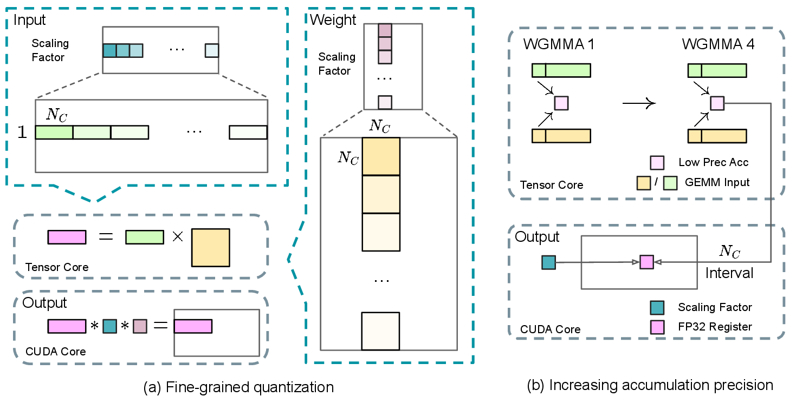
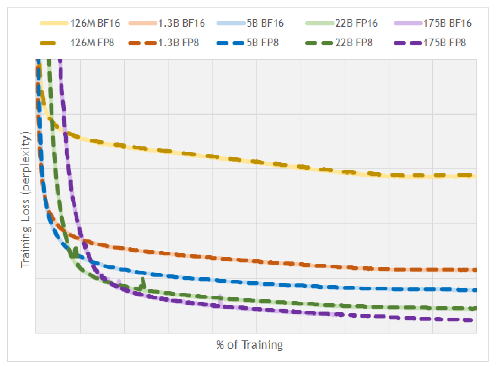

# FP8 矩阵乘里的数据、尺度和累加

FP8用8个bit保存浮点数，但不同格式的指数位和尾数位分配不同，范围与精度也不同。服务系统要同时决定数据格式、scale粒度、累加方式和硬件路径。一个tensor标记为FP8，还不足以说明它会怎样参与计算。

## 从一块输入到一次矩阵乘

先约定 $A\approx s_A A_q$、$B\approx s_B B_q$，即s表示反量化尺度。若两块各用一个scale，则

$$
AB\approx s_As_B(A_qB_q).
$$

量化时先除以s，再转换到FP8可表示值；矩阵乘通常把低精度操作数送入适用的矩阵指令，在选定精度下累加，最后恢复尺度。某些库保存的是这里s的倒数，读API时必须核对，不能只看变量名scale。

用十进制教学数说明尺度关系，设 $A_q=[2,4]$、$B_q=[3,1]^\top$，$s_A=0.5,s_B=0.25$。整数样式的点积为10，恢复结果为1.25。实际FP8操作数可以带小数，这个例子只演示scale乘回的位置。

### E4M3 和 E5M2 的取舍

FP8 常见的两种编码把 8 个 bit 分给符号、指数和尾数的方式不同。E4M3 有更多尾数位，适合在范围已经受控的激活或权重上保留相对精度；E5M2 有更多指数位，能覆盖更宽的动态范围，常被放在梯度等更容易出现大值的路径。具体可表示范围还受特殊值、bias、硬件实现和 flush-to-zero 规则影响，因此不能只根据名称推断某一框架的边界。

如果张量经过 scale 后仍超出格式范围，通常会饱和到最大有限值或变成特殊值；如果绝对值太小，也可能下溢为零。饱和会让少数大值形成明显的 outlier，零化则会让小幅更新或稀疏分支消失。校准时应同时统计最大值、分位数、饱和比例和零值比例，而不是只记录一个最大绝对值。

NVIDIA Transformer Engine 的 FP8 primer 将格式、tensor scaling 和 delayed scaling 分开讨论。这里借用它的拆分方式，正文仍用本站的小矩阵和错误表解释接口；实际训练是否使用 E4M3、E5M2 以及何时切换，要以目标硬件和 runtime 版本为准。

## 分块尺度会改变归约结构

若K方向分成两块，每块有不同尺度，结果为

$$
C=\sum_g s_{A,g}s_{B,g}(A_{q,g}B_{q,g}).
$$

不能先把所有未缩放部分和加起来，最后随便乘一个scale。Kernel需要把scale读取、部分累加和布局一起组织。因此细粒度scale既是数值选择，也是执行接口。

### scale 粒度决定谁共享一个异常值

常见粒度可以按整个 tensor、按输出通道、按每组通道或按矩阵 tile 划分。粒度越粗，元数据少、kernel 更简单，但一个 outlier 会迫使整块使用更大的 scale，其他值的有效精度下降；粒度越细，误差通常更可控，却要读取更多 scale，可能破坏融合和访存合并。

设一行激活为 `[0.1, 0.2, 100.0, 0.3]`。用一个 tensor scale 覆盖 100 时，前三个小值在量化后只占很少码值；如果按两组 `[0.1, 0.2]` 与 `[100.0, 0.3]` 分开，第一组能使用更合适的范围。这个例子不代表分组一定改善任务质量，因为分组后的缩放还必须与 GEMM 的累加和反量化顺序一致。

校准时应记录 scale 的来源和轴。例如 `per_channel` 可能沿输出通道缩放，`per_token` 可能沿序列中的每个 token 缩放；两者都可能在日志里被简称为 channel scale。写出 scale tensor 的 shape 和它广播到哪几个轴，比名称更可靠。

DeepGEMM锁定版本的README明确区分SM90与SM100的scale布局。前者使用FP32尺度，后者相应路径要求打包UE8M0尺度；左操作数scale还需符合其转置和TMA对齐要求。支持某种FP8数据格式，并不自动意味着现有scale张量就可直接传入。

{ width="920" }

<small>图源：[DeepSeek-V3 Technical Report](https://arxiv.org/abs/2412.19437)，Figure 6。原图表达大模型训练中的 FP8 mixed precision framework。这里用它说明：FP8 是低精度计算、高精度保护、scale 与通信策略的组合，不是单一开关。</small>

{ width="860" }

<small>图源：[DeepSeek-V3 Technical Report](https://arxiv.org/abs/2412.19437)，Figure 7。原图表达 FP8 quantization、scale、accumulation 和高精度处理的关系。这里用它说明：FP8 工程难点在于计算路径和 scale 路径一起设计。</small>

## 静态范围和动态范围各花什么成本

静态scale可在校准时决定，减少请求期统计，但输入范围变化可能增加截断或下溢。动态scale依据当前张量统计范围，能适应当前输入，却增加归约、转换与元数据操作。小batch的短kernel里，这些开销可能占较大比例。

例如一个教学流水线原先GEMM花10个时间单位，其余操作花10。改FP8后GEMM变成6，量化与布局多花3，整条路径从20降到19。算子内部节省40%，端到端只节省5%。这组数字用于拆账，不是任何GPU的实测。

{ width="630" }

<small>图源：[FP8 Formats for Deep Learning](https://arxiv.org/abs/2209.05433)，Figure 1。原图用多类模型训练曲线说明 FP8 路线可以接近高精度基线。这里用它说明：格式定义本身不能证明可用，必须回到任务曲线和质量回归。</small>

## 混合精度如何由误差定位得到

先固定输入，对照每层浮点与FP8输出。若某层误差显著放大，再尝试只恢复该层或某段计算的高精度，并观察任务质量是否恢复。归一化、softmax或输出头常值得单独检查，但不应预先宣布它们在所有模型里最敏感。

同样，保留高精度模块可能引入转换与阻断融合。最终方案要比较完整计算路径，同时保留质量与延迟结果。FP8权重、FP8激活、FP8 KV是三个独立配置，修改其中一个时不要把另外两个默认算入收益。

可以用下面的表组织一次最小验收。每一行都要求同一输入、同一 tokenizer、同一采样设置和同一硬件边界。

| 检查层 | 记录什么 | 能回答的问题 | 不能回答的问题 |
| --- | --- | --- | --- |
| 码值 | 饱和率、零值率、scale shape | 是否已经发生明显截断或下溢 | 任务质量是否可接受 |
| 单层输出 | 与 FP32/BF16 的最大误差、均方误差和分位数 | 哪一层先放大误差 | 端到端速度是否更快 |
| 任务结果 | 固定评测集、分桶质量、失败样例 | 误差是否改变实际行为 | 新 kernel 是否真正被调用 |
| 服务 trace | 转换、GEMM、layout、同步和队列时间 | 省下的矩阵乘是否被其他阶段抵消 | 其他硬件上的表现 |

如果质量掉了，先固定 scale 和输入重放单层输出，再逐层恢复高精度。若单层误差很小而任务仍明显退化，应检查累积误差、采样敏感性、KV 或输出头，而不是继续调同一个 scale。

## 从源码确认收益会落在哪里

DeepGEMM README明确要求输入转置和FP8转换由调用方负责，辅助PyTorch函数可能较慢。因此计时至少分为“已准备好的矩阵乘”和“包含转换的完整层”两种边界。框架加载成功只能证明某个路径能执行，trace中实际kernel与输入布局才说明执行了什么。

还要区分三种计时边界。只计已准备好的 FP8 矩阵乘，回答的是 kernel 本身的吞吐；把量化、转置、scale 生成和输出转换算进去，回答的是层级成本；再把调度、KV、网络和 batch 等待算进去，才接近服务端用户延迟。不同论文或博客若使用不同边界，不能直接比较一个“FP8 加速倍数”。

## 对照源码与延伸阅读

- [DeepGEMM 固定版本的格式、布局和调用方职责](https://github.com/deepseek-ai/DeepGEMM/blob/5081f8513af57e61696de4f4f04b0e707ffb503e/README.md)
- [NVIDIA Transformer Engine](https://github.com/NVIDIA/TransformerEngine) 的文档与示例说明 E4M3、E5M2、tensor scaling 和 delayed scaling 的基本接口。
- [vLLM quantization documentation](https://docs.vllm.ai/en/stable/features/quantization/) 用于核对服务端支持的量化路径和版本边界。

## FP8 路线的学习顺序

先用单个 scale 的矩阵乘理解反量化位置，再加入 K 分块 scale、动态范围和调用方转换，最后对照 SM90/SM100 的实际布局与 kernel。每一步都把“低精度输入、累加精度、输出转换、scale 元数据”分开记录。

**来源与改编说明**：[FP8 Formats for Deep Learning](https://arxiv.org/abs/2209.05433)负责格式与训练证据，[DeepSeek-V3 Technical Report](https://arxiv.org/abs/2412.19437)负责混合精度系统背景，[DeepGEMM README](https://github.com/deepseek-ai/DeepGEMM/blob/5081f8513af57e61696de4f4f04b0e707ffb503e/README.md)负责版本化接口。本文的时间数字均为构造例子，真实收益必须在目标设备和完整调用边界下测量。

读完后可以接[FP8 训练与优化器 kernel](../operators/fp8-training-and-optimizer-kernels.md)，看训练状态和溢出跳过怎样改变精度边界；服务侧再看[量化 runtime 与框架](quantization-runtimes-and-frameworks.md)和[Serving stacks 的硬件取舍](serving-stacks-and-hardware-tradeoffs.md)，把 scale 准备、kernel、质量门槛和并发成本放在同一条路径里。
