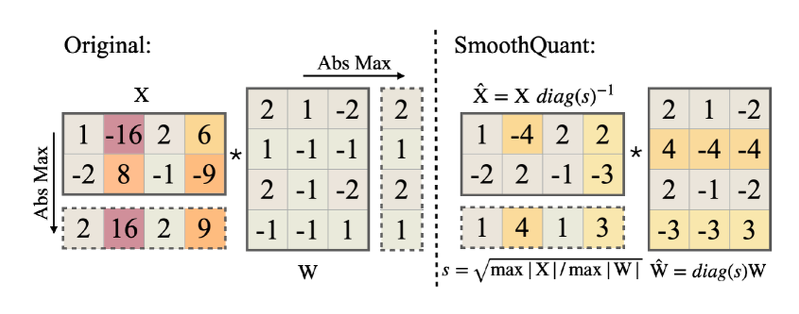

# 量化论文图解导读

这页把量化章节最常用的论文图放在一条线上。读法不是背图，而是用每张图回答一个问题：量化为什么必要，误差在哪里，系统为什么不一定变快，哪些方法在保护关键路径。

!!! tip "看图顺序"
    先看 SmoothQuant Figure 1 建立系统压力，再看 Low-bit LLM Survey Figure 1/2/3 分清分类和基础概念，随后看 GPTQ/AWQ/SmoothQuant/QLoRA 的方法图，最后看 Low-bit LLM Survey 的系统、KV、PTQ 和 transformation 图。

## 1. SmoothQuant Figure 1：为什么量化是部署问题

{ width="760" }

<small>图源：[SmoothQuant](https://arxiv.org/abs/2211.10438)，Figure 1。原论文图意：模型规模增长快于单卡 GPU 显存增长，低精度部署成为大模型落地的重要路径。</small>

**原图在说什么**：模型越来越大，但单卡显存增长没有那么快。量化首先是为了让模型放得下、跑得动、服务成本可控。

**初学者怎么看**：不要把量化理解成压缩包，而要理解成部署边界管理。权重、激活、KV cache 和 kernel 都会影响最终成本。

**容易误读**：显存压力大不等于任何 4bit 方案都值得上线。压缩率必须和质量、runtime、latency 同表验收。

## 2. Low-bit LLM Survey Figure 1：量化不是一个算法名

{ width="840" }

<small>图源：`A Survey of Low-bit Large Language Models: Basics, Systems, and Algorithms`，Figure 1。原论文图意：把低比特 LLM 拆成基础、系统、训练、推理算法和未来方向。</small>

**原图在说什么**：低比特 LLM 包括 number format、scale granularity、dynamic/static quantization、inference framework、training 和 inference algorithm。

**初学者怎么看**：先从左到右读。格式回答“数字怎么存”，系统回答“谁来跑”，算法回答“怎么少掉点”。

**容易误读**：把它当方法列表。更好的读法是：每看到一个量化方案，都问它改的是哪一层。

## 3. Low-bit LLM Survey Figure 2：scale 粒度决定误差和成本

{ width="840" }

<small>图源：Low-bit LLM Survey，Figure 2。原论文图意：展示 tensor-wise、token-wise、channel-wise、group-wise 和 element-wise 的量化粒度。</small>

**原图在说什么**：scale 可以管整个 tensor、某个 token、某个 channel、某个 group，甚至单个元素。

**初学者怎么看**：红框越大，scale 越粗，元数据越少但更怕 outlier；红框越小，误差更容易控制但 kernel 和内存访问更复杂。

**容易误读**：scale 越细就一定越好。真实系统中，scale 读取和 dequant 也会消耗带宽和指令。

## 4. Low-bit LLM Survey Figure 3：动态和静态量化的准备成本不同

{ width="840" }

<small>图源：Low-bit LLM Survey，Figure 3。原论文图意：比较 dynamic quant、static weight & activation quant 和 static weight-only quant 的准备阶段与推理阶段。</small>

**原图在说什么**：dynamic quant 推理时根据当前输入算 scale；static quant 用校准集提前固定参数；weight-only 只压权重，激活仍保持高精。

**初学者怎么看**：看下半部分 inference 路径。每次请求都要做的事情最影响线上延迟。

**容易误读**：weight-only 不是“低级方案”。它经常是最稳的部署起点，只是计算核心未必变成低比特。

## 5. GPTQ Figure 2：量一列，补后面的误差

{ width="780" }

<small>图源：[GPTQ](https://arxiv.org/abs/2210.17323)，Figure 2。原论文图意：按列递归量化权重块，并用 inverse Hessian 相关信息补偿尚未量化列。</small>

**原图在说什么**：GPTQ 不是每个权重独立 round，而是一边量化一边把误差传给还没量化的部分，让这一层输出尽量不变。

**初学者怎么看**：把右侧块矩阵想成一排待处理的列。已经量化的列固定，后面的列会被调整来抵消前面的误差。

**容易误读**：Hessian 不是为了把每个权重恢复得更像，而是为了让这一层对校准输入的输出更像。

## 6. AWQ Figure 1：重要权重由激活决定

{ width="830" }

<small>图源：[AWQ](https://arxiv.org/abs/2306.00978)，Figure 1。原论文图意：少量 activation-salient weights 对量化质量影响很大，按激活幅度做保护或缩放可显著恢复效果。</small>

**原图在说什么**：不是所有权重同样重要。被真实激活频繁放大的通道，即使权重数量很少，也可能决定输出质量。

**初学者怎么看**：AWQ 的关键词是 activation-aware。它不是只看权重大小，而是看权重在真实输入下是否会被用力打到输出里。

**容易误读**：把 AWQ 理解成简单保留最大权重。它保护的是激活敏感的权重通道。

## 7. SmoothQuant Figure 2：把 activation outlier 压平

{ width="760" }

<small>图源：[SmoothQuant](https://arxiv.org/abs/2211.10438)，Figure 2。原论文图意：activation 中的 outlier 会减少有效量化 bit；SmoothQuant 把一部分难度迁移到更容易离线处理的权重侧。</small>

**原图在说什么**：activation outlier 会让 scale 变粗，主体数值只能挤在少量格子里。SmoothQuant 通过通道缩放把 activation 变平滑。

**初学者怎么看**：它不是凭空减少误差，而是在不改变 \(XW\) 输出的前提下，把难量化的一侧换成更好量化的形态。

**容易误读**：以为 SmoothQuant 只是在 clip outlier。它更准确地说是等价重参数化。

## 8. SmoothQuant Figure 5：核心方法图

{ width="780" }

<small>图源：SmoothQuant，Figure 5。原论文图意：通过离线迁移 activation 的量化难度，让权重和激活都更适合 INT8 量化。</small>

**原图在说什么**：原始 activation 的极端通道被缩小，同时对应权重通道被放大，线性层输出保持等价。

**初学者怎么看**：看“迁移”两个字。SmoothQuant 把在线难处理的问题尽量变成离线可处理的问题。

**容易误读**：权重侧被放大也有代价，所以仍然需要校准和任务回归。

## 9. SmoothQuant Figure 6：不是所有算子都该 INT8

{ width="780" }

<small>图源：SmoothQuant，Figure 6。原论文图意：Transformer block 中部分矩阵乘可以走 INT8，LayerNorm、Softmax、残差等仍保留 FP16。</small>

**原图在说什么**：生产里的低精度通常是混合精度。GEMM 适合低比特，归一化、softmax、残差和某些敏感路径更常保高精。

**初学者怎么看**：这张图能帮你摆脱“全模型统一 bit”的想法。量化是分模块分算子的资源分配。

**容易误读**：只看到 INT8 区域，却忽略 FP16 保护路径。很多稳定性来自这些保留高精的部分。

## 10. QLoRA Figure 1：省的是微调显存

{ width="760" }

<small>图源：[QLoRA](https://arxiv.org/abs/2305.14314)，Figure 1。原论文图意：比较 32-bit/16-bit 全量微调、LoRA 和 QLoRA 的显存组织。</small>

**原图在说什么**：QLoRA 冻结并量化底座，只训练小的 adapter，再用分页优化器缓解显存峰值。

**初学者怎么看**：这不是“把模型训练成 4bit”的普通部署量化，而是“在 4bit 存储的底座上继续低资源微调”。

**容易误读**：以为所有计算都在 4bit。实际训练中常会反量化到更高精度参与计算，只是底座存储显著省显存。

## 11. Low-bit LLM Survey Figure 4：数据搬运决定速度

{ width="860" }

<small>图源：Low-bit LLM Survey，Figure 4。原论文图意：以 A100 为例展示 weight 和 activation 在 host、global memory、L2、shared memory、registers 与 MatMul kernel 间的数据传输。</small>

**原图在说什么**：矩阵乘不是抽象的 \(Y=XW\)，它要把数据从不同内存层级搬到计算单元。

**初学者怎么看**：量化能省的不只是参数文件，而是内存层级里的传输字节数。

**容易误读**：低比特一定快。如果 dequant、scale 读取和格式转换破坏了热路径，节省的带宽会被新开销抵消。

## 12. Low-bit LLM Survey Figure 5：weight-only 和 W&A 是两条路径

{ width="900" }

<small>图源：Low-bit LLM Survey，Figure 5。原论文图意：展示 quantized weight preparation、weight-only quantization 和 weight & activation quantization 的数据传输过程。</small>

**原图在说什么**：weight-only 主要省权重存储和权重搬运；W&A 还想让 activation 和 MatMul 也进入低比特路径。

**初学者怎么看**：看 MatMul 之前有没有 dequant。若先 dequant 回 FP16，再用 FP16 GEMM，系统收益和真正低比特 GEMM 不一样。

**容易误读**：W&A 一定更好。它更可能快，但对硬件、kernel、layout 和校准要求也更高。

## 13. Low-bit LLM Survey Figure 6：KV cache 是长上下文主角

{ width="820" }

<small>图源：Low-bit LLM Survey，Figure 6。原论文图意：量化 KV cache 可减少缓存存储和传输，并在 attention forward 前反量化。</small>

**原图在说什么**：生成越长，历史 token 的 K/V 越多。KV cache 量化直接针对这部分动态显存。

**初学者怎么看**：权重量化解决“模型常驻显存”，KV 量化解决“长上下文并发显存”。

**容易误读**：KV cache 只是一点辅助缓存。对长上下文和高并发服务，它可能比权重更早成为瓶颈。

## 14. Low-bit LLM Survey Figure 7：QLoRA 不是唯一低比特训练结构

{ width="800" }

<small>图源：Low-bit LLM Survey，Figure 7。原论文图意：比较 QLoRA 类完整 LoRA、QA-LoRA 类修改 LoRA 结构、L4Q 类接近 QAT 的 LoRA 结构。</small>

**原图在说什么**：量化 PEFT 有多种结构，有的只是量化底座，有的会改变 adapter 或更接近 QAT。

**初学者怎么看**：QLoRA 是非常重要的入口，但不要把所有“量化训练”都叫 QLoRA。

**容易误读**：把低资源微调、QAT 和全量低比特训练混为一谈。

## 15. Low-bit LLM Survey Figure 8：PTQ 是一组方法族

{ width="820" }

<small>图源：Low-bit LLM Survey，Figure 8。原论文图意：把 LLM PTQ 分成 equivalent transformation、compensation、mixed precision、combination 和更多量化形式。</small>

**原图在说什么**：PTQ 不只是 round-to-nearest。它包括等价变换、误差补偿、混合精度和方法组合。

**初学者怎么看**：GPTQ 属于 compensation 直觉，SmoothQuant 属于 equivalent transformation 直觉，混合精度承认不同层敏感性不同。

**容易误读**：PTQ 简单粗暴。现代 PTQ 已经是一套围绕误差控制的部署算法族。

## 16. Low-bit LLM Survey Figure 9：平移变换处理 outlier

{ width="880" }

<small>图源：Low-bit LLM Survey，Figure 9。原论文图意：shifting transformation 通过可合并偏移项调整 activation 分布，并把对应变换合并进权重路径。</small>

**原图在说什么**：有些 transformation 不改变整体函数，却能让待量化分布更温和。

**初学者怎么看**：这类方法的核心是“先把难量化的数据整理一下，再量化”。

**容易误读**：以为这是额外增加线上计算。很多等价变换可以离线合并进权重或 bias。

## 17. Low-bit LLM Survey Figure 11：旋转把 outlier 分散

{ width="900" }

<small>图源：Low-bit LLM Survey，Figure 11。原论文图意：rotation transformation 可减少 activation outlier，其中部分 rotation 可合并进权重，部分通常不能完全合并。</small>

**原图在说什么**：旋转可以把集中在少数通道的极端值分散到更多维度，让 per-channel 或 group-wise 量化更容易。

**初学者怎么看**：它像把尖峰摊平。摊平以后，scale 不会被单个通道拖得太粗。

**容易误读**：所有 rotation 都免费。有些可离线合并，有些会增加运行时成本，要看具体实现。

## 18. 用这些图读后续页面

| 如果你卡在 | 回看哪张图 |
| --- | --- |
| 不知道量化为什么重要 | SmoothQuant Figure 1 |
| 分不清格式、算法、系统 | Low-bit LLM Survey Figure 1 |
| 不懂 per-channel/group-wise | Low-bit LLM Survey Figure 2 |
| 分不清 dynamic/static/weight-only | Low-bit LLM Survey Figure 3 |
| 不懂 GPTQ | GPTQ Figure 2 |
| 不懂 AWQ | AWQ Figure 1 |
| 不懂 SmoothQuant | SmoothQuant Figure 2/5/6 |
| 不懂 QLoRA | QLoRA Figure 1、Low-bit LLM Survey Figure 7 |
| 不懂为什么量了不快 | Low-bit LLM Survey Figure 4/5 |
| 不懂长上下文显存 | Low-bit LLM Survey Figure 6 |
