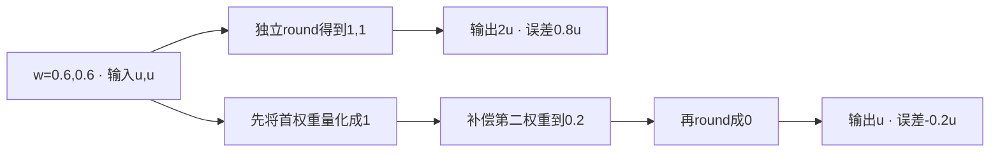
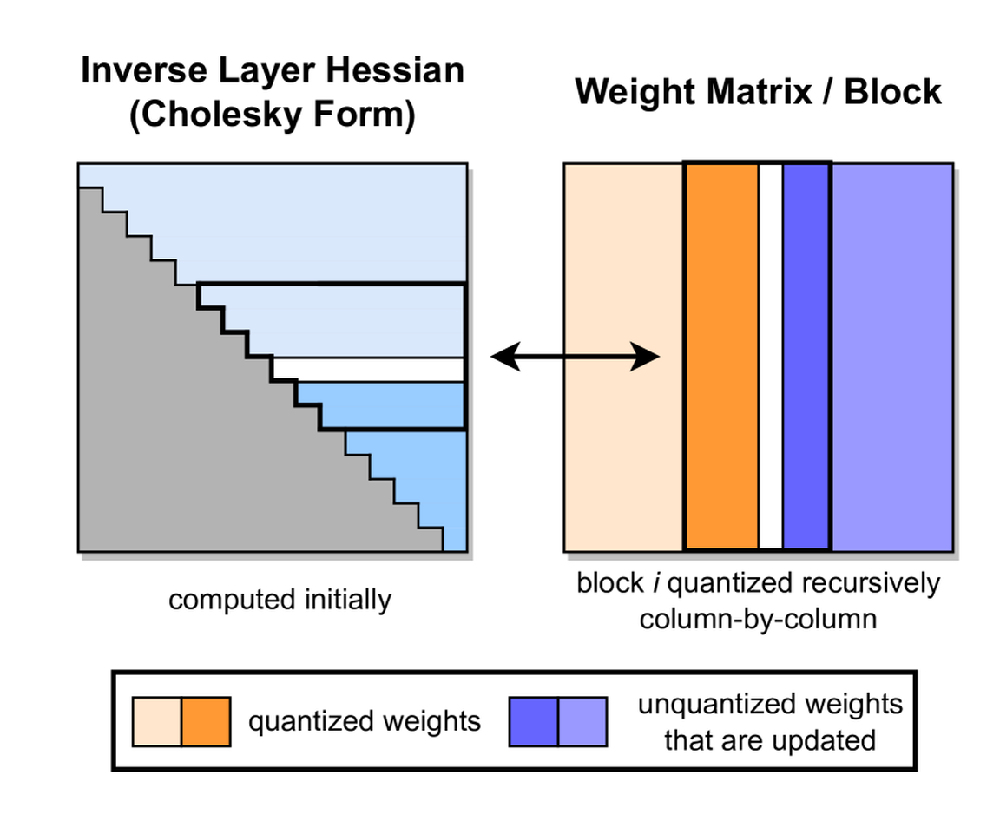
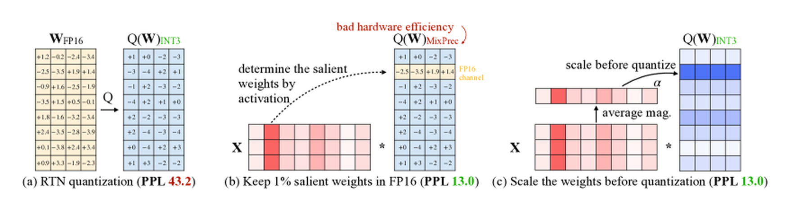
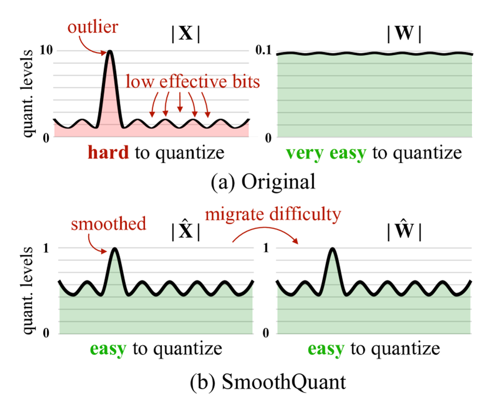

# GPTQ、AWQ 与 SmoothQuant 怎样减少量化误差

最直接的训练后量化，是给训练好的权重选定格子，再逐个舍入。它能马上减小表示范围，但相同的权重误差会被输入放大、抵消或沿后续层传播。本页从一个线性层出发，解释为什么 GPTQ 要补偿其他权重，AWQ 要看激活，而 SmoothQuant 会同时改动归一化和线性层。

下文统一用 $Y=XW$，X 的每行是一条输入，W 的每列是一个输出通道。源码里的 `nn.Linear.weight` 通常是 W 的转置。

## 先看逐个舍入漏掉了什么

假设输入的两个通道在校准样本里总相等，$x=[u,u]$，权重为 $w=[0.6,0.6]^\top$。原输出为 $1.2u$。如果整数格子间隔为 1，独立舍入得到 $[1,1]$，输出变成 $2u$。

现在先把第一个权重量化成 1，再允许第二个尚未量化的权重补偿。要暂时保持总和 1.2，第二个权重应改成 0.2；最终量化成 0，输出为 u。误差从 $0.8u$ 降到 $-0.2u$。这个二维教学例说明，按输入相关性补偿，比把各个权重孤立地看待更有希望保住输出。

它也暴露了校准边界。若真实输入变为 $[u,-u]$，这组补偿就未必合适。量化算法优化的是它看到的输入分布。

<!-- systems-workflow-visual -->


补偿利用了当前输入通道的相关性。换一种输入关系，较小误差的结论也可能改变。

## GPTQ 先量化一列，再修正剩余列

GPTQ 针对层输出重建目标

$$
\min_{\hat W}\|XW-X\hat W\|_F^2.
$$

若只看一个输出通道，其二阶曲率与 $X^\top X$ 有关。相关输入允许一个方向的量化偏差由另一个方向部分补偿。原始 `gptq.py` 的 `add_batch` 累积输入统计；`fasterquant` 加入对角阻尼，计算逆矩阵相关分解，再按列量化并更新未处理的权重。

代码里的 `Hinv` 名称尤其容易误读。完成两次 Cholesky 操作之后，这个变量存的是逆矩阵的上三角 Cholesky 因子，不能把循环中的每个除法直接解释成“除以 Hessian 对角”。分块处理用于组织补偿计算，group size 则决定多大一组权重共用量化参数，两者也要分开。

{ width="760" }

<small>图源：[GPTQ: Accurate Post-Training Quantization for Generative Pre-trained Transformers](https://arxiv.org/abs/2210.17323)，Figure 2。原图表达 GPTQ 按列量化权重，并用近似 Hessian 信息更新尚未量化的列；这里要抓住的是层输出重构，而不是单个权重逐个 round。</small>

校准输入有完全相关的通道时，$X^\top X$ 可能奇异。阻尼能改善数值问题，也会改变所求近似。上面的二维例只说明补偿直觉，没有模拟源码的阻尼、分块与所有量化细节。

## AWQ 用激活判断哪些权重误差更昂贵

对某个输入通道 i，输出误差包含 $x_i E_{i,:}$。一个权重行本身不大，但若对应激活经常很大，舍入这一行仍会产生显著误差。AWQ 利用校准激活搜索通道缩放，并在支持的位置把等价变换吸收到相邻算子。

设正对角矩阵 D 为通道尺度，先写成 $XW=(XD^{-1})(DW)$，再量化 DW。放大某个权重通道，有机会让它相对量化格距获得更细的有效表示；相应输入必须反向缩小。由于同组其他权重及 scale 也会改变，放大并不自动改善结果，需要实际计算层或块的输出误差。

AWQ 的 `pre_quant.py` 会注册 hook 收集线性层输入，再调用缩放与截断搜索，并把结果应用到网络。随后 `quantizer.py` 明确区分 `pseudo_quantize_model_weight` 和 `real_quantize_model_weight`。前者用浮点张量模拟舍入误差，后者构造可用于真实低比特执行的 `WQLinear`。

AWQ 常见实现仍将相关权重打包到低比特格式。“保护重要通道”不应被理解为必然留下若干 FP16 权重。具体是否混用精度，取决于实现和配置。

{ width="900" }

<small>图源：[AWQ: Activation-aware Weight Quantization for LLM Compression and Acceleration](https://arxiv.org/abs/2306.00978)，Figure 1。原图表达少量显著 activation 通道对应的权重更需要保护；这里的重点是 AWQ 的关键词是 activation-aware，重要性来自运行时输入如何使用这些通道，而不只来自权重绝对值。</small>

## SmoothQuant 把动态激活的范围转移给静态权重

如果还希望激活也进入低比特矩阵乘，动态激活离群值会使每次请求的 scale 难以选择。SmoothQuant 使用同样的等价缩放，但重点是让激活更容易量化。

在本页方向下，把输入通道除以 $s_i$、对应权重行乘以 $s_i$。源码按激活通道最大幅度 a 与权重通道最大幅度 w 构造近似为

$$
s_i=\frac{a_i^\alpha}{w_i^{1-\alpha}},
$$

并带有防零截断。增大 $\alpha$ 通常向激活侧分配更多平滑力度，也会让权重侧承担更大范围。`smooth_ln_fcs` 通过缩放 LayerNorm 的 weight/bias 和下游 Linear 权重完成折叠；Llama 类 RMSNorm 路径则没有同样的 bias。

若归一化输出同时送给 Q、K、V 三个投影，所有消费同一输入的分支都要保持等价。只改一条分支，整个网络就变了。实际支持哪些模型结构，需要看该版本的结构分支。

{ width="760" }

<small>图源：[SmoothQuant: Accurate and Efficient Post-Training Quantization for Large Language Models](https://arxiv.org/abs/2211.10438)，Figure 2。原图表达 activation outlier 会拉大量化范围，使主体值失去分辨率；SmoothQuant 通过等价缩放把部分难度迁移到 weight。</small>

## 怎样从这三种方法走到可用模型

先固定浮点参考模型、tokenizer、输入和输出比较方式。再用独立校准集估计统计量、搜索缩放或补偿，得到模拟量化结果。只有这一步的误差可接受，才值得打包并送进目标 runtime，比较模拟结果和实际 kernel 是否对齐。

GPTQ、AWQ、SmoothQuant 描述的是处理误差的办法，W4A16、W8A8 描述的是数值路径，两组名字不能互相替代。同样的算法可以有不同 group size、scale 格式和打包布局。后续的 [运行时](quantization-runtimes-and-frameworks.md)会继续追踪一个 packed byte 怎样参与乘法。

## 三种方法到底在保护什么

| 方法 | 量化前要观察什么 | 主要改变 | 更适合用来回答的问题 |
| --- | --- | --- | --- |
| GPTQ | 校准输入在每个线性层的二阶误差 | 量化一部分权重后，用输入相关性修正其他权重 | 在给定输入分布下，怎样减少层输出重建误差 |
| AWQ | 激活通道的幅度与出现频率 | 对通道做等价缩放，再量化权重 | 哪些权重会被真实激活反复放大，应该优先保护 |
| SmoothQuant | 激活和权重的动态范围 | 将部分激活离群值转移到权重 | 怎样让激活也能进入更规整的低比特矩阵乘 |

这个表只能帮助选择实验起点。GPTQ 的校准输入会进入曲率近似，AWQ 的缩放会改变相邻算子的数值范围，SmoothQuant 还要求折叠后的权重和激活路径在实现中保持等价。把三者都叫作“4 bit 量化”会漏掉真正需要检查的对象。

## 先把浮点、伪量化和真实 kernel 分成三层

对同一批输入，至少保存三份输出。第一份来自浮点参考模型，第二份来自仍以浮点张量执行的伪量化模型，第三份来自目标 runtime 的实际低比特 kernel。可以用下面的结果卡片记录一次比较：

```text
model_revision: <固定提交号>
calibration_set: calib_v1
evaluation_set: heldout_v1
quantizer: awq
weight_format: w4a16
reference: fp16_model
pseudo_quant: float_dequant_path
real_kernel: <runtime 与 kernel 版本>
layer_output_max_abs: ...
logit_relative_l2: ...
task_quality_delta: ...
latency_p50_p95: ...
fallback_count: ...
```

伪量化误差小而真实 kernel 误差大，优先检查 scale 的轴、权重转置、group 顺序、zero point 和 packed byte 解码。两者都接近浮点，但端到端速度没有变化，通常要查 kernel 是否真正命中、是否发生 dequant fallback、请求 shape 是否落在支持范围内。量化误差和部署收益由不同证据负责，不能合并成一个分数。

## 校准集怎样暴露错误，而不是只让分数好看

校准集应覆盖部署时会出现的长度、语言、代码或视觉 token。它只用于估计 scale、排序敏感性或曲率，最终质量评测需要保持独立。可以把输入按长度和任务切片，分别记录浮点与量化输出的差异。若短问答几乎没有变化、长代码明显退化，首先说明校准分布没有覆盖长代码，不能直接归因于 bit 数。

一个足够小的层级实验可以固定输入矩阵 $X$ 和权重 $W$，依次比较

```python
import numpy as np

reference = X @ W
pseudo = X @ dequantize(quantize(W, scales))
relative_l2 = np.linalg.norm(pseudo - reference) / np.linalg.norm(reference)
print("relative_l2", relative_l2)
```

仓库还提供一个不依赖 GPU 的[逐行伪量化回放脚本](../assets/examples/quantization/ptq_layer_reconstruction.py)。从仓库根目录运行

```bash
python files/assets/examples/quantization/ptq_layer_reconstruction.py --bits 4
```

它会打印浮点输出范数、最大绝对误差、相对二范数误差和 scale 范围。这个脚本使用对称逐行舍入，只验证误差记账和 shape 约束，不实现 GPTQ 的 Hessian 补偿、AWQ 的激活搜索或任何真实低比特 kernel。

然后用相同的 scale 和相同的打包格式送入真实 kernel，再比较 `real - pseudo`。这个顺序能把算法误差、反量化误差和 kernel 实现误差分开。若只跑端到端生成，最终文本变化很难告诉我们哪一层先出了问题。

## 低比特验收至少要有四个结果

第一项是数值一致性，记录层输出或 logits 的误差和异常样本。第二项是任务质量，按长度、任务类型和关键失败切片，而不是只报一个平均分。第三项是系统性能，固定输出长度后记录首 token、decode 间隔、吞吐、峰值显存和 fallback。第四项是可回滚性，保留原始权重、校准集、scale、打包版本和运行时配置。

如果量化后平均质量只下降 0.2 分，却把某一类安全请求的拒答率改变了，平均数不能替代分桶结果。如果显存下降但 p95 延迟上升，应把它写成资源与时延的权衡，而不是“量化成功”。低比特路径真正可用的标准，是在指定硬件、请求集合和质量门槛下通过这四项检查。

## 常见的四种失败定位

| 现象 | 优先检查 |
| --- | --- |
| 伪量化和浮点接近，真实 kernel 偏差很大 | packed layout、scale 轴、反量化顺序和 dtype 转换 |
| 只有长上下文或视觉输入退化 | 校准集覆盖、激活长尾和 KV 或视觉投影的独立格式 |
| 某一个线性层误差远高于其他层 | 权重转置、group size、异常通道和该层是否共用 scale |
| 质量变化很小，端到端速度也几乎不变 | kernel 命中、shape 分桶、通信和调度是否掩盖了矩阵乘收益 |

每个现象都应回到一条固定输入、一个固定层和一次可重放的运行记录。临时改 scale 直到分数恢复，会破坏校准和评测边界，留下的结果无法解释。


## 对照源码与延伸阅读

- [GPTQ add_batch 与 fasterquant](https://github.com/IST-DASLab/gptq/blob/2d65066eeb06a5c9ff5184d8cebdf33662c67faf/gptq.py)
- [AWQ 激活收集、缩放与截断](https://github.com/mit-han-lab/llm-awq/blob/d6e797a42b9ef7778de8ee2352116e0f48a78d61/awq/quantize/pre_quant.py)
- [SmoothQuant 等价变换](https://github.com/mit-han-lab/smoothquant/blob/c61476d728e42ae0d8a35e7e78494edcac3237b5/smoothquant/smooth.py)

## 算法和部署依据

GPTQ 的层输出重建目标和近似 Hessian 更新对照原论文与固定 commit 的实现，AWQ 的通道重要性与伪量化、真实量化路径对照论文和源码，SmoothQuant 的等价缩放对照原论文与 `smooth_ln_fcs`。二维补偿数字、三层输出对比和失败定位表是本站的教学设计，不是任何论文 benchmark。

下一步可以把同一批 `calib_v1` 和 `heldout_v1` 接到[量化部署验收](evaluation-and-deployment-checklist.md)，再在[运行时与框架](quantization-runtimes-and-frameworks.md)中记录真实 kernel。只有当量化方法、数据切片、硬件和运行时都固定下来，页面里的“误差变小”才有明确含义。
