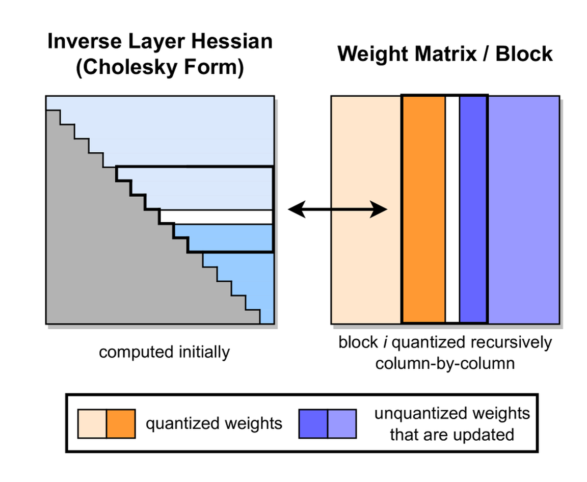
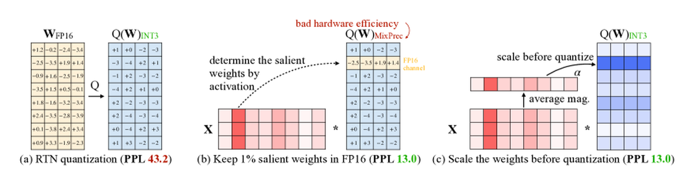

# PTQ、GPTQ、AWQ 与 SmoothQuant：先找瓶颈，再分误差预算

> **这篇回答的问题。** 如何理解“PTQ、GPTQ、AWQ 与 SmoothQuant”背后的核心机制、适用边界和下一步阅读路径。

量化不是把 `float16` 文件改成 `int4` 文件。它真正做的是：用更少的离散格子近似原来的连续数值，同时让模型质量、服务延迟和长尾任务尽量不坏。文件变小只说明存储少了；上线成功还要证明低比特 kernel 命中、请求分布匹配、质量分桶没有退化。

所以这页不按“INT8、INT4、FP8 谁更高级”排序，而按一个更实用的问题来讲：**量化到底在保护哪类误差，省下的成本又落在权重、activation、KV cache 还是 runtime kernel 上？**

70B 模型的 FP16 权重大约是 140GB。把权重量化到 4-bit，可能让模型更容易放进显存，也可能降低 decode 阶段的权重带宽。但如果 runtime 没有高效 INT4 GEMM，系统先解包、反量化、再用高精度算，端到端 TPOT 不一定变好。量化选型的第一步，不是选方法名，而是找瓶颈。

## 先分清三张账

| 账本 | 你在省什么 | 必须同时证明什么 |
| --- | --- | --- |
| 数值账 | 用更少 bit 表示权重、activation 或 KV | 误差没有伤到关键任务和长尾样本 |
| 系统账 | 降低显存、带宽、通信或 cache 压力 | 热点 kernel、layout、Q/DQ 和调度真的兑现收益 |
| 运维账 | 让模型更便宜、更易部署 | 量化配置、校准集、runtime 版本和回归集可追溯 |

很多量化事故都来自只看其中一张账。只看数值账，会得到“perplexity 不掉但服务不变快”；只看系统账，会得到“TPOT 好看但工具调用和长上下文掉分”；只看运维账，会得到“能上线但问题无法复现”。

## 量化就是给数轴分格子

均匀量化可以写成：

\[
q=\operatorname{clip}\left(\operatorname{round}\left(\frac{x}{s}\right), q_{\min}, q_{\max}\right),
\qquad
\hat{x}=s q
\]

\(x\) 是原始浮点值，\(q\) 是低比特整数，\(\hat{x}\) 是反量化后的近似值，\(s\) 是 scale。scale 决定一个整数格子对应原始数轴上的多大间隔。bit 越少，格子越少；格子越少，就越需要决定哪些值要被精细表示，哪些值可以被牺牲。

非对称量化会加入 zero point：

\[
q=\operatorname{round}(x/s+z),
\qquad
\hat{x}=s(q-z)
\]

\(z\) 用来让浮点 0 对齐到整数格点，适合处理不以 0 为中心的分布。代价是 kernel 更复杂，尤其在高性能 GEMM 中，zero point、scale、解包和反量化能否融合，直接影响性能收益。

量化误差大致分两类。rounding error 来自连续值被吸到最近格点；clipping error 来自超出可表示范围的值被截断。低比特方法不是消灭误差，而是在这两类误差之间分配预算。

一个典型例子是 activation outlier。某层 activation 大多数值在 \([-2,2]\)，但偶尔有一个通道出现 30。如果用 INT4 per-tensor scale 并为了装下 30 选择 \(s=30/7\)，主体区域几乎只剩一两个格子；如果把 scale 调小，主体区域更清楚，30 又会被截断。outlier 的危险不在于出现次数多，而在于它决定了普通值还能不能被分辨。

## 量化对象不同，问题完全不同

权重、activation、KV cache 和 optimizer state 都能低比特，但它们不是同一种对象。

| 对象 | 什么时候可见 | 常见路线 | 主要风险 |
| --- | --- | --- | --- |
| 权重 | 加载前就固定 | GPTQ、AWQ、weight-only INT4/INT8 | 校准集偏、group size 粗、runtime 没有低比特 kernel |
| activation | 每个请求动态产生 | SmoothQuant、W8A8、动态 scale | outlier、长度/领域漂移、Q/DQ 开销 |
| KV cache | decode 中不断增长 | KV INT8/FP8、paged cache、GQA/MQA | 长上下文引用错、attention 排序变、cache layout 成瓶颈 |
| optimizer state | 训练时长期累积 | 低比特训练、压缩 optimizer | 更新动力学变、恢复训练不一致 |

GPTQ 和 AWQ 主要处理静态权重，所以能在训练后用校准数据离线搜索、重构或保护通道。SmoothQuant 处理的是 activation 也要低比特的问题，因此必须面对动态分布和 outlier。KV cache 量化则服务长上下文推理，风险会体现在跨段引用、needle retrieval、代码定位和多轮记忆里。

## PTQ 的成败取决于校准

Post-Training Quantization 指训练完成后再量化，不重新做完整训练。它便宜、快、适合部署试验，但它的质量上限被校准集强烈限制。

校准不是随便拿几条样本跑一遍。校准集要覆盖真实服务里的长度、语言、代码、表格、工具调用、长上下文、多模态输入和高风险失败桶。只用普通闲聊做校准，模型可能在短问答上正常，在数学、代码、函数调用、OCR 表格或长文档引用上悄悄掉质量。

粒度也要写清楚：

| 粒度 | 好处 | 代价 |
| --- | --- | --- |
| per-tensor | 元数据少、实现简单 | 一个 outlier 影响整块张量 |
| per-channel | 更贴合通道分布 | scale 更多，kernel 更复杂 |
| per-group | 4-bit weight-only 常见折中 | group size 变成质量和速度超参 |
| per-token | 适合动态 activation | runtime 统计和 Q/DQ 开销更高 |

同样叫 INT4，group size、zero point、scale 粒度、packing layout、是否对称、是否动态 scale、是否有 fused kernel 都可能不同。读模型卡或部署文档时，这些细节就是方法本身。

## GPTQ：保护层输出，而不是每个权重

GPTQ 的问题意识是：量化权重时，真正影响模型的不是单个权重的绝对误差，而是这一层输出有没有偏离原模型。

对线性层：

\[
Y=XW
\]

若把权重 \(W\) 量化成 \(\hat{W}\)，输出误差可以写成：

\[
\|XW-X\hat{W}\|_2^2
\]

\(X\) 来自校准数据。这个式子解释了 GPTQ 为什么需要校准样本：它要知道真实输入经过这一层时，哪些权重方向的误差更会伤输出。GPTQ 使用近似 Hessian 信息，按列量化权重，并把当前列造成的误差补偿给尚未量化的列。

{ width="760" }

<small>图源：[GPTQ: Accurate Post-Training Quantization for Generative Pre-trained Transformers](https://arxiv.org/abs/2210.17323)，Figure 2。本站复用已有论文图，未使用 image2 生成新图。原图表达 GPTQ 按列量化权重，并用近似 Hessian 信息更新尚未量化的列；本站用它说明 GPTQ 的重点是层输出重构，而不是单个权重逐个 round。</small>

GPTQ 常用于 W4A16：权重以 4-bit 存储，activation 保持更高精度。它适合降低权重显存和 decode 权重带宽。坑也很明确：校准集太窄，Hessian 近似会偏；group size 太大，误差会粗；部署栈只支持加载 GPTQ 文件，不代表热点 GEMM 真的走高效低比特路径。

## AWQ：保护被 activation 放大的权重通道

AWQ 的出发点不同。它观察到 LLM 里不是所有权重同样重要：少数通道会被 activation 强烈使用，如果这些通道对应的权重被量化坏，输出会明显偏移。AWQ 因此用校准 activation 判断哪些权重通道更值得保护。

{ width="900" }

<small>图源：[AWQ: Activation-aware Weight Quantization for LLM Compression and Acceleration](https://arxiv.org/abs/2306.00978)，Figure 1。本站复用已有论文图，未使用 image2 生成新图。原图表达少量显著 activation 通道对应的权重更需要保护；本站用它说明 AWQ 的关键词是 activation-aware，重要性来自运行时输入如何使用这些通道，而不只来自权重绝对值。</small>

一句话讲 AWQ：权重 \(W\) 是静态的，但量化误差是否伤模型，要看它被什么 activation \(X\) 乘上。一个权重通道数值不一定最大，但如果真实输入经常在对应 activation 通道上给出大值，它的误差就会被放大。

AWQ 会搜索缩放策略，让重要通道在低比特表示中损伤更小。它不是把所有 outlier 都保高精，也不是只保护权重绝对值最大的通道，而是用校准 activation 识别对输出更有影响的通道。它适合 4-bit weight-only 部署，尤其适合想用相对低成本校准获得稳定质量的场景。

AWQ 的边界也来自它的优点。它主要保护权重，不直接解决 activation 低比特计算、KV cache 量化和多模态 connector 尺度漂移。OCR、表格、长上下文工具调用或动作输出这类任务，不能只用通用文本 perplexity 判断它是否安全。

## SmoothQuant：把动态 outlier 搬到静态权重

SmoothQuant 处理的是 W8A8 路线里的核心问题：activation 也想低比特，但 activation outlier 会严重拖累 scale。它利用线性层的缩放等价性。

对线性层：

\[
Y=XW
\]

选择一个按通道的对角缩放矩阵 \(S\)，可以改写为：

\[
Y=(XS^{-1})(SW)
\]

这不是近似，而是矩阵乘法等价变换。\(XS^{-1}\) 把难量化的 activation 通道缩小，让 activation 更容易进入 INT8 格子；\(SW\) 把对应权重通道放大，把一部分量化难度转移到静态权重上。权重是离线固定的，更容易校准和检查；activation 是线上动态生成的，更难补救。

{ width="760" }

<small>图源：[SmoothQuant: Accurate and Efficient Post-Training Quantization for Large Language Models](https://arxiv.org/abs/2211.10438)，Figure 2。本站复用已有论文图，未使用 image2 生成新图。原图表达 activation outlier 会拉大量化范围，使主体值失去分辨率；SmoothQuant 通过等价缩放把部分难度迁移到 weight。</small>

SmoothQuant 更适合 W8A8：权重和 activation 都进入 INT8 GEMM，在 prefill、大 batch 或计算占比较高的场景里更可能兑现收益。若部署栈没有成熟 W8A8 kernel，或 Q/DQ 没有融合，数学上的等价缩放不一定转化成端到端速度。

## 三种方法在分配同一份误差预算

GPTQ、AWQ、SmoothQuant 不是互斥标签，而是三种误差控制视角。

| 方法 | 保护什么 | 更适合什么瓶颈 | 主要验收 |
| --- | --- | --- | --- |
| GPTQ | 层输出重构误差 | 权重显存、decode 权重带宽 | 校准集、group size、W4 kernel、任务分桶 |
| AWQ | 被 activation 放大的重要通道 | 4-bit weight-only 部署 | activation 校准、敏感任务、runtime layout |
| SmoothQuant | activation outlier 导致的 W8A8 难题 | prefill、大 batch、INT8 GEMM | Q/DQ 融合、activation 分桶、TTFT/吞吐 |

选型时先从服务瓶颈倒推：

| 目标 | 更自然的起点 | 不够的证据 |
| --- | --- | --- |
| 模型装不下 | GPTQ / AWQ W4A16 | 只说文件变小 |
| Decode 读权重太贵 | weight-only + 高效 serving kernel | 只测单请求平均延迟 |
| Prefill 或大 batch GEMM 成本高 | SmoothQuant / W8A8 / FP8 | 只看离线 perplexity |
| 长上下文并发显存大 | KV cache quantization / GQA / paged cache | 只测短上下文 |
| 多模态或 VLA 部署 | 混合精度 + 模块级敏感度分析 | 只测文本任务 |

一个短 prompt 上不掉分的 INT4 模型，到了长上下文 batch serving 可能被 KV cache 卡住；一个 perplexity 正常的 W8A8 模型，到了表格 OCR、工具调用或 action head 可能因为少数 outlier 桶掉质量。量化收益必须由误差、kernel 和请求分布一起闭合。

## 上线前怎么验收

质量上，不只看平均 perplexity。文本 LLM 要覆盖数学、代码、长上下文、工具调用、安全拒答和多语言；VLM 要覆盖 OCR、表格、坐标、图文细节；VLA 要覆盖动作误差、恢复桶和闭环成功率。校准集和评测集要刻意分开，避免把 scale 调到评测集上。

性能上，不只看模型文件大小。要看 TTFT、TPOT、tokens/s、P95/P99、显存峰值、KV cache 占用、batch 命中率、kernel trace 和 Q/DQ 开销。低比特模型如果大量时间花在解包、反量化、格式转换或 fallback kernel 上，就没有兑现系统收益。

运维上，要记录量化配置：方法、bit width、group size、zero point、scale 粒度、校准集 manifest、被跳过的层、runtime 版本、硬件型号、kernel 后端、评测版本。没有这些信息，线上掉分后很难判断是数据分布变了、kernel 路径变了，还是量化配置本来就不稳。

## 最后判断

PTQ 不是“训练后随手压一下”，而是用校准数据估计真实张量分布。GPTQ 用近似二阶信息减少 weight-only 量化后的层输出偏移；AWQ 用 activation 统计保护高影响权重通道；SmoothQuant 用等价缩放把 activation outlier 的难度迁移到 weight，让 W8A8 更可行。

真正部署时，应该反过来读这些方法：先确认服务瓶颈和硬件/runtime，再决定量化对象，再选校准集、方法和评测桶。只看 `INT4`、`INT8`、`FP8` 标签，最容易得到一个文件更小、性能没涨、长尾任务还掉分的模型。

## 外部精读

- [Hugging Face Quantization concept guide](https://huggingface.co/docs/transformers/quantization/concept_guide)：量化概念、对象和 Transformers 生态入口。
- [Hugging Face: selecting a quantization method](https://huggingface.co/docs/transformers/quantization/selecting)：按硬件、内存和延迟目标选择量化路线。
- [GPTQ](https://arxiv.org/abs/2210.17323)：理解 Hessian-aware weight-only PTQ。
- [AWQ](https://arxiv.org/abs/2306.00978)：理解 activation-aware weight protection。
- [SmoothQuant](https://arxiv.org/abs/2211.10438)：理解 activation outlier migration。
- [LLM.int8()](https://arxiv.org/abs/2208.07339)：理解大模型 activation outlier 与 mixed-precision decomposition 的早期重要工作。
- [PaddleNLP 大模型量化教程](https://paddlenlp.readthedocs.io/en/stable/llm/quantization.html)：中文官方文档，适合看 GPTQ、AWQ 等工具链参数如何落地。

## 相关阅读与下一步

- 外部材料：[Hugging Face Quantization 概念指南](https://huggingface.co/docs/transformers/main/en/quantization/concept_guide)。
- 外部材料：[GPTQ 论文](https://arxiv.org/abs/2210.17323)。
- 外部材料：[AWQ 论文](https://arxiv.org/abs/2306.00978)。
- 站内下一步：[量化专题](index.md)。
- 站内下一步：[PTQ / GPTQ / AWQ / SmoothQuant](ptq-gptq-awq-smoothquant.md)。
- 站内下一步：[量化评测与部署清单](evaluation-and-deployment-checklist.md)。
