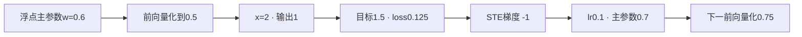

# 从模拟量化训练到真正的低比特执行

量化感知训练 QAT 可以让浮点参数在前向中经历舍入和截断，提前适应将来的离散表示。但训练时的浮点张量仍可能占用原来的存储。要获得显存和速度收益，还需要把码值打包，并由理解这种格式的 kernel 执行。

## 舍入的导数为什么造成困难

设 $\hat w=s\operatorname{round}(w/s)$，s固定。w在同一个格子内变化时，$\hat w$完全不变，导数几乎处处为0。直接使用这个导数，模型无法沿通常的梯度下降方向跨过量化格子。

常见 fake quant 前向仍用 $\hat w$，反向在未截断范围内近似取 $\partial\hat w/\partial w=1$，称为 straight-through estimator，即STE。它是人为定义的近似梯度，不能当成round的真实导数。截断区间外的梯度、scale是否可学等，要看具体量化器。

## 用一个参数看它怎样移动

教学设定为 $s=0.25,w=0.6,x=2$，目标输出1.5，损失 $L=\frac12(\hat wx-1.5)^2$。前向先把0.6量化到0.5，输出1，loss为0.125。STE给出的梯度为 $(1-1.5)\times2=-1$。

学习率0.1时，浮点w更新到0.7。下一次前向量化为0.75，输出恰为1.5。保存的可训练浮点值跨过了一个舍入边界，前向使用的码值才跟着改变。

如果每次更新都立即把主参数永久舍入，细小变化可能反复丢失。QAT通常需要区分可训练主参数与用于前向的近似值。训练是否稳定还取决于量化插入位置、尺度估计和数据，不能保证所有QAT都优于PTQ。

<!-- systems-workflow-visual -->

离散前向与浮点主参数更新分开保存，STE提供近似反向方向。

## Fake quant 之后还要经过 packing

假设模拟量化得到两个无符号码值3和12。它们可打包成一个字节 $3+(12\ll4)=195$。运行时分别用 `byte & 15` 和 `(byte >> 4) & 15` 取出，再结合scale和zero point恢复数值。

AWQ源码把 `pseudo_quantize_model_weight` 与 `real_quantize_model_weight` 分开，就是一个清楚的实现例子。模拟阶段适合检查误差，真实阶段构造包含打包权重的线性层。若推理先把整模型恢复为BF16常驻显存，文件虽小，设备上的权重压缩收益就没有保住。

{ width="690" }

<small>图源：`A Survey of Low-bit Large Language Models`，Figure 5。原论文图意：展示 quantized weight preparation、weight-only quantization 和 weight & activation quantization 的数据传输过程。</small>

## 量化格式写在 checkpoint 上，速度还要看执行路径

W4A16、W8A8 和 FP8 说的是权重与激活采用什么表示，不能直接当成端到端速度结论。W4A16 主要减少权重存储和搬运，矩阵乘中仍可能需要把权重解包或转换；W8A8、FP8 则让激活也进入低精度计算，但要求对应的 Tensor Core、累加精度和 kernel 都能接上；KV cache 量化只改变历史状态的存储与读取，权重格式可以完全不同。

| 路径 | 主要省下什么 | 额外依赖 | 最容易漏掉的检查 |
| --- | --- | --- | --- |
| W4A16 / AWQ / GPTQ | 权重显存和权重带宽 | 打包布局、反量化 GEMM 或专用 kernel | 是否发生整层 BF16 fallback |
| W8A8 / FP8 | 权重和激活的计算、搬运 | 硬件低精度指令、scale 传播、累加策略 | scale 是否与真实输入分布匹配 |
| FP8 或更低比特 KV | KV cache 容量和 attention 读带宽 | K/V 的量化粒度、scale 生命周期、attention backend | 长上下文中 logits 和首 token 延迟是否漂移 |

当前 [vLLM 稳定版量化文档](https://docs.vllm.ai/en/stable/features/quantization/)把 AutoAWQ、GPTQ、FP8 W8A8、INT4 W4A16、INT8 W4A8 和 INT8 W8A8 分开列出，并单独列出硬件兼容性。文档也明确提醒兼容表会随实现变化。TensorRT-LLM 的[量化文档](https://nvidia.github.io/TensorRT-LLM/features/quantization.html)则把 FP8 per-tensor、block scaling、rowwise、FP8/NVFP4 KV cache、W4A16/W4A8 AWQ 和 GPTQ 分成不同 recipe。使用某个 checkpoint 前，应同时查格式、backend 和目标 GPU，不能只看文件名里的 bit 数。

一个实际排查顺序是：先确认权重是否以目标格式常驻设备，再看 profiler 中 GEMM 使用的 kernel，最后测完整请求的 TTFT、TPOT、峰值显存和吞吐。只看到模型文件从 16 GB 变成 4 GB，不能推出服务会快四倍；如果每层都在 kernel 前反量化到 BF16，收益可能主要停留在加载阶段。

## KV 量化沿用表示原理，但状态生命周期不同

权重加载后基本固定，KV随着每个新token产生。一个请求在L层、$H_{kv}$个KV头、头维d、T个历史token、每元素b字节时，KV主体存储为

$$
M_{KV}=2LTH_{kv}db.
$$

例如L=32、$H_{kv}=8$、d=128、T=32768，BF16主体为4GiB。若改为每元素1字节，主体理论上变为2GiB，还需加尺度、页表和对齐等开销。

写入时必须知道对应scale；读取attention时必须按同样约定恢复。K的误差改变打分 $qk^\top$，V的误差改变加权输出，两者经过softmax的路径不同。因此同样的位宽未必适合相同粒度。

{ width="620" }

<small>图源：`A Survey of Low-bit Large Language Models`，Figure 6。原论文图意：quantized KV cache 减少缓存存储和数据传输，并在 attention forward 前 dequantize。</small>

### K 和 V 可以采用不同量化粒度

KIVI 的 [论文摘要](https://arxiv.org/abs/2402.02750)报告了一项很具体的观察：在其研究的模型和设置中，K cache 更适合按 channel 分组，V cache 更适合按 token 分组，并据此提出免调参的 2-bit KV cache 方案。这个结论不能直接改写成“所有模型的 K 都按 channel、V 都按 token”，但它说明 K/V 不一定应该共享同一个 scale 维度。

vLLM 的[量化 KV cache 文档](https://docs.vllm.ai/en/stable/features/quantization/quantized_kvcache/)给出了另一组工程接口。FP8 KV cache 可以使用 per-tensor scale，也可以使用 per-attention-head scale；后者在当前文档中要求 FlashAttention backend 和 llm-compressor 提供的校准路径。没有校准时，文档示例把 scale 设为 1.0；使用数据集校准时，scale 来自选定的样本分布。某些 sliding-window attention 层还可以通过 `--kv-cache-dtype-skip-layers` 留在原始精度。

因此 KV 量化的实验不能只写一个 `kv_cache_dtype=fp8`。至少应把以下信息一起记在配置里：K/V 的量化粒度、scale 是固定还是校准得到、校准集的文本长度和来源、哪些层被跳过、attention backend、上下文长度和生成任务。更换任意一项，都可能改变误差位置和 cache 的读取路径。

## 把误差定位到 cache 写入、读取和采样三段

长上下文出现质量下降时，先不要只比较最终字符串。可以固定 prompt、随机种子和采样参数，保存一条 BF16 基线与一条量化路径的中间结果。

| 对照位置 | 建议保存的量 | 能回答的问题 |
| --- | --- | --- |
| Cache 写入后 | 每层 K/V 的 scale、min/max、量化码值直方图 | 是否在写入时就饱和或错位 |
| Attention 读取后 | \(qk^\top\)、softmax 输出、加权 V 的误差 | K 的打分误差还是 V 的内容误差更大 |
| 每步 logits | top-k token、最大 logit、熵 | 误差从哪一步开始进入采样 |
| 最终输出 | 文本、停止原因、生成长度 | 质量变化是否只是采样路径放大 |
| 服务层 | TTFT、TPOT、cache 命中、峰值显存 | 量化是否真的改变了线上瓶颈 |

如果 K 的误差很小而 V 的误差明显，优先调整 V 的粒度或 scale；如果前几步 logits 已经大幅变化，先检查写入布局和反量化顺序；如果 logits 接近但最终文本差异很大，应把温度、top-p 和随机种子固定后再判断。这样的分段记录比用一个平均 perplexity 猜原因更容易定位 kernel 或状态生命周期错误。

## 训练模拟应尽量对齐部署路径

若训练用per-channel scale，部署只支持per-tensor；或者训练模拟BF16累加，实际kernel采用另一种中间精度，二者优化的函数就不同。先用同一小张量对齐fake quant与真实kernel，再扩展到层输出、完整模型和服务负载。

KV量化还要加入长上下文与重复生成测试，因为误差在每一步都会参与新预测。这里只推导存储和数值路径，没有测得某模型可接受的最低bit数。

## QAT 验收要跨过三个实现边界

第一步确认 fake quant 的前向输出与量化约定一致；第二步用同一小张量对照真实 packing 和 dequant；第三步把真实 kernel 放回长上下文或完整服务。只在第一步看到 loss 下降，不能证明保存的 checkpoint 能由目标 runtime 执行；只在短上下文看到输出接近，也不能推出 KV 误差在长序列中不会累积。

对 KV cache 还要把写入和读取分开测试。写入阶段检查位置、页和 scale 是否对应，读取阶段检查 K 的打分误差、V 的输出误差和 softmax 稳定性。若只有最终文本不同，先回到每层 attention 输出和每步 logits，避免把采样随机性误判成量化问题。

一条更完整的验收记录可以按下面的顺序保存。每一步都应保留配置和硬件信息，避免把不同 backend 的结果混成一条曲线。

1. **码值对齐**：同一小张量在 fake quant、packing、dequant 和真实 kernel 间逐元素对照，记录最大绝对误差和相对误差。
2. **层输出对齐**：固定输入，逐层比较 BF16 与量化路径的 hidden state、attention 输出和 logits，找到第一个明显分叉的层。
3. **任务质量**：在固定数据集、采样策略和上下文长度下比较 perplexity、准确率或任务成功率；不要只挑一组容易的 prompt。
4. **长度扫描**：至少覆盖短上下文、接近训练长度和接近服务上限的输入，记录误差是否随 token 数累积。
5. **服务成本**：用同一 batch、并发和 warmup 测 TTFT、TPOT、p50/p95、峰值显存以及 fallback 次数。

只有前两步通过，才有理由把后面的任务差异归因于量化近似；只有第五步改善，才可以说部署成本下降。论文中的速度和质量数字仍然属于它们的模型、硬件和测试协议，不能替代本地测量。

## 继续读

量化验收后，继续看[推理缓存、路由与投机](../inference/caching-routing-and-speculative.md)、[低精度 kernel](../operators/low-precision-and-quantized-kernels.md)和[测试、回归与维护](../operators/testing-regression-and-maintenance.md)。

## 对照源码与延伸阅读

- [模拟量化与真实打包的两个实现入口](https://github.com/mit-han-lab/llm-awq/blob/d6e797a42b9ef7778de8ee2352116e0f48a78d61/awq/quantize/quantizer.py)
- [vLLM 量化格式与硬件兼容性](https://docs.vllm.ai/en/stable/features/quantization/)
- [vLLM FP8 KV cache 与校准](https://docs.vllm.ai/en/stable/features/quantization/quantized_kvcache/)
- [TensorRT-LLM 量化 recipes](https://nvidia.github.io/TensorRT-LLM/features/quantization.html)
- [KIVI 论文摘要](https://arxiv.org/abs/2402.02750)

**来源与改编说明**：STE 与 fake quant 说明参考量化训练的一般定义，模拟/真实打包边界对照 [AWQ quantizer](https://github.com/mit-han-lab/llm-awq/blob/d6c797a42b9ef7778de8ee2352116e0f48a78d61/awq/quantize/quantizer.py)；vLLM 和 TensorRT-LLM 文档用于核对当前格式、backend、校准和 KV cache 接口；KIVI 用于说明 K/V 量化粒度可能不同。KV 存储式、误差分段和验收表是本站可计算或可执行的教学组织，未声称某个模型的最低可用 bit 数，也没有在本站声称复现这些项目的 benchmark。
