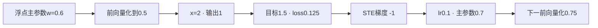
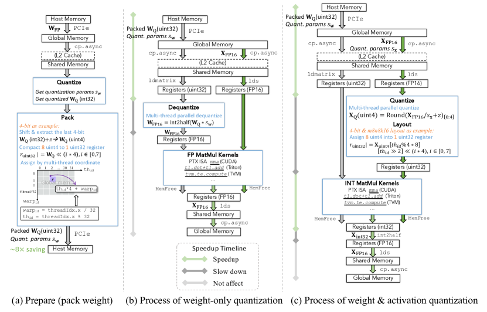
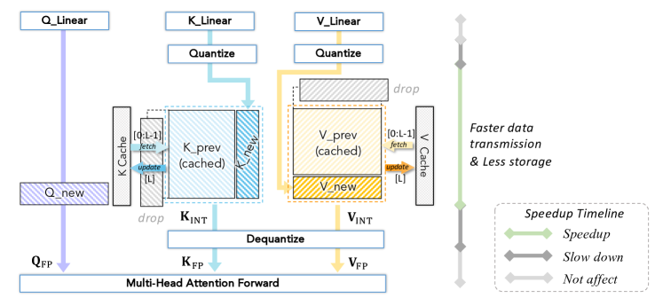

# 从模拟量化训练到真正的低比特执行

量化感知训练 QAT 可以让浮点参数在前向中经历舍入和截断，提前适应将来的离散表示。但训练时的浮点张量仍可能占用原来的存储。要获得显存和速度收益，还需要把码值打包，并由理解这种格式的 kernel 执行。

## 舍入的导数为什么造成困难

设 $\hat w=s\operatorname{round}(w/s)$，s固定。w在同一个格子内变化时，$\hat w$完全不变，导数几乎处处为0。直接使用这个导数，模型无法沿通常的梯度下降方向跨过量化格子。

常见 fake quant 前向仍用 $\hat w$，反向在未截断范围内近似取 $\partial\hat w/\partial w=1$，称为 straight-through estimator，即STE。它是人为定义的近似梯度，不能当成round的真实导数。截断区间外的梯度、scale是否可学等，要看具体量化器。

## 用一个参数看它怎样移动

教学设定为 $s=0.25,w=0.6,x=2$，目标输出1.5，损失 $L=\frac12(\hat wx-1.5)^2$。前向先把0.6量化到0.5，输出1，loss为0.125。STE给出的梯度为 $(1-1.5)\times2=-1$。

学习率0.1时，浮点w更新到0.7。下一次前向量化为0.75，输出恰为1.5。保存的可训练浮点值跨过了一个舍入边界，前向使用的码值才跟着改变。

如果每次更新都立即把主参数永久舍入，细小变化可能反复丢失。QAT通常需要区分可训练主参数与用于前向的近似值。训练是否稳定还取决于量化插入位置、尺度估计和数据，不能保证所有QAT都优于PTQ。

<!-- systems-workflow-visual -->

离散前向与浮点主参数更新分开保存，STE提供近似反向方向。

## Fake quant 之后还要经过 packing

假设模拟量化得到两个无符号码值3和12。它们可打包成一个字节 $3+(12\ll4)=195$。运行时分别用 `byte & 15` 和 `(byte >> 4) & 15` 取出，再结合scale和zero point恢复数值。

AWQ源码把 `pseudo_quantize_model_weight` 与 `real_quantize_model_weight` 分开，就是一个清楚的实现例子。模拟阶段适合检查误差，真实阶段构造包含打包权重的线性层。若推理先把整模型恢复为BF16常驻显存，文件虽小，设备上的权重压缩收益就没有保住。

{ width="690" }

<small>图源：`A Survey of Low-bit Large Language Models`，Figure 5。原论文图意：展示 quantized weight preparation、weight-only quantization 和 weight & activation quantization 的数据传输过程。</small>

## KV 量化沿用表示原理，但状态生命周期不同

权重加载后基本固定，KV随着每个新token产生。一个请求在L层、$H_{kv}$个KV头、头维d、T个历史token、每元素b字节时，KV主体存储为

$$
M_{KV}=2LTH_{kv}db.
$$

例如L=32、$H_{kv}=8$、d=128、T=32768，BF16主体为4GiB。若改为每元素1字节，主体理论上变为2GiB，还需加尺度、页表和对齐等开销。

写入时必须知道对应scale；读取attention时必须按同样约定恢复。K的误差改变打分 $qk^\top$，V的误差改变加权输出，两者经过softmax的路径不同。因此同样的位宽未必适合相同粒度。

{ width="620" }

<small>图源：`A Survey of Low-bit Large Language Models`，Figure 6。原论文图意：quantized KV cache 减少缓存存储和数据传输，并在 attention forward 前 dequantize。</small>

## 训练模拟应尽量对齐部署路径

若训练用per-channel scale，部署只支持per-tensor；或者训练模拟BF16累加，实际kernel采用另一种中间精度，二者优化的函数就不同。先用同一小张量对齐fake quant与真实kernel，再扩展到层输出、完整模型和服务负载。

KV量化还要加入长上下文与重复生成测试，因为误差在每一步都会参与新预测。这里只推导存储和数值路径，没有测得某模型可接受的最低bit数。

## 对照源码与延伸阅读

- [模拟量化与真实打包的两个实现入口](https://github.com/mit-han-lab/llm-awq/blob/d6e797a42b9ef7778de8ee2352116e0f48a78d61/awq/quantize/quantizer.py)
