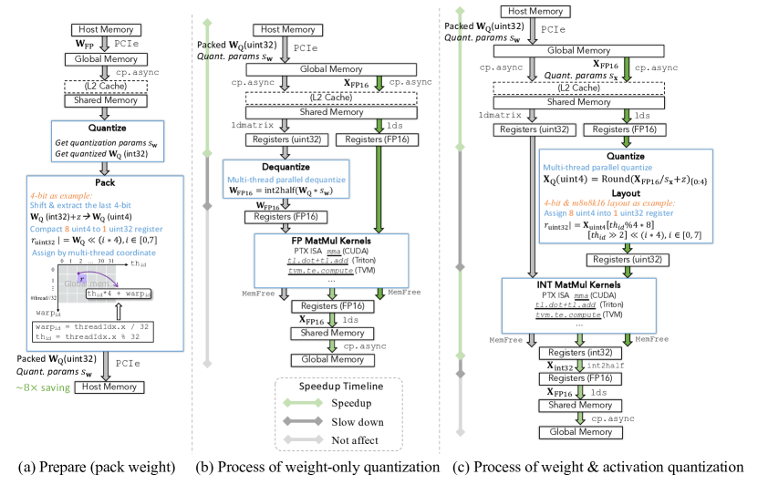
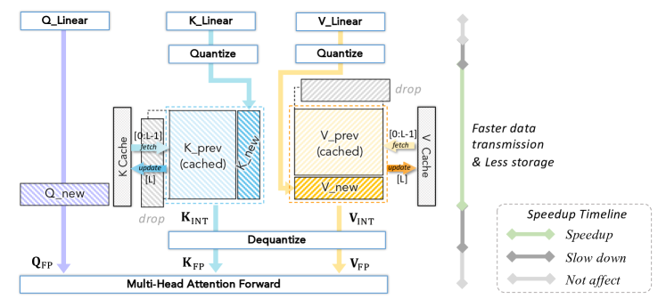
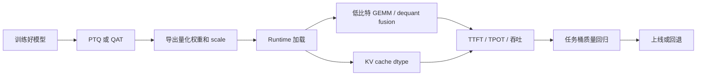

# QAT、Kernel 与 KV Cache

这一页把三件常被混在一起的事情拆开：`QAT` 解决模型怎样适应量化误差，`kernel` 决定低比特是否真的跑得快，`KV cache quantization` 解决长上下文推理里的动态显存和带宽。

!!! note "初学者先抓住"
    QAT 是训练方法，kernel 是执行路径，KV cache 是推理时不断增长的缓存。它们都和量化有关，但不在同一层。

## 1. QAT 在优化什么

QAT，quantization-aware training，会在训练时模拟量化误差。一个简化目标可以写成：

\[
\min_\theta\ \mathcal{L}(f_{\hat{\theta}}(x),y)
\]

| 符号 | 含义 |
| --- | --- |
| \(\theta\) | 原始模型参数 |
| \(\hat{\theta}\) | 前向中经过 fake quant 或低比特模拟的参数 |
| \(x\) | 训练输入 |
| \(y\) | 标签或目标输出 |
| \(f_{\hat{\theta}}(x)\) | 带量化噪声的模型输出 |
| \(\mathcal{L}\) | 训练损失 |

**读作什么**：训练时就让模型看到量化后的自己，让它学会在低比特误差存在时仍然输出正确结果。

### fake quant 怎么理解

训练中常见 fake quant 形式：

\[
\hat{x}=s\left(\mathrm{round}\left(\frac{x}{s}\right)-z\right)
\]

| 符号 | 含义 |
| --- | --- |
| \(x\) | 高精度训练张量 |
| \(\hat{x}\) | 模拟量化再反量化后的张量 |
| \(s,z\) | scale 和 zero-point |

**读作什么**：前向时加入量化误差，反向时通常用近似梯度让训练能继续。这和 PTQ 的区别是：PTQ 是训练完才压，QAT 是训练时就适应。

## 2. 什么时候值得做 QAT

| 场景 | 为什么 PTQ 可能不够 |
| --- | --- |
| 低到 4bit/2bit 或更激进 | 误差太大，单纯校准难恢复 |
| W&A 同时量化 | activation 动态变化大 |
| 高质量生产服务 | 关键任务掉点不可接受 |
| 多模态/VLA | 视觉、动作、安全头更敏感 |
| 特定硬件低比特路径 | 模型要配合硬件格式和 kernel |

**一句话**：PTQ 是低成本起点；QAT 是质量门槛更高时，让模型主动适应低比特。

## 3. Kernel 决定收益是否兑现

量化线性层不只是 \(Y=XW\)，真实执行常包含：

```text
load packed low-bit weight
-> load scale / zero-point
-> unpack
-> dequant or low-bit matmul
-> accumulate
-> output cast
```

两条常见路径：

| 路径 | 发生什么 | 主要收益 | 风险 |
| --- | --- | --- | --- |
| weight-only + dequant | 权重低比特存储，计算前反量化到 FP16/BF16 | 省权重显存和带宽 | GEMM 本身未必低比特 |
| W&A low-bit kernel | 权重和激活都低比特，直接走 INT/FP8 matmul | 有机会同时省带宽和计算 | 对硬件、layout、scale 粒度要求高 |

!!! warning "常见误解"
    “runtime 支持 INT4”不等于每个请求都走高效 INT4 kernel。实际可能因为模型结构、group size、GPU 架构、batch shape 或 LoRA 组合而 fallback。

## 4. Q/DQ、packing、dequant fusion 分别是什么

| 名称 | 含义 | 初学者理解 |
| --- | --- | --- |
| Q | quantize，把浮点转低比特 | 把数塞进格子 |
| DQ | dequantize，把低比特还原近似浮点 | 取出来再乘 scale |
| packing | 把多个低比特值塞进一个更大 word | 例如 8 个 INT4 放进 32bit |
| fusion | 把 dequant 和 GEMM 等操作合并 | 减少中间读写和 kernel launch |
| accumulation | 矩阵乘累加精度 | 低比特输入常用更高精累加 |

**读作什么**：量化收益常常死在 Q/DQ 和 scale 读取上。好的 kernel 会尽量把 unpack、scale 和 matmul 融合进一条高效路径。

{ width="900" }

<small>图源：`A Survey of Low-bit Large Language Models`，Figure 5。原论文图意：展示 quantized weight preparation、weight-only quantization 和 weight & activation quantization 的数据传输过程。</small>

!!! note "图解：怎么读这张系统图"
    左边是离线准备和 packing；中间是 weight-only，搬运低比特权重但计算前可能 dequant 到 FP；右边是 W&A，目标是让 activation 和 MatMul 也进入低比特路径。绿色箭头是潜在收益，灰色箭头是新增开销。

## 5. KV cache 为什么是长上下文主角

生成模型每生成一个 token，都要保存每层历史 token 的 Key 和 Value。KV cache 显存可粗略估算为：

\[
\mathrm{KV\ Memory}\approx2\times L\times B\times T\times H_{\text{kv}}\times d_h\times \mathrm{bytes}
\]

| 符号 | 含义 |
| --- | --- |
| \(2\) | K 和 V 两份缓存 |
| \(L\) | Transformer 层数 |
| \(B\) | batch 或并发序列数 |
| \(T\) | 上下文长度 |
| \(H_{\text{kv}}\) | KV head 数 |
| \(d_h\) | 每个 head 的维度 |
| \(\mathrm{bytes}\) | 每个元素占用字节数 |

**读作什么**：上下文越长、并发越高、层数越多，KV cache 越大。权重已经量化后，KV cache 可能成为新的显存瓶颈。

{ width="820" }

<small>图源：`A Survey of Low-bit Large Language Models`，Figure 6。原论文图意：quantized KV cache 减少缓存存储和数据传输，并在 attention forward 前 dequantize。</small>

!!! note "图解：KV 量化省在哪里"
    图里的低比特 KV 主要省缓存存储和读写带宽。attention 真正计算前可能仍然要 dequant，所以要同时看显存下降、decode 带宽、dequant 开销和长程任务质量。

## 6. KV 量化的小账

假设：

| 变量 | 值 |
| --- | --- |
| \(L\) | 32 层 |
| \(B\) | 8 |
| \(T\) | 16k |
| \(H_{\text{kv}}d_h\) | 4096 |
| BF16 bytes | 2 |

则：

\[
2\times32\times8\times16384\times4096\times2\approx64\mathrm{GiB}
\]

如果 KV 改成 INT8，bytes 从 2 降到 1，理论上 KV 本体接近减半。但实际还要加 scale 元数据、page 管理、碎片、workspace，以及 dequant 成本。

## 7. KV cache 量化的质量风险

| 风险 | 表现 |
| --- | --- |
| 长程记忆变弱 | 前文事实引用错、跨段一致性下降 |
| attention 排名变化 | 原本应该关注的 token 被弱化 |
| 工具/代码任务掉点 | 细节 token、括号、变量名更容易丢 |
| 多轮对话漂移 | 越到后面越不稳定 |
| VLA/世界模型 drift | 长 horizon 状态和风险判断变差 |

**验收重点**：KV 量化不能只看短问答。必须看长文档、代码、多轮、RAG 引用、长推理和业务高风险样本。

## 8. QAT、kernel、KV 的端到端链路



这张图的重点是：QAT 只解决模型能否适应量化误差；kernel 才决定速度；KV cache 决定长上下文并发；最终仍要由任务桶质量决定是否可上线。

## 9. 实践检查清单

| 问题 | 要看什么 |
| --- | --- |
| QAT 是否值得做 | PTQ 掉点是否不可接受，训练预算是否允许 |
| 低比特 kernel 是否命中 | profiler、kernel name、fallback、dequant 时间 |
| scale 粒度是否匹配 kernel | group size、alignment、layout |
| packing 是否带来收益 | 权重加载带宽、unpack 开销 |
| KV 量化是否划算 | 长上下文显存、TPOT、任务一致性 |
| 是否有回退路径 | 敏感层保高精、KV dtype 可切换、全精 checkpoint |

## 10. 小结

QAT、kernel 和 KV cache 是量化落地的三块拼图。QAT 让模型适应误差，kernel 把低比特转成真实速度，KV cache 解决长上下文动态显存。只有三者和任务质量一起过关，量化才算从论文数字变成可用系统。
