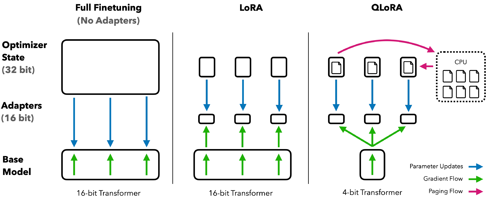

# QLoRA 与量化训练

QLoRA 很容易被误解成“把模型训练成 4bit”。更准确地说，它是在低比特存储的冻结底座上，训练一小组 LoRA adapter，从而把微调显存大幅降下来。

!!! note "读法定位"
    这页先回答“QLoRA 与量化训练”在「量化」里的位置：它解决什么局部问题，依赖哪些前置，最后会影响哪类工程或研究判断。
    **前置**：先懂张量、线性层和基本推理成本；遇到 FP8、KV Cache、outlier 时回前置页补概念。 必要时先回 [量化入口](index.md)、[基础知识](../foundations/index.md) 或 [术语表](../glossary/index.md)。
    **主线关系**：把数值格式、误差来源、校准/训练方法、kernel 和服务部署连成一条效率链，而不是只比较 bit 数。

{ width="760" }

<small>图源：[QLoRA: Efficient Finetuning of Quantized LLMs](https://arxiv.org/abs/2305.14314)，Figure 1。原论文图意：对比普通 32-bit/16-bit 微调、LoRA 与 QLoRA 的显存组织；QLoRA 将冻结底座量化存储，只训练 adapter，并通过分页机制缓解显存峰值。</small>

!!! note "图解：先看哪些东西在训练"
    全量微调要保存可训练权重、梯度、optimizer state 和激活；LoRA 冻结底座，只训练小 adapter；QLoRA 再把冻结底座用 4bit 存储。图里的关键不是“4bit”标签，而是 optimizer 主要服务少量 adapter，底座不再全量训练。

## LoRA 先解决什么

全量微调会更新整个权重 \(W\)。LoRA 改成只训练一个低秩增量：

\[
W'=W+\Delta W
\]

\[
\Delta W=BA
\]

| 符号 | 含义 | 常见 shape |
| --- | --- | --- |
| \(W\) | 原始模型权重，通常冻结 | \(d_{\text{out}}\times d_{\text{in}}\) |
| \(W'\) | 适配任务后的有效权重 | 同 \(W\) |
| \(\Delta W\) | LoRA 学到的权重增量 | 同 \(W\) |
| \(A\) | LoRA 降维矩阵 | \(r\times d_{\text{in}}\) |
| \(B\) | LoRA 升维矩阵 | \(d_{\text{out}}\times r\) |
| \(r\) | rank，低秩瓶颈维度 | 远小于 \(d_{\text{in}},d_{\text{out}}\) |

**读作什么**：不直接改大矩阵 \(W\)，只训练两个小矩阵 \(A,B\)，它们相乘得到一个低秩增量 \(\Delta W\)。

**小账**：如果 \(d_{\text{in}}=d_{\text{out}}=4096\)，全量权重约 \(4096^2\approx16.8M\) 参数。若 \(r=16\)，LoRA 只需 \(4096\times16+16\times4096\approx0.13M\) 参数，少两个数量级。

## QLoRA 比 LoRA 多做了什么

QLoRA 把冻结底座量化存储：

\[
W_{\text{base}}\approx \hat{W}_{\text{4bit}}
\]

然后训练 LoRA adapter：

\[
W'=\hat{W}_{\text{4bit}}+BA
\]

| 符号 | 含义 |
| --- | --- |
| \(W_{\text{base}}\) | 原始预训练底座权重 |
| \(\hat{W}_{\text{4bit}}\) | 4bit 存储、计算时可反量化的底座近似 |
| \(BA\) | 可训练 LoRA 增量 |
| \(W'\) | 推理时等效使用的适配权重 |

**读作什么**：底座负责保留大模型已有能力，adapter 负责学习新任务。底座低比特存储省显存，adapter 高精训练保证适配能力。

!!! warning "常见误解"
    QLoRA 不等于所有前向和反向都用 4bit。很多实现会把 4bit 权重反量化到 BF16/FP16 参与计算。它主要省的是冻结底座的存储显存和 optimizer 服务对象。

## QLoRA 的三个关键组件

| 组件 | 作用 | 初学者理解 |
| --- | --- | --- |
| 4bit quantized base | 冻结底座低比特存储 | 大楼主体不重建，只压低常驻成本 |
| LoRA adapter | 少量可训练参数 | 给大楼外挂小结构，适配新任务 |
| paged optimizer | 缓解显存峰值 | 防止长序列或大 batch 时 optimizer 暴涨 |

QLoRA 论文还常和 `NF4`、double quantization 相关：

| 名称 | 含义 | 为什么有用 |
| --- | --- | --- |
| NF4 | 面向近似正态权重分布的 4bit 格式 | 比普通 INT4 更适合权重分布 |
| double quantization | 再量化 scale 等元数据 | 进一步压缩量化元数据 |
| paged optimizer | 使用分页机制管理 optimizer state | 缓解训练峰值显存 |

## Rank、alpha 和 dropout 在控制什么

LoRA 实际常写成：

\[
W'=W+\frac{\alpha}{r}BA
\]

| 符号 | 含义 |
| --- | --- |
| \(r\) | rank，adapter 容量 |
| \(\alpha\) | LoRA scaling，控制增量强度 |
| \(\alpha/r\) | 常用归一化缩放 |
| dropout | 训练时随机丢弃部分 adapter 输入或路径 |

**读作什么**：rank 决定 adapter 能表达多复杂的变化；alpha 决定这个变化打到原模型上的强度；dropout 用来降低过拟合。

| 参数太小 | 参数太大 |
| --- | --- |
| rank 太小会学不动复杂任务 | rank 太大显存和过拟合风险增加 |
| alpha 太小适配弱 | alpha 太大可能破坏底座能力 |
| dropout 太低可能过拟合 | dropout 太高可能欠拟合 |

## QLoRA 和部署量化不是一回事

| 名称 | 目的 | 是否训练 | 典型问题 |
| --- | --- | --- | --- |
| PTQ/GPTQ/AWQ | 把已训练模型压低 bit 部署 | 否 | 质量掉点、kernel 是否支持 |
| QLoRA | 在低显存下微调模型 | 是，只训练 adapter | 适配够不够、数据质量如何 |
| QAT | 训练时模拟量化误差，让模型适应低比特 | 是 | 成本高、流程复杂 |
| 全量低比特训练 | 从训练过程就用低精度数值系统 | 是 | 稳定性、scale、kernel、长跑发散 |

**读作什么**：QLoRA 主要解决“我显存不够，但想微调”。部署量化主要解决“我模型训好了，想上线更省”。

## 为什么量化底座后还能训练

QLoRA 能工作，依赖几个假设：

| 假设 | 含义 |
| --- | --- |
| 底座能力仍在 | 4bit 近似没有摧毁原模型主要能力 |
| 任务变化可低秩表达 | 新任务不需要大幅重写全模型 |
| adapter 容量足够 | rank 和 target modules 能覆盖任务所需变化 |
| 计算精度受保护 | 关键计算路径不会完全被 4bit 噪声支配 |

**直觉**：如果新任务只是行业问答、格式适配、风格调整，少量 adapter 往往够用；如果任务要求模型学会全新推理技能或跨模态结构，QLoRA 可能吃力。

## target modules 为什么关键

LoRA 通常不会插到所有层所有矩阵上，而是选择目标模块：

| 模块 | 常见作用 | 是否常见 |
| --- | --- | --- |
| \(W_q,W_k,W_v,W_o\) | attention 投影 | 很常见 |
| up/down/gate projection | MLP/SwiGLU 路径 | 常见 |
| embedding/lm head | 词表相关能力 | 任务相关 |
| projector/connector | 多模态对齐 | 多模态时重要 |
| action/risk head | 控制和安全输出 | VLA 中要谨慎 |

!!! tip "实用判断"
    target modules 选得太少，adapter 可能学不动；选得太多，显存和过拟合风险上升。多模态或 VLA 任务还要重点考虑 projector、动作头和风险头是否该训练或保高精。

## 什么时候 QLoRA 最合适

| 场景 | 为什么适合 |
| --- | --- |
| 领域问答适配 | 底座已有语言能力，只需补领域风格和知识表达 |
| 企业代码助手 | 适配内部 API、格式和偏好 |
| 文档结构化抽取 | 学输出格式、字段约束和少量领域模式 |
| 对话风格调整 | 不必全量重训 |
| 单卡或低显存环境 | 底座量化存储显著省显存 |

**不太适合**：

| 场景 | 风险 |
| --- | --- |
| 任务需要改变基础能力边界 | adapter 容量可能不够 |
| 域偏移非常大 | 底座特征不匹配 |
| 数据质量差 | 小 adapter 更容易记住噪声 |
| 量化底座已经明显掉点 | adapter 要先补量化损伤，再学任务 |
| 严格实时/VLA 控制 | adapter 和量化误差可能影响动作稳定性 |

## QLoRA 训练时要记录什么

| 记录项 | 为什么重要 |
| --- | --- |
| base model 和量化配置 | NF4/INT4、group size、compute dtype 会影响结果 |
| target modules | 决定 adapter 覆盖范围 |
| rank/alpha/dropout | 决定容量和稳定性 |
| sequence length 与 batch | 影响激活显存和峰值 |
| optimizer 和 paged 设置 | 影响峰值显存和速度 |
| baseline 对照 | 要知道掉点来自量化、adapter，还是数据 |
| 合并/部署方式 | adapter 是否 merge，runtime 是否支持 |

## 和 QAT 的区别

QAT 的目标常写成：

\[
\min_\theta \mathcal{L}(f_{\hat{\theta}}(x),y)
\]

| 符号 | 含义 |
| --- | --- |
| \(\theta\) | 模型参数 |
| \(\hat{\theta}\) | 训练中模拟量化后的参数或激活 |
| \(f_{\hat{\theta}}(x)\) | 带量化噪声的前向输出 |
| \(\mathcal{L}\) | 任务损失 |

**读作什么**：QAT 在训练时就把量化误差放进前向过程，让模型学会适应低比特。QLoRA 则主要是冻结低比特底座，只训练 adapter。

| 对比 | QLoRA | QAT |
| --- | --- | --- |
| 目标 | 低资源微调 | 让量化模型更稳 |
| 训练对象 | LoRA adapter | 可能是全模型或部分模块 |
| 成本 | 相对低 | 通常更高 |
| 部署含义 | adapter + 量化底座 | 量化模型本身更适应低比特 |

## 一个医疗问答例子

假设要把 7B 通用模型适配到医疗问答：

1. 用 QLoRA 载入 4bit 底座，只训练 attention 和 MLP 的 LoRA。
2. 保持 compute dtype 为 BF16，避免训练计算完全受 4bit 噪声限制。
3. 校验通用问答、医疗术语、拒答安全、长病历摘要。
4. 如果医疗长文档掉点，先检查 sequence length、target modules 和数据，而不是直接提高 rank。
5. 部署时确认 runtime 能加载量化底座和 adapter，或明确是否 merge。

## 本页结论

QLoRA 的价值在于让低资源微调变得可行：底座低比特存储，adapter 高效训练，optimizer 主要服务小参数集。它不是 PTQ 的替代品，也不是 QAT 的同义词。读 QLoRA 时，最重要的是分清：省的是微调显存，不一定自动得到端到端最快的低比特部署。

!!! tip "下一站"
    - 回到本专题入口：[量化](index.md)，确认这页在整条路线中的位置。
    - 按导航顺序继续：[QAT、Kernel 与 KV Cache](qat-kernels-and-kv-cache.md)。
    - 概念或符号卡住时，先查 [术语表](../glossary/index.md)，再回到当前页。
