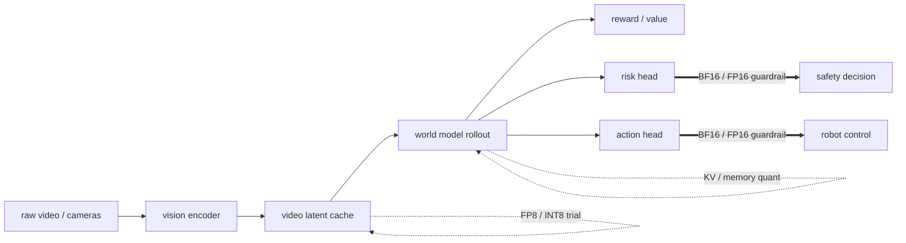

# 多模态与 VLA 模型量化

量化在 LLM 上已相对成熟，但到了 VLM、视频模型、VLA 和具身系统，问题会明显复杂化。原因不只是模型更大，而是输入分布更杂、模块更多、对细粒度结构和时序稳定性的要求更高。一个在文本问答上还能接受的量化误差，到了文档理解、UI grounding 或机器人动作生成中，可能就会被放大成明显错误。因此，多模态与 VLA 模型量化需要比“压参数”更细的思路。

<!-- [补充] -->
| 读者 | 建议读法 | 工程落点 |
| --- | --- | --- |
| 初学者 | 先抓“多模态与 VLA 模型量化”要解决的问题、关键术语和最小例子；公式只看变量方向。 | 能说清输入、输出和常见失败信号。 |
| 工程师 | 直接对照结构、指标、成本和边界条件，必要时回到前置页补概念。 | 落到数据、算力、延迟、显存、评测和回滚检查。 |

!!! note "合并提示"
    **note · 读法定位**

    这页先回答“多模态与 VLA 模型量化”在「量化」里的位置：它解决什么局部问题，依赖哪些前置，最后会影响哪类工程或研究判断。
    **前置**：先懂张量、线性层和基本推理成本；遇到 FP8、KV Cache、outlier 时回前置页补概念。 必要时先回 [量化入口](index.md)、[基础知识](../foundations/index.md) 或 [术语表](../glossary/index.md)。
    **主线关系**：把数值格式、误差来源、校准/训练方法、kernel 和服务部署连成一条效率链，而不是只比较 bit 数。

    **note · 初学者先抓住**

    多模态量化最怕“平均看起来没问题，关键细节坏了”。文档数字、UI 坐标、表格边界、动作头输出和时序一致性都可能对低精度误差很敏感，因此校准集和评测集必须覆盖这些长尾。

    **note · 难点解释：为什么 VLA 比聊天模型更谨慎**

    聊天模型量化后偶尔措辞变差，用户还能追问；VLA 量化后一个小动作偏差可能在闭环里累积成抓取失败或碰撞风险。它评估的是时序控制稳定性，不只是单步回答质量。

    **example · 有趣例子：发票小数点和机械臂夹爪**

    文档 VLM 少看一个小数点，金额就可能错一百倍；VLA 动作头偏一点，夹爪就可能碰到杯沿。多模态量化要保护的往往不是平均语义，而是这些小而关键的结构。

## 为什么多模态模型更敏感

多模态系统通常由视觉编码器、文本编码器或 LLM 主干、跨模态投影层、OCR / grounding / 分类头等结构模块，以及动作头或控制头组成。

不同模块对量化误差的敏感性差异极大。视觉主干可能对轻微权重量化较稳，但跨模态投影和动作头往往对尺度偏差更敏感。

## 输入分布更异质

文本模型面对的是 token 序列；VLM / VLA 面对的则是自然图像、文档页、图表、UI 截图、视频帧、机器人 proprioception 和语言指令。

这些输入的统计差异很大，导致激活分布也更复杂。统一校准集若覆盖不够，很容易遗漏关键长尾。

## 跨模态投影为何关键

很多 VLM 把视觉特征投到语言模型空间，形式上类似：

$$
h_v' = W_p h_v.
$$

<!-- [补充：符号说明] -->
| 符号 | 含义 | 取值范围 / 常见值 |
| --- | --- | --- |
| \(h_v\) | 公式中的变量或中间量 | 按上下文定义 |
| \(W_p\) | 公式中的变量或中间量 | 按上下文定义 |

这个投影层若量化误差较大，可能直接损坏模态对齐，表现为图像信息进入 LLM 后被弱化、OCR 细节和版面关系丢失、grounding 位置偏差增大。

因此实际部署中，这类层常是混合精度保留重点。

## 文档与 OCR 场景的特殊敏感性

文档 VLM 对数字、小字体和结构关系极度敏感。量化误差一旦影响细粒度视觉特征、OCR token 对齐、表格边界、字段定位或数值 token 排序匹配，就会造成业务上不可接受的错误。这里“主观上看没啥区别”的图像特征变化，可能在财务或合规任务里非常致命。

## UI 与 grounding 场景的特殊敏感性

屏幕 agent 需要识别小按钮、相近文案和位置关系。量化后常见问题包括相邻元素区分度下降、位置回归抖动、状态文本细节丢失，以及多步操作中的错误累积。

因此 grounding 头、坐标回归相关层，以及与空间结构有关的模块，通常要比通用问答头更谨慎。

## VLA 的控制敏感性

在 VLA 中，量化误差不只是回答变差，而可能直接变成动作抖动、抓取失败或恢复困难。设动作预测为

$$
\hat{a}_t = f_\theta(o_t, l, h_t),
$$

<!-- [补充：符号说明] -->
| 符号 | 含义 | 取值范围 / 常见值 |
| --- | --- | --- |
| \(\hat{a}_t\) | 动作、优势或系数 | 动作空间/实数标量，依上下文而定 |
| \(\theta\) | 模型或策略参数 | 实值张量，形状由模型结构决定 |
| \(f\) | 公式中的变量或中间量 | 按上下文定义 |
| \(o_t\) | 公式中的变量或中间量 | 按上下文定义 |
| \(l\) | 损失或目标函数 | 实数标量，训练时按 batch 聚合 |
| \(h_t\) | 公式中的变量或中间量 | 按上下文定义 |

若量化后参数变为 $\tilde{\theta}$，误差可能在闭环中累积：

$$
\delta a_t = f_{\tilde{\theta}}(o_t,l,h_t) - f_\theta(o_t,l,h_t).
$$

<!-- [补充：符号说明] -->
| 符号 | 含义 | 取值范围 / 常见值 |
| --- | --- | --- |
| \(\delta\) | 公式中的变量或中间量 | 按上下文定义 |
| \(\theta\) | 模型或策略参数 | 实值张量，形状由模型结构决定 |
| \(a_t\) | 动作、优势或系数 | 动作空间/实数标量，依上下文而定 |
| \(f_{}\) | 公式中的变量或中间量 | 按上下文定义 |
| \(o_t\) | 公式中的变量或中间量 | 按上下文定义 |
| \(l\) | 损失或目标函数 | 实数标量，训练时按 batch 聚合 |

短期看 $\delta a_t$ 很小，但经过动力学滚动后，可能导致状态显著偏离。

## 时序一致性比单步精度更重要

<!-- [融合：算法基础] 来源：llm-algo-leetcode《20. Quantization W8A16 | 模型量化基础: INT8 绝对最大值量化与反量化 (Quantization)》-->
> **算法视角**：量化可以看成在权重或激活旁边维护 scale / zero-point，把高精度矩阵乘改写成“低比特存储 + 反量化或融合计算”的数据布局问题。
>
> 延伸阅读：[20. Quantization W8A16 | 模型量化基础: INT8 绝对最大值量化与反量化 (Quantization)](https://datawhalechina.github.io/llm-algo-leetcode/02_PyTorch_Algorithms/20_Quantization_W8A16.html)

<!-- [融合：复杂度分析] 来源：llm-algo-leetcode《20. Quantization W8A16 | 模型量化基础: INT8 绝对最大值量化与反量化 (Quantization)》-->
| 操作 | 时间复杂度 | 空间复杂度 | 说明 |
|------|-----------|-----------|------|
| 逐元素量化 / 反量化 | $O(N)$ | $O(N)$ 或按 block 存 scale | 关键收益通常来自带宽和存储减少，而不是渐进复杂度下降；参考：[对应章节](https://datawhalechina.github.io/llm-algo-leetcode/02_PyTorch_Algorithms/20_Quantization_W8A16.html) |
| 量化 GEMM | $O(MNK)$ | 权重侧约按 bit-width 缩放 | 反量化若能融合进 matmul epilogue，才更容易转成端到端收益。 |

对视频 VLM 和 VLA 而言，量化评估不能只看单帧或单步，而要检查多帧特征是否稳定、长序列动作是否漂移、恢复策略是否仍有效、低比特是否增加抖动和不确定性。

这意味着评测集必须包含时序任务，而不只是静态问答。

### 放到世界模型里：哪些能压，哪些要保

世界模型不是一个均匀 Transformer。它通常至少包含视频/视觉 latent、动作条件接口、未来预测 head、reward/value/risk head 和 policy/action head。量化时要按模块分配误差预算。

| 模块 | 能否积极量化 | 推荐起点 | 主要风险 | 验收方式 |
| --- | --- | --- | --- | --- |
| 视频 latent cache / memory | 可以尝试 | FP8 或 INT8 per-channel / per-token scale | 长时一致性下降、遮挡状态遗忘 | object permanence、latent rollout drift |
| 视觉 encoder 主干 | 中等积极 | INT8 / FP8，关键层混合精度 | 小物体、边界、OCR、抓取点退化 | grounding、contact boundary、坐标误差 |
| VLM/VLA connector | 谨慎 | BF16/FP16 或 FP8 小范围试点 | 模态对齐尺度漂移 | 图文对齐、动作敏感性 |
| action head / action expert | 保守 | BF16/FP16，最多对非关键 MLP 试 FP8 | 动作抖动、chunk 内误差累积 | action L2、jerk、闭环成功率 |
| risk / safety head | 很保守 | BF16/FP16 | 低估碰撞、滑落、越界概率 | calibration、near-miss recall、false negative |
| reward / value head | 谨慎 | FP16/BF16 或校准后 FP8 | imagined rollout 被错误奖励牵引 | value calibration、policy improvement |

一句话：视频 latent 和中间缓存可以先压，因为它们主要省显存和带宽；动作头、risk head 和安全相关分类器不能激进压，因为小误差会直接变成闭环风险。

这张图的意思是：低精度优先放在“缓存和中间状态”上试，不能先从安全决策和动作输出开刀。世界模型量化不是一条直线，而是一圈防火墙：越靠近真实控制和风险判断，越要保守。

### 视频 latent 能不能压：一个具体账

假设视频世界模型每个训练/rollout 起点保存 8 秒历史，采样 8Hz，共 64 个 latent frame。每帧 latent grid 是 \(16\times16=256\) token，hidden size 为 1024。

BF16 存储一条历史 latent 约为：

\[
64\times256\times1024\times2 \approx 33.6MB
\]

<!-- [补充：符号说明] -->
| 符号 | 含义 | 取值范围 / 常见值 |
| --- | --- | --- |
| 公式整体 | 本公式表达的变量关系 | 按上下文定义 |

这行可以先拆成 token 数：`64` 帧乘每帧 `256` 个 latent token，等于 `16,384` 个历史 token；每个 token 是 `1024` 维 BF16，所以是 \(16,384\times1024\times2\) bytes。它只是在算一条起点历史的 latent cache，不含后续 Transformer 的 KV cache、decoder 临时激活、候选动作分支和 dataloader 预取。

如果改成 FP8 / INT8 latent cache，理论存储约降到 16.8MB，再加 scale metadata。对大规模 imagined rollout 来说，这个数会被起点数和候选数放大：例如同时保留 `1024` 个起点，就是约 `34GB` BF16 latent history；每个起点再展开 `16` 条候选，就会把缓存、读取带宽和调度压力继续放大。但它不等于可以把所有视频训练目标都低精度化：

| 场景 | 可以压的部分 | 不建议压的部分 |
| --- | --- | --- |
| 离线 replay 读取 | 历史 latent cache、非关键背景 token | 监督标签、关键接触帧、失败 replay |
| imagined rollout | 远期 memory、候选轨迹缓存 | 当前窗口、动作分叉附近 latent |
| 部署推理 | 长时 memory、KV cache | risk head 输入、action head 输出 |

验收时不要只看视频重建误差。更关键的是低精 latent 下的三件事：同一状态接不同动作，未来是否仍分叉；遮挡物体是否仍被记住；风险概率是否仍能在滑落、碰撞、越界前上升。

### 7.3 长时一致性如何验收

低精视频 latent 最隐蔽的问题是“短片看不出来，长 rollout 才坏”。例如 2 秒预测里杯子还在桌上，12 秒后模型已经把杯子位置漂到另一侧；或者当前窗口里风险分数正常，遮挡 5 秒后 risk head 不再记得物体边缘。世界模型量化要专门做长时一致性回归。

| 验收桶 | 构造方式 | 看什么指标 | 常见低精失败 |
| --- | --- | --- | --- |
| 遮挡再出现 | 目标物体被手臂或人遮挡 2-6 秒后重新出现 | object ID consistency、位置误差、风险恢复时间 | 物体身份被重置，risk head 低估碰撞 |
| 动作分叉 | 固定历史，分别执行 left / right / push / grasp | future latent distance、ranking agreement、event accuracy | 不同动作未来变得太像 |
| 长任务记忆 | 30-120 秒任务，中途多次离开目标区域 | layout recall、subtask progress、memory hit rate | 模型忘记已完成步骤，重复抓同一物体 |
| 接触瞬间 | 抓取、插入、滑落、碰撞前后 1 秒高频片段 | contact event F1、near-miss recall、action jerk | 视频质量尚可，但接触事件错过 |
| 候选轨迹排序 | 同一状态下比较 8-32 条动作候选 | top-k ranking agreement、cost per success | BF16 排名第一的安全动作被低精版本排低 |

一个推荐的上线表述是：`FP8 latent cache 在普通短视频桶中 LPIPS 变化很小，但在遮挡再出现桶里 object ID consistency 从 97.8% 降到 94.1%，near-miss recall 降 2.3 个百分点，因此只用于远期 memory，不用于当前 2 秒窗口和 risk head 输入。` 这种结论比“平均指标掉 0.4%”更能指导部署。

## 校准集的扩展原则

多模态量化校准集应覆盖高分辨率文档与低质扫描、图表与表格、UI 截图与深浅色主题、视频关键帧、机器人长时轨迹片段，以及数字、公式、细粒度文本。

如果只用普通自然图像和短文本做校准，很多关键分布都没被看见。

## 混合精度在多模态系统中的实践

一个可行思路往往是：视觉 backbone 主体低比特，跨模态投影高精度保留，grounding / OCR / 动作头保留更高精度，LLM 主体使用已成熟量化路径，KV cache 视任务再单独优化。

这不是妥协，而是按照敏感度分配精度预算。

## 模块级误差定位

多模态系统一旦量化后退化，最好先问：问答能力掉了，还是图像利用率掉了；grounding 坐标偏了，还是语言理解错了；动作成功率下降，是动作头问题还是视觉状态估计问题。

这要求模块级评测，而不是只看端到端总分。

## 例子：发票理解 VLM

一个量化后的发票模型在常规问答上几乎没掉点，但在“税率 9% / 13% 区分”和“金额字段跨页关联”上明显变差。排查后发现量化主要伤害了跨模态投影层和表格结构头，而不是 LLM 主体。若一开始只看整体问答准确率，这种问题很难看出来。

## 例子：仓库机器人 VLA

量化后，机器人在简单抓取任务上仍然成功，但在细长物体和狭窄容器放置中恢复能力变差。说明量化误差主要影响了动作精细调节和时序稳定性，而不是高层任务理解。此时应优先恢复动作头和关键感知层精度，而不是整体回退到高比特。

### 12.1 更贴近世界模型的排查方式

如果一个 VLA + 世界模型系统量化后闭环掉点，可以按下面顺序拆：

| 排查问题 | 对照实验 | 结论指向 |
| --- | --- | --- |
| 是视觉压坏了吗 | 低精视觉 + 高精 action/risk | grounding 或状态 latent 问题 |
| 是动作头压坏了吗 | 高精视觉 + 低精 action head | 控制输出和 chunk 稳定性问题 |
| 是风险头压坏了吗 | 高精 rollout + 低精 risk head | near-miss 低估和校准问题 |
| 是 KV / memory 压坏了吗 | 短 horizon 正常、长 horizon 退化 | rollout cache 或 memory 量化问题 |
| 是 runtime 没兑现吗 | 同量化权重换高精 kernel 对照 | kernel / dequant / layout 问题 |

一个常见结论是：视觉主干和视频 latent 可以低精，动作头和 risk head 先保高精；等闭环稳定后，再对非关键 MLP 或候选轨迹缓存做局部 FP8/INT8。这样比“全模型统一 8bit”更符合世界模型的风险结构。

## 设计建议

多模态量化必须使用专项校准集，不可只靠通用文本或图像数据。更稳的流程是先做模块级敏感度分析，找到必须高精保留的层；对 VLA 加入长时闭环评测，而不是只看离线动作误差；把跨模态投影、grounding、结构头和动作头列为重点保护对象。若系统面向高风险业务，宁可保守混合精度，也不要盲目追最小比特。

## 本页结论

多模态与 VLA 模型量化的难点，不是参数更多，而是误差会穿过模态对齐、结构理解和控制闭环，被放大成真实任务失败。只有把量化看成一个跨模块、跨时序、跨任务的系统设计问题，才能在节省资源的同时维持真正可用的能力。

## 工程收束

多模态与 VLA 量化要拆开看视觉编码器、跨模态对齐、动作头、缓存布局和控制风险。最容易踩坑的是只量化语言头、模态间尺度失配、闭环控制误差被静态指标掩盖；验收时应拆分编码器 / 融合层 / 动作头，离线和闭环同时评测，并保留关键模态的高精路径。

!!! tip "下一站"
    - 回到本专题入口：[量化](index.md)，确认这页在整条路线中的位置。
    - 按导航顺序继续：[评测与部署清单](evaluation-and-deployment-checklist.md)。
    - 概念或符号卡住时，先查 [术语表](../glossary/index.md)，再回到当前页。
