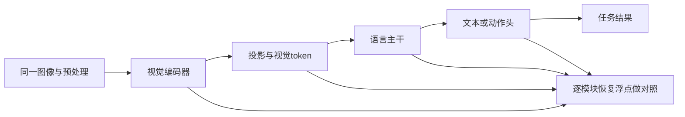
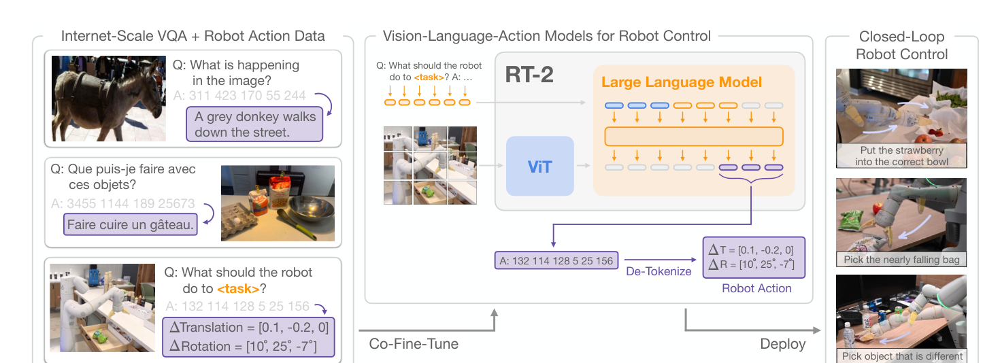

# 多模态量化怎样从层误差走到任务误差

图像编码器、跨模态投影、语言主干和动作头承担不同映射。若压缩整个系统后OCR或控制性能下降，只看到最终分数，很难知道误差从哪一段进入。更有效的办法是固定输入，沿模块接口比较中间输出，再做单模块替换。

## 先固定一条可以重复的计算路径

以一张带数字的图像为例，视觉编码器输出视觉token，投影层把它们映射到语言模型宽度，语言模型再生成文本。记录同一张图的预处理尺寸、token顺序、prompt和解码设置，才能把两个版本的差异归因到量化。

先只量化语言主干，其他模块保持参考实现；再单独量化视觉编码器或投影。这样能判断哪个改动使目标输出改变。多个模块同时量化的结果还可能存在交互，因此单模块结果不能简单相加。

<!-- systems-workflow-visual -->

模块替换用来定位误差从哪里进入，最终任务指标用来判断这点误差是否重要。

## 局部均方误差为何不能代替任务指标

下面是教学构造。输出头的两个候选logit原为 `[3.00,2.99]`，量化扰动后变为 `[2.98,3.01]`。每个元素只变动0.02，但argmax翻转。若两候选分别是数字“8”和“3”，字段是否正确会发生离散变化。

反过来，一个中间层较大的均方误差，可能主要落在后续不敏感的方向。于是层误差用于定位，OCR字符准确率、字段完全匹配或grounding坐标误差用于判断实际结果。不能从“投影层连接两种模态”直接推断它必然最敏感。

## 动作误差还要经过时间与动力学

设一个一维教学系统 $p_{t+1}=p_t+\Delta t\,v_t$。若每步预测速度都多0.01m/s，$\Delta t=0.1s$，持续100步而没有纠正，位置偏差为0.1m。这说明很小的有偏误差可以累积。

真实闭环控制会重新观测并纠正，也可能因接触、不稳定状态或控制饱和放大误差。因此必须在相同初始条件下比较任务完成率、轨迹误差与恢复行为。单步动作MSE不能独自证明闭环可用。

同样的原则适用于视频与世界模型。固定一个潜变量的量化误差，不一定预测长rollout的身份保持或碰撞预测误差。需要把短期重建、长时一致性与任务结果分别测量。

## 校准输入必须经过真实预处理

若部署中图像会切成多个高分辨率块，校准却只使用缩小的单图，视觉token数和激活分布都会改变。视频还涉及帧间隔、片段长度与运动速度；机器人涉及动作单位、归一化和状态分布。

自然流量抽样负责主要分布，困难条件单独分层。小字、遮挡或接触场景可以成为验证桶，但不要把所有样本都替换成极端情况，再把得到的配置称为平均效果最好。

## 混合精度配置应从替换实验产生

假如量化版输出错误，把某一模块换回浮点后恢复，只能说明该模块的改动在当前输入上有影响。继续在独立样本中复验，再比较保留高精度带来的显存和转换成本。若多个模块联合恢复才有效，需要考虑交互。

最终记录每个模块的格式、scale粒度、校准来源，以及完整任务和服务指标。本文没有提供某个真实VLM或机器人模型的量化效果百分比；上面的logit和位置例子只解释误差传播机制。

<small>图源：[RT-2 project page](https://robotics-transformer2.github.io/) / [论文](https://arxiv.org/abs/2307.15818)。原图表达 VLA 把视觉、语言和动作放进同一个模型接口；读图重点是：量化不能只按 Transformer 主干统一处理，还要分开看视觉 encoder、跨模态 projector、动作头和安全/风险头。它不能证明 RT-2 的具体层对量化最敏感，只提供多模态量化分层排查的结构参照。</small>

## 对照源码与延伸阅读

- [等价变换必须保持所有消费分支的对应关系](https://github.com/mit-han-lab/smoothquant/blob/c61476d728e42ae0d8a35e7e78494edcac3237b5/smoothquant/smooth.py)
- [用模块hook收集真实输入激活的方法](https://github.com/mit-han-lab/llm-awq/blob/d6e797a42b9ef7778de8ee2352116e0f48a78d61/awq/quantize/pre_quant.py)
