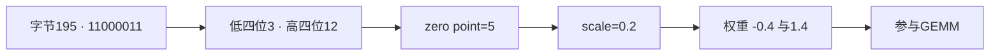

# 一份量化权重怎样被运行时执行

量化checkpoint包含的不只是低比特码值，还包括scale、zero point、分组大小、轴方向和打包方式。Loader负责恢复这些语义，kernel负责按照语义计算。两者不一致时，文件可以成功加载，输出却可能错误。

## 先把两个码值装进一个字节

设无符号4-bit码值为3和12，采用低位先放第一个值的教学布局，打包结果为195，即二进制 `11000011`。若scale为0.2、zero point为5，恢复得到-0.4和1.4。

```python
packed = 3 | (12 << 4)
codes = [packed & 15, (packed >> 4) & 15]
weights = [0.2 * (q - 5) for q in codes]
print(packed, codes, weights)
```

这个布局便于解释，但真实kernel可能为向量化、矩阵指令或分组读取交错多个通道。即使每个权重都占4 bit，两个项目的packed tensor也未必可互换。

<!-- systems-workflow-visual -->


这个可手算布局说明码值、zero point与scale必须一起解释。真实布局还可能交错更多通道。

## Loader 需要重建一个线性层的契约

加载时先核对原矩阵shape、量化轴和group size，再建立码值与scale的对应关系。若输入维d=4096、group size=128，一个输出行有32组；若checkpoint把分组沿另一维定义，直接reshape不能修复语义。

AWQ 的 `real_quantize_model_weight` 先得到模拟量化权重与scale/zero，再创建 `WQLinear`并替换原Linear。`init_only`路径用于只建立相应模块结构。这个过程说明量化模型的执行类也发生了变化，不只是参数dtype变了。

Tokenizer、模型结构和adapter身份仍需与checkpoint对应。量化元数据正确，不能弥补装错了底座架构。

## Kernel 可以选择在哪里反量化

一种路径先恢复整个权重矩阵，再交给普通GEMM。实现容易对齐，但会多一次展开写回，还可能让高精度权重常驻。另一种路径只在处理当前tile时解包、减zero point、乘scale，然后直接参与乘法。它减少中间全矩阵的读写，但要求kernel支持当前shape和格式。

因此weight-only的W4A16不等于矩阵乘一定使用INT4乘法。它可以读取4-bit权重，局部恢复成浮点，再与高精度激活计算。其主要收益可能来自权重带宽与容量。

## 名字应该放在正确层次比较

| 名字所属层 | 描述的内容 | 应核对的信息 |
| --- | --- | --- |
| GPTQ、AWQ | 量化时怎样控制误差 | 校准、分组、缩放或补偿配置 |
| INT4、FP8、NF4 | 数值表示或码本 | 范围、尺度、累加与反量化语义 |
| checkpoint格式或容器 | 磁盘组织 | 元数据、tensor命名、packing布局 |
| bitsandbytes等执行组件 | 具体量化层与算子路径 | 支持dtype、设备、反向与加载接口 |
| vLLM等服务runtime | 调度、KV、batch与kernel组合 | 模型结构、量化后端、并发与兼容条件 |

一个服务runtime可以接多种后端，一个算法也能输出多种布局。具体版本的支持矩阵应以该版本文档与实际加载结果为准，不能用“支持AWQ”推断所有AWQ变体都支持。

### 四个名称分别回答什么问题

| 层次 | 例子 | 它决定什么 | 不能单独推出什么 |
| --- | --- | --- | --- |
| 量化算法 | GPTQ、AWQ、SmoothQuant | 怎样选择 scale、校准样本和误差目标 | 目标 runtime 一定有对应 kernel |
| 数值表示 | INT4、INT8、FP8、NF4 | 码值范围、累加方式和可表达的数 | 磁盘上的 bit packing 具体顺序 |
| checkpoint / 容器 | safetensors、GPTQ 权重、AWQ 权重 | tensor 名称、元数据和存储布局 | loader 会选择哪条执行路径 |
| 执行与服务 | bitsandbytes、TensorRT-LLM、vLLM | dequant、GEMM、调度、KV 和回退 | 所有 shape 都使用低精度 kernel |

例如，AWQ 是量化方法，`WQLinear` 是某个实现中的线性层，vLLM 是包含调度和模型执行的服务 runtime。三者可以在一个部署里同时出现，却不是同义词。排查时先把问题写成“哪一层的契约被破坏”，比笼统地说“量化不兼容”更容易定位。

## 先对齐一层，再跑整条服务

用固定小输入同时计算原浮点Linear、模拟量化Linear和真实打包Linear。前两者的差别衡量量化近似，后两者的差别主要检查packing与执行。若真实结果偏离模拟结果，先看轴、zero point、scale和累加方式。

随后才测完整模型的质量和服务延迟，分别报告prefill和decode，记录实际命中的kernel。冷启动编译、格式转换和fallback若发生在请求路径里，必须计入对应延迟。

一个很常见的误报是 loader 在不支持某个 shape 时自动回退到 BF16。输出仍然合理，显存甚至可能暂时足够，只有延迟和日志暴露了问题。最小 smoke test 可以把“结果接近”和“路径正确”分开写：

```python
with torch.inference_mode():
    y_fp = fp_linear(x)
    y_fake = fake_quant_linear(x)
    y_packed = packed_linear(x)

torch.testing.assert_close(y_fake, y_fp, rtol=1e-2, atol=1e-2)
torch.testing.assert_close(y_packed, y_fake, rtol=2e-2, atol=2e-2)
assert runtime_report.kernel_name == "awq_int4_gemm"
assert runtime_report.fallback_reason is None
```

这里的阈值只是一组接口测试的占位值，不能当作所有模型的质量门槛。真正的验收还要在固定校准集和任务集上比较 logits、生成结果与业务指标。`kernel_name` 和 `fallback_reason` 则应来自 runtime 的日志或 profiler，不能由模块类名猜出来。

## 运行时兼容性要做成矩阵

一份量化 checkpoint 至少要在模型结构、量化格式、设备、kernel 后端和服务模式五个维度上核对。可以把同一小输入跑三条路径：浮点 Linear、模拟量化 Linear、真实打包 Linear；再把同一配置放进单请求、连续批处理和长上下文。矩阵中的“未支持”要记录成显式回退或拒绝，不能让 loader 静默转回高精度后仍被统计成量化性能。

质量与性能也要一起留档。真实 kernel 与模拟结果接近、服务延迟却没有下降，常见原因是权重解包或格式转换仍在请求路径；延迟下降但结果偏离，则回到 scale、轴、累加 dtype 和 fallback 日志。运行时名称只能说明入口，不能代替这张兼容矩阵。

## 兼容矩阵最好写成一次可执行的 gate

可以把一份 checkpoint 的最低验收条件写成配置，而不是在终端里凭印象检查：

```yaml
checkpoint: model-awq-g128-v3
model_revision: <git-or-registry-id>
quantization: {algorithm: awq, bits: 4, group_size: 128, axis: output}
runtime: {name: <runtime>, version: <version>, device: <gpu>}
paths:
  - name: fp_reference
    expected: reference_linear
  - name: simulated
    expected: fake_quant_linear
  - name: packed_kernel
    expected: awq_int4_gemm
  - name: unsupported_shape
    expected: explicit_reject_or_named_fallback
checks:
  max_logit_abs_error: <threshold>
  quality_regression: <threshold>
  decode_p95_ms: <slo>
  fallback_rate: 0
```

`expected` 是执行路径的断言，不是根据模块名称猜测。运行时应把实际命中的 kernel、是否发生格式转换和 fallback 原因写回结果。若 `unsupported_shape` 静默进入 FP16，质量可能正常，性能结论却已经失效；若直接拒绝，也要把拒绝请求保留在服务错误率中。

## 先测单层，再测长上下文和混合批

单层 F/Q/K 对照只能验证数值接口。真实服务还要增加三类容易触发另一条路径的输入：短输入与长输入、单请求与连续批处理、常见 shape 与尾部 shape。每种组合都记录 `kernel_name`、`fallback_reason`、`input_tokens`、`output_tokens`、`cache_mode` 和峰值显存。

如果只有长上下文退化，优先看 KV dtype、prefill kernel 和工作区；如果只有小 batch 退化，可能是解包成本和 kernel 启动占主导；如果质量只在代码或多模态桶下降，回到校准集覆盖和输入预处理。把问题分桶以后，量化算法、运行时和服务调度的责任边界才清楚。

速度计时也要划定边界。只测 `packed_linear(x)` 的 kernel 时间，回答的是一个 tile 或一个层的执行成本；把权重加载、格式转换和第一次编译放进去，回答的是冷启动成本；把 tokenizer、队列、prefill、decode 和输出传输都放进去，才接近服务端到端时间。三种时间都可以报告，但不能放在同一张“加速比”列里。

建议为每一次结果保留下面这些字段：

```text
model_revision, quant_revision, runtime_version, device, dtype,
shape_mnk, group_size, scale_axis, kernel_name, fallback_reason,
warmup, timed_iterations, synchronize_before_after, max_abs_error,
task_bucket, prompt_tokens, output_tokens, p50_ms, p95_ms
```

其中 `synchronize_before_after` 对 CUDA 计时尤其重要。若只在 Python 端读取异步 kernel 的开始和结束时间，很容易得到偏小的数；若第一次迭代包含编译，又会把 cold start 混进稳态。每条记录还应保留使用的输入 seed，便于重放同一 shape 和误差。

{ width="720" }

<small>图源：[SmoothQuant](https://arxiv.org/abs/2211.10438)，Figure 6。原图表达激活/权重不同张量在 INT8 路径中的精度与缩放处理；读图重点是把量化 runtime 的责任看成“格式、scale、layout、kernel dispatch 和回滚”的整条链路。它不能证明 SmoothQuant 是所有部署场景的最佳方法。</small>

## 对照源码与延伸阅读

- [AWQ 从浮点模拟到 WQLinear 的替换流程](https://github.com/mit-han-lab/llm-awq/blob/d6e797a42b9ef7778de8ee2352116e0f48a78d61/awq/quantize/quantizer.py)
- [运行库对数据与scale布局的具体要求](https://github.com/deepseek-ai/DeepGEMM/blob/5081f8513af57e61696de4f4f04b0e707ffb503e/README.md)

继续阅读：[量化评测与部署验收](evaluation-and-deployment-checklist.md)把 F/Q/K 对照接到质量、P95 和回退门槛；[量化 runtime 与硬件取舍](serving-stacks-and-hardware-tradeoffs.md)比较不同后端的实际支持范围。

**来源与改编说明**：Loader 与 WQLinear 的描述参考 [AWQ quantizer](https://github.com/mit-han-lab/llm-awq/blob/d6c797a42b9ef7778de8ee2352116e0f48a78d61/awq/quantize/quantizer.py)，scale、layout 和 kernel 契约参考固定版本的 DeepGEMM README。示例字节布局是教学构造，不代表所有 checkpoint 格式。

补充阅读可以对照 [GPTQ](https://arxiv.org/abs/2210.17323)、[AWQ](https://arxiv.org/abs/2306.00978)、[SmoothQuant](https://arxiv.org/abs/2211.10438) 的原始方法，以及 [Transformers bitsandbytes 文档](https://huggingface.co/docs/transformers/main/en/quantization/bitsandbytes) 的加载约定。它们分别解释误差控制、激活迁移和执行接口，不能互相替代。
