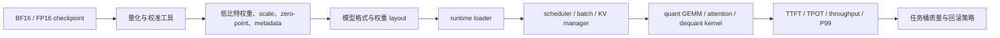
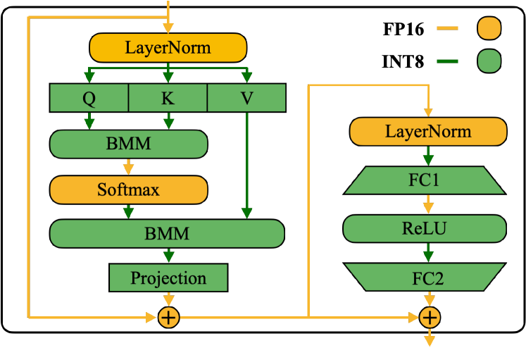

# 量化运行时与部署框架

量化 checkpoint 只有在 runtime 能把低比特格式、权重布局、KV cache、batching 和 kernel 路径接起来时，才会变成真实端到端收益。硬件和成本模型放在 [量化服务栈与硬件选择](serving-stacks-and-hardware-tradeoffs.md)，底层 kernel 细节放在 [低精度与量化 Kernel](../operators/low-precision-and-quantized-kernels.md)。本页聚焦中间这层：**低比特模型怎样被运行时可靠地加载、调度、执行、观测和回滚**。

## Runtime 在量化链路里的职责边界

量化上线不是一个单点开关，而是一条跨工具、格式、runtime 和 kernel 的链路：



{ width="720" }

<small>图源：[SmoothQuant](https://arxiv.org/abs/2211.10438)，Figure 6。原图表达激活/权重不同张量在 INT8 路径中的精度与缩放处理；本站读法是把量化 runtime 的责任看成“格式、scale、layout、kernel dispatch 和回滚”的整条链路。它不能证明 SmoothQuant 是所有部署场景的最佳方法。</small>

这条链路里，runtime 不是“加载权重的包”，而是模型和硬件之间的执行层。它至少负责：

| 职责 | 具体要承接什么 | 量化相关风险 |
| --- | --- | --- |
| Loader | 读取 safetensors、AWQ、GPTQ、FP8、GGUF、ONNX 等产物 | config、scale、group size、packing layout 不一致 |
| Layout | 把权重和 scale 放成 kernel 能消费的布局 | 加载后再转换 layout，冷启动和显存峰值变高 |
| Scheduler | 组织 prefill、decode、continuous batching、优先级 | 低比特 kernel 只在部分 shape 上命中 |
| KV manager | 分配、回收、分页、复用和量化 KV cache | KV dtype 与 attention kernel 不匹配，长上下文掉点 |
| Adapter path | 合并或动态加载 LoRA、QLoRA adapter | base 低比特和 adapter 高精路径发生额外转换 |
| Kernel dispatch | 选择 FP8、INT8、W4A16、dequant fusion 或 fallback | profiler 看到的是高精 kernel 或外部 dequant |
| Observability | 暴露阶段耗时、kernel 路径、fallback、cache 状态 | 线上退化无法归因，只能盲目回滚 |

**证据边界**：如果只证明“模型能加载”或“权重文件变小”，不能推出 TPOT、吞吐或单位成本改善。运行时验收必须同时证明：目标请求桶命中目标 kernel，KV 和 batch 路径没有引入新瓶颈，质量桶没有越过风险阈值。

## 部署链路的常见失败点

量化部署最常见的问题不是直接崩溃，而是“看起来成功，实际上没有兑现收益”。

| 现象 | 常见根因 | 优先验证 |
| --- | --- | --- |
| checkpoint 能加载但 TPOT 不降 | dequant 在 GEMM 外部执行，或 decode batch 太小 | profiler、kernel 名称、HBM 读写量 |
| 显存下降但 P99 变差 | layout conversion、JIT、graph cache miss 或动态量化统计 | cold/warm run 对照、shape bucket trace |
| INT4 不如 INT8 快 | unpack、scale 读取或 group size 与 tile 不对齐 | group size、kernel occupancy、scale cache |
| FP8 质量不稳 | scale 策略、amax 滞后、敏感层没有保高精 | layer-wise fallback、overflow/amax 日志 |
| KV quant 后长上下文错引 | K/V 误差改变注意力分布 | 长文档、引用、needle、工具轨迹桶 |
| LoRA 加载后收益消失 | adapter 路径触发高精 dequant 或额外 matmul | adapter merge 策略、per-request adapter trace |
| agent 格式遵循掉点 | 低比特影响 logits 边界和结构化约束 | JSON/schema/tool-call 长尾回归 |
| 多租户吞吐波动 | 不同模型、dtype、LoRA、长度桶混批 | batch 组成、kernel dispatch、路由策略 |

排查时先把问题定位到“加载、layout、kernel、KV、batch、质量”其中一层，再决定是换量化格式、调 runtime 参数、保护敏感层，还是回到 BF16 路由。直接换算法名通常效率很低。

## Runtime 选型矩阵

以下矩阵不是版本支持表。runtime 支持矩阵变化很快，实际部署前必须查对应版本的官方文档和 release note。本表只描述工程默认假设。

| Runtime / 生态 | 更适合的工作负载 | 量化部署重点 | 典型风险 |
| --- | --- | --- | --- |
| `vLLM` | 通用在线 LLM 服务、高并发聊天、RAG、OpenAI API 风格服务 | 预量化权重加载、FP8、KV cache、PagedAttention、continuous batching、LoRA serving | 混合 shape 或多 adapter 下 kernel 路径碎片化 |
| `SGLang` | agent、多阶段生成、结构化输出、prefix cache 密集场景 | prefix cache 与 KV dtype、在线/离线量化边界、工具调用和 schema 质量桶 | 只看裸 tokens/s 会低估编排收益或结构化掉点 |
| `TensorRT-LLM` | 固定硬件、稳定模型、稳定 shape、追求极致吞吐或低延迟 | engine build、FP8/INT8/INT4 recipe、插件、graph 优化、并行配置 | 构建链路重，动态 shape 和模型迭代成本更高 |
| `ONNX Runtime` | 跨平台、CPU/边缘、图级优化、传统模型链路 | QDQ/QOperator、Execution Provider、图融合、校准产物 | LLM 动态生成和 KV 管理能力要单独验证 |
| `GGUF / llama.cpp` | 本地、端侧、CPU/GPU 混合、单用户低资源部署 | weight-only 格式、设备内存、context、batch、采样性能 | 生产在线多租户能力和高并发调度不是默认目标 |

一个实用判断顺序：

1. 通用在线服务先从 `vLLM` 起步，除非工作负载强依赖 agent 编排或固定硬件特化。
2. agent、多阶段程序化生成、prefix cache 密集场景优先评估 `SGLang`。
3. 模型、硬件、输入长度和批处理策略足够稳定，并且团队能维护 build/engine 链路时，再评估 `TensorRT-LLM`。
4. 边缘、本地或跨平台图部署才把 `ONNX Runtime`、`GGUF` 等作为主线，而不是拿它们替代在线 serving runtime。

**证据边界**：runtime 选型不能靠单一 benchmark。固定 batch、固定长度、固定 dtype 的 tokens/s 不能代表真实流量中的 TTFT、P99、KV 压力、adapter 混用、agent 工具路径和质量掉点。

## 量化格式到 kernel 的验收

量化格式的工程含义，不只是 bit 数，而是 runtime 最终会走哪条 kernel 和数据流。

| 格式或路径 | 收益来源 | Runtime 必须支持 | Profiling 要看到 | 典型失败模式 |
| --- | --- | --- | --- | --- |
| W4A16 / INT4 weight-only | 权重带宽和常驻显存下降，激活保持高精 | 权重 packing、group scale、fused dequant GEMM | decode GEMM 命中 W4 或 fused dequant 路径 | 外部 dequant 到 FP16 后再 GEMM，速度不升 |
| W8A8 / INT8 | 权重和激活路径都低比特，潜在计算收益更大 | 激活 scale、zero-point、校准或动态统计、INT8 kernel | INT8 matmul 或 QDQ 融合，不是零散 Q/DQ kernel | activation outlier 导致掉点，动态统计拖慢 |
| FP8 | 带宽减半、部分新 GPU tensor core 吞吐更高 | scale/amax 管理、FP8 GEMM、敏感层保高精 | FP8 GEMM、FP8 KV 或明确混合精度 trace | fallback 到 BF16，或 scale 策略导致长尾质量波动 |
| KV cache quant | 长上下文并发显存下降，decode KV 读带宽下降 | KV dtype、page/block 管理、attention 前 dequant 或低比特 attention | KV memory 下降、decode attention 路径可解释 | 长上下文引用错、page locality 变差、dequant 抵消收益 |
| LoRA on quantized base | 低比特底座复用，多任务 adapter 服务 | adapter merge 或动态加载、dtype 边界、batch 组织 | base 和 adapter 路径分别可观测 | 多 adapter 混批导致 kernel 和 batch 碎片化 |

建议把每种路径都拆成两个问题：

1. **质量问题**：量化误差是否在任务桶里可接受，尤其是代码、数学、长上下文、工具调用、表格数字和安全桶。
2. **系统问题**：低比特数据是否在热路径里保持低比特，还是加载后很快被展开成高精度中间张量。

只有两个问题都过，才能说这条量化路径在该 runtime 上成立。

## 上线实验矩阵

线上验收不应只比较一个平均 tokens/s。建议至少用下面的实验矩阵组织结果：

| 实验组 | 目的 | 必测指标 | 通过口径 |
| --- | --- | --- | --- |
| BF16 / FP16 baseline | 建立质量和性能基线 | 质量、TTFT、TPOT、throughput、P95/P99、peak memory | 后续所有组都与它同表对照 |
| 预量化 W4A16 或 W8 | 验证权重路径 | kernel hit、TPOT、显存、短/长输出桶 | 文件变小之外，decode 热路径有收益 |
| FP8 主体 | 验证硬件友好低精度 | FP8 kernel、overflow/amax、质量桶、P99 | 大块 GEMM 低精，敏感层无异常掉点 |
| KV cache quant | 验证长上下文并发 | KV memory、TPOT、page 状态、长文档质量 | 并发或 context 上限改善，长程质量过线 |
| LoRA / adapter 组合 | 验证多任务服务 | adapter latency、batch 组成、kernel path、质量 | adapter 不触发不可控 fallback |
| Agent / structured bucket | 验证编排和格式稳定 | tool-call 成功率、JSON/schema、retry、P99 | 格式遵循和工具链不因低比特劣化 |
| Shadow / canary | 验证真实流量 | bucketed quality、rollback rate、SLO、错误样本 | 高风险桶可回滚，低风险桶收益稳定 |

推荐记录维度：

| 维度 | 需要落盘的字段 |
| --- | --- |
| 模型与量化 | model hash、quant method、bits、group size、scale granularity、calibration set |
| Runtime | runtime name/version、CUDA、driver、GPU、tensor parallel、pipeline parallel |
| 请求桶 | input length、output length、tenant、task、LoRA id、sampling config |
| 性能 | queue time、prefill time、decode TPOT、throughput、P95/P99、peak memory |
| Kernel | kernel names、dtype path、fallback count、graph cache hit、layout conversion time |
| KV | KV dtype、block size、free pages、fragmentation、prefix hit、eviction |
| 质量 | baseline diff、task score、format error、citation error、tool failure、manual review flag |

**证据边界**：短问答过线不能外推到长上下文；离线 perplexity 稳不能外推到工具调用；单租户压测稳定不能外推到多 LoRA、多模型、多长度混合流量。

## 排障流程

当量化上线结果不符合预期时，按下面顺序查，能减少很多无效试错。

| 顺序 | 问题 | 该看什么 | 常见动作 |
| --- | --- | --- | --- |
| 1 | 模型是否正确加载 | config、tokenizer、scale、metadata、dtype | 固定模型 hash，重新导出或转换 |
| 2 | 格式和 layout 是否匹配 runtime | packing layout、group size、tensor parallel 切分 | 换 runtime 支持的格式或重排权重 |
| 3 | kernel 是否命中 | profiler、kernel names、Q/DQ 数量、fallback | 调 shape bucket、换 recipe、启用 fused path |
| 4 | KV 路径是否成为瓶颈 | KV memory、page miss、fragmentation、attention time | 调 block/page、KV dtype、prefix cache |
| 5 | batch 和 shape 是否破坏收益 | decode batch、input/output length bucket、LoRA mix | 分桶、限流、拆高风险租户 |
| 6 | 质量掉点是否集中 | layer、task bucket、length bucket、format bucket | 敏感层高精回退、重做校准 |
| 7 | 版本是否可复现 | runtime、driver、CUDA、commit、build flags | pin 版本，保留回滚镜像 |

两个高频排障结论：

1. **权重变小但速度不升**：优先查 kernel 和 dequant 位置。很多时候 runtime 先把低比特权重展开成高精度临时张量，文件省了，热路径没省。
2. **平均质量不掉但线上事故增加**：优先查任务桶。量化退化常集中在长上下文引用、代码符号、JSON schema、表格数字、权限工具调用和安全拒答边界。

## 工程收束清单

上线前把下面信息写进部署记录，后续升级 runtime、driver 或模型时才能复验。

| 类别 | 必须记录 |
| --- | --- |
| 模型 | base model、adapter、tokenizer、model hash、revision |
| 量化 | method、bits、weight/activation/KV dtype、group size、scale granularity、calibration data |
| Runtime | vLLM/SGLang/TensorRT-LLM/ONNX/GGUF 版本、启动参数、engine build 参数 |
| 系统 | GPU、driver、CUDA、NCCL、parallelism、memory limit、container image |
| Kernel | profiler trace、命中 kernel、fallback 条件、known bad shapes |
| KV/cache | KV dtype、block/page size、prefix cache 策略、eviction 和隔离策略 |
| 评测 | 质量桶、长度桶、agent/tool 桶、SLO、P95/P99、shadow/canary 结果 |
| 回滚 | BF16 或上一量化版本路由、灰度比例、触发阈值、事故样本回放路径 |

生产上更稳的表述通常不是“模型已量化到 4bit”，而是：

```text
在 vLLM + H100 的当前版本上，W4A16 预量化权重在短聊天和 8k RAG 桶中命中 fused dequant GEMM，TPOT P50/P95 分别下降，代码和引用桶质量差异低于阈值；32k 以上长上下文暂不启用 KV quant，工具调用高权限桶保留 BF16 路由。
```

这类结论同时说明 runtime、硬件、请求桶、kernel 证据、质量边界和回滚范围，比单独报告 bit 数可靠得多。

## 外部精读

1. vLLM Quantization：<https://docs.vllm.ai/en/latest/features/quantization/index.html>
2. SGLang Quantization：<https://docs.sglang.io/docs/advanced_features/quantization>
3. TensorRT-LLM Quantization：<https://nvidia.github.io/TensorRT-LLM/>
4. ONNX Runtime Quantization：<https://onnxruntime.ai/docs/performance/model-optimizations/quantization.html>
5. *A Survey of Low-bit Large Language Models*：<https://arxiv.org/abs/2409.16694>
