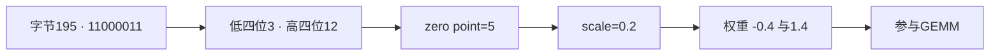
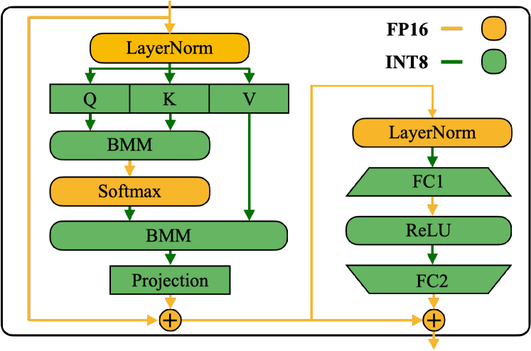

# 一份量化权重怎样被运行时执行

量化checkpoint包含的不只是低比特码值，还包括scale、zero point、分组大小、轴方向和打包方式。Loader负责恢复这些语义，kernel负责按照语义计算。两者不一致时，文件可以成功加载，输出却可能错误。

## 先把两个码值装进一个字节

设无符号4-bit码值为3和12，采用低位先放第一个值的教学布局，打包结果为195，即二进制 `11000011`。若scale为0.2、zero point为5，恢复得到-0.4和1.4。

```python
packed = 3 | (12 << 4)
codes = [packed & 15, (packed >> 4) & 15]
weights = [0.2 * (q - 5) for q in codes]
print(packed, codes, weights)
```

这个布局便于解释，但真实kernel可能为向量化、矩阵指令或分组读取交错多个通道。即使每个权重都占4 bit，两个项目的packed tensor也未必可互换。

<!-- systems-workflow-visual -->


这个可手算布局说明码值、zero point与scale必须一起解释。真实布局还可能交错更多通道。

## Loader 需要重建一个线性层的契约

加载时先核对原矩阵shape、量化轴和group size，再建立码值与scale的对应关系。若输入维d=4096、group size=128，一个输出行有32组；若checkpoint把分组沿另一维定义，直接reshape不能修复语义。

AWQ 的 `real_quantize_model_weight` 先得到模拟量化权重与scale/zero，再创建 `WQLinear`并替换原Linear。`init_only`路径用于只建立相应模块结构。这个过程说明量化模型的执行类也发生了变化，不只是参数dtype变了。

Tokenizer、模型结构和adapter身份仍需与checkpoint对应。量化元数据正确，不能弥补装错了底座架构。

## Kernel 可以选择在哪里反量化

一种路径先恢复整个权重矩阵，再交给普通GEMM。实现容易对齐，但会多一次展开写回，还可能让高精度权重常驻。另一种路径只在处理当前tile时解包、减zero point、乘scale，然后直接参与乘法。它减少中间全矩阵的读写，但要求kernel支持当前shape和格式。

因此weight-only的W4A16不等于矩阵乘一定使用INT4乘法。它可以读取4-bit权重，局部恢复成浮点，再与高精度激活计算。其主要收益可能来自权重带宽与容量。

## 名字应该放在正确层次比较

| 名字所属层 | 描述的内容 | 应核对的信息 |
| --- | --- | --- |
| GPTQ、AWQ | 量化时怎样控制误差 | 校准、分组、缩放或补偿配置 |
| INT4、FP8、NF4 | 数值表示或码本 | 范围、尺度、累加与反量化语义 |
| checkpoint格式或容器 | 磁盘组织 | 元数据、tensor命名、packing布局 |
| bitsandbytes等执行组件 | 具体量化层与算子路径 | 支持dtype、设备、反向与加载接口 |
| vLLM等服务runtime | 调度、KV、batch与kernel组合 | 模型结构、量化后端、并发与兼容条件 |

一个服务runtime可以接多种后端，一个算法也能输出多种布局。具体版本的支持矩阵应以该版本文档与实际加载结果为准，不能用“支持AWQ”推断所有AWQ变体都支持。

## 先对齐一层，再跑整条服务

用固定小输入同时计算原浮点Linear、模拟量化Linear和真实打包Linear。前两者的差别衡量量化近似，后两者的差别主要检查packing与执行。若真实结果偏离模拟结果，先看轴、zero point、scale和累加方式。

随后才测完整模型的质量和服务延迟，分别报告prefill和decode，记录实际命中的kernel。冷启动编译、格式转换和fallback若发生在请求路径里，必须计入对应延迟。

{ width="720" }

<small>图源：[SmoothQuant](https://arxiv.org/abs/2211.10438)，Figure 6。原图表达激活/权重不同张量在 INT8 路径中的精度与缩放处理；读图重点是把量化 runtime 的责任看成“格式、scale、layout、kernel dispatch 和回滚”的整条链路。它不能证明 SmoothQuant 是所有部署场景的最佳方法。</small>

## 对照源码与延伸阅读

- [AWQ 从浮点模拟到 WQLinear 的替换流程](https://github.com/mit-han-lab/llm-awq/blob/d6e797a42b9ef7778de8ee2352116e0f48a78d61/awq/quantize/quantizer.py)
- [运行库对数据与scale布局的具体要求](https://github.com/deepseek-ai/DeepGEMM/blob/5081f8513af57e61696de4f4f04b0e707ffb503e/README.md)
