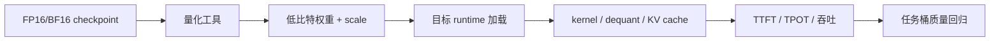

# 量化运行时与部署框架

这一页只讲一个问题：量化模型由谁加载、谁调度、谁真正调用低比特 kernel。硬件和成本选择放在 [量化服务栈与硬件选择](serving-stacks-and-hardware-tradeoffs.md)。

!!! note "读法定位"
    这页先回答“量化运行时与部署框架”在「量化」里的位置：它解决什么局部问题，依赖哪些前置，最后会影响哪类工程或研究判断。
    **前置**：先懂张量、线性层和基本推理成本；遇到 FP8、KV Cache、outlier 时回前置页补概念。 必要时先回 [量化入口](index.md)、[基础知识](../foundations/index.md) 或 [术语表](../glossary/index.md)。
    **主线关系**：把数值格式、误差来源、校准/训练方法、kernel 和服务部署连成一条效率链，而不是只比较 bit 数。

!!! note "初学者先抓住"
    量化算法做出一个 checkpoint，不代表 runtime 一定能高效服务它。上线前要确认模型格式、量化配置、kernel、KV cache、LoRA、batching 和目标硬件是否互相兼容。

## 先分清四个对象

| 对象 | 回答的问题 | 例子 |
| --- | --- | --- |
| 量化算法 | 怎么降低误差 | GPTQ、AWQ、SmoothQuant、QAT |
| 模型格式 | 权重和 scale 怎么存 | safetensors、GGUF、GPTQ/AWQ 格式、ONNX QDQ |
| runtime | 谁加载和调度请求 | vLLM、SGLang、TensorRT-LLM、ONNX Runtime |
| kernel | 低比特怎么算 | FP8 GEMM、W4A16 GEMM、INT8 MatMul、dequant fusion |

**读作什么**：算法产物必须被格式表达，格式必须被 runtime 读懂，runtime 必须有 kernel 才能兑现性能。

## 一条量化部署链路

这条链路任何一段不匹配，都会出现“模型文件变小了，但服务没变快”的情况。

## 常见 runtime 怎么理解

| Runtime | 适合先怎么理解 | 量化相关重点 | 上线前确认 |
| --- | --- | --- | --- |
| vLLM | 通用 LLM 在线服务和高吞吐调度 | 多种预量化权重、FP8、KV cache、PagedAttention | 模型格式、GPU 架构、KV dtype、LoRA 和 batch shape |
| SGLang | 结构化输出、agent workflow、prefix cache | 离线量化和在线量化路径都可能出现 | 不要把预量化和在线量化重复叠加 |
| TensorRT-LLM | NVIDIA 深度优化部署 | FP8/INT8/INT4、engine 构建、kernel 融合 | 构建配置、目标 GPU、动态 shape 和回退 |
| ONNX Runtime | 跨平台、CPU/边缘、图级部署 | QDQ/QOperator、动态/静态量化、EP 支持 | 图是否可表达，EP 是否有量化 kernel |
| GGUF/llama.cpp 生态 | 本地/边缘/CPU/GPU 混合 | 多种 weight-only 格式 | 目标设备、context、batch 和质量 |

!!! warning "版本会变"
    runtime 支持矩阵更新很快。本文只给选型框架；实际部署前必须查对应版本的官方文档和 release note。

## vLLM 这类在线服务要问什么

| 问题 | 为什么重要 |
| --- | --- |
| checkpoint 是预量化还是运行时量化 | 两者流程、性能和风险不同 |
| 量化格式是否原生支持 | 不支持就可能加载失败或 fallback |
| attention/KV cache 路径如何处理 | 长上下文性能常由 KV 决定 |
| LoRA/adapter 是否兼容 | QLoRA 适配模型常需要一起服务 adapter |
| batch shape 是否稳定 | kernel 命中和 CUDA graph 受 shape 影响 |

**实用判断**：vLLM 一类 runtime 的价值不只是“能加载模型”，而是把低比特权重、KV cache、PagedAttention、batching 和 OpenAI API 风格服务组织起来。

## SGLang 这类 agent runtime 要问什么

SGLang 常被用于结构化输出、agentic workload、prefix cache 和复杂调度。量化时要额外确认：

| 检查项 | 原因 |
| --- | --- |
| 离线量化还是在线动态量化 | 在线动态量化会增加运行时开销 |
| prefix cache 和 KV dtype 是否兼容 | agent 多轮复用缓存时尤其重要 |
| 结构化输出是否掉点 | 低比特可能影响格式遵循 |
| 工具调用长尾样本 | 平均问答不代表 agent 稳定 |

## TensorRT-LLM 要问什么

TensorRT-LLM 更像“把模型构建成深度优化 engine”的路线。它常见优势是 kernel 融合和 NVIDIA 硬件优化，但工程约束也更强。

| 检查项 | 原因 |
| --- | --- |
| engine 构建配置 | 精度、shape、parallelism 会固化进构建 |
| FP8/INT8/INT4 recipe | 不同 recipe 对校准和硬件要求不同 |
| 动态 shape 支持 | 请求长度变化会影响 engine 选择 |
| 插件和自定义层 | 非标准结构可能需要额外适配 |

**初学者理解**：TensorRT-LLM 更像“提前把路铺好”，铺好后很快，但路的形状要和真实请求匹配。

## ONNX Runtime 里的 QDQ 和 QOperator

ONNX 量化表示常见两类：

| 表示 | 含义 | 初学者理解 |
| --- | --- | --- |
| QDQ | 图里显式插入 QuantizeLinear / DeQuantizeLinear | 标出哪里量化、哪里反量化 |
| QOperator | 直接替换成量化算子 | 例如量化 MatMul/Conv |

**读作什么**：QDQ 更容易调试和让后端融合；QOperator 更像直接调用量化算子。到底哪个更好，要看目标 Execution Provider 有没有成熟 kernel。

动态量化和静态量化区别：

| 类型 | scale 何时确定 | 适合直觉 |
| --- | --- | --- |
| 动态量化 | 推理时按输入算 | 输入分布变化大 |
| 静态量化 | 校准阶段固定 | 推理路径更固定 |

## 工具链和 runtime 的关系

| 工具或生态 | 常见角色 |
| --- | --- |
| AutoAWQ / GPTQModel | 生成或加载 AWQ/GPTQ 权重 |
| bitsandbytes | 研究和微调中常见的 8bit/4bit 加载 |
| TorchAO | PyTorch 生态量化实验和部署路径 |
| LLM Compressor / compression 工具 | 生成可被多个 runtime 消费的量化模型 |
| ONNX quantization tooling | 图级量化和跨平台部署 |

**关键点**：量化工具能导出，不等于目标 runtime 能高效消费。导出格式、scale 粒度、group size、packing layout 都要对齐。

## 运行时验收清单

| 检查项 | 通过标准 |
| --- | --- |
| 模型能加载 | 权重、scale、config、tokenizer 一致 |
| 低比特 kernel 命中 | profiler 能看到目标 kernel，不是全程 dequant fallback |
| KV cache 配置明确 | dtype、scale、page/block 管理可追踪 |
| adapter 兼容 | LoRA/QLoRA adapter 加载和合并策略明确 |
| 性能端到端改善 | TTFT、TPOT、throughput、P95/P99 同表对照 |
| 质量任务桶通过 | 不只看困惑度或短问答 |
| 版本可复现 | runtime、driver、CUDA、模型 hash、量化参数记录完整 |

## 一个选型顺序

1. 先定业务场景：在线聊天、RAG、agent、边缘、本地、批处理还是 VLA。
2. 再定 runtime：它决定可用 kernel、KV cache、batching 和 API 形态。
3. 再定量化格式：格式必须被 runtime 和硬件支持。
4. 再定算法：GPTQ、AWQ、SmoothQuant、FP8、QAT 等用来控制质量。
5. 最后做任务桶和 profiler 双验收。

## 参考资料

1. vLLM Quantization：<https://docs.vllm.ai/en/latest/features/quantization/index.html>
2. SGLang Quantization：<https://docs.sglang.io/docs/advanced_features/quantization>
3. TensorRT-LLM Quantization：<https://nvidia.github.io/TensorRT-LLM/>
4. ONNX Runtime Quantization：<https://onnxruntime.ai/docs/performance/model-optimizations/quantization.html>
5. *A Survey of Low-bit Large Language Models*：<https://arxiv.org/abs/2409.16694>

!!! tip "下一站"
    - 回到本专题入口：[量化](index.md)，确认这页在整条路线中的位置。
    - 按导航顺序继续：[多模态与 VLA 模型量化](quantization-for-multimodal-and-vla-models.md)。
    - 概念或符号卡住时，先查 [术语表](../glossary/index.md)，再回到当前页。
