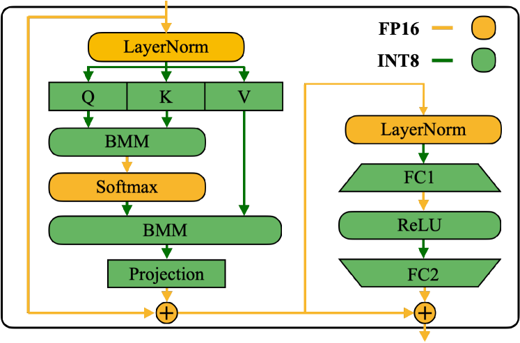

# 量化后省下的显存去了哪里

设一个假想模型有8B个参数，GPU可用于模型执行的预算为24GiB。BF16权重主体约14.90GiB，4-bit码值主体约3.73GiB。这个变化看上去省了四分之三，但服务还要容纳KV、scale、workspace和运行时临时张量。

## 把权重与KV放进同一预算

若4-bit权重每128个元素存一个FP16 scale，尺度约0.116GiB，权重加scale约3.84GiB，暂不计zero point、padding和其他未量化模块。

假设服务给KV留12GiB，workspace等占2GiB，BF16总量约28.90GiB，超出预算；量化后约17.84GiB，可以运行。实际节省比例约38%，明显不同于权重主体的75%。这些数字是明确配置下的算账示例，不对应某款模型实测。

对于32层、8个KV头、头维128、BF16 KV的模型，每token需要128KiB。12GiB大约能放98304个历史token，若每个请求都占32768个token，理论上只够3条。权重压缩完成以后，长上下文并发仍可能受KV限制。

## 容量收益和带宽收益如何分开

容量收益是从“放不下”变成“放得下”，或允许更大的batch。带宽收益则要求每步实际减少从显存读取的字节。

对于低batch decode，同一层权重可能只服务少量token，权重读取占比高；大batch或prefill把同一权重用于多行输入，复用增加，计算或其他路径可能成为瓶颈。若量化让GEMM提速，却新增反量化或布局转换，总收益需要把这些操作一同计算。

一个只考虑算力与带宽的下界是

$$
T\ge\max(F/P,\ M/B),
$$

F为运算量，M为实际搬运字节，P与B为相应计算和带宽上限。这个下界不包括launch、通信、排队，也不保证实现能达到峰值。

## 硬件支持需要落到具体路径

先查目标设备是否具备相应矩阵指令，再查运行库是否支持当前shape、layout和scale。DeepGEMM的固定版本对不同架构规定了不同scale格式，这类接口条件比“GPU支持FP8”更具体。

边缘设备、CPU与GPU的可用路径不同。某些格式的主要价值是减小内存容量，另一些能调用原生低精度乘法。不能把一个设备上较快的格式直接当作跨设备结论。

## 如何选择下一步压缩对象

如果权重放不下，先检查权重主体与未量化模块。若权重已经很小但长请求经常挤满KV，再考虑KV表示和调度。若显存充足而延迟差，先看trace里的权重读取、KV读取、转换与通信占比，容量压缩不一定解决当前问题。

最后把质量约束放回成本。若一次请求便宜20%，但成功率下降导致更多重试，每成功任务成本可能上升。比较配置时固定请求分布，报告完成量、成功量与SLO内完成量，才能判断新增容量有没有变成可用服务。

<small>图源：[SmoothQuant](https://arxiv.org/abs/2211.10438)。原图表达不同算子和张量在低精度部署中的精度映射；读图重点是：服务栈选型不是只选“几 bit”，而是要确认硬件 kernel、runtime fallback、activation scale 和质量门槛是否同时成立。它不能直接证明某张 GPU 上的线上 P99 收益，实际仍需按请求分布压测。</small>

## 对照源码与延伸阅读

- [FP8执行路径与架构边界](https://github.com/deepseek-ai/DeepGEMM/blob/5081f8513af57e61696de4f4f04b0e707ffb503e/README.md)
- [KV容量与调度共同限制在途请求](https://github.com/vllm-project/vllm/blob/fa3b9d1377219247060d3c8b49eae199c9e7e154/vllm/v1/core/sched/scheduler.py)
