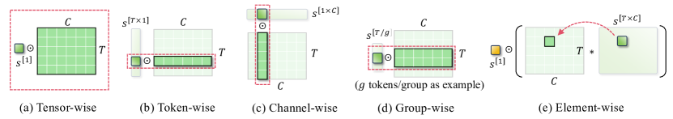

# 量化的格子、误差与线性层

把 0.9 存成一个 4-bit 整数，需要先约定这个整数代表什么。整数 3 可以表示 0.3，也可以表示 1.5，差别就在 scale。理解这个约定以后，才能判断“4-bit 模型”究竟保存了哪些数据、损失了哪些信息。

## 从一个数开始

本页采用有符号对称教学量化器，码值使用 $[-7,7]$，scale 为 $s=0.25$。有 16 种状态的 4-bit 存储仍可以容纳它，但这里主动不用 -8，保证正负范围对称。量化与反量化为

$$
q=\operatorname{clip}(\operatorname{round}(x/s),-7,7),\qquad \hat x=sq.
$$

于是 $0.9\to4\to1.0$，$-0.6\to-2\to-0.5$，$2.2\to7\to1.75$。前两个数只有舍入误差，最后一个超过范围，发生了截断。在范围内，最近邻舍入误差不超过 $s/2$；发生截断后，这个界不再成立。

真实文件可能采用 $[-8,7]$、无符号码值，或非均匀码本，不能把本页的范围直接当作所有 INT4 的定义。GPTQ 原始 `quant.py` 就把码值存为 $[0,2^b-1]$，另用 zero point 还原。

## Zero point 怎样表达偏移范围

仿射量化写为

$$
q=\operatorname{clip}(\operatorname{round}(x/s)+z,q_{\min},q_{\max}),
\qquad \hat x=s(q-z).
$$

若码值为 $[0,15]$、$s=0.2,z=5$，则浮点 0 存成整数 5，-1 存成 0，2 存成 15。这里 z 是整数坐标，s 有原始数值的单位。量化器还必须说明范围估计、舍入规则与全零张量的处理方式，否则公式相同也可能产生不同文件。

```python
def quantize(values, scale, zero, lo, hi):
    codes = [max(lo, min(hi, round(x / scale) + zero)) for x in values]
    restored = [scale * (q - zero) for q in codes]
    return codes, restored

print(quantize([0.9, -0.6, 2.2], 0.25, 0, -7, 7))
# ([4, -2, 7], [1.0, -0.5, 1.75])
```

这是标准库程序，Python 的 `round` 使用到偶数舍入。比较两个实现时还要检查半格点的规则。

## 一个 scale 应该覆盖哪些数

把整个矩阵共用一个 scale，元数据很少，但一个大值会抬高所有数的格距。按输出通道或固定大小的组分别保存 scale，可以让各组使用更适合自己的格子。

假设一组有 128 个 4-bit 权重，另存一个 FP16 scale，不存 zero point。权重需要 64 字节，scale 需要 2 字节，总计 66 字节，平均每权重 4.125 bit。若缩成每 32 个权重一个 scale，平均增加到 4.5 bit。更细粒度可能改善误差，但也增加读取和布局成本。

“per-channel”必须说清轴。下文设输入 $X\in\mathbb R^{N\times d}$、权重 $W\in\mathbb R^{d\times m}$，输出为 $Y=XW$。PyTorch Linear 通常存储 $[m,d]$ 的权重，执行时取转置；看源码时先转换这一约定。



<small>图源：[A Survey of Low-bit Large Language Models](https://arxiv.org/abs/2409.16694)。原图表达 per-tensor、per-channel、per-group 等量化粒度会改变 scale 覆盖范围；读图重点是把公式里的 \(s\)、\(z\)、group size 和误差预算对应到具体张量布局。它不能替代某个 runtime 的 kernel 文档，只提供读量化数学时的结构地图。</small>

## 权重误差怎样进入输出

令 $\hat W=W+E$，则 $\hat Y-Y=XE$。同样大小的 E，在不同输入下可能产生很不一样的输出误差。

取一个输出通道，$w=[0.9,-0.6]^\top$，量化后 $\hat w=[1,-0.5]^\top$。输入 $x=[2,1]$ 时，原输出 1.2，近似输出 1.5，误差 0.3；输入换成 $[1,-1]$，原输出和近似输出都为 1.5，两个权重误差恰好抵消。

对一批输入，平方输出误差为

$$
\|XE\|_F^2=\operatorname{tr}(E^\top X^\top X E).
$$

这说明校准数据的相关性 $X^\top X$ 会决定哪些误差方向昂贵。只最小化 $\|E\|_F^2$，丢掉了这部分信息。[GPTQ、AWQ 与 SmoothQuant](ptq-gptq-awq-smoothquant.md)正是在不同环节利用这一事实。

## 通道缩放为什么可以先保持输出不变

令 D 为非零正对角矩阵，则

$$
XW=(XD^{-1})(DW).
$$

把某个输入通道除以 10，同时把对应权重行乘以 10，精确算术下输出不变。随后对两侧量化，格子与误差会改变，因此可以搜索更容易量化的表示。等价变换保留原计算，不代表量化后的计算也精确等价。

接下来读 [激活离群值与校准](activation-outliers-and-calibration-strategies.md)，可以看到为什么仅仅缩小一个大值，也会改变其他通道的表示精度。

## 一层量化怎样从权重走到输出

取一个输入行向量和二维权重

\[
x=[2,1],\qquad
W=\begin{bmatrix}0.9&-0.4\\-0.6&0.8\end{bmatrix}.
\]

浮点输出为 \(xW=[1.2,0]\)。若整个矩阵共用 \(s=0.25\)，逐元素量化后

\[
\hat W=\begin{bmatrix}1&-0.5\\-0.5&0.75\end{bmatrix},
\qquad x\hat W=[1.5,0.25].
\]

第一列误差为 0.3，第二列误差为 0.25。若第一行和第二行分别使用不同 scale，重建误差可能下降，但 GEMM 需要在对应的 K 分块上读取并乘回多个尺度。量化的选择因此同时改变数值近似和 kernel 的归约顺序。

部署时还要区分三份对象。`codes` 是打包后的低比特码值，`scales` 与可能的 `zero_points` 是元数据，`dequantized` 是计算或检查时恢复出的浮点近似。只保存恢复后的浮点矩阵，无法证明真实 runtime 使用了低比特存储；只保存 codes，又无法复现反量化轴和舍入规则。

## 误差指标要和使用场景对应

逐元素误差可以看最大绝对误差、均方误差和分位数。线性层更关心输出误差 \(X(W-\hat W)\)，因为某个权重误差只有在输入常访问的方向上才会放大。语言模型还应观察 logits 差、token 选择变化和长上下文累积；视觉或控制模型则可能需要按类别、物体距离或动作维度分桶。

一个 scale 在校准集上表现很好，不代表部署分布也一样。至少保存校准集的长度、领域、模态和随机种子，再用独立测试集检查 outlier 是否转移。量化配置改变后，F/Q/K 三条路径的对照见[量化验收](evaluation-and-deployment-checklist.md)。


## 对照源码与延伸阅读

- [GPTQ 的量化器与参数选择](https://github.com/IST-DASLab/gptq/blob/2d65066eeb06a5c9ff5184d8cebdf33662c67faf/quant.py)
- [SmoothQuant 的通道缩放实现](https://github.com/mit-han-lab/smoothquant/blob/c61476d728e42ae0d8a35e7e78494edcac3237b5/smoothquant/smooth.py)
