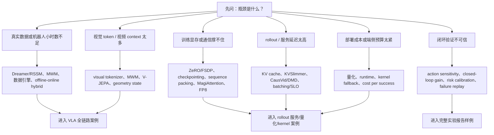

# 全站效率技术覆盖矩阵

这页是全站地图，回答一个问题：**每个专题到底服务哪类效率，证据入口在哪里，还有什么不能证明。** 它不替代各专题正文，也不替代 [证据与复现状态标准](evidence-and-reproducibility-standard.md)。

!!! note "读法"
    先按瓶颈选路线，再进入对应专题。不要把数据效率、训练效率、推理效率、显存效率、验证效率和部署效率混成一个笼统的“更高效”。

## 覆盖矩阵

| 专题 | 数据效率 | 训练效率 | 推理效率 | 显存效率 | 验证效率 | 部署效率 | 证据入口 | 当前缺口 |
| --- | --- | --- | --- | --- | --- | --- | --- | --- |
| [世界模型](../world-models/index.md) | RSSM/Dreamer、MWM、失败回流 | latent dynamics、masked/JEPA、轨迹 packing | imagined rollout、CausVid-style streaming | latent state、KV/GQA、低比特 rollout | action sensitivity、closed-loop gain、risk ECE | cost per success、延迟门禁 | [Claim Ledger](claim-ledger.md)、[世界模型效率矩阵](../world-models/efficiency-technique-coverage-matrix.md) | 前沿视频世界模型仍需真实闭环与独立复现 |
| [VLM/VLA](../vlm/index.md) | web-scale 表征迁移、机器人数据混合 | visual tokenizer、connector、action token | action chunk、VLA rollout 调度 | 视觉 token 压缩、长视频 memory | task bucket、failure replay | 安全回退、动作接口治理 | [VLA 全链路案例](../world-models/vla-world-model-full-chain-case.md) | 需要更多跨硬件、跨任务的动作因果证据 |
| [具身智能](../embodied-ai/index.md) | sim2real、near-miss、数据引擎 | 多相机/深度/轨迹 schema | 闭环控制频率、恢复策略 | 几何状态层、相机 token | 真实任务成功率、安全 case | 部署模式、人机接管 | RT-2、Open X、π0.5、Depth Anything 3 专题 | 真实家庭长任务复现成本高 |
| [训练](../training/index.md) | 数据质量、去重、mixture、curriculum | ZeRO/FSDP、checkpointing、低比特训练、packing | MTP 影响推理候选 | optimizer/gradient/activation state | ablation、run governance、artifact 复盘 | checkpoint 可恢复、实验经济学 | [证据标准](evidence-and-reproducibility-standard.md)、ZeRO/Megatron/技术报告专题 | 系统吞吐和任务质量仍需同表报告 |
| [推理](../inference/index.md) | prompt/cache 复用降低重复计算 | serving trace 反哺训练配置 | prefill/decode、KV、routing、speculative | KV cache、batch、上下文压缩 | online eval、SLO、shadow | P95/P99、capacity planning | [rollout 服务案例](../world-models/rollout-serving-quantization-kernel-case.md) | 系统指标不能直接证明规划质量 |
| [量化](../quantization/index.md) | QLoRA/低成本适配 | FP8/FP4/QAT、敏感头保护 | W4A16、KV INT8、runtime kernel | 权重、activation、KV、scale metadata | quality regression、task bucket | 端侧/多租户/回退路径 | SmoothQuant、Low-bit Survey、DeepSeek/Nemotron 专题 | 低比特收益需按任务桶和硬件复验 |
| [算子与编译器](../operators/index.md) | shape bucket 改善有效样本吞吐 | GEMM/attention/communication overlap | kernel fusion、runtime dispatch | HBM、shared memory、register、通信 buffer | microbench + end-to-end trace | 硬件拓扑、kernel fallback | MagiAttention、FlashAttention、DeepGEMM 专题 | microbenchmark 不等于端到端收益 |
| [扩散模型](../diffusion/index.md) | teacher/student 和 distillation 降采样成本 | DMD/LCM/Rectified Flow 少步训练 | 少步采样、streaming video | latent diffusion、VAE 压缩 | FID/VBench 与任务评测区分 | 预览/终稿分层 | DMD、DMD2、CausVid、Wan 专题 | 视频质量指标不能替代 planning utility |
| [强化学习](../reinforcement-learning/index.md) | replay、offline RL、verifiable reward | policy gradient、GRPO、world-model RL | rollout batching、reward 评估 | actor/critic/value state | closed-loop、reward hacking、risk | 自动验证、失败回流 | RL for world models、verl 流程 | verifier 质量决定 RL 是否真省人工 |
| [论文专题](../paper-deep-dives/index.md) | 汇总数据配方证据 | 汇总训练链路证据 | 汇总推理/系统证据 | 汇总显存/KV/低比特证据 | 汇总 benchmark、ablation、closed-loop | 汇总代码、demo、部署证据 | [证据标准](evidence-and-reproducibility-standard.md) | 新增专题必须同步补 Evidence Snapshot |

## 瓶颈驱动决策树

## 使用门槛

1. 写“更高效”时必须说明省的是哪一列成本。
2. 引用前沿系统时必须补 `Evidence Type` 和 `Repro Status`。
3. 只有 `System Throughput` 不能证明任务质量，只有 `Official Demo` 不能证明平均成功率，只有 `Toy Fixture` 不能证明真实系统有效。
