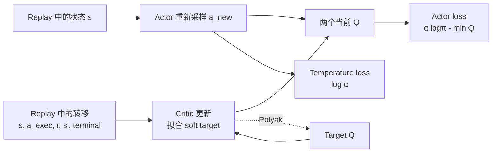

# 连续控制与 SAC

一根倒立摆需要在连续力矩中选择动作。仓库 SAC 示例使用 Pendulum-v1，观察包含角度的正余弦与角速度，动作范围为 `[-2,2]`。DQN 可以枚举几个离散按钮，连续力矩却有无限多个候选，通常需要 actor 直接产生动作。SAC 同时训练随机 actor 和动作价值 critic，并把策略熵放入回报目标；读代码时应先分清三个更新分别消费哪一份动作和梯度。



同一个 batch 会被三个更新重复读取，但动作的来源不同。critic 用日志里真正执行过的 `a_exec`，actor 在相同状态上重新采样 `a_new`，temperature 只看当前策略的 log density。先把这三条线分开，SAC 代码里的 `detach`、`no_grad` 和参数冻结才有明确含义。

## 同一条摆杆经验怎样进入三个更新

Replay 中存储 `(state, executed_action, reward, next_state, terminated)`。Critic 用这条转移判断刚才的力矩有多好，actor 在这些状态上重新采样当前动作，temperature 再调节随机性的权重。它们消费同一 batch，却不优化同一个参数集合。

假设一批 64 条转移，观察形状为 `[64,3]`，动作为 `[64,1]`。Actor 输出高斯的均值与 log standard deviation，经采样和 tanh 得到合法力矩；critic 把状态与动作拼成四维输入，分别输出两个 `[64,1]` Q。三个优化器更新之间需要分清冻结谁、在哪个分支保留梯度，否则有限的 loss 也可能对应错误算法。

## 熵如何进入价值递推

策略熵为 $H(\pi(\cdot\mid s))=\mathbb E_{a\sim\pi}[-\log\pi(a\mid s)]$。在最大熵目标中，未来奖励之外还计入 $\alpha H$，其中温度 $\alpha>0$ 控制熵的权重。常用 twin-Q 版本的 critic target 是

\[
y=r+\gamma b\left[\min_{j=1,2}Q_{\bar\phi_j}(s',a')-\alpha\log\pi_\theta(a'\mid s')\right],\quad a'\sim\pi_\theta(\cdot\mid s').
\]

$b$ 在真实终止时为零。取两个 Q 的较小者用于缓解过估计，不能保证它一定是真实价值的下界。目标分支停止梯度，两个 critic 分别拟合该目标。

设 $r=1$、$\gamma=0.9$、较小的后继 Q 为 $4$、$\alpha=0.2$、后继动作 log density 为 $-0.5$，则目标为 $1+0.9(4+0.1)=4.69$。这组值演示熵项的符号，实际连续概率密度也可能大于 $1$，其 log density 为正并不违规。

## 有界动作的概率密度不能照抄高斯

Actor 通常先产生高斯变量，再通过 tanh 压到合法动作范围。设动作上下界为 $l,h$，则

\[
u=\mu_\theta(s)+\sigma_\theta(s)\odot\varepsilon,\quad\varepsilon\sim\mathcal N(0,I),
\qquad a=c\odot\tanh u+d,
\]

其中 $c=(h-l)/2$，$d=(h+l)/2$。重参数化使梯度能从 Q 经动作流回 actor。概率密度还必须考虑变换的体积变化

\[
\log\pi(a\mid s)=\log\mathcal N(u;\mu,\sigma)
-\sum_i\log(1-\tanh^2u_i)-\sum_i\log c_i.
\]

忽略 tanh Jacobian 会把压到边界附近的密度算错；忽略 action scale 则混淆归一化动作与环境动作的坐标。例子中 $u=0$、标准高斯、环境范围 $[-2,2]$，tanh 项为零，但尺度项为 $-\log2$，环境动作的 log density 为约 $-1.6121$，而非标准高斯的 $-0.9189$。

```python
import math
normal_logp = -0.5 * math.log(2.0 * math.pi)
environment_logp = normal_logp - math.log(2.0)
assert abs(environment_logp + 1.6120857138) < 1e-9
```

数值实现常对 $1-\tanh^2u$ 加小量防止取零的对数。更稳定的等价表达是 $\log(1-\tanh^2u)=2(\log2-u-\operatorname{softplus}(-2u))$。动作尺度变化也改变微分熵，target entropy 必须说明使用哪个坐标系，不能在改动动作归一化后机械沿用阈值。

## Actor 的梯度穿过 Q，但不更新 Q 参数

给定 replay 中的状态，actor 最小化

\[
L_\pi=\mathbb E\left[\alpha\log\pi_\theta(a_\theta(s)\mid s)-\min_jQ_{\phi_j}(s,a_\theta(s))\right].
\]

第一项鼓励熵，第二项鼓励高价值动作。Actor 更新时可以冻结 critic 参数，但必须保留 Q 对动作的梯度。把整个 Q 调用放进 `no_grad` 会连这条动作梯度一起切断。Critic、actor 和 temperature 的优化器也应分别清梯度、反向传播和更新，避免意外累积。

Replay 里的状态动作来自历史策略，critic 可以重用这些转移；actor 在这些状态上重新采样当前动作。这解释了 SAC 的 off-policy 数据使用方式，也解释了旧数据覆盖与当前动作分布差异仍然重要。

## 温度怎样自动调整

设 $\eta=\log\alpha$，常用的温度代理损失为

\[
L_\alpha=-\mathbb E\left[\eta\operatorname{stopgrad}(\log\pi(a\mid s)+H_{\mathrm{target}})\right].
\]

若估计熵 $H=-\mathbb E\log\pi$ 低于目标，则对 $\eta$ 的梯度为 $H-H_{\mathrm{target}}<0$，梯度下降增大 $\eta$，从而增大 $\alpha$，提高后续 actor 的熵权重。例如目标微分熵 $-1$，当前熵 $-2$，梯度为 $-1$，更新方向应提高温度。熵可以为负，这是连续密度的正常性质。

Target Q 也缓慢跟随在线 Q。若约定 $\tau$ 为新参数的权重，则 Polyak 更新是 $\bar\phi\leftarrow(1-\tau)\bar\phi+\tau\phi$。另一些文献用相反记号，读配置时必须看具体公式。

## 把公式放回一次实际 minibatch 的顺序

仓库 [`run_sac`](../assets/examples/reinforcement-learning/deep_rl_smoke.py) 先在 `no_grad` 中对 `next_states` 采当前策略的下一动作，用两个 target Q 的较小者和下一动作 log density 计算固定 target。当前两个 Q 则读取 replay 中真正执行过的 `actions`，分别拟合这个 target。这里不能拿新采动作替换日志动作，否则 reward 和后继状态就不再对应它。

更新 actor 时重新读取 `states`，采新的 `sampled_actions`，用当前两个 Q 评分。Critic 参数临时冻结，但从 Q 输出到动作再到 actor 的导数保留。Actor 优化器执行完，再使用停止梯度的 log density 更新 `log_alpha`，最后缓慢更新 target Q。每步的输入和梯度用途如下。

| 更新 | 读取的动作 | 梯度到哪里 | 被固定的量 |
| --- | --- | --- | --- |
| critic | replay 实际动作 | 两个当前 Q 参数 | 下一动作、target Q、温度和 target |
| actor | 当前策略新采动作 | actor，经由 Q 对动作的导数 | Q 参数与温度 |
| temperature | 当前采样的 log density | `log_alpha` | actor log density 与目标熵 |
| target 跟随 | 无新动作 | 无反向传播 | 按 Polyak 公式赋值 |

再回看 $u=0$ 的密度算例，动作在环境坐标中为 0，log density 为 −1.6121。若一条构造经验奖励为 −1、下一状态较小 Q 为 −4、$\alpha=0.2,\gamma=0.9$，target 为 $-1+0.9[-4-0.2(-1.6121)]\approx-4.3098$。熵项提高了这条 soft target，但没有把负任务奖励变成正奖励。Critic 学的是含熵的目标，不能把 Q 数值直接当作环境原始回报。

## Pendulum 示例与结论边界

仓库[`deep_rl_smoke.py`](../assets/examples/reinforcement-learning/deep_rl_smoke.py)的 SAC 路径使用 Pendulum-v1，观察维数为 $3$，动作范围为 $[-2,2]$。前 64 个动作随机采样，replay 达到 64 条后开始更新。256 次交互从第 64 条数据起每步更新一次，共 193 次。

```bash
python files/assets/examples/reinforcement-learning/deep_rl_smoke.py sac --seed 7 --steps 256
```

示例设定 `target_entropy=-1.0`，使用 scale-corrected environment-action logprob，即已经包含动作尺度修正的环境动作密度。实现保留 tanh 与 action-scale 的 log density 修正，actor 更新期间冻结 critic 参数，并独立优化 `log_alpha`。[示例 README](../assets/examples/reinforcement-learning/README.md)解释 `actor_loss`、`critic_loss`、`alpha`、参数变化和回报字段。短于完整 episode 的运行应报告 `completed_episode_return_mean=unavailable` 和 `current_partial_episode_return`，不能制造一个值为零的 completed return 均值。

SAC 的多项 loss 都有限，只说明这些计算没有立即数值失败。策略是否学到稳定控制，还需要足够交互、多 seed、独立评测和动作分布检查。原始最大熵框架见 [SAC 论文](https://arxiv.org/abs/1801.01290)，自动温度与后续算法表述见 [Soft Actor-Critic Algorithms and Applications](https://arxiv.org/abs/1812.05905)。完全固定数据时还需面对[离线 RL](offline-reinforcement-learning.md)的分布外动作问题。

## 算法和环境依据

最大熵目标和 twin-Q 更新参考 [Soft Actor-Critic](https://arxiv.org/abs/1801.01290)，自动温度和工程化算法表述参考 [Soft Actor-Critic Algorithms and Applications](https://arxiv.org/abs/1812.05905)。Pendulum 的观察、动作范围、短运行和 log-prob 修正来自本站的 smoke test；它只验证更新链路，不证明 SAC 已学会稳定控制。

自测时冻结同一批 replay，分别只执行 critic、actor 和 temperature 一步，打印每个参数集合的梯度是否存在。再去掉 tanh action-scale 的 log density 修正，比较 target 与 actor loss，能看到一个常被隐藏的接口错误。
