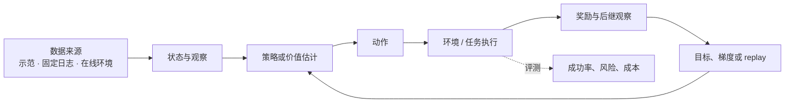

# 强化学习

在一张只有六个格子的地图上，智能体从左下角走到右上角。绕开障碍会多走一步，直接冲过去可能撞墙，终点奖励要到几步之后才出现。这个小例子已经包含了强化学习最麻烦的部分，动作会改变后面能看到的状态，奖励可能延迟，训练得到的策略还要在新的轨迹上接受检验。

机器人抓杯子、语言模型生成答案，使用的模型和反馈形式差别很大，判断能否用强化学习时仍要落回三个问题，决策过程能否写清楚，反馈是否真的对应目标，探索或离线外推的代价是否可接受。

同一个算法名放在不同数据来源上，训练问题可能完全不同。先沿这条闭环标出数据从哪里来、动作有没有新反馈，再决定读 value、policy、offline 或 model-based 分支。

## 导航任务怎样产生学习信号

设一个教学任务连续三次行动得到奖励 $1,0,2$，折扣因子 $\gamma=0.9$。从起点看的回报为

\[
G_0=1+0.9\times0+0.9^2\times2=2.62.
\]

第二步虽然没有即时奖励，却可能是获得最后两分的必要动作。只拟合“哪一步的奖励最大”，会丢掉这条因果链。强化学习里的价值函数估计从某个状态或动作继续执行策略能得到多少回报；策略则决定如何行动。价值预测和策略改进因此相互依赖。

这里有三种容易混在一起的量。reward 是环境给某次转移的反馈，return 是一段未来反馈的累计，value 是在策略与环境随机性下对 return 的条件期望。单条轨迹回报高，不保证策略平均表现好；value 高，也不表示眼前奖励高。它可能来自预计稍后获得的机会，也可能来自错误外推。

## 先辨认数据怎样产生

| 设置 | 训练中有什么 | 优化的直接对象 | 容易漏掉的限制 |
| --- | --- | --- | --- |
| 监督学习 | 输入与目标标签 | 标签预测误差 | 标签未必表达长期后果 |
| 模仿学习 | 示范状态与动作 | 模仿行为的概率或距离 | 自己行动后可能进入示范未覆盖的状态 |
| Offline RL | 固定的状态、动作、奖励和后继状态日志 | 数据约束下的长期回报 | 无法现场验证没见过的动作 |
| Online RL | 能持续与环境交互 | 交互产生的回报 | 探索消耗时间、资源并可能产生失败 |

Off-policy 和 offline 也不同。DQN、SAC 可以从旧策略的 replay 学习，同时继续收集新数据，因此属于 online off-policy 方法。Offline RL 的训练数据固定，错误动作价值缺少新反馈纠正。[离线强化学习](offline-reinforcement-learning.md)专门处理这一困难。

## 按问题查阅 {#完整学习路线}

这些文章按技术依赖连接，可以围绕眼前的问题阅读。数学符号不熟时，可随时返回[概率与期望](../prerequisite-math/probability-distributions-and-expectation.md)。

| 当前问题 | 对应正文 |
| --- | --- |
| observation、state、action 与一次环境交互分别是什么 | [Agent、环境与训练闭环](rl-agent-environment-loop.md) |
| 未知选项该怎样探索，探索成本如何计算 | [多臂老虎机与探索](multi-armed-bandits-and-exploration.md) |
| 延迟奖励怎样写成可递推的价值 | [MDP、价值函数与 Bellman](mdp-value-bellman.md) |
| 有模型和只有轨迹时怎样估计同一个价值 | [动态规划、Monte Carlo 与 TD](dynamic-programming-monte-carlo-td.md) |
| 怎样通过动作价值学习离散决策 | [Q-learning 与 DQN](q-learning-and-dqn.md) |
| 奖励为什么能对动作概率求梯度 | [Policy Gradient 与 REINFORCE](policy-gradient-and-reinforce.md) |
| 怎样用 critic 降低方差，并约束策略更新 | [Actor-Critic、GAE 与 PPO](policy-gradient-actor-critic-ppo-grpo.md) |
| 连续动作的概率、熵和 replay 怎样协作 | [连续控制与 SAC](continuous-control-and-sac.md) |
| 固定日志为什么会诱发分布外动作高估 | [Offline Reinforcement Learning](offline-reinforcement-learning.md) |
| 怎样利用环境预测进行规划或策略学习 | [Model-based RL 与世界模型](rl-for-world-models.md) |
| 人类偏好、可验证奖励怎样训练语言模型 | [LLM 强化学习](llm-rlhf-rlvr-and-grpo.md) |
| 分布式系统怎样保存采样与更新的概率关系 | [verl 训练流程](verl-code-flow.md) |
| 动作块怎样接上真实反馈、恢复和人工接管 | [VLA、机器人与闭环强化学习](vla-robotics-and-closed-loop-rl.md) |
| 算法假设和实验结果怎样一起判断 | [实践与算法选择](practice-and-algorithm-selection.md) |

## 从一次更新核对到实际行为

价值方法先检查 reward、bootstrap 和 Q 的尺度；策略梯度先检查动作 log probability、advantage 的符号和优化方向；模型方法先检查预测是否会随动作正确变化。它们最后都要回到闭环行为。训练 loss 降低、奖励上涨和真实任务成功，是三种不同证据。

### 先把一条 transition 读对

在开始看算法前，拿一条环境返回值逐字段核对：

| 字段 | 例子 | 读者要回答的问题 |
| --- | --- | --- |
| observation | `s=2` | 这是执行动作前还是 reset 后的状态？ |
| action | `a=1` | 是策略提出的动作还是过滤器实际执行的动作？ |
| reward | `-1` | 奖励对应这一步转移，还是下一个状态？ |
| next observation | `s'=3` | 它是否来自同一 episode？ |
| terminated / truncated | `False / True` | 价值目标是否还应 bootstrap？ |

例如奖励为 `1`、折扣为 `0.9`、截断前的后继状态价值为 `6`，外部时间上限只会让采样段结束，TD 目标仍是 `1 + 0.9×6 = 6.4`；若任务在该步自然终止，目标是 `1`。把二者压成一个 `done=True` 会让同一条算法在不同环境里学习不同目标。完整接口见[Agent、环境与训练闭环](rl-agent-environment-loop.md)。

这张表的数字是机制例子。真正的环境还要记录 `final_observation`、episode ID、时间步和自动 reset 行为。先把这条合同固定下来，再比较 DQN、PPO 或 SAC 的算法差异，排查会快很多。

仓库的[可运行示例](../assets/examples/reinforcement-learning/README.md)提供 Bandit、GridWorld、策略目标数值计算，以及 DQN、REINFORCE、PPO、SAC 的短更新流程。前几种适合逐项核对公式；深度 RL 的短运行只检查数据流、有限 loss 和参数变化，不能据此宣称收敛。每篇文章会说明具体检查了什么，以及哪些结论仍需要多个随机种子和独立环境评测。

本站 [REINFORCE](policy-gradient-and-reinforce.md) 与 [PPO](policy-gradient-actor-critic-ppo-grpo.md) 使用同一张六格地图，正文给出可独立运行的完整 NumPy 学习循环，并用环境的精确价值评估训练前后变化。它们让轨迹、目标和参数更新对应起来；两者训练预算不同，文中的结果不用于算法性能排名。

## 怎样把算法读成可检查的代码

第一次实现时，顺序不必跟着论文热度走。先用 Bandit 和小型 GridWorld 核对 reward、return、探索和随机策略，再在 DP、MC、TD 中比较 bootstrap 带来的偏差与方差。到了 DQN 和 REINFORCE，分别盯住离散 Q 的目标值，以及轨迹中 log probability 的梯度。Actor-Critic、PPO、SAC 会再加入 value baseline、熵、连续动作和 replay。Offline RL、Model-based RL 与 RLHF 则要等数据支持、模型误差和奖励来源都能单独说清楚以后再接入。

每增加一种算法，都保留一个小环境回归集。新实现如果不能在小环境里重现基本趋势，先查数据流和目标定义，训练更大的网络只会把问题藏得更深。

一个实用的学习顺序是：先用 Bandit 验证探索和随机策略，再用六格地图验证回报与终止，再用同一张地图比较 DP、MC、TD 和 REINFORCE，最后才把网络、并行环境、连续动作或离线数据接进来。每一步保留精确解或可计算基线，记录真实交互步数、参数更新次数、评测 episode 数和失败原因。这样新增算法带来的变化才有可比较的参照。

## 自测，reward 上升能说明什么

给出一个训练后平均 reward 上升、但碰撞率也上升的机器人策略。列出至少三个可能解释，并写出下一项对照。合理方向包括奖励塑形改变、探索或安全约束变化、评测分布改变或终止条件被绕过。只有把 reward、任务成功、风险事件和数据分母一起记录，才能判断是否真的改善。

## 再去看哪些材料

Sutton 与 Barto 的[教材](http://incompleteideas.net/book/the-book-2nd.html)和 OpenAI Spinning Up 的[入门材料](https://spinningup.openai.com/en/latest/spinningup/rl_intro.html)适合建立 MDP、回报、价值和策略的共同词汇。读本站的 Bellman、DP/MC/TD、DQN 和 REINFORCE 时，可以同时打开 CleanRL 的[PPO 实现](https://docs.cleanrl.dev/rl-algorithms/ppo/)，对照 rollout、GAE 和 clipping 在代码中分别落在哪里。等 reward、return、value、advantage 和 policy ratio 能互相区分，再进入 RLHF、RLVR 和 GRPO 会轻松很多。
