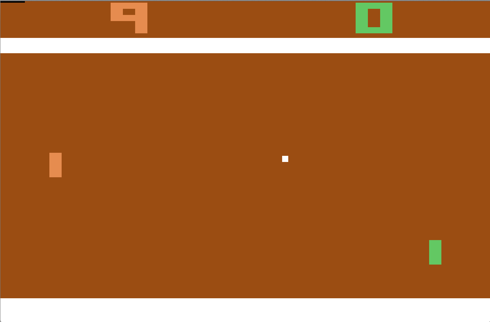
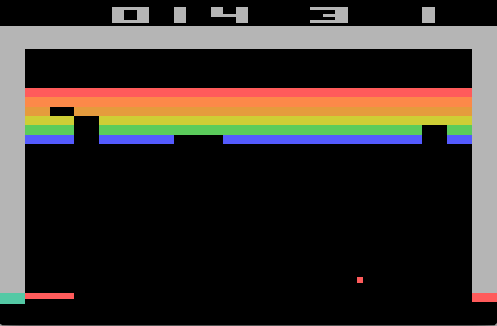
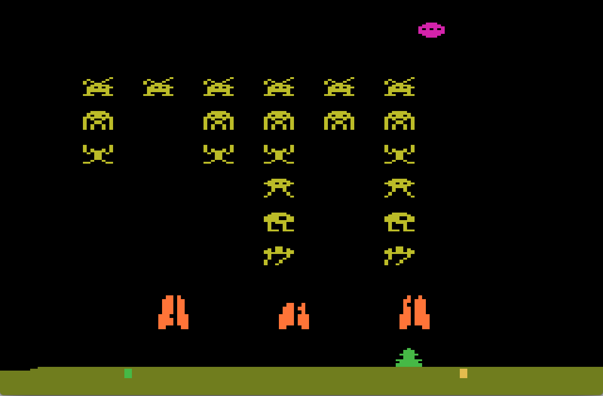
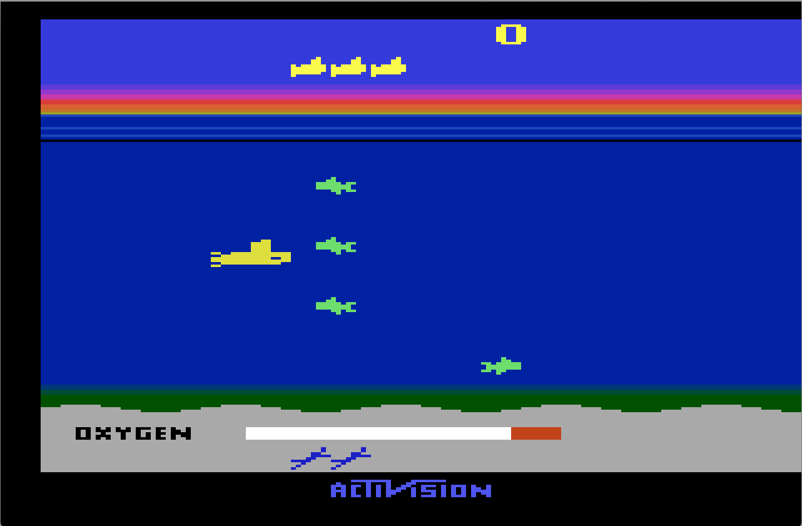
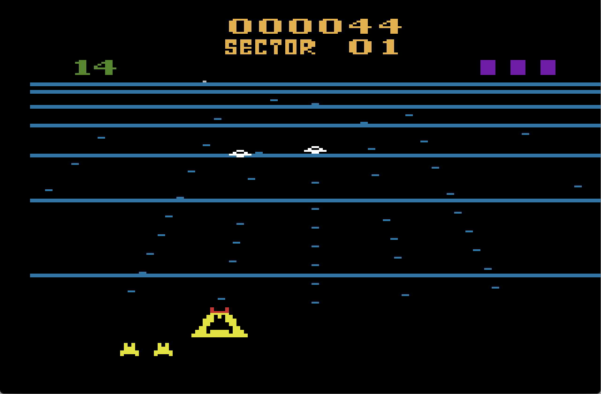
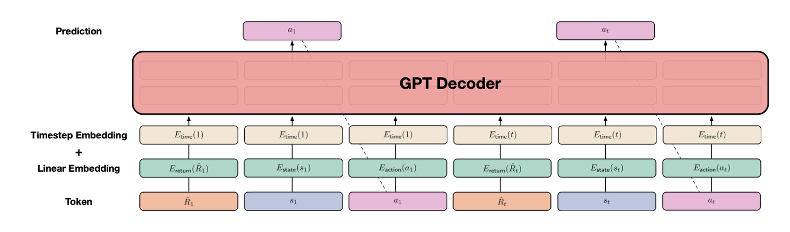
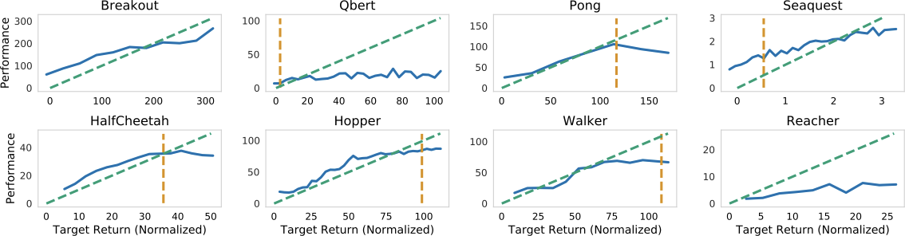
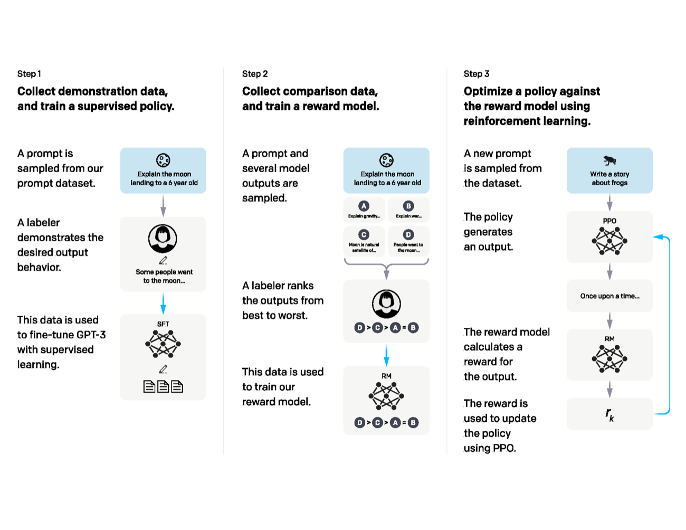

# 强化学习路线图：从奖励到世界模型

强化学习是从 VLM/VLA 走向世界模型时必须补上的决策层。VLM 让模型看懂视觉和语言，VLA 让模型输出动作，世界模型让模型预测动作后果，而强化学习负责把“结果好不好”转回策略更新、奖励优化和闭环改进。

!!! note "在主线里的位置"
    世界模型高效训练不能只看预测视频像不像，还要看预测是否能改善决策。强化学习专题负责把 imagined rollout、真实交互、奖励、value、advantage 和策略更新接起来，帮助判断一个世界模型到底是在节省真实试错成本，还是只是在生成看起来合理的未来。

!!! note "初学者先抓住"
    强化学习不是“多一个 loss 名字”，而是一种闭环学习方式：模型先做动作，环境或评测器给奖励，再根据奖励把更好的行为概率提高。它和监督学习最大的差别是，监督学习直接告诉你标准答案；强化学习通常只告诉你这段行为最终好不好。

!!! tip "本专题的读法"
    先别急着推公式，先把一次循环讲清楚：谁观察、谁行动、谁给反馈、反馈如何变成策略更新。读 PPO、GRPO、RLVR、Dreamer 或 verl 时，都把它们放回这条循环里看，复杂配置就会少很多噪声。

<div class="atlas-meta-grid">
  <div>
    <strong>读前先知道</strong>
    <p>监督学习、概率采样、loss、梯度和基础序列生成。</p>
  </div>
  <div>
    <strong>读中抓主线</strong>
    <p>state、action、reward、return、advantage、policy update。</p>
  </div>
  <div>
    <strong>读完能判断</strong>
    <p>一个 RL 方法是在改奖励、采样、baseline、KL 约束、rollout 系统还是世界模型。</p>
  </div>
</div>

如果你只有监督学习基础，可以先这样迁移概念：

| 监督学习里熟悉的东西 | 强化学习里的对应物 | 不同点 |
| --- | --- | --- |
| 样本 \(x\) | state / observation：当前看到的局面 | RL 的输入会被上一轮动作改变 |
| 标签 \(y\) | reward：行为结果的反馈 | reward 常常延迟出现，不一定告诉正确动作 |
| 模型输出 | action / response：要执行的动作或生成内容 | 输出会影响下一步数据分布 |
| loss | policy objective / value loss | 目标里经常包含采样、baseline、KL 和长期回报 |
| 验证集指标 | closed-loop return / success rate | 离线分数高不一定代表真实交互会成功 |

!!! example "有趣例子：刷题和学骑车"
    监督学习像做带答案解析的选择题，错了能看到标准答案。强化学习更像学骑车：没有人逐帧告诉你脚踏板该转多少度，但摔倒、保持平衡、顺利转弯会给你反馈。世界模型则像在脑中预演“如果现在急刹会不会摔”，再让策略选更稳的动作。

## 0. 最小闭环：先把五个角色分清楚

初学者读 RL 公式前，先把下面五个角色分清楚：

| 角色 | 简洁解释 | 大模型 / VLA 里的对应 |
| --- | --- | --- |
| agent | 做决定的系统 | LLM、VLM policy、VLA policy、机器人策略 |
| environment | 被 agent 改变并返回反馈的外部世界 | prompt 评测器、工具环境、仿真器、真实机器人场景 |
| observation / state | 当前能看到或能推断出的局面 | prompt、图像、历史动作、latent state |
| action | agent 实际选择的输出 | token、完整回答、工具调用、动作块、关节命令 |
| reward | 结果好坏的反馈 | 正确性、偏好分、任务成功、碰撞惩罚、视频预测指标 |

一次 RL 训练可以压成一条循环：

```text
观察局面 -> 采样动作 -> 得到结果和奖励 -> 估计这次行为比预期好不好 -> 更新策略
```

!!! note "难点解释：为什么一定要采样"
    如果模型永远只输出最可能的答案，你只能看到一种行为的结果，也就不知道其他答案会不会更好。采样让模型暴露出多种候选行为，reward 才能比较“哪一种更值得提高概率”。GRPO 里 `rollout.n=5` 就是在同一道题或同一状态下采样多次，用组内比较构造 advantage。

同一套语言可以落到不同系统里：

| 场景 | state / observation | action | reward |
| --- | --- | --- | --- |
| Atari | 屏幕像素和历史帧 | 上下左右、开火等按键 | 游戏分数 |
| 数学 RLVR | 题目 prompt 和当前解题前缀 | 下一段推理或完整答案 | 答案正确、格式正确 |
| VLA | 图像、语言指令、关节状态、历史动作 | 动作 token 或 action chunk | 成功率、碰撞、平滑度 |
| 世界模型 | 当前状态、动作和上下文 | 预测下一状态或未来轨迹 | 和真实未来的可验证指标 |

## 1. 为什么这里需要强化学习

从 VLM/VLA 走向世界模型时，问题会发生变化：

| 阶段 | 主要问题 | 学习信号 |
| --- | --- | --- |
| VLM | 视觉和语言如何对齐 | 图文配对、指令数据、问答标签 |
| VLA | 当前观测下应该做什么动作 | 示范轨迹、行为克隆、成功/失败反馈 |
| 世界模型 | 动作之后未来会怎样 | 下一状态、奖励、终止、风险、可验证指标 |
| RL | 怎样让行为因结果而改进 | reward、advantage、return、policy update |

如果只用监督学习，模型最多学会“模仿数据里出现过的动作”。真实智能体还需要处理未见过的状态，根据长期结果调整短期动作，主动探索更好的策略，在世界模型里先想象后果再决定是否执行，并用可验证奖励把生成模型或世界模型对齐到任务指标。

!!! example "有趣例子：学会煎鸡蛋"
    监督学习像看教程：每一步该怎么做都有人示范。强化学习像自己练习：鸡蛋煎糊会扣分，火候刚好会加分，模型逐渐学会“什么时候翻面”和“火太大要调小”。世界模型则更进一步：还没下锅前，先预测如果继续大火会不会糊。

## 2. 本章阅读路线

| 页面 | 你会学到什么 |
| --- | --- |
| [MDP、价值函数与 Bellman](mdp-value-bellman.md) | state、action、reward、return、value、Q-value、Bellman 的基础语言 |
| [Policy Gradient 到 PPO / GRPO](policy-gradient-actor-critic-ppo-grpo.md) | 从 REINFORCE 到 PPO/GRPO，理解 LLM/VLM 后训练为什么这样做 |
| [世界模型中的强化学习](rl-for-world-models.md) | model-based RL、Dreamer、PlaNet、RLVR-World 与 world model 的关系 |
| [verl 训练流程：从配置到 RL 更新](verl-code-flow.md) | 结合 `verl-project/verl` 理解 actor、rollout、critic、reward 和 Ray trainer |

## 3. 和 VLM/VLA 的关系

VLM/VLA 章节里保留的 CLIP/InfoNCE 只解决静态表示问题：

\[
\text{image/text similarity}
\]

强化学习解决的是行动后的结果优化：

\[
\max_\theta\; \mathbb{E}_{\tau\sim\pi_\theta}\left[\sum_t \gamma^t r_t\right]
\]

这两个方向都重要，但服务的系统层不同。静态对齐让模型“看懂”；策略学习让模型“做对”；世界模型让模型“预判做了以后会怎样”。

!!! note "难点解释：静态对齐和决策学习的分工"
    CLIP/InfoNCE 这类目标擅长建立静态语义空间：图片和文本是否匹配、语义是否接近。强化学习处理的是另一层问题：某个动作、回答或预测会带来什么结果，怎样根据 reward、advantage、imagined rollout 和 verifiable reward 改进策略。读到世界模型时，一定要把“相似性空间”和“动作后果优化”分开。

## 4. 强化学习在大模型时代的三种形态

| 形态 | 典型场景 | 关键差别 |
| --- | --- | --- |
| 经典控制 RL | 游戏、机器人、连续控制 | 环境会返回下一状态和奖励，目标是学策略 |
| RLHF / RLVR | LLM、VLM、agent 后训练 | 模型生成回答或动作，reward model 或规则奖励打分 |
| Model-based RL | PlaNet、Dreamer、TD-MPC、世界模型 | 先学习 dynamics，再在模型里规划或训练策略 |

大模型后训练常见的 PPO、GRPO、RLOO、ReMax，本质上都在解决一个共同问题：生成式模型的输出空间太大，奖励又常常只在完整回答或完整轨迹结束后出现，所以需要稳定地把“这次结果好不好”转回 token、动作和参数更新。

!!! note "初学者判断：你看到的到底是哪类 RL"
    如果论文在真实或仿真环境里反复交互，通常是经典控制 RL。如果论文用 prompt 采样回答、规则或 reward model 打分，通常是 LLM/VLM 后训练。如果论文先学习 \(P(s_{t+1}\mid s_t,a_t)\)，再在模型里想象未来，通常是 model-based RL 或世界模型路线。三者共享 reward、return、advantage 这些语言，但工程瓶颈完全不同。

## 4.1 从论文专题回填的 RL 知识点

技术报告里的 RL 已经不再只是 InstructGPT 式 RLHF。现在更常见的是 rule-verifiable reward、多环境同步训练、agentic tool environments 和世界模型 imagined rollout。

| 专题来源 | RL 层面的补充 | 应接到本章哪里 |
| --- | --- | --- |
| [DeepSeek-R1](../paper-deep-dives/technical-reports/deepseek-r1.md) | 纯 RL / RLVR 可以在可验证任务上激发推理，但 reward 设计、格式约束和 cold-start SFT 决定稳定性 | [Policy Gradient、PPO 与 GRPO](policy-gradient-actor-critic-ppo-grpo.md)、[verl 代码流程](verl-code-flow.md) |
| [Qwen3](../paper-deep-dives/technical-reports/qwen3.md) | thinking budget 和强到弱蒸馏说明 RL 后的能力还要被蒸馏、压缩和模式化，才能进入可控产品形态 | [Policy Gradient、PPO 与 GRPO](policy-gradient-actor-critic-ppo-grpo.md) |
| [Nemotron 3 Super](../paper-deep-dives/technical-reports/nemotron-3-super.md) | 异步 GRPO、多环境同步 RL、masked importance ratio 和 MTP 加速 rollout 说明 RL 系统瓶颈已经扩展到采样吞吐和策略滞后 | [verl 代码流程](verl-code-flow.md)、[世界模型中的强化学习](rl-for-world-models.md) |
| [Kimi K2](../paper-deep-dives/technical-reports/kimi-k2.md) | agentic data synthesis、tool-use SFT、self-critique reward 和 checkpoint engine 说明开放 agent RL 要把环境、数据和恢复机制一起设计 | [Policy Gradient、PPO 与 GRPO](policy-gradient-actor-critic-ppo-grpo.md)、[世界模型中的强化学习](rl-for-world-models.md) |
| [Dreamer](../paper-deep-dives/world-models/dreamer.md)、[DreamZero](../paper-deep-dives/embodied-ai/dreamzero.md) | 世界模型里的 RL 不是给回答打分，而是在 learned dynamics 或 joint video-action model 中训练/选择动作 | [世界模型中的强化学习](rl-for-world-models.md) |

## 5. 论文图先建立直觉

经典深度强化学习常从 Atari 游戏讲起，因为它把“看图像、选动作、拿分数、长期优化”压缩在一个容易观察的环境里。

| Pong | Breakout | Space Invaders | Seaquest | Beam Rider |
| --- | --- | --- | --- | --- |
|  |  |  |  |  |

<small>图源：[Playing Atari with Deep Reinforcement Learning](https://arxiv.org/abs/1312.5602)，Figure 1。原论文图意：展示 DQN 训练中使用的 Atari 2600 游戏画面。</small>

!!! note "图解：为什么 Atari 图适合做 RL 入门"
    每张图都可以按同一套语言读：屏幕像素是 observation，按键是 action，游戏分数变化是 reward，一局游戏是 trajectory。DQN 的难点是模型只能从图像和分数里学到“什么时候开火、什么时候躲避、什么时候等待”，这正好对应 RL 的长期信用分配问题。

Decision Transformer 适合理解“RL 轨迹也可以被看成序列建模问题”：它把 return、state、action 交替放进 Transformer，让模型在给定目标回报的条件下预测动作。

{ width="920" }

<small>图源：[Decision Transformer: Reinforcement Learning via Sequence Modeling](https://arxiv.org/abs/2106.01345)，Figure 1。原论文图意：把 return-to-go、state 和 action 三类 token 输入 GPT decoder，用自回归方式预测后续 action。</small>

!!! note "图解：为什么这张图和大模型/VLA 很相关"
    这张图把 RL 从“显式 Bellman backup”改写成“条件序列建模”：如果希望未来拿到高回报，就把目标 return 作为条件输入，再预测动作。对 VLA 和世界模型来说，这个视角很有用：轨迹可以像语言一样 token 化，动作也可以进入 Transformer；但它仍依赖离线数据质量，不能自动解决分布外动作和闭环失败。

{ width="920" }

<small>图源：[Decision Transformer](https://arxiv.org/abs/2106.01345)，Figure 4。原论文图意：展示不同任务中目标 return conditioning 与实际性能的关系，虚线表示理想单调趋势。</small>

!!! note "图解：return conditioning 不是魔法按钮"
    横轴是你告诉模型“我想要多少回报”，纵轴是实际执行表现。理想情况是目标越高，实际越好；但曲线会饱和、波动甚至失效，因为训练数据里未必有足够高质量轨迹。把它迁移到机器人或世界模型时，要检查高目标条件下是否真的能闭环执行，而不是只在离线轨迹上看起来合理。

InstructGPT 的流程图是理解 LLM 强化学习后训练的入口：先做 SFT，再训练 reward model，最后用 PPO 让 policy 朝高奖励回答移动。

{ width="920" }

<small>图源：[Training language models to follow instructions with human feedback](https://arxiv.org/abs/2203.02155)，Figure 2。原论文图意：展示 demonstration data、comparison data、reward model 和 PPO policy optimization 的三步流程。</small>

!!! note "图解：RLHF 不等于人类每一步实时教模型"
    人类通常不逐 token 标注“下一步应该生成什么”。先由人写示范做 SFT，再让人比较多个回答训练 reward model，最后让 policy 自己采样回答并用 reward model 打分。PPO 的角色是把“完整回答得分”变成稳定的策略更新，同时用 reference/KL 约束避免模型为了奖励跑偏。

世界模型中的强化学习更像下面这条线：先学一个能 rollout 的内部环境，再在内部想象中训练策略或优化预测目标。

{ width="890" }

<small>图源：[Dream to Control: Learning Behaviors by Latent Imagination](https://arxiv.org/abs/1912.01603)，Figure 3。原论文图意：Dreamer 从经验中学习 latent world model，并在 imagined trajectories 上训练 action model 和 value model。</small>

!!! note "图解：Dreamer 展示了 RL 和世界模型的合流点"
    Dreamer 不把 world model 当作漂亮的视频生成器，而是当作可以在 latent space 中想象未来的训练环境。真实数据训练 dynamics，imagined rollout 训练 actor 和 value。这样做的价值是用更少真实交互获得更多策略学习信号，但前提是 world model 不能被 actor 轻易利用漏洞。

## 6. 读完本章应能回答

| 问题 | 合格理解 |
| --- | --- |
| RL 和监督学习差在哪 | 监督学习模仿给定答案，RL 根据采样行为的奖励改策略 |
| value 和 reward 差在哪 | reward 是当前反馈，value 是从当前状态往后能拿到的期望回报 |
| PPO 为什么常用 | 它限制新旧策略差距，让高方差的策略更新更稳定 |
| GRPO 为什么流行 | 它用同一 prompt 的多次采样做组内基线，减少或去掉 critic 成本 |
| RL 如何帮助世界模型 | 用任务奖励、规划反馈或 imagined rollout，让模型不只拟合数据分布，还服务决策指标 |
## 深度标杆页

强化学习专题应服务世界模型主线：从 MDP、policy、value 到 imagined rollout 和数据回流。短页需要向下面几页补足定义、公式、例子和失败模式。

| 标杆页 | 对齐标准 |
| --- | --- |
| [MDP、价值函数与 Bellman](mdp-value-bellman.md) | 把状态、动作、奖励、转移和价值函数讲清楚 |
| [PG / PPO / GRPO](policy-gradient-actor-critic-ppo-grpo.md) | 说明策略梯度、优势估计、clip 和 group reward 的取舍 |
| [世界模型中的强化学习](rl-for-world-models.md) | 明确 imagined rollout 如何减少真实交互成本 |
| [verl 训练流程](verl-code-flow.md) | 把 RL 训练从算法概念落到数据流、worker 和故障排查 |
