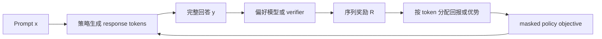

# LLM 强化学习、RLHF、RLVR 与 GRPO

同一道算术题，语言模型生成了三个回答，分别答错、部分得分、完全正确。训练要根据这些反馈改变生成概率，但日志只给了完整回答的评价，没有直接标注哪一步 token 导致了错误。语言模型生成时，动作是下一个 token，状态是 prompt 与已经生成的前缀。先把这条 credit assignment 链写清楚，再比较 RLHF、RLVR、GRPO 和 DPO，能避免把“用了奖励”当成同一个算法。



这里的奖励通常在回答结束后才出现，token 级的梯度只是把同一个序列信号沿有效 response 位置展开。padding、prompt token 和人工评语的作用不同，不能因为它们都出现在一个 batch 里就共用同一张 mask。

## 序列概率怎样连接到策略梯度

给定 prompt $x$ 和回答 $y=(y_1,\ldots,y_T)$，序列概率为

\[
\pi_\theta(y\mid x)=\prod_{t=1}^T\pi_\theta(y_t\mid x,y_{<t}),\qquad
\log\pi_\theta(y\mid x)=\sum_t\log\pi_\theta(y_t\mid x,y_{<t}).
\]

如果只有末尾回答奖励 $R(x,y)$，最简单的 REINFORCE 将同一序列回报乘到所有 response token 的 logprob 梯度上。训练并没有直接知道哪一步推理正确；信用分配来自多次采样后的统计关系。过程奖励和 critic 可以提供更细的信息，也会引入各自的标注误差或估计偏差。

Prompt token 是条件，padding 是占位，它们不应被当作采样动作加入 response policy loss。序列 logprob 是有效 token 的求和，token 平均则除以长度，这两种 reduction 会给长短回答不同权重，必须和目标定义一起检查。

## RLHF 的偏好如何变成奖励

RLHF 常从同一 prompt 下的 chosen/rejected 回答对训练 reward model。Bradley–Terry 模型将偏好概率写成

\[
p(y^+\succ y^-\mid x)=\sigma\bigl(r_\psi(x,y^+)-r_\psi(x,y^-)\bigr),
\]

因此 reward loss 为 $-\log\sigma(r^+-r^-)$。若两者分差为零，偏好概率为 $0.5$，loss 约为 $0.693$；分差为 $2$ 时，偏好概率约为 $0.881$，loss 约为 $0.127$。模型学到相对排序，不是天然校准的“人类满意度分数”，给同一 prompt 的两个奖励同时加一个常数也不改变偏好概率。

随后策略根据奖励优化，并常用 reference policy 约束偏移。[InstructGPT](https://arxiv.org/abs/2203.02155)是这类流程的原始实例。PPO 可以为 token 状态训练 critic 并使用 GAE，具体目标见 [Actor-Critic 与 PPO](policy-gradient-actor-critic-ppo-grpo.md)。

RLVR 使用可验证反馈，例如最终答案匹配或代码测试结果，减少对偏好模型的依赖。Verifier 的正确性仍是训练目标的一部分。只检查格式会奖励空洞但格式正确的回答；只检查公开测试会鼓励对测试的特化；超时、解析失败与真正答错也应分开记录。训练奖励提升需要与隐藏正确率、任务覆盖和长度变化一起解释。

## GRPO 怎样从一组回答得到优势

[DeepSeekMath](https://arxiv.org/abs/2402.03300)提出的 GRPO 对同一 prompt 采样多个回答，用组内奖励比较形成优势，从而不必训练独立 value critic。对于 outcome reward，教学形式为

\[
A_i=\frac{R_i-\overline R}{\operatorname{std}(R)+\varepsilon}.
\]

仓库[`policy_objectives.py`](../assets/examples/reinforcement-learning/policy_objectives.py)使用总体标准差，即 NumPy 的 `ddof=0`。奖励 $[0,1,2]$ 的均值为 $1$，标准差为 $\sqrt{2/3}$，忽略极小稳定项后得到 $[-1.224745,0,1.224745]$。每个回答内的有效 token 使用该回答的优势，再结合 token 概率比进行 clipped policy update。不同实现对标准差、长度归一化与 KL 项的处理可能不同，应逐项核对。

若奖励全为 $[1,1,1]$，示例明确返回零优势，避免除以接近零的标准差。这里消失的是这组数据的奖励优势项，KL 正则、其他样本或共享参数仍可能造成模型更新，不能概括成“策略完全不更新”。

组均值包含回答自身，标准差也来自同组数据，所以不能把它无条件视为与动作独立的无偏 baseline。[RLOO](https://arxiv.org/abs/2402.14740)对第 $i$ 个回答使用其余回答的均值

\[
A_i^{\mathrm{LOO}}=R_i-\frac{1}{G-1}\sum_{j\ne i}R_j.
\]

同样的奖励 $[0,1,2]$ 会得到 $[-1.5,0,1.5]$。当其他回答是在给定 prompt 下独立采样时，leave-one-out baseline 排除了自身回报与 score 的相关项。GRPO、RLOO 的估计与尺度因此不同，不能仅凭“都没有 critic”把它们当成同一个目标。

## 把三个回答接成一次 masked objective

让三个回答的有效长度分别为 2、3、4，奖励仍为 `[0,1,2]`。下面构造已经对齐的 old/current logprob，计算每个 token 的 PPO 比率，再对每条回答的有效 token 平均，最后对回答平均。它是完整的目标函数数值计算，没有调用或训练语言模型。

```python
import numpy as np

rewards = np.array([0., 1., 2.])
mask = np.array([[1,1,0,0], [1,1,1,0], [1,1,1,1]], dtype=float)
old_logp = np.array([[-1.,-.7,0.,0.], [-.8,-1.2,-.5,0.], [-1.,-.9,-.6,-.4]])
ratio_requested = np.array([[.7,.9,1.,1.], [1.1,.9,1.2,1.], [1.1,1.3,.9,1.0]])
current_logp = old_logp + np.log(ratio_requested)
advantages = (rewards - rewards.mean()) / rewards.std(ddof=0)
ratio = np.exp(current_logp - old_logp)
unclipped = ratio * advantages[:, None]
clipped = np.clip(ratio, .8, 1.2) * advantages[:, None]
per_token = np.minimum(unclipped, clipped)
per_sequence = (per_token * mask).sum(axis=1) / mask.sum(axis=1)
loss = -per_sequence.mean()
print('advantages', advantages.round(6))
print('sequence surrogate', per_sequence.round(6), 'loss', round(loss, 6))
assert np.isclose(advantages[1], 0.)
assert np.isclose(loss, -0.0816496580927726)
```

第一条负优势回答的 ratio 0.7 已低于 0.8，该位置不再因为继续降低概率获得更高代理收益；第三条正优势回答的 ratio 1.3 已超过 1.2，也不再得到这条样本的额外鼓励。中间回答优势为零，当前只看奖励项时贡献为零。

若改成全部有效 token 一起平均，长度为四的回答会比长度为二的回答贡献更多权重。原始算法及各工程变体可能选择不同 reduction，必须明确它们怎样改变优化目标。Prompt 和 padding 不属于采样回答动作，不能用同一个非空字符串判断就加进 loss。KL 正则仍需独立加入相应目标，它没有包含在上述数值里。

## Old policy 与 reference policy 分别约束什么

PPO 的 token ratio 为 $\exp(\log\pi_\theta-\log\pi_{\mathrm{old}})$，old 是生成或锚定本轮训练数据的策略。Reference 则提供 KL 约束的参照，通常在多轮训练中保持固定。

单点的 $\log\pi_\theta(a\mid s)-\log\pi_{\mathrm{ref}}(a\mid s)$ 可以为负。例如当前概率 $0.2$、reference 概率 $0.4$，差为 $\log0.5\approx-0.693$。在当前策略下对完整动作分布取期望才得到非负的 forward KL。对旧策略样本直接求均值还涉及采样分布差异，不能把任意有限批次值叫作精确 KL。

Token ratio 与 sequence ratio 也不同。后者是全部 token ratio 的乘积，长回答更容易产生极端权重；GRPO 的 token surrogate 不能用一个未经说明的序列比率替代。[verl 数据流](verl-code-flow.md)进一步区分 rollout behavior、proximal old、current 与 reference 四个角色。

## DPO 怎样直接使用偏好对

DPO 在其 KL 正则奖励模型假设下，把隐式奖励写成 reference-relative logprob。chosen 与 rejected 的分差中，prompt 相关的归一化常数抵消，得到

\[
L_{\mathrm{DPO}}=-\log\sigma\left(\beta\left[
\log\frac{\pi_\theta(y^+\mid x)}{\pi_{\mathrm{ref}}(y^+\mid x)}-
\log\frac{\pi_\theta(y^-\mid x)}{\pi_{\mathrm{ref}}(y^-\mid x)}\right]\right).
\]

它推动 chosen 相对 reference 的概率增量超过 rejected 的增量。这里是完整回答的条件 logprob，不能把 chosen 的绝对概率变大当作全部目标。原始 [DPO](https://arxiv.org/abs/2305.18290)直接训练偏好数据，不需要每次优化都在线生成新回答；数据分布、偏好噪声和 reference 选择仍会影响结果。

## 用数值脚本核对目标，不把它当训练结果

```bash
python files/assets/examples/reinforcement-learning/policy_objectives.py --seed 7
```

这个 NumPy 脚本输出两组奖励、组内优势、逐点 log-ratio 和 clipped loss。固定 seed 的 `clipped_policy_loss` 为 `0.000795`，format 组优势全为零，arithmetic 组为负、零、正。脚本使用构造的 logprob 数值检查目标函数，并没有运行语言模型，也没有证明模型正确率提高。训练和运行依赖的完整说明见[示例 README](../assets/examples/reinforcement-learning/README.md)。

在真实训练中，同一 prompt 的 group id、采样温度、每条回答长度、结束原因、raw reward、各奖励分量与 policy 版本应一起保存。最大生成长度是否算任务结束，取决于具体优化任务；有 critic 时不能机械把所有长度截断当作真实终止。零优势组比例、隐藏集正确率、KL 与回答长度的联合变化，比单独一条平均 reward 曲线更能解释更新发生了什么。[DeepSeek-R1](https://arxiv.org/abs/2501.12948)可作为 RLVR 后续系统的原始阅读入口。

## 算法和环境依据

RLHF 的数据与 PPO 流程参考 [InstructGPT](https://arxiv.org/abs/2203.02155)，GRPO 的组内相对优势参考 [DeepSeekMath](https://arxiv.org/abs/2402.03300)，留一法 baseline 对照 [RLOO](https://arxiv.org/abs/2402.14740)，偏好直接优化参考 [DPO](https://arxiv.org/abs/2305.18290)。三条算术回答、组内奖励、token reduction 和示例脚本是本站构造的机制算例；它们不代表某个 RLHF 或 RLVR 训练已经提升了模型能力。

真实实验至少同时保存 prompt/group、response token、old/current/reference logprob、raw reward、奖励分项、KL、长度和终止原因。单独看平均 reward 或 loss，无法判断提升来自正确率、长度偏置、奖励模型漏洞还是策略漂移。
