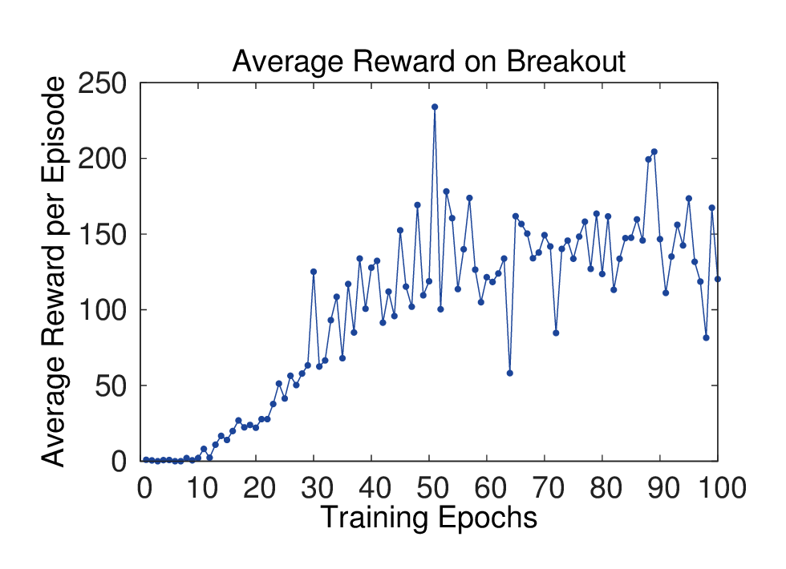
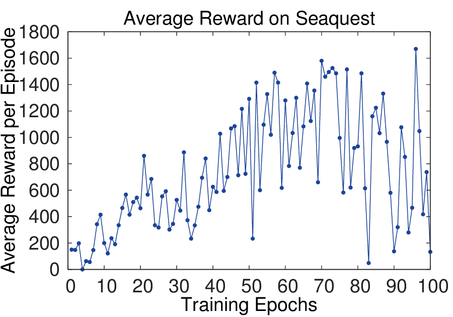
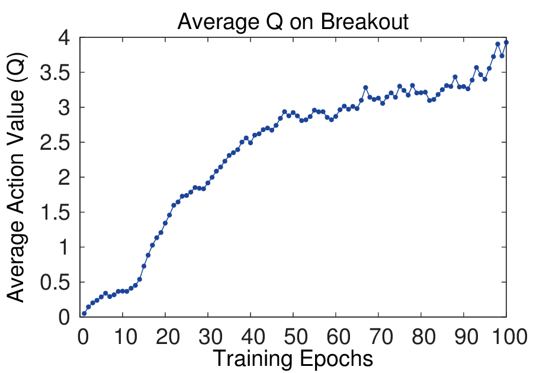
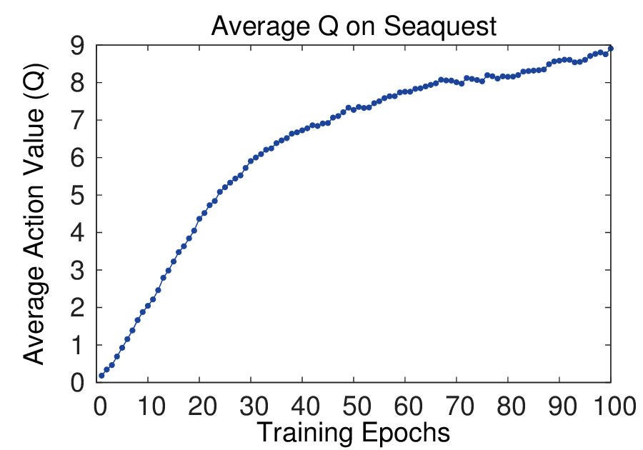
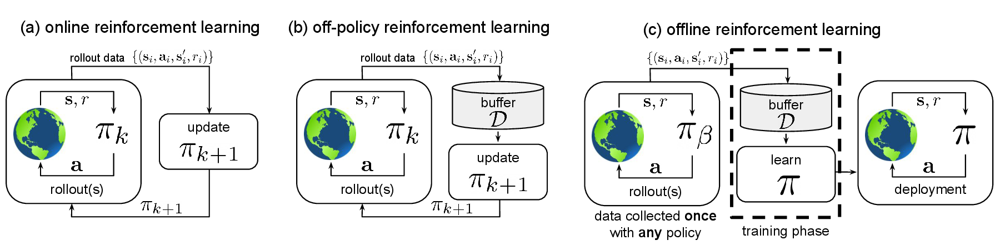
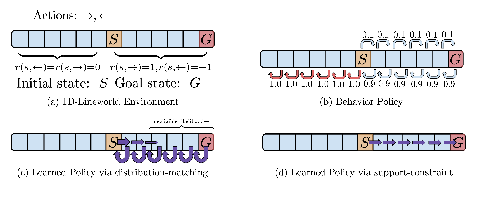
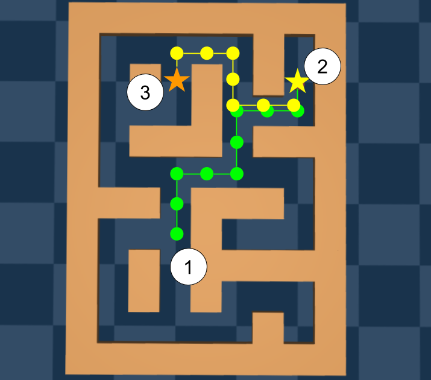

# MDP、价值函数与 Bellman

强化学习的基础不是某个算法，而是一套描述闭环决策的语言。只要把 `state`、`action`、`reward`、`policy`、`value` 和 `Bellman equation` 理顺，后面的 PPO、GRPO、Dreamer 和世界模型都会清楚很多。

<!-- [补充] -->
| 读者 | 建议读法 | 工程落点 |
| --- | --- | --- |
| 初学者 | 先抓“MDP、价值函数与 Bellman”要解决的问题、关键术语和最小例子；公式只看变量方向。 | 能说清输入、输出和常见失败信号。 |
| 工程师 | 直接对照结构、指标、成本和边界条件，必要时回到前置页补概念。 | 落到数据、算力、延迟、显存、评测和回滚检查。 |


!!! note "合并提示"
    **note · 读法定位**

    这页先回答“MDP、价值函数与 Bellman”在「强化学习」里的位置：它解决什么局部问题，依赖哪些前置，最后会影响哪类工程或研究判断。
    **前置**：先懂概率、优化和基本训练曲线；PPO/GRPO 不必先记公式，先抓更新对象。 必要时先回 [强化学习入口](index.md)、[基础知识](../foundations/index.md) 或 [术语表](../glossary/index.md)。
    **主线关系**：把状态、动作、奖励、策略优化和世界模型闭环连起来，看模型如何通过反馈改进决策。

    **note · 初学者先抓住**

    强化学习要解决的是“现在做什么会让未来更好”。所以它不只关心当前动作看起来是否合理，还关心这个动作会把系统带到什么状态，以及后面还能拿到多少奖励。

    **tip · 主线定位：从预测未来到选择动作**

    MDP/Bellman 页在世界模型高效训练中负责把“预测未来”转成“选择动作”。如果 transition、reward 或 value 错了，策略会把这些错误系统性放大；如果它们足够可靠，agent 就能先在模型或价值函数里估计后果，减少真实试错。

## MDP 是最小决策模型

MDP（Markov Decision Process，马尔可夫决策过程）通常写成：

\[
\mathcal{M}=(\mathcal{S}, \mathcal{A}, P, R, \gamma)
\]

<!-- [补充：符号说明] -->
| 符号 | 含义 | 取值范围 / 常见值 |
| --- | --- | --- |
| \(\gamma\) | return、组大小或缩放系数 | 按任务定义；组大小通常为正整数 |
| \(P\) | 概率、转移分布或预测量 | 概率分布或任务定义的张量 |
| \(R\) | 奖励、回报或时间索引相关量 | 实数标量或上下文定义的索引范围 |


逐项读法：一个 MDP 是五件东西的组合：有哪些状态、有哪些动作、动作会怎样改变状态、动作会得到什么奖励、未来奖励要打多少折扣。

| 符号 | 英文 | 直觉 |
| --- | --- | --- |
| \(\mathcal{M}\) | Markov Decision Process | 一个完整决策问题 |
| \(\mathcal{S}\) | state space | 环境可能处在的所有状态集合 |
| \(\mathcal{A}\) | action space | agent 可以选择的所有动作集合 |
| \(P\) | transition function | 执行动作后状态如何变化 |
| \(R\) | reward function | 当前动作或结果带来的反馈 |
| \(\gamma\) | discount factor | 未来奖励折算到当前的系数 |

!!! example "生活例子：找钥匙"
    状态是“你知道或不知道钥匙可能在哪里”，动作是“看桌面、打开抽屉、翻外套口袋”，奖励是“找到钥匙加分、浪费时间扣分”。如果只看当前画面，桌上没有钥匙很容易被误读成“钥匙不存在”；如果状态里保留了历史记忆，就能知道刚才还没查过外套口袋。

如果状态不能完全观测，就变成 POMDP。机器人和 VLA 常常是 POMDP，因为摄像头只能看到一部分世界，抽屉里、遮挡后、过去发生过的接触都可能影响下一步。

!!! note "state 不等于 observation"
    `observation` 是传感器看到的东西，例如当前图像；`state` 是足以预测未来的内部描述，例如物体位置、速度、接触关系和任务进度。VLM 往往处理 observation，世界模型要努力学习更接近 state 的 latent。

MDP 的一个隐含假设是 Markov property：只要知道当前 state，未来就不需要额外依赖更早历史。

\[
P(s_{t+1}\mid s_1,a_1,\ldots,s_t,a_t)=P(s_{t+1}\mid s_t,a_t)
\]

<!-- [补充：符号说明] -->
| 符号 | 含义 | 取值范围 / 常见值 |
| --- | --- | --- |
| \(P\) | 概率、转移分布或预测量 | 概率分布或任务定义的张量 |
| \(s_{t+1}\) | 状态、序列长度或分数 | 状态空间/正整数/实数标量，依上下文而定 |
| \(s_1\) | 状态、序列长度或分数 | 状态空间/正整数/实数标量，依上下文而定 |
| \(a_1\) | 动作、优势或系数 | 动作空间/实数标量，依上下文而定 |
| \(s_t\) | 状态、序列长度或分数 | 状态空间/正整数/实数标量，依上下文而定 |
| \(a_t\) | 动作、优势或系数 | 动作空间/实数标量，依上下文而定 |


逐项读法：左边说“下一状态可能依赖完整历史”，右边说“如果当前状态 \(s_t\) 已经足够好，预测下一状态只需要 \(s_t\) 和当前动作 \(a_t\)”。

这不是说真实世界没有历史，而是说我们选的 state 应该已经把有用历史压进去了。世界模型、RSSM、Transformer memory 和 VLA 的历史窗口，本质上都在努力构造更接近 Markov 的内部状态。

## Policy 是行为规则

策略（policy）写成：

\[
\pi_\theta(a_t\mid s_t)
\]

<!-- [补充：符号说明] -->
| 符号 | 含义 | 取值范围 / 常见值 |
| --- | --- | --- |
| \(\pi_\theta\) | 模型或策略参数 | 实值张量，形状由模型结构决定 |
| \(a_t\) | 动作、优势或系数 | 动作空间/实数标量，依上下文而定 |
| \(s_t\) | 状态、序列长度或分数 | 状态空间/正整数/实数标量，依上下文而定 |


逐项读法：给定当前状态 \(s_t\)，参数为 \(\theta\) 的模型选择动作 \(a_t\) 的概率是多少。

在语言模型 RLHF 中，状态可以理解为 prompt 加已经生成的前缀，动作就是下一个 token。在机器人里，状态可能是图像、关节角、任务指令和历史动作的组合，动作可能是一个连续控制向量或动作 token。

| 术语 | 简洁解释 |
| --- | --- |
| deterministic policy | 同一状态总输出同一动作，适合稳定执行 |
| stochastic policy | 同一状态按概率采样动作，适合探索和生成 |
| behavior policy | 负责采样数据的策略，可能是旧模型或示范策略 |
| target policy | 正在被优化或评估的策略 |

!!! note "合并提示"
    **example · 生活例子：走迷宫**

    如果每次到路口都固定向左走，这是 deterministic policy。如果有 70% 概率向左、30% 概率向右，这是 stochastic policy。训练早期需要一定随机性，否则 agent 可能永远发现不了右边有出口。

    **note · behavior policy 为什么重要**

    Offline RL 和 VLA 示范数据经常来自旧策略或人类示范，也就是 behavior policy。你要训练的新策略可能想选更好的动作，但如果这个动作在数据里几乎没出现过，value 估计就只能外推，容易虚高。

## Trajectory、Episode 和 Horizon

RL 不只看单个样本，而是看一串状态、动作和奖励：

\[
\tau=(s_0,a_0,r_0,s_1,a_1,r_1,\ldots)
\]

<!-- [补充：符号说明] -->
| 符号 | 含义 | 取值范围 / 常见值 |
| --- | --- | --- |
| \(\tau\) | 轨迹或采样路径 | 由策略与环境/数据生成过程决定 |
| \(s_0\) | 状态、序列长度或分数 | 状态空间/正整数/实数标量，依上下文而定 |
| \(a_0\) | 动作、优势或系数 | 动作空间/实数标量，依上下文而定 |
| \(r_0\) | 奖励、回报或时间索引相关量 | 实数标量或上下文定义的索引范围 |
| \(s_1\) | 状态、序列长度或分数 | 状态空间/正整数/实数标量，依上下文而定 |
| \(a_1\) | 动作、优势或系数 | 动作空间/实数标量，依上下文而定 |


逐项读法：\(\tau\) 是一段交互记录。第 0 步在状态 \(s_0\) 做动作 \(a_0\)，得到奖励 \(r_0\)，进入状态 \(s_1\)，再继续。

<!-- [补充] -->
| 符号 / 术语 | 含义 | 取值范围 |
| --- | --- | --- |
| \(\tau\) | trajectory，一段连续交互记录 | 有限或截断的状态-动作-奖励序列 |
| \(s_t\) | 第 \(t\) 步状态 | 状态空间 \(\mathcal{S}\) |
| \(a_t\) | 第 \(t\) 步动作 | 动作空间 \(\mathcal{A}\) |
| \(r_t\) | 第 \(t\) 步奖励 | 实数标量 |
| episode | 从开始到终止的一整局任务，例如一局游戏或一次机器人任务 | 一段完整交互 |
| horizon | 最多向前看多少步，短 horizon 看局部，长 horizon 看长期后果 | 正整数或任务设定的截断长度 |
| rollout | 用当前 policy 采样一段 trajectory，真实环境或模型环境都可以 | 采样流程或采样数据 |

!!! example "生活例子：做饭任务的 horizon"
    如果 horizon 只有 1 步，机器人只会问“现在夹锅铲是否合理”。如果 horizon 有 30 步，它还要考虑夹起锅铲后抽屉是否打开、路径是否会撞到锅、放进去后是否需要松爪。世界模型之所以重要，是因为长 horizon 真实试错很贵，内部 rollout 可以先筛掉明显危险的候选动作。

## Reward、Return 和 Value

单步 reward 是当前反馈：

\[
r_t = R(s_t,a_t)
\]

<!-- [补充：符号说明] -->
| 符号 | 含义 | 取值范围 / 常见值 |
| --- | --- | --- |
| \(r_t\) | 奖励、回报或时间索引相关量 | 实数标量或上下文定义的索引范围 |
| \(R\) | 奖励、回报或时间索引相关量 | 实数标量或上下文定义的索引范围 |
| \(s_t\) | 状态、序列长度或分数 | 状态空间/正整数/实数标量，依上下文而定 |
| \(a_t\) | 动作、优势或系数 | 动作空间/实数标量，依上下文而定 |


逐项读法：在第 \(t\) 步，如果状态是 \(s_t\)，动作是 \(a_t\)，奖励函数 \(R\) 会给出一个反馈 \(r_t\)。

return 是从当前时刻开始累计的未来奖励：

\[
G_t = r_t + \gamma r_{t+1} + \gamma^2 r_{t+2} + \cdots
\]

<!-- [补充：符号说明] -->
| 符号 | 含义 | 取值范围 / 常见值 |
| --- | --- | --- |
| \(\gamma\) | return、组大小或缩放系数 | 按任务定义；组大小通常为正整数 |
| \(G_t\) | return、组大小或缩放系数 | 按任务定义；组大小通常为正整数 |
| \(r_t\) | 奖励、回报或时间索引相关量 | 实数标量或上下文定义的索引范围 |
| \(r_{t+1}\) | 奖励、回报或时间索引相关量 | 实数标量或上下文定义的索引范围 |
| \(r_{t+2}\) | 奖励、回报或时间索引相关量 | 实数标量或上下文定义的索引范围 |


逐项读法：\(G_t\) 是从第 \(t\) 步往后看的总收益。当前奖励权重是 1，下一步奖励乘 \(\gamma\)，再下一步乘 \(\gamma^2\)，越远的奖励影响越小。

value 是在某个策略下，从状态 \(s\) 出发能拿到的期望 return：

\[
V^\pi(s)=\mathbb{E}_\pi[G_t\mid s_t=s]
\]

<!-- [补充：符号说明] -->
| 符号 | 含义 | 取值范围 / 常见值 |
| --- | --- | --- |
| \(\pi\) | 策略或概率分布 | 非负概率分布，总和为 1 |
| \(V\) | value、速度场或向量量 | 实数标量/向量，依上下文而定 |
| \(s\) | 状态、序列长度或分数 | 状态空间/正整数/实数标量，依上下文而定 |
| \(G_t\) | return、组大小或缩放系数 | 按任务定义；组大小通常为正整数 |
| \(s_t\) | 状态、序列长度或分数 | 状态空间/正整数/实数标量，依上下文而定 |


逐项读法：如果当前状态是 \(s\)，之后都按照策略 \(\pi\) 行动，那么平均下来能拿到多少 return。

Q-value 则多固定了当前动作：

\[
Q^\pi(s,a)=\mathbb{E}_\pi[G_t\mid s_t=s,a_t=a]
\]

<!-- [补充：符号说明] -->
| 符号 | 含义 | 取值范围 / 常见值 |
| --- | --- | --- |
| \(\pi\) | 策略或概率分布 | 非负概率分布，总和为 1 |
| \(Q\) | 公式中的变量或中间量 | 按上下文定义 |
| \(s\) | 状态、序列长度或分数 | 状态空间/正整数/实数标量，依上下文而定 |
| \(a\) | 动作、优势或系数 | 动作空间/实数标量，依上下文而定 |
| \(G_t\) | return、组大小或缩放系数 | 按任务定义；组大小通常为正整数 |
| \(s_t\) | 状态、序列长度或分数 | 状态空间/正整数/实数标量，依上下文而定 |


逐项读法：如果当前在状态 \(s\)，第一步强制做动作 \(a\)，之后再按策略 \(\pi\) 行动，平均能拿到多少 return。

Advantage 衡量“这个动作比平均策略好多少”：

\[
A^\pi(s,a)=Q^\pi(s,a)-V^\pi(s)
\]

<!-- [补充：符号说明] -->
| 符号 | 含义 | 取值范围 / 常见值 |
| --- | --- | --- |
| \(\pi\) | 策略或概率分布 | 非负概率分布，总和为 1 |
| \(A\) | 动作、优势或系数 | 动作空间/实数标量，依上下文而定 |
| \(s\) | 状态、序列长度或分数 | 状态空间/正整数/实数标量，依上下文而定 |
| \(a\) | 动作、优势或系数 | 动作空间/实数标量，依上下文而定 |
| \(Q\) | 公式中的变量或中间量 | 按上下文定义 |
| \(V\) | value、速度场或向量量 | 实数标量/向量，依上下文而定 |


逐项读法：同一个状态里，如果先做动作 \(a\) 的长期价值高于这个状态的平均价值，advantage 为正；如果更差，advantage 为负。

!!! note "合并提示"
    **note · reward 和 value 不要混**

    reward 像这一步考试得了几分，value 像从现在开始预计整门课最终能拿多少分。一个动作当前 reward 可能低，但如果它把系统带到更好的未来状态，value 仍然可能很高。很多长时任务难，就难在短期反馈和长期收益不一致。

    **warning · 常见误区：reward 写得越细越好**

    奖励太稀疏会难学，但奖励太细也会让模型钻空子。比如只奖励“夹爪靠近杯子”，机器人可能学会一直贴近杯子却不抓；只奖励“回答越长越好”，LLM 可能堆废话。好的 reward 要尽量贴近最终任务，同时监控是否出现投机行为。

## Bellman 方程

Bellman 方程把“当前价值”拆成“当前奖励 + 下一状态价值”：

\[
V^\pi(s)=\mathbb{E}_{a\sim\pi,\,s'\sim P}
\left[
R(s,a)+\gamma V^\pi(s')
\right]
\]

<!-- [补充：符号说明] -->
| 符号 | 含义 | 取值范围 / 常见值 |
| --- | --- | --- |
| \(\pi\) | 策略或概率分布 | 非负概率分布，总和为 1 |
| \(\gamma\) | return、组大小或缩放系数 | 按任务定义；组大小通常为正整数 |
| \(V\) | value、速度场或向量量 | 实数标量/向量，依上下文而定 |
| \(s\) | 状态、序列长度或分数 | 状态空间/正整数/实数标量，依上下文而定 |
| \(a\) | 动作、优势或系数 | 动作空间/实数标量，依上下文而定 |
| \(P\) | 概率、转移分布或预测量 | 概率分布或任务定义的张量 |


逐项读法：在状态 \(s\) 时，先按策略 \(\pi\) 采样动作 \(a\)，环境再按 transition \(P\) 给出下一状态 \(s'\)。当前状态的价值，等于当前奖励 \(R(s,a)\) 加上打折后的下一状态价值 \(\gamma V^\pi(s')\)，再对可能发生的动作和下一状态取平均。

Q-value 也可以写成：

\[
Q^\pi(s,a)=\mathbb{E}_{s'\sim P}
\left[
R(s,a)+\gamma \mathbb{E}_{a'\sim\pi} Q^\pi(s',a')
\right]
\]

<!-- [补充：符号说明] -->
| 符号 | 含义 | 取值范围 / 常见值 |
| --- | --- | --- |
| \(\pi\) | 策略或概率分布 | 非负概率分布，总和为 1 |
| \(\gamma\) | return、组大小或缩放系数 | 按任务定义；组大小通常为正整数 |
| \(Q\) | 公式中的变量或中间量 | 按上下文定义 |
| \(s\) | 状态、序列长度或分数 | 状态空间/正整数/实数标量，依上下文而定 |
| \(a\) | 动作、优势或系数 | 动作空间/实数标量，依上下文而定 |
| \(P\) | 概率、转移分布或预测量 | 概率分布或任务定义的张量 |


逐项读法：先固定当前动作 \(a\)，所以外层只需要对下一状态 \(s'\) 取平均；到了下一状态后，后续动作 \(a'\) 又按策略 \(\pi\) 采样。

!!! note "图像化理解：Bellman 是可递归的未来账本"
    Bellman 不是神秘公式，它只是说：要知道现在值多少钱，就看现在立刻得到多少，加上下一步状态值多少钱。世界模型的价值在这里很直接：如果能预测 \(s'\) 和 \(r\)，就能在执行前估算未来账本。

### 5.1 算一遍：discount 不是哲学参数，是 horizon 预算

\(\gamma\) 决定未来奖励还能影响当前决策多久。一个粗略有效 horizon 是：

\[
H_{\text{eff}}\approx\frac{1}{1-\gamma}
\]

<!-- [补充：符号说明] -->
| 符号 | 含义 | 取值范围 / 常见值 |
| --- | --- | --- |
| \(\gamma\) | return、组大小或缩放系数 | 按任务定义；组大小通常为正整数 |
| \(H_{}\) | 公式中的变量或中间量 | 按上下文定义 |


逐项读法：当 \(\gamma\) 越接近 1，未来奖励衰减越慢，当前决策会受到更远未来的影响。这个近似不是严格任务边界，而是一个帮助估算时间尺度的经验读法。

如果机器人控制频率是 `20Hz`：

| \(\gamma\) | 约等效步数 | 约等效真实时间 |
| ---: | ---: | ---: |
| `0.95` | `20` steps | `1s` |
| `0.99` | `100` steps | `5s` |
| `0.995` | `200` steps | `10s` |

这不是说 \(\gamma=0.995\) 一定更好。更长 horizon 会让价值更关注长期后果，但也会放大世界模型 transition error 和 reward misspecification。若每步关键接触误判概率是 `2%`，`100` 步内至少一次误判的概率约为：

\[
1-0.98^{100}\approx86.7\%
\]

<!-- [补充：符号说明] -->
| 符号 | 含义 | 取值范围 / 常见值 |
| --- | --- | --- |
| 公式整体 | 本公式表达的变量关系 | 按上下文定义 |


所以真实取舍是：

```text
症状：短 horizon 策略贪心，长 horizon 策略在真实环境崩
指标：effective horizon、reward prediction error、TD error、model exploitation、closed-loop success
机制：Bellman backup 会递归使用下一状态价值；transition/reward 错误会沿 horizon 放大
修复：缩短 rollout、加入 uncertainty penalty、使用 value clipping、用真实回放校准 reward/done/risk
边界：gamma 和 rollout horizon 要跟任务时间尺度、模型误差和控制频率一起定
```

## 从 Bellman 到 Q-learning

Q-learning 直接学习 \(Q(s,a)\)：在状态 \(s\) 做动作 \(a\) 后，长期看大概能拿多少回报。它用 Bellman 思路构造 TD target：

\[
y_t = r_t + \gamma \max_{a'} Q_{\text{target}}(s_{t+1}, a')
\]

<!-- [补充：符号说明] -->
| 符号 | 含义 | 取值范围 / 常见值 |
| --- | --- | --- |
| \(\gamma\) | return、组大小或缩放系数 | 按任务定义；组大小通常为正整数 |
| \(y_t\) | 公式中的变量或中间量 | 按上下文定义 |
| \(r_t\) | 奖励、回报或时间索引相关量 | 实数标量或上下文定义的索引范围 |
| \(a\) | 动作、优势或系数 | 动作空间/实数标量，依上下文而定 |
| \(Q_{}\) | 公式中的变量或中间量 | 按上下文定义 |
| \(s_{t+1}\) | 状态、序列长度或分数 | 状态空间/正整数/实数标量，依上下文而定 |


逐项读法：训练目标 \(y_t\) 等于这一步真实拿到的奖励 \(r_t\)，加上下一状态里“当前估计最好的动作价值”的折扣值。

再让当前网络的 \(Q(s_t,a_t)\) 靠近这个 target：

\[
L=\left(y_t-Q_\theta(s_t,a_t)\right)^2
\]

<!-- [补充：符号说明] -->
| 符号 | 含义 | 取值范围 / 常见值 |
| --- | --- | --- |
| \(\theta\) | 模型或策略参数 | 实值张量，形状由模型结构决定 |
| \(L\) | 损失或目标函数 | 实数标量，训练时按 batch 聚合 |
| \(y_t\) | 公式中的变量或中间量 | 按上下文定义 |
| \(Q\) | 公式中的变量或中间量 | 按上下文定义 |
| \(s_t\) | 状态、序列长度或分数 | 状态空间/正整数/实数标量，依上下文而定 |
| \(a_t\) | 动作、优势或系数 | 动作空间/实数标量，依上下文而定 |


逐项读法：如果当前 Q 网络预测的 \(Q_\theta(s_t,a_t)\) 和 TD target \(y_t\) 差很多，平方误差就大；优化会让当前预测向 target 靠近。

| 术语 | 简洁解释 |
| --- | --- |
| Q-learning | 学状态-动作价值 \(Q(s,a)\)，再选价值最高的动作 |
| TD target | 用“当前奖励 + 下一状态估计价值”拼出的训练目标 |
| bootstrapping | 用模型自己的下一步估计来训练当前估计 |
| replay buffer | 保存过去交互样本，训练时随机抽取，减少样本相关性 |
| target network | 慢更新或延迟更新的目标网络，让 TD target 不至于每步剧烈漂移 |

!!! example "生活例子：餐厅排队"
    你在商场里选择排哪家餐厅。reward 是这次吃得是否满意，value 是“排这家之后，等待、用餐、赶电影整体值不值”。Q-learning 不只记“这家好吃”，还要记“现在排队 50 分钟时还值不值”。

DQN 把 Q-learning 接到深度网络上，用图像作为输入，用神经网络预测每个动作的 Q-value。它的两个关键工程技巧是 experience replay 和 target network。

{ width="420" }
{ width="420" }
{ width="420" }
{ width="420" }

<small>图源：[Playing Atari with Deep Reinforcement Learning](https://arxiv.org/abs/1312.5602)，Figure 2。原论文图意：左侧两图是 Breakout 和 Seaquest 训练中的平均回合奖励；右侧两图是固定状态集合上的平均最大预测 action-value。</small>

!!! note "图解：reward 曲线为什么抖，value 曲线为什么更平滑"
    平均回合 reward 很容易抖，因为策略一点小变化就会让整局游戏进入不同状态分布。右侧的平均最大 Q-value 用固定状态集合观察模型估计，像一个验证集上的长期价值读数，所以更平滑。初学者读训练曲线时不要只盯 reward：value、KL、entropy、success rate 和真实闭环评测经常要一起看。

## Value 真的学到了什么

DQN 的 Seaquest 图很适合解释“value 是未来机会”，而不只是当前分数。

<div class="atlas-value-figure">
  <figure class="atlas-value-curve">
    
  </figure>
  <div class="atlas-value-frames">
    <figure>
      
      <figcaption>A</figcaption>
    </figure>
    <figure>
      
      <figcaption>B</figcaption>
    </figure>
    <figure>
      
      <figcaption>C</figcaption>
    </figure>
  </div>
</div>

<small>图源：[Playing Atari with Deep Reinforcement Learning](https://arxiv.org/abs/1312.5602)，Figure 3。原论文图意：左图是 Seaquest 中 30 帧片段的预测 value；A、B、C 是曲线上三个时间点对应的游戏画面。</small>

!!! note "图解：A、B、C 三个点在讲什么"
    A 点敌人出现，模型预测“现在有得分机会”，value 上升。B 点鱼雷快击中敌人，未来得分几乎要兑现，value 达到峰值。C 点敌人消失，机会被消耗，value 回落。这个例子能帮你分清 reward 和 value：reward 是打中那一下的即时分数，value 是打中之前模型已经看到的未来机会。

## Model-free、Model-based、Imitation 和 Offline

| 路线 | 学什么 | 优点 | 风险 |
| --- | --- | --- | --- |
| Model-free RL | 直接学习 policy 或 value | 不需要显式 dynamics，接口简单 | 样本效率低，长时信用分配难 |
| Model-based RL | 学 transition / world model，再规划或训练策略 | 可用 imagined rollout，提高样本效率 | 模型误差会被 planner 或 actor 利用 |
| Imitation / BC | 模仿示范动作 | 稳定、省交互、工程常用 | 出分布后容易连环偏离 |
| Offline RL | 只用离线数据学习策略 | 适合昂贵或危险环境 | 分布外动作的价值估计容易虚高 |

VLA 常从 BC 起步，因为机器人实机探索代价高。世界模型和 RL 的作用，是在 BC 之外补上“动作后果”和“长期奖励”的闭环。

## On-policy、Off-policy 与 Offline RL

这三个词很容易混：

| 类型 | 数据从哪里来 | 更新时最怕什么 |
| --- | --- | --- |
| on-policy RL | 当前 policy 刚采样的数据 | 样本贵、方差大、吞吐低 |
| off-policy RL | replay buffer 里的历史数据，仍会继续收新数据 | 旧数据和当前策略差太远 |
| offline RL | 固定数据集，不再和环境交互 | 分布外动作的价值被高估 |

{ width="920" }

<small>图源：[Offline Reinforcement Learning: Tutorial, Review, and Perspectives on Open Problems](https://arxiv.org/abs/2005.01643)，Figure 1。原论文图意：对比 classic online RL、classic off-policy RL 和 offline RL 的数据收集与训练关系。</small>

!!! note "图解：三种 RL 的关键差别"
    左图 online RL 每轮用当前 policy 收新数据；中图 off-policy RL 把多轮 policy 的数据放进 buffer 反复使用；右图 offline RL 的数据集一开始就固定，训练过程不能再试错。机器人、医疗、自动驾驶和大模型后训练经常关心 offline 或接近 offline 的设置，因为真实试错成本高。

Offline RL 不是“把监督学习数据拿来做 RL”这么简单。它真正难的是：模型可能会想选数据里几乎没出现过的动作，而这些动作的 Q-value 只是神经网络外推出来的，可能虚高。

{ width="920" }

<small>图源：[Offline Reinforcement Learning: Tutorial, Review, and Perspectives on Open Problems](https://arxiv.org/abs/2005.01643)，Figure 4。原论文图意：用一维 lineworld 说明 distribution constraint 和 support constraint 的差别。</small>

!!! note "图解：support constraint 为什么比“完全模仿分布”更灵活"
    图里 behavior policy 很偏向向左走，但只要数据支持向右这个动作，support constraint 仍允许学习出向右到达目标的策略。distribution constraint 更像“按照数据里的概率来”，容易把低概率但正确的动作压住。对 VLA 来说，这对应一个常见矛盾：既要避免分布外危险动作，又不能把策略锁死在低质量示范的频率上。

Offline RL 也可能从不完整轨迹里拼出更好的策略。

{ width="620" }

<small>图源：[Offline Reinforcement Learning: Tutorial, Review, and Perspectives on Open Problems](https://arxiv.org/abs/2005.01643)，Figure 6。原论文图意：展示 Maze2D 中利用轨迹组合结构找到更短路径的例子。</small>

!!! note "图解：trajectory stitching 是什么"
    数据里可能没有一条完整最优轨迹，但有“从 1 到 2”的片段和“从 2 到 3”的片段。好的 offline RL 应该能把这些片段组合起来，推出从 1 到 3 的更优行为。这比行为克隆更进一步：BC 只模仿已有路径，offline RL 尝试用 Bellman/value 把片段的长期价值接起来。

## 和世界模型的接口

世界模型本质上补上了 MDP 里的 transition：

\[
\hat P_\theta(s_{t+1}\mid s_t,a_t)
\]

<!-- [补充：符号说明] -->
| 符号 | 含义 | 取值范围 / 常见值 |
| --- | --- | --- |
| \(\theta\) | 模型或策略参数 | 实值张量，形状由模型结构决定 |
| \(P\) | 概率、转移分布或预测量 | 概率分布或任务定义的张量 |
| \(s_{t+1}\) | 状态、序列长度或分数 | 状态空间/正整数/实数标量，依上下文而定 |
| \(s_t\) | 状态、序列长度或分数 | 状态空间/正整数/实数标量，依上下文而定 |
| \(a_t\) | 动作、优势或系数 | 动作空间/实数标量，依上下文而定 |


逐项读法：\(\hat P_\theta\) 是模型学出来的环境转移近似。给它当前状态 \(s_t\) 和动作 \(a_t\)，它预测下一状态 \(s_{t+1}\) 的分布。

如果还能预测 reward、done 和 risk：

\[
(\hat r_t,\hat d_t,\hat \rho_t)=f_\theta(s_t,a_t)
\]

<!-- [补充：符号说明] -->
| 符号 | 含义 | 取值范围 / 常见值 |
| --- | --- | --- |
| \(\rho_t\) | 奖励、回报或时间索引相关量 | 实数标量或上下文定义的索引范围 |
| \(\theta\) | 模型或策略参数 | 实值张量，形状由模型结构决定 |
| \(r_t\) | 奖励、回报或时间索引相关量 | 实数标量或上下文定义的索引范围 |
| \(d_t\) | 公式中的变量或中间量 | 按上下文定义 |
| \(f\) | 公式中的变量或中间量 | 按上下文定义 |
| \(s_t\) | 状态、序列长度或分数 | 状态空间/正整数/实数标量，依上下文而定 |


逐项读法：世界模型不只预测下一画面，还预测这一步奖励、任务是否结束、风险是否升高。后面的 PlaNet、Dreamer、RLVR-World 都在围绕这件事展开：用可学习模型近似环境，再把强化学习的长期优化接上去。

!!! tip "下一站"
    - 回到本专题入口：[强化学习](index.md)，确认这页在整条路线中的位置。
    - 按导航顺序继续：[PG / PPO / GRPO](policy-gradient-actor-critic-ppo-grpo.md)。
    - 概念或符号卡住时，先查 [术语表](../glossary/index.md)，再回到当前页。
