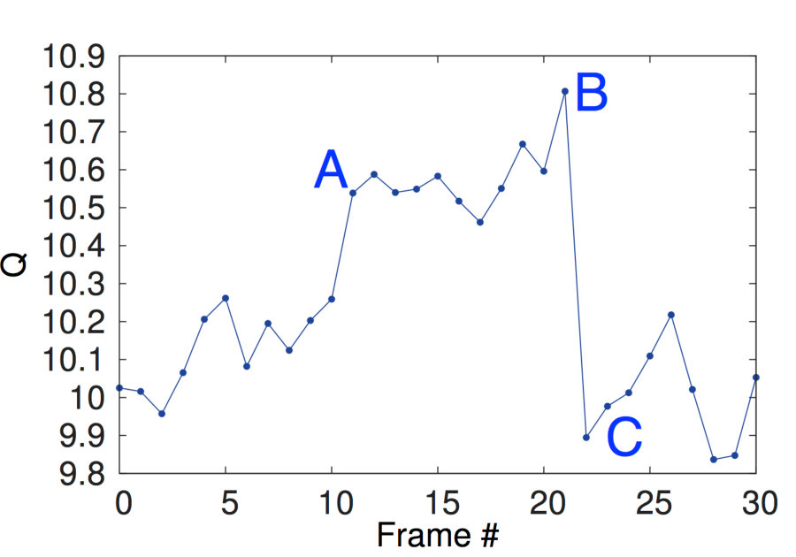

# MDP、价值函数与 Bellman

## 本章回答什么

一个动作怎样改变未来，未来的好坏又怎样回到当前决策？本章只建立这件事所需的语言：MDP、trajectory、return、状态价值、动作价值、advantage，以及 Bellman expectation 和 Bellman optimality。算法如何从模型或样本求这些量，留到下一章。

读完后，你应能把一次转移写进 MDP，分清 reward 与 return、\(V\) 与 \(Q\)，并判断一条 Bellman 式是在评估固定 policy，还是在寻找最优动作。

## 先修知识

先读 [Agent、环境与训练闭环](rl-agent-environment-loop.md)，确认 observation、state、action、reward、termination 和 truncation 在交互 API 中的位置。条件概率与期望不熟时，回看 [概率分布、随机变量与期望](../prerequisite-math/probability-distributions-and-expectation.md)；Markov 假设的概率含义见 [随机过程与马尔可夫性](../prerequisite-math/stochastic-processes-and-markov.md)。

本章约定：agent 在 \(t\) 时刻看到 \(s_t\)，选择 \(a_t\)，环境随后返回 \(r_t\) 与 \(s_{t+1}\)。有些教材把同一个转移产生的奖励记为 \(r_{t+1}\)；只要整篇推导一致，两种时间下标都可以。

## 最小任务

使用后续章节的 2×3 GridWorld。状态按行编号，`0` 是起点，`5` 是终点：

```text
0  1  2
3  4  5*
```

动作 `0/1/2/3` 分别为上、右、下、左；撞边界会留在原状态。普通转移 reward 为 `-1`，进入终点的 reward 为 `0`。例如状态 `0` 向右产生样本 `(s_t=0, a_t=1, r_t=-1, s_{t+1}=1, terminated=False)`；状态 `2` 向下则得到 `(2, 2, 0, 5, True)`。

这两个样本已经能提出长期问题：状态 `0` 的即时 reward 只说明向右这一步付出 `-1`，但无法单独说明从 `0` 出发最终要付出多少；后者需要 return 或 value。

## 核心机制

### MDP 五元组与 Markov property

Markov Decision Process 写成：

\[
\mathcal{M}=(\mathcal{S},\mathcal{A},P,R,\gamma)
\]

其中 \(\mathcal{S}\) 是状态集合，\(\mathcal{A}\) 是动作集合，\(P(s'\mid s,a)\) 是下一状态的 transition probability，\(\gamma\) 是折扣因子。为允许 reward 本身也随机，本章把 \(R\) 定义为给定这次转移后的条件期望：

\[
R(s,a,s')=\mathbb{E}[r_t\mid s_t=s,a_t=a,s_{t+1}=s']
\]

因此样本中的 \(r_t\) 可以波动，而 \(R(s,a,s')\) 是这些 reward 的条件均值。有限任务还要说明初始状态分布和哪些状态是 terminal；它们决定 trajectory 从哪里开始、在哪里结束。

MDP 的 Markov property 可以写成：

\[
p(s_{t+1},r_t\mid s_0,a_0,r_0,\ldots,s_t,a_t)=p(s_{t+1},r_t\mid s_t,a_t)
\]

这行式子说，给定当前 state 与 action 后，下一 state 和这次 reward 的联合分布不再依赖更早的 state、action、reward 历史。Markov property 不是说世界没有历史，而是说历史中影响下一转移与 reward 的信息已经编码进 \(s_t\)。

### State 与 observation

`state` 是对未来转移充分的信息；`observation` 是 agent 实际收到的测量。GridWorld 把状态编号直接交给 agent，因此完全可观测。机器人只收到相机画面时，遮挡后的物体仍属于环境 state，却不在当前 observation 中；这时单帧 observation 通常不满足 Markov property，需要历史、记忆或 belief state。

因此“输入网络的张量”不自动等于 MDP state。部分可观测时应先回到 [交互闭环中的 POMDP 说明](rl-agent-environment-loop.md)，明确 policy 究竟以 observation、历史还是内部 belief 为条件。

### Policy、trajectory 与 return

随机策略写成 \(\pi(a\mid s)\)，表示在状态 \(s\) 下选择动作 \(a\) 的概率。策略与环境共同产生 trajectory：

\[
\tau=(s_0,a_0,r_0,s_1,a_1,r_1,\ldots)
\]

从时刻 \(t\) 开始的折扣 return 定义为：

\[
G_t=\sum_{k=0}^{\infty}\gamma^k r_{t+k}
\]

其中 reward \(r_t\) 是一次转移的即时反馈，return \(G_t\) 则汇总当前之后的一串 reward。有限 episode 的求和在结束处停止，并不存在终点之后凭空追加的 reward。

### Reward、\(V\)、\(Q\) 与 advantage

固定策略 \(\pi\) 后，状态价值与动作价值分别为：

\[
V^\pi(s)=\mathbb{E}_\pi[G_t\mid s_t=s]
\]

\[
Q^\pi(s,a)=\mathbb{E}_\pi[G_t\mid s_t=s,a_t=a]
\]

第一行表示“从状态 \(s\) 起一直按 \(\pi\) 行动”的平均 return；第二行多固定了当前动作 \(a\)，之后仍按 \(\pi\) 行动。advantage 定义为：

\[
A^\pi(s,a)=Q^\pi(s,a)-V^\pi(s)
\]

它表示动作 \(a\) 相对该策略在状态 \(s\) 下平均行为好多少。四者不能互换：reward 是一步信号，return 是一条未来序列的结果，\(V\) 给状态定价，\(Q\) 给“状态加当前动作”定价，advantage 做相对比较。

{ width="720" }

<small>图源：[Playing Atari with Deep Reinforcement Learning](https://arxiv.org/abs/1312.5602)，Figure 3。原图展示 Seaquest 连续画面上的预测 value：未来得分机会出现时 value 先升高，机会消耗后回落。它用于说明 value 估计未来机会，不等同于当前帧刚收到的 reward。</small>

### Bellman expectation：评估固定策略

对固定 \(\pi\)，下面的 Bellman expectation equation 适用于每个非 terminal state \(s\)：

\[
V^\pi(s)=\sum_a\pi(a\mid s)\sum_{s'}P(s'\mid s,a)
\left[R(s,a,s')+\gamma V^\pi(s')\right]
\]

terminal 的边界值约定为：

\[
V^\pi(s_{\mathrm{terminal}})=0
\]

Bellman 式先按当前 policy 对动作求平均，再用 \(P\) 对 transition 的随机性求和；\(R(s,a,s')\) 已经是给定该转移后的条件期望 reward，因此也纳入了 reward 的随机性。它回答“\(\pi\) 有多好”，动作分布由 \(\pi\) 给定，没有在每个状态偷偷改成最大值。

同样地，动作价值满足：

\[
Q^\pi(s,a)=\sum_{s'}P(s'\mid s,a)
\left[R(s,a,s')+\gamma\sum_{a'}\pi(a'\mid s')Q^\pi(s',a')\right]
\]

其中当前动作已经固定，下一状态的后续动作才由 \(\pi\) 加权。若 successor \(s'\) 是 terminal，则 continuation 项定义为 \(\sum_{a'}\pi(a'\mid s')Q^\pi(s',a')=0\)；进入该 terminal 的条件期望 reward \(R(s,a,s')\) 仍保留。

### Bellman optimality：比较动作

对非 terminal state \(s\)，最优状态价值 \(V^*(s)=\max_\pi V^\pi(s)\) 满足 Bellman optimality equation：

\[
V^*(s)=\max_a\sum_{s'}P(s'\mid s,a)
\left[R(s,a,s')+\gamma V^*(s')\right]
\]

相应的 terminal 边界为：

\[
V^*(s_{\mathrm{terminal}})=0
\]

这里的 \(\max_a\) 是控制问题的关键：它比较当前可选动作，寻找最优 value。Bellman expectation 用给定 \(\pi\) 加权动作，Bellman optimality 用最大化改进决策；把二者混在一起，就会把“评估现有 policy”误写成“假设之后总能选最优动作”。

### Discount 与 effective horizon

当 \(0\le\gamma<1\) 时，更远 reward 的权重按几何级数衰减。常用的粗略尺度是：

\[
H_{\mathrm{eff}}\approx\frac{1}{1-\gamma}
\]

这里 \(H_{\mathrm{eff}}\) 只是“权重显著衰减需要多少步”的量级，不是任务的真实截止时间，也不是保证能准确归因的步数。控制频率改变时，同一个 \(\gamma\) 对应的真实时间也会改变。较大的 \(\gamma\) 并不自动更好：它会让长期 reward 更重要，也会让 value 误差传播得更远。有限 episodic 问题有时可用 \(\gamma=1\)，但仍需可靠的终止条件与有限 return。

### 算法桥接：Q-learning 与数据来源

Bellman optimality 可以给 Q-learning 构造 terminal-masked TD target：

\[
y_t=r_t+\gamma(1-d_t)\max_{a'}Q(s_{t+1},a')
\]

其中 \(d_t=1\) 只表示真正 terminal，此时 target 就是 \(r_t\)。这里的 \(Q\) 是当前 action-value estimate，这才是通用 tabular Q-learning target。

使用函数逼近时，DQN 可以把 bootstrap network 换成一段时间内冻结的 frozen target network；这是额外的函数逼近稳定机制，完整做法见 [2015 Nature DQN](https://doi.org/10.1038/nature14236)。

replay buffer 也是 deep DQN 的工程机制，不是 tabular Q-learning 定义的一部分；早期 DQN 与 experience replay 见 2013 预印本 [Playing Atari with Deep Reinforcement Learning](https://arxiv.org/abs/1312.5602)，算法细节与可运行例子见 [Q-learning 与 DQN](q-learning-and-dqn.md)。

数据来源还决定 value 估计的边界：

| 设置 | 数据来源 | 主要边界 |
| --- | --- | --- |
| online RL | 持续与环境交互并产生新数据 | 新 policy 会改变后续数据分布 |
| off-policy RL | 用其他或较旧 behavior policy 的数据学习当前目标 policy，常见于继续采样同时复用 replay | 必须处理行为分布与目标 policy 的差异 |
| offline RL | 只用固定数据集，不再收集新 transition | 分布外（OOD）动作缺少数据支持，value 外推可能虚高 |

这只是数据源区别，不替代算法章节。固定数据的 OOD/value 风险、保守估计与评测边界见 [Offline Reinforcement Learning](offline-reinforcement-learning.md)，其问题定义来源见 [Offline Reinforcement Learning: Tutorial, Review, and Perspectives on Open Problems](https://arxiv.org/abs/2005.01643)。

## 训练数据流

对一次样本转移 `(s_t, a_t, r_t, s_{t+1}, terminated)`，可以直接得到即时 reward；若已有下一状态估计 \(V(s_{t+1})\)，还可以构造一步 target \(r_t+\gamma V(s_{t+1})\)。若转移真正终止，下一状态后没有未来 return，bootstrap 项应被 mask 掉。仅凭一个非终止样本，不能算出完整 Monte Carlo return，因为后续 reward 尚未发生。

两类方法使用 Bellman 关系的方式不同：

```text
已知 P、R -> 枚举 state/action/next_state -> 对期望求和 -> DP value update
未知或不可枚举 P、R -> policy 与环境交互 -> transition / episode 样本 -> MC 或 TD update
```

Dynamic Programming 需要可查询的完整模型；Monte Carlo 与 TD 则从 sampled transition 学习。下一章会让这三种更新在同一个 GridWorld 上对齐。

## 常见失败

| 混淆 | 错误表现 | 正确边界 |
| --- | --- | --- |
| state / observation | 把单帧传感器输入默认当 Markov state | state 是相关历史的充分统计量，observation 可能只是局部测量 |
| reward / return | 用一次 `-1` 判断整条路径价值 | return 汇总当前之后的 reward |
| \(V\) / \(Q\) | 用 \(V(s)\) 直接区分同一状态下的动作 | \(Q(s,a)\) 固定当前动作，\(V(s)\) 对 policy 的动作求平均 |
| evaluation / optimality | 评估 \(\pi\) 时写入 \(\max_a\) | expectation 固定 policy；optimality 才最大化动作 |
| termination / truncation | episode 一停就把 bootstrap 置零 | 只有真正 terminal 没有后续价值；时间截断需看任务语义 |
| \(\gamma\) | 把 \(1/(1-\gamma)\) 当硬截止步数 | effective horizon 只是折扣权重的粗略尺度 |

## 自检与练习

1. **概念题**：解释 Markov property 为什么是“state 足够”，而不是“历史不重要”；给出一个 observation 不足以成为 state 的例子。
2. **手算题**：设 \(\gamma=0.9\)，三次 reward 为 `-1, -1, 0`，随后真正终止。分别算 \(G_0,G_1,G_2\)。
3. **Bellman 辨析**：把 Bellman expectation 与 Bellman optimality 中的动作聚合项圈出来，说明何时是 \(\sum_a\pi(a\mid s)\)，何时是 \(\max_a\)。
4. **小改动题**：把 GridWorld 的普通 reward 从 `-1` 改为 `-2`，先不运行代码，预测最优路径和起点 \(V^*\) 会怎样变化，再用下一章示例验证。

## 下一步

进入 [动态规划、Monte Carlo 与 TD](dynamic-programming-monte-carlo-td.md)，在同一个 2×3 GridWorld 中分别用已知模型、完整 episode 和一步 bootstrap 估计 value。随后沿 [Q-learning 与 DQN](q-learning-and-dqn.md) 学习 action-value control，沿 [Offline Reinforcement Learning](offline-reinforcement-learning.md) 学习固定数据的 support 边界，或进入 [Model-based RL 与世界模型](rl-for-world-models.md) 学习 transition 建模。课程地图中仅“综合实践与算法选择”仍标为规划中，见 [完整学习路线](index.md#完整学习路线)。
