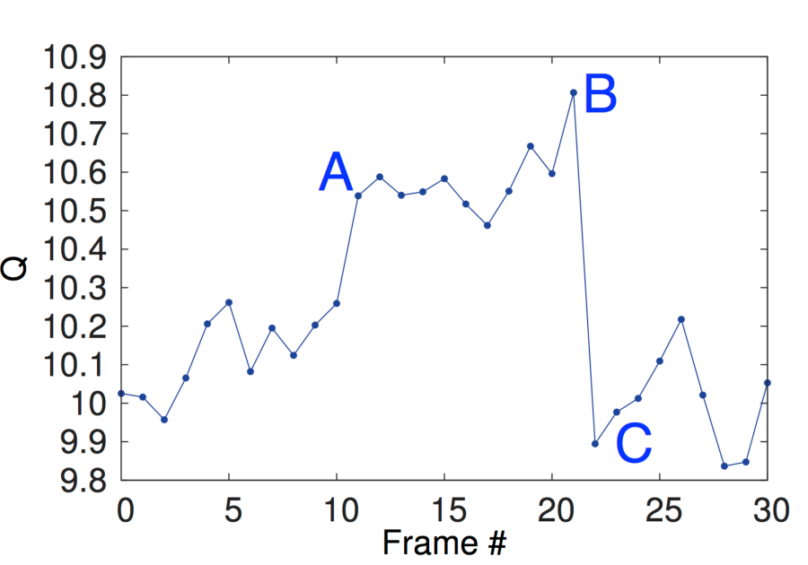

# MDP、价值函数与 Bellman

走迷宫时，当前格子的价值取决于从这里继续行动能否到达终点。Bellman 方程把这件事拆成一步后的奖励与剩余价值，使整段未来可以递推计算。它同时给出价值估计与策略改进的基础。

## 先把过程写清楚

MDP 记作 $\mathcal M=(\mathcal S,\mathcal A,P,R,\gamma)$，其中 $P(s'\mid s,a)$ 是转移概率，$R(s,a,s')=\mathbb E[r_t\mid s_t=s,a_t=a,s_{t+1}=s']$ 是转移上的期望奖励。折扣 $\gamma\in[0,1)$ 控制远期反馈的权重；有限回合任务也可以在相应条件下使用 $\gamma=1$。

Markov 假设要求

\[
p(s_{t+1},r_t\mid s_{\le t},a_{\le t})=p(s_{t+1},r_t\mid s_t,a_t).
\]

它约束的是信息是否足够，网络输入不自动满足该假设。摄像头看不见的速度、接触状态或任务剩余时间可能需要历史补充，见[交互闭环](rl-agent-environment-loop.md)与[随机过程](../prerequisite-math/stochastic-processes-and-markov.md)。

给定策略 $\pi(a\mid s)$，定义从 $t$ 开始的折扣回报

\[
G_t=\sum_{k=0}^{T-t-1}\gamma^k r_{t+k}=r_t+\gamma G_{t+1}.
\]

状态价值 $V^\pi(s)=\mathbb E_\pi[G_t\mid s_t=s]$ 对第一步动作也按策略取平均。动作价值 $Q^\pi(s,a)=\mathbb E_\pi[G_t\mid s_t=s,a_t=a]$ 固定第一步动作，之后才继续执行策略。因此

\[
V^\pi(s)=\sum_a\pi(a\mid s)Q^\pi(s,a),\qquad A^\pi(s,a)=Q^\pi(s,a)-V^\pi(s).
\]

Advantage 表示这个动作相对该状态下策略平均表现的增益。它可以为负，即使对应的回报为正。

## Bellman 方程怎样从回报得到

对 $G_t=r_t+\gamma G_{t+1}$ 取条件期望，先对动作、再对后继状态求和，得到 Bellman expectation equation

\[
V^\pi(s)=\sum_a\pi(a\mid s)\sum_{s'}P(s'\mid s,a)
\left[R(s,a,s')+\gamma V^\pi(s')\right].
\]

终止状态约定 $V^\pi(s_{\mathrm{terminal}})=0$。进入终点那一步的奖励仍在 $R$ 中，并没有被清零。终点之后没有任务回报，才使后续价值为零。

如果要选择最优策略，就不再平均第一步动作，而是取最好的动作

\[
V^*(s)=\max_a\sum_{s'}P(s'\mid s,a)
\left[R(s,a,s')+\gamma V^*(s')\right].
\]

这里的最大化仍然位于对环境转移的期望之外。策略能选择动作，不能选择随机环境恰好给它哪个结果。把最大化放到随机结果上，会得到一个能预知运气的虚假决策者。

## 六个格子上的完整计算

仓库 [GridWorld](../assets/examples/reinforcement-learning/gridworld.py) 使用如下地图

```text
0  1  2
3  4  5*
```

动作编号 $0,1,2,3$ 分别为上、右、下、左。撞边界留在原地；普通转移奖励 $-1$，进入终点 $5$ 奖励 $0$，终点吸收且后续奖励为零。取 $\gamma=0.9$，最短路径 $0\to1\to2\to5$ 的奖励为 $-1,-1,0$，所以起点最优价值为 $-1-0.9=-1.9$。

从终点向前算，$V^*(2)=V^*(4)=0$，因为下一步可直接进入终点；$V^*(1)=V^*(3)=-1$；最后 $V^*(0)=-1.9$。在状态 $1$，向右的 $Q^*$ 为 $-1+0.9\times0=-1$；向左回到 $0$ 的 $Q^*$ 为 $-1+0.9\times(-1.9)=-2.71$。因此向左的最优策略 advantage 为 $-1.71$，明确量出了绕路成本。

若把普通奖励改为 $-2$，同样最短路径的回报变成 $-2-1.8=-3.8$，最短路径本身没有改变。奖励的尺度改变会影响 value、critic loss 和优化步长，却不一定改变任务排序。若再加入其他不同权重的奖励，结论就需要重算。

## 从零开始，亲自做四轮 Bellman 备份

前面的最短路可以手算，下面让程序只按转移和奖励更新，不预先告诉它正确动作。代码从仓库根目录运行，只依赖 NumPy。

```python
import sys
import numpy as np
sys.path.insert(0, 'files/assets/examples/reinforcement-learning')
from gridworld import GridWorld

env = GridWorld()
value = np.zeros(6)
for sweep in range(4):
    updated = np.zeros_like(value)
    for state in range(5):
        candidates = []
        for action in range(4):
            next_state, reward, terminal = env.transition(state, action)
            candidates.append(reward + 0.9 * (0.0 if terminal else value[next_state]))
        updated[state] = max(candidates)
    value = updated
    print(sweep + 1, value.round(3).tolist())
assert np.allclose(value, [-1.9, -1., 0., -1., 0., 0.])
```

第一次备份得到 `[-1,-1,0,-1,0,0]`。因为尚未知道后继状态有多差，状态 0 暂时只看到眼前的一次 −1；第二轮读取旧数组中状态 1 或 3 的 −1，起点才变成 −1.9。终点旁边的状态始终可以直接进入终点，值为零。之后数组不再变化，达到这个问题的固定点。

每轮必须说明读取旧数组还是原地更新。上例整轮使用旧 `value`，同轮内状态遍历顺序不影响结果。如果改成原地写回，信息传播的快慢依赖顺序，虽然合适条件下仍可到同一个解，却不能把逐轮数组与上例逐项比较。

把 `max(candidates)` 改成四个数的平均，就会评估均匀随机策略。相同环境、相同奖励，策略不同，价值也不同。这也是下一页[DP、MC 与 TD](dynamic-programming-monte-carlo-td.md)首先要固定“正在评估谁”的原因。

## 递推为什么能求解

固定策略的 Bellman 算子在 $\gamma<1$ 时会把最大绝对误差缩小到至多原来的 $\gamma$ 倍，因为转移概率加权平均不会放大最大误差。最优 Bellman 算子也具有这一收缩性质。在有限表格、精确模型和有界奖励条件下，反复备份会收敛到相应唯一固定点。

这一保证不能直接搬到神经网络更新。网络同时改变很多状态的值，采样分布也不一定覆盖所有状态；自举目标又依赖当前估计。[DQN](q-learning-and-dqn.md)里的 replay 和 target network 正是围绕这些额外困难设计的。

{ width="720" }

<small>图源：[Playing Atari with Deep Reinforcement Learning](https://arxiv.org/abs/1312.5602)，Figure 3。原图展示 Seaquest 连续画面上的预测 value；value 估计未来机会，不等同于当前帧刚收到的 reward。</small>

有模型时可以直接计算 Bellman 右侧的期望；只有轨迹时则用样本近似，区别见[动态规划、Monte Carlo 与 TD](dynamic-programming-monte-carlo-td.md)。固定日志还多出数据覆盖限制，见[离线强化学习](offline-reinforcement-learning.md)。这些方法共享同一价值定义，差别在于怎样得到右侧的目标以及目标的误差如何传播。
