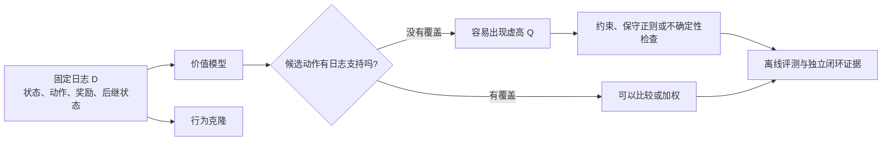

# Offline Reinforcement Learning

离线强化学习从一份固定的轨迹日志学习策略，训练期间不能通过新交互验证动作。日志可能来自机器人示范、旧控制器、历史推荐策略或过去的模拟实验。数据包含奖励和后继状态，因而能研究长期收益；但它只告诉我们采集策略确实做过的动作发生了什么。页面的主线是 support 问题，模型能不能在没有证据的动作上给出高价值。



离线算法面对的限制先于具体算法名。日志没有执行过的动作，后面没有真实奖励替它纠错；任何“发现更好动作”的结果，都要说明这个动作怎样被数据支持，以及有没有独立评测把它拉回现实。

## 日志覆盖了哪些动作，决定了可以改进什么

设机器人从入口状态选择绕行或近路，随后在货架前选择抓取。日志包含绕行后的几种抓法，价值分别约为 2 和 6；近路没有真实执行记录。高质量抓法并非每条轨迹都使用，因此有利用奖励改进的空间，但没有证据确认近路是否安全。这里的价值数值是教学构造，用于比较各个目标。

行为克隆会按日志频率模仿绕行与两种抓法。如果日志中较差抓法很多，它也会被大量复制。离线 RL 试图提高有证据的好动作权重，同时避免利用近路上的虚高估计。即使日志片段可连接，连接后的状态也必须落在已有支持内；算法不能凭一句“轨迹拼接”获得从未观察的后果。

## 为什么 replay 有用，固定 replay 却会出问题

回到入口，日志中的绕行动作有真实回报支持，网络对未见过的近路却偶然预测为 $20$。普通 Q-learning 的最大化会选中近路，随后把这个虚高值传播到前面的状态。训练日志中的 Bellman loss 可能很低，策略却正在追逐没有证据支持的动作。

[DQN](q-learning-and-dqn.md) 和 [SAC](continuous-control-and-sac.md) 等 online off-policy 方法可以继续执行动作，收集反馈后纠错；offline 数据无法自动增加这个反例。因此关键限制是 support，候选策略要选择的状态动作对是否在数据分布中有足够覆盖。仅有很多轨迹或低训练误差，都不能回答这个问题。

Behavior cloning 直接最大化日志动作的概率，不用奖励判断哪种行为更好。它是重要基线，也能限制离线策略远离数据，但可能复制日志中的次优动作。离线 RL 要利用奖励改进行为，同时控制数据外的价值外推。

## CQL 怎样对未见动作的高值施加代价

在有限离散动作的简化形式中，CQL 在 Bellman 误差之外加入

\[
L_{\mathrm{CQL}}=\alpha\,\mathbb E_{s\sim D}\left[
\log\sum_a\exp Q(s,a)-\mathbb E_{a\sim D(\cdot\mid s)}Q(s,a)\right].
\]

第一项对高 Q 动作敏感，第二项抵消数据动作受到的压低作用。对每个 Q 的梯度为 softmax 概率减去数据动作频率。把问题放到同一状态的三动作表中，令两个有日志动作的 Q 为 2、6，未见动作的 Q 为 20，数据频率为 $[0.5,0.5,0]$。softmax 近似 $[0,0,1]$，正则梯度约为 $[-0.5,-0.5,1]$。梯度下降会提高有数据支持的动作、压低未见动作的虚高值。

```python
import numpy as np
q = np.array([2.0, 6.0, 20.0])
probabilities = np.exp(q - q.max())
probabilities /= probabilities.sum()
regularizer_gradient = probabilities - np.array([0.5, 0.5, 0.0])
assert (regularizer_gradient[:2] < 0).all()
assert regularizer_gradient[2] > 0
```

完整优化还包括 Bellman 项、系数选择与目标策略，不能只运行这个正则就得到可靠策略。连续动作无法直接枚举求和，原论文使用相应采样近似。[CQL 的价值下界与改进保证](https://arxiv.org/abs/2006.04779)依赖具体假设，不能解释成任意神经网络训练后每个动作都安全或都不会被高估。

## IQL 为什么不直接对未见动作取最大值

IQL 先从数据动作的 Q 值中拟合一个偏向较好动作的状态价值，再用它构造 Q target。其 value loss 使用 expectile 回归

\[
L_V=\mathbb E_{(s,a)\sim D}\left[|\tau-\mathbb 1[u<0]|u^2\right],\qquad
u=Q_{\mathrm{target}}(s,a)-V(s).
\]

这里残差记作 $u$。当 $\tau>0.5$ 时，Q 高于 V 的正残差权重更大，因此 V 向数据中的高价值动作偏移。继续使用上述两个等频数据动作的 Q $2,6$，把未见动作的 20 排除在 value 拟合之外，$\tau=0.75$。若 V 位于二者之间，最优条件为 $0.25(V-2)+0.75(V-6)=0$，得到 $V=5$；普通均方回归则得到均值 $4$。

随后 Q 拟合 $r+\gamma bV(s')$，避免在下一状态显式查询所有未见动作的 Q。Actor 再做 advantage-weighted behavior cloning

\[
L_\pi=-\mathbb E_{(s,a)\sim D}\left[
\exp\bigl(\beta[Q(s,a)-V(s)]\bigr)\log\pi(a\mid s)\right].
\]

继续取 $V=5$，两个数据动作优势为 −3 和 1。若 $\beta=1$，权重分别约为 0.0498 和 2.718，相对比值约为 54.6，较好动作获得更多模仿权重。未见动作即使 Q 为 20，也没有对应行为克隆样本。这里约定 $\beta$ 乘在优势前，实际实现常对权重截顶。它让数据中的好动作获得更大模仿权重，但不会创造日志里从未存在的成功行为。算法原始解释见 [Offline Reinforcement Learning with Implicit Q-Learning](https://arxiv.org/abs/2110.06169)。

| 方法思路 | 限制外推的位置 | 仍然需要的数据条件 |
| --- | --- | --- |
| Behavior cloning | 直接拟合采集动作 | 示范质量与部署状态覆盖 |
| BCQ | 将候选动作约束在数据附近 | 数据附近确实存在可用动作 |
| CQL | 对过高的分布外价值加代价 | 正则、估计与覆盖假设合理 |
| IQL | 用数据动作拟合 value，再加权模仿 | 高价值动作与可连接轨迹有足够支持 |

[BCQ](https://arxiv.org/abs/1812.02900)和其他行为约束方法也处理同一个基本矛盾，约束太弱会外推，太强则可能难以超越原行为。

## 离线评测为什么也依赖覆盖

如果知道行为策略 $\mu$，可以考虑重要性采样权重

\[
w(\tau)=\prod_t\frac{\pi(a_t\mid s_t)}{\mu(a_t\mid s_t)}.
\]

这要求目标策略可能采取的动作在行为策略下也有非零概率，且概率记录或估计可信。长轨迹的乘积容易造成少数样本主导。权重 $[1,1,8]$ 的有效样本量为 $(1+1+8)^2/(1+1+64)=100/66\approx1.52$，虽然名义上有三条轨迹，信息集中程度却接近只有一两条。

Fitted Q Evaluation 等方法通过另一个价值模型评价固定策略，也需要函数逼近与数据覆盖假设。它们可以提供证据和不确定性分析，但不能验证日志从未覆盖的真实后果。随机切分高度相关的同一条轨迹，还可能把相邻状态泄漏到评测集，应按 episode、时间或任务场景选择合适切分。

实际阅读一份离线 RL 结果时，应同时检查采集策略、成功与失败轨迹比例、奖励标注、终止原因、行为克隆基线，以及独立闭环评测。方法分类与开放问题见[离线 RL 综述](https://arxiv.org/abs/2005.01643)。当环境模型参与生成新轨迹时，还需检查模型误差，详见[世界模型与 Model-based RL](rl-for-world-models.md)。

## 算法和环境依据

行为约束、数据外动作和价值过高估计的背景参考 [BCQ](https://arxiv.org/abs/1812.02900)、[CQL](https://arxiv.org/abs/2006.04779) 与 [IQL](https://arxiv.org/abs/2110.06169)，方法范围对照[离线强化学习综述](https://arxiv.org/abs/2005.01643)。绕行/近路、价值 2/6、虚高 Q=20 和重要性采样有效样本量是本站构造的机制例子，不是离线机器人实验结果。

自测时把日志按 episode 切分为训练和评测，统计目标策略会选择但行为策略从未执行的状态动作对。再把行为克隆作为基线，报告 support 覆盖、离线估计和独立闭环结果；没有最后一项，不能把离线分数写成真实策略成功率。
