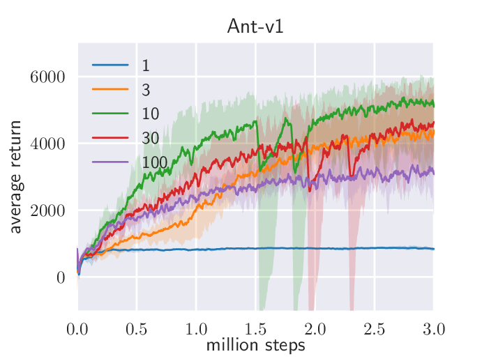
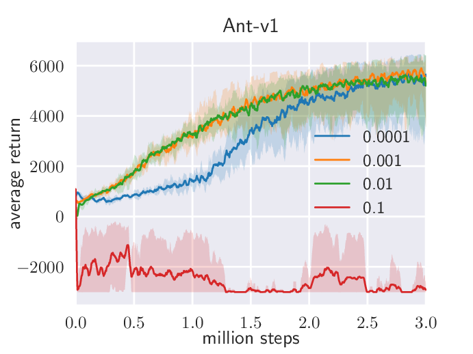
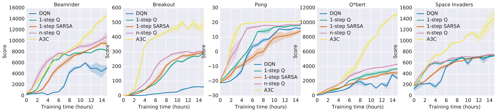
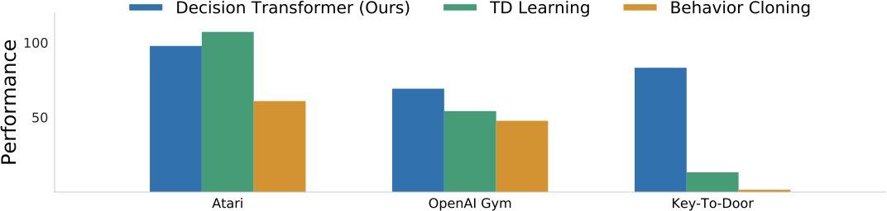
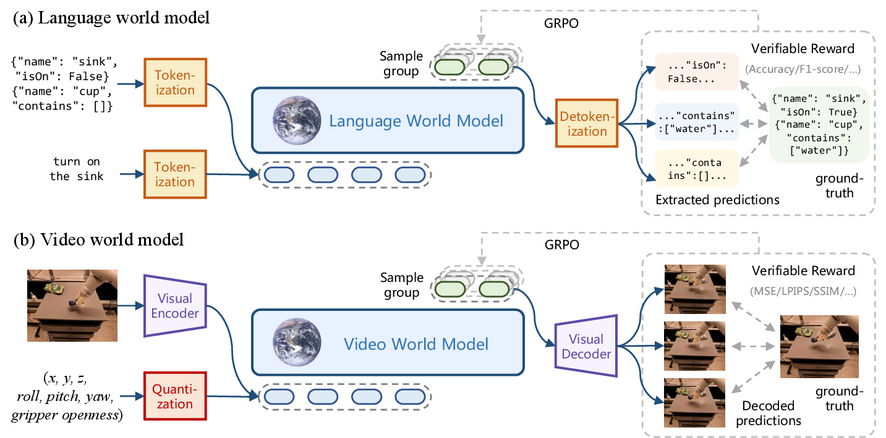

# Policy Gradient、Actor-Critic、PPO 与 GRPO

这页从策略梯度讲到 PPO 和 GRPO。目标不是推完所有公式，而是让你理解：为什么大模型后训练需要采样、奖励、advantage、reference/KL，以及 verl 这类框架为什么围绕 actor、rollout、critic 和 reward 组织。

## 1. Policy Gradient：直接让好动作更可能

策略目标可以写成：

\[
J(\theta)=\mathbb{E}_{\tau\sim\pi_\theta}[R(\tau)]
\]

REINFORCE 的核心估计是：

\[
\nabla_\theta J(\theta)
\approx
\mathbb{E}
\left[
G_t \nabla_\theta \log \pi_\theta(a_t\mid s_t)
\right]
\]

直觉很简单：如果一条轨迹奖励高，就提高这条轨迹里动作的概率；奖励低，就降低概率。

!!! note "难点解释：为什么要乘 \(\nabla \log \pi\)"
    生成式模型不能直接对“采样结果”求导，因为采样是离散动作。但可以对“这个动作的概率”求导。奖励告诉你方向好坏，\(\nabla \log \pi\) 告诉你该怎样改参数才能提高或降低这个动作概率。

!!! example "有趣例子：给骰子调权重"
    假设一个骰子代表模型的动作分布，掷到 6 分会赢。你不能对“已经掷出的 6”求导，但可以调整骰子内部权重，让以后更容易掷到 6。policy gradient 做的就是这件事：奖励高的采样结果提高概率，奖励低的采样结果降低概率。

## 2. Baseline 与 Advantage：降低方差

直接用 return 更新策略方差很大。常用做法是减去 baseline：

\[
\nabla_\theta J(\theta)
\approx
\mathbb{E}
\left[
(G_t-b(s_t))\nabla_\theta\log\pi_\theta(a_t\mid s_t)
\right]
\]

当 baseline 取 value function \(V(s_t)\) 时，就得到 advantage：

\[
A_t = G_t - V(s_t)
\]

| 量 | 简洁解释 |
| --- | --- |
| return \(G_t\) | 这次从当前位置往后实际拿到多少 |
| value \(V(s_t)\) | 一般情况下从这个状态预计拿多少 |
| advantage \(A_t\) | 这次动作比预期好还是差 |

!!! example "有趣例子：考试平均分"
    如果你考了 85 分，不能只看 85 高不高，还要看平均分是多少。平均 60 时，85 是好结果；平均 95 时，85 反而差。Advantage 就是“相对预期的好坏”。

## 3. Actor-Critic

Actor-Critic 把模型拆成两个角色：

| 角色 | 做什么 |
| --- | --- |
| actor / policy | 产生动作或 token |
| critic / value model | 估计状态或前缀的未来回报 |

critic 不直接执行动作，它负责给 actor 的更新提供低方差 baseline。PPO 就是典型 actor-critic 路线；GRPO 则用组内相对奖励替代 critic，减少训练一个 value model 的成本。

!!! note "难点解释：critic 不是裁判，而是估分器"
    reward 像最终裁判分，critic 像赛前根据局面估一个平均水平。actor 更新时真正用的是“比估分高还是低”。如果 critic 估得准，策略梯度噪声会小很多；如果 critic 估错，actor 也可能被错误信号带偏。

!!! example "有趣例子：餐厅评论"
    actor 像正在选餐厅的人，critic 像根据地点、价格和排队长度估计“这次大概会满意到什么程度”的朋友。真正有用的信息不是“这顿饭 4 星”，而是“这家在这种条件下本来预期 3 星，结果 4 星，说明选择比预期好”。这就是 advantage。

## 4. 探索：epsilon、entropy 与 SAC

探索不是“随机乱试”，而是在不知道哪个动作更好时，给策略保留发现更好行为的机会。常见做法有三类：

| 做法 | 简洁解释 | 典型位置 |
| --- | --- | --- |
| \(\epsilon\)-greedy | 大多数时候选当前最优动作，少数时候随机试 | DQN、离散动作入门 |
| entropy bonus | 奖励策略保持一定随机性，避免过早变成单一路线 | A3C、PPO、SAC |
| stochastic policy | 策略本身输出分布，动作从分布中采样 | 连续控制、生成模型 |

SAC 是理解“熵为什么有用”的经典论文。它把目标写成“最大化 reward，同时最大化 policy entropy”，也就是既要完成任务，又不要太早把策略压成单一路径。

{ width="720" }

<small>图源：[Soft Actor-Critic: Off-Policy Maximum Entropy Deep Reinforcement Learning with a Stochastic Actor](https://arxiv.org/abs/1801.01290)，Figure 4。原论文图意：比较 SAC 与 deterministic SAC variant 在 Humanoid (rllab) 上不同随机种子的稳定性。</small>

!!! note "图解：为什么 stochastic policy 更稳"
    蓝色 SAC 使用最大熵目标，策略不会太早坍缩到一个确定动作；红色 deterministic 变体更容易因为早期偶然高分锁到局部解。对机器人和 VLA 来说，这像“只练一种抓杯姿势”与“保留几种合理抓法”的区别：后者更有机会在物体位置、摩擦和遮挡变化时保持鲁棒。

SAC 还提醒我们：reward 的尺度会改变探索和利用的平衡。

{ width="420" }
{ width="420" }

<small>图源：[Soft Actor-Critic](https://arxiv.org/abs/1801.01290)，Figure 5(b)(c)。原论文图意：展示 Ant-v1 上 reward scale 与 target smoothing coefficient 对 SAC 训练的影响。</small>

!!! note "图解：reward scale 和 target network 为什么会影响训练"
    reward scale 太小，策略会接近均匀随机，学不到任务偏好；reward scale 太大，策略很快变得近似确定，探索不足，可能卡在局部最优。target smoothing 则影响 value target 的移动速度：目标动得太快会不稳，太慢会学得慢。LLM/RLHF 里的 reward normalization、KL 系数、advantage 标准化，本质上也在控制“奖励信号有多强、更新步子有多大”。

## 5. 为什么系统要并行 rollout

RL 训练常被数据采样卡住：要先用当前策略和环境交互，才能得到 reward 和 trajectory。A3C 的一个重要启发是用多个 actor-learner 并行收集经验，减轻单个环境采样的瓶颈。

{ width="920" }

<small>图源：[Asynchronous Methods for Deep Reinforcement Learning](https://arxiv.org/abs/1602.01783)，Figure 1。原论文图意：比较 DQN 与多种 asynchronous RL 方法在 Atari 游戏上的学习速度。</small>

!!! note "图解：从 A3C 并行 actor 到 verl rollout worker"
    图里的核心不是某条曲线绝对更好，而是“采样、评估、更新”可以拆成并行工作流。大模型 RLHF/GRPO 中，rollout worker 负责高吞吐生成，reward worker 负责打分，actor/critic worker 负责训练。`verl` 的 dataflow 设计可以看作把这种并行交互思想搬到 LLM/VLM 后训练上，只是环境从 Atari 模拟器变成了 prompt、工具、规则奖励或 reward model。

## 6. PPO：限制策略不要一步跑太远

PPO 使用新旧策略概率比：

\[
r_t(\theta)=
\frac{\pi_\theta(a_t\mid s_t)}
{\pi_{\theta_{\text{old}}}(a_t\mid s_t)}
\]

clipped surrogate objective 常写成：

\[
L^{\text{CLIP}}(\theta)
=
\mathbb{E}_t
\left[
\min
\left(
r_t(\theta)A_t,
\mathrm{clip}(r_t(\theta),1-\epsilon,1+\epsilon)A_t
\right)
\right]
\]

{ width="760" }

<small>图源：[Proximal Policy Optimization Algorithms](https://arxiv.org/abs/1707.06347)，Figure 1。原论文图意：展示 clipped surrogate objective 如何在概率比偏离旧策略过多时截断收益，避免过大的策略更新。</small>

!!! note "图解：clip 不是为了让模型学慢，而是让更新可信"
    如果某个回答这次得分很高，朴素 policy gradient 可能把它的概率一下推得很高。PPO 的 clip 会限制新策略相对旧策略的概率变化，防止一次 batch 中的偶然高分把模型拉偏。LLM 后训练里还会叠加 reference/KL 约束，目的也是避免模型为了 reward 牺牲基础能力和语言质量。

PPO 的算法流程可以直接按原论文 Algorithm 1 抽成四步：

```text
for iteration = 1, 2, ...:
  run policy for T steps with N parallel actors
  compute advantage estimates
  optimize surrogate objective for K epochs with minibatches
  set old policy = current policy
```

<small>流程源：[Proximal Policy Optimization Algorithms](https://arxiv.org/abs/1707.06347)，Algorithm 1。原论文算法要点：每轮先用当前策略采样轨迹，估计 advantage，再用多个 epoch 的 minibatch 优化 surrogate objective。</small>

!!! note "图解：PPO 的两层循环"
    外层循环负责采样新轨迹，内层循环负责在这批轨迹上做多轮 minibatch 更新。它不是无限重复使用旧数据的离线训练；PPO 仍然是近似 on-policy 方法，所以采样策略和更新策略不能差太远。这也是为什么 rollout、old log prob、reference log prob 和 KL 控制在工程上很重要。

## 7. RLHF 中的 PPO 映射

| RL 术语 | LLM/RLHF 对应 |
| --- | --- |
| state | prompt 加已经生成的前缀 |
| action | 下一个 token 或一段 response |
| trajectory | 从 prompt 到完整回答的 token 序列 |
| reward | reward model、规则检查器或人类偏好分数 |
| actor | 当前被训练的语言模型 |
| reference policy | SFT 模型或旧策略，用来约束 KL |
| critic | value model，估计当前前缀未来奖励 |

!!! warning "常见误区：RLHF 只是把 reward 当 loss"
    reward 通常来自完整回答或外部评测，不能像交叉熵那样直接逐 token 对齐。PPO 要先采样回答，再算 log prob、reward、value 和 advantage，最后才更新 policy。这就是为什么 RLHF 工程比普通 SFT 多出 rollout、reward、reference 和 critic 这些模块。

## 8. Decision Transformer：把轨迹当成序列建模

Decision Transformer 不从 Bellman backup 出发，而是把一段轨迹写成 token 序列：

\[
(\hat R_1,s_1,a_1,\hat R_2,s_2,a_2,\ldots)
\]

其中 \(\hat R_t\) 是 return-to-go，也就是“从现在开始还希望拿到多少回报”。模型像 GPT 一样自回归预测 action。

{ width="860" }

<small>图源：[Decision Transformer: Reinforcement Learning via Sequence Modeling](https://arxiv.org/abs/2106.01345)，Figure 2。原论文图意：比较 Decision Transformer、TD Learning 和 Behavior Cloning 在 Atari、OpenAI Gym 与 Key-To-Door 上的总体表现。</small>

!!! note "图解：为什么它是 VLA/世界模型的桥"
    Decision Transformer 说明“状态、动作、回报”可以统一进 Transformer 序列。VLA 也常把观测、语言和动作 token 放进同一个模型；世界模型也把状态、动作和未来预测组织成序列。但它仍然是离线轨迹建模路线：如果数据里没有好策略或高回报条件落在分布外，单靠 Transformer 不能保证闭环成功。

!!! warning "常见误区：序列建模替代了强化学习"
    Decision Transformer 简化了算法形态，但没有消灭 RL 问题。它绕开了显式 value backup，却仍然依赖 reward/return 标注、轨迹质量、目标 return 设定和闭环评测。对于大模型和 VLA，它更像一种把轨迹接进 Transformer 的接口，而不是所有 RL 后训练的替代品。

## 9. GRPO：用组内相对奖励替代 critic

GRPO 的思路是：对同一个 prompt 采样多个回答，形成一组：

\[
\{o_1,o_2,\ldots,o_G\}
\]

每个回答得到奖励 \(R_i\)，再用组内平均和标准差归一化：

\[
A_i =
\frac{R_i-\mathrm{mean}(\{R_j\}_{j=1}^G)}
{\mathrm{std}(\{R_j\}_{j=1}^G)+\epsilon}
\]

这样可以不训练单独 critic，也能知道“这个回答比同题其他回答好多少”。

{ width="920" }

<small>图源：[RLVR-World: Training World Models with Reinforcement Learning](https://arxiv.org/abs/2505.13934)，Figure 2。原论文图意：语言世界模型和视频世界模型都被统一成序列建模问题；模型采样一组预测，解码后用可验证指标与真实下一状态比较，并用 GRPO 优化。</small>

!!! note "图解：GRPO 适合可验证奖励"
    图中每个输入都会生成一组候选预测。语言世界模型可以解析出结构化状态，视频世界模型可以解码成未来帧，再用 Accuracy、F1、MSE、LPIPS、SSIM 等指标打分。GRPO 不需要额外 critic，而是比较同组样本谁更好。这非常适合 math、code、state prediction 这类能自动判分的任务。

!!! example "有趣例子：同一道题采样 5 个解法"
    如果同一道数学题采样 5 个答案，两个正确、三个错误，那么正确答案不只是“得 1 分”，而是“比同题其他答案更好”。GRPO 用这组内部比较当 baseline。它不需要 critic 估计每个前缀的未来价值，但代价是一次 prompt 要生成多条 response，rollout 吞吐和 reward 质量会变得更重要。

## 10. PPO、GRPO、RLOO、ReMax 和 DPO 的边界

| 方法 | 是否采样当前策略 | 是否显式 reward | 是否需要 critic | 适合什么 |
| --- | --- | --- | --- | --- |
| PPO | 是 | 是 | 通常需要 | reward model、RLHF、连续改进 |
| GRPO | 是 | 是 | 通常不需要 | 可验证奖励、多样本组内比较 |
| RLOO | 是 | 是 | 不需要 | 多样本 leave-one-out baseline，减少 critic 成本 |
| ReMax | 是 | 是 | 不需要 | 用额外 baseline generation 做方差降低 |
| DPO | 否，主要用偏好对 | 隐式 | 不需要 | 偏好数据稳定、想简化 RL 工程 |

DPO 很重要，但它更像偏好优化的监督化变体；本章重点放 PPO/GRPO/RLOO/ReMax 这类需要 rollout 和 reward 的路线，因为它们更直接连接世界模型、RLVR 和 verl 这类 RL 工程框架。

## 11. 工程检查点

做 LLM/VLM/VLA 强化学习时，至少要检查：

| 检查项 | 为什么重要 |
| --- | --- |
| reward 是否可被投机 | reward 漏洞会让 policy 学会钻空子 |
| KL/reference 是否合适 | 太强学不动，太弱会破坏基础能力 |
| rollout 分布是否更新及时 | 旧数据太多会偏离 on-policy 假设 |
| advantage 方差是否过大 | 方差大会导致训练不稳或奖励曲线虚高 |
| 评测是否闭环 | 离线 reward 提升不一定等于真实任务成功 |
