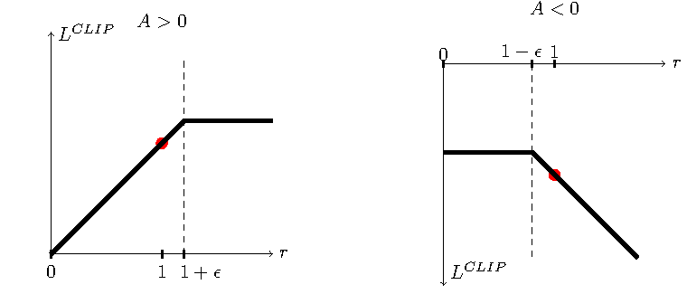

# Actor-Critic、GAE 与 PPO

[REINFORCE](policy-gradient-and-reinforce.md)已经让六格地图上的策略学会少撞边界。它仍有三个实际困难：完整回合结束前拿不到完整回报，同一个动作的回报会受后续随机行动影响，而花成本采到的一批轨迹通常只做一次策略更新。Actor-Critic、GAE 和 PPO 分别回应这些问题，下面沿用同一环境逐步改造训练循环。

## 先用 critic 估计尚未发生的未来

状态价值 $V_\phi(s)$ 估计从当前状态继续执行策略的平均回报。上一页用它作 baseline，现在还让它补齐一步之后的未来。对转移 $(s_t,a_t,r_t,s_{t+1})$，TD residual 为

\[
\delta_t=r_t+\gamma b_tV_\phi(s_{t+1})-V_\phi(s_t),\quad
b_t=1-\mathbb 1[\text{真实终止}].
\]

前两项是执行当前动作后的新估计，最后一项是执行前的预期。若 critic 精确，对后继随机性取期望后，$\delta_t$ 就是动作 advantage；critic 不精确时，误差也会进入 actor 的学习信号。

仍看路径 $0\to1\to2\to5$，奖励为 $[-1,-1,0]$。假设旧 critic 在这些状态的值为 $[-5,-3,-1,0]$，折扣为 $0.9$，则三个 TD residual 为 $[1.3,1.1,1]$。第一步得到 $-1$ 奖励，却使未来预期从 $-5$ 改为 $-1+0.9(-3)=-3.7$，因此它比原先估计更好，优势信号为正。

## 一步预测不准时，怎样使用后续反馈

只用一步 TD，当前动作的权重强烈依赖下一状态 critic。用完整 return 又引入整段随机轨迹。GAE 把之后的 TD residual 按距离衰减累加

\[
\hat A_t=\delta_t+\gamma\lambda c_t\hat A_{t+1}.
\]

$c_t$ 表示是否能继续接同一采样段的下一条误差。取 $\lambda=0.95$，$\gamma\lambda=0.855$，从终点前开始计算

\[
\hat A_2=1,\qquad
\hat A_1=1.1+0.855\times1=1.955,
\]

\[
\hat A_0=1.3+0.855\times1.955=2.971525.
\]

加回旧 value 得到 critic target $[-2.028475,-1.045,0]$。当 $\lambda=1$ 时，中间 value 项相互抵消，优势变成真实 return 减旧 value，即 $[3.1,2,1]$；当 $\lambda=0$ 时回到一步 TD。中间值让反馈覆盖不同时间跨度，但不存在对所有环境都最优的 $\lambda$。

## 固定长度 rollout 怎样与回合边界共存

实际程序常一次收集固定数量的环境步，例如 128 步。其中可以有多个完整回合，也可能以未完成回合结束。数组需要保留两种边界。

真实终止时，后继价值为零，也不能把重置后的新回合误差接过来，所以 $b_t=c_t=0$。若仅因收集够了 128 步而停止，本任务仍可继续，保留最后真实后继状态的 value，即 $b_t=1$；但当前数组没有下一项误差，取 $c_t=0$。外部时间截断且任务未结束也采用相应区分，若任务自身截止则属于真实终止。

例如在状态 $1$ 执行动作后到达 $2$ 就停止采样，奖励 $-1$、旧 value 分别为 $-3,-1$。该步 TD residual 仍为 $-1+0.9(-1)-(-3)=1.1$，不应因为 batch 结束改成 $2$，也不应加入新 episode 的第一条 residual。自动重置环境还必须保存重置前的 final observation，不能拿新起点的 value 来 bootstrap。

## 为什么重复训练旧轨迹需要概率比

假设初始策略在状态 $1$ 向右概率为 $0.25$，这次向右动作比预期好。完成第一次更新后，它的概率可能变成 $0.30$。若继续把这条样本当成仍由当前策略采样，目标就忽略了数据来源变化。

PPO 保存采样时的 old logprob，当前每次更新重新计算同一状态、同一动作的 logprob，并形成

\[
\rho_t=\exp(\log\pi_\theta(a_t\mid s_t)-\log\pi_{\mathrm{old}}(a_t\mid s_t)).
\]

上述概率对应 $\rho=0.30/0.25=1.2$。在固定状态的动作分布上，这是重要性比率；但多轮更新也会改变策略未来访问哪些状态，单步 ratio 没有精确修正所有状态分布变化。PPO 因此使用受限幅度的代理更新，而不无限重用一批数据。

## Clip 删除的是哪一方向的额外激励

PPO-Clip 最大化

\[
L^{\mathrm{clip}}=\mathbb E_t\left[\min\left(\rho_t\hat A_t,
\operatorname{clip}(\rho_t,1-\epsilon,1+\epsilon)\hat A_t\right)\right].
\]

取 $\epsilon=0.2$。地图中某个向右动作的优势为 $2$，从概率 $0.25$ 增到 $0.30$，代理项由 $2$ 增到 $2.4$；再增到 $0.375$，ratio 为 $1.5$，代理项仍为 $2.4$。这条样本不再提供继续增大概率的梯度。

若另一个绕路动作优势为 $-2$，概率从 $0.25$ 降到 $0.20$，代理项变为 $-1.6$；再降到 $0.15$，未裁剪项是 $-1.2$，裁剪项是 $-1.6$，取较小的 $-1.6$。反过来，坏动作概率增到 $0.375$ 时仍取 $-3$，保留纠正错误方向的梯度。

{ width="760" }

<small>图源：[Proximal Policy Optimization Algorithms](https://arxiv.org/abs/1707.06347)，Figure 1，正负优势下的 clipped surrogate。</small>

Clip 没有把参数投影回一个可行区间。其他样本、共享网络、critic loss 或熵项仍可能改变该动作概率，所以 ratio 可以越界。它删除的是该样本某个方向的额外收益，不能代替 KL 监测或合适的学习率。

## 在同一张地图上完成 PPO 更新

下例仍只需 NumPy。每批固定 actor/critic 收集 128 步，保存 old logprob 和旧 value，倒序计算一次 GAE，然后在同一批数据上更新四轮。Actor 使用 clipped surrogate 的解析梯度，critic 拟合固定的 `advantages + old_value`。

```python
import sys
import numpy as np
sys.path.insert(0, 'files/assets/examples/reinforcement-learning')
from gridworld import GridWorld, policy_evaluation

rng = np.random.default_rng(7)
env = GridWorld()
state = env.reset()
theta, value = np.zeros((6,4)), np.zeros(6)
gamma, lam, epsilon = 0.9, 0.95, 0.2

def probabilities(logits):
    e = np.exp(logits - logits.max(axis=-1, keepdims=True))
    return e/e.sum(axis=-1, keepdims=True)

start = policy_evaluation(GridWorld(), probabilities(theta))[0]
for iteration in range(100):
    states, actions, old_logp, rewards = [], [], [], []
    old_value, next_value, bootstrap, continuation = [], [], [], []
    for t in range(128):
        p = probabilities(theta[state])
        action = int(rng.choice(4, p=p))
        next_state, reward, terminated = env.step(action)
        states.append(state)
        actions.append(action)
        old_logp.append(np.log(p[action]))
        rewards.append(reward)
        old_value.append(value[state])
        next_value.append(value[next_state])
        bootstrap.append(float(not terminated))
        continuation.append(float(not terminated and t < 127))
        state = env.reset() if terminated else next_state
    states, actions = np.asarray(states), np.asarray(actions)
    old_logp, old_value = np.asarray(old_logp), np.asarray(old_value)
    advantages = np.zeros(128)
    carry = 0.0
    for t in reversed(range(128)):
        delta = rewards[t] + gamma*bootstrap[t]*next_value[t] - old_value[t]
        carry = delta + gamma*lam*continuation[t]*carry
        advantages[t] = carry
    targets = advantages + old_value
    for epoch in range(4):
        p = probabilities(theta[states])
        ratio = np.exp(np.log(p[np.arange(128), actions]) - old_logp)
        active = ((advantages >= 0) & (ratio <= 1+epsilon)) | ((advantages < 0) & (ratio >= 1-epsilon))
        scores = -p
        scores[np.arange(128), actions] += 1.0
        actor_gradient = np.zeros_like(theta)
        np.add.at(actor_gradient, states, (active*ratio*advantages)[:,None]*scores)
        theta += 0.5*actor_gradient/128
        critic_gradient = np.zeros_like(value)
        np.add.at(critic_gradient, states, 2*(value[states]-targets))
        value -= 0.5*critic_gradient/128
end = policy_evaluation(GridWorld(), probabilities(theta))[0]
print(f'exact_start_value: {start:.6f} -> {end:.6f}')
print('start_action_probabilities:', probabilities(theta[0]).round(3))
assert end > start
```

固定 seed 的实测输出为

```text
exact_start_value: -6.716893 -> -1.942582
start_action_probabilities: [0.006 0.980 0.008 0.006]
```

这组输出只验证当前表格环境中实现能学到有效策略。它与上一页 REINFORCE 使用的交互量、更新次数和超参数不同，不能据此宣称 PPO 更好。这里的 PPO 对 rollout 时间步均匀平均，折扣用于 critic/GAE，采用常见的局部代理目标约定；它没有逐项实现上一页起点折扣目标的外层 $\gamma^t$ 权重。

`active` 决定该样本是否还有 actor 梯度。正优势且 ratio 已超过上界，或负优势且 ratio 已低于下界，当前分支梯度为零；其他情况使用 `ratio * advantage * score`。`np.add.at` 将重复访问同一状态的贡献累加到同一行，这在向量化代码里不能简单用会丢失重复索引累加的写法替代。

`old_logp`、`old_value`、`advantages` 和 `targets` 在四轮更新中不重算。当前概率和当前 value 每轮变化，正是需要优化的量。神经实现用自动微分得到这些梯度，并可能加入熵、value clipping、梯度范数限制和 minibatch；这些是额外实现选择，应分别解释作用。

## 成熟实现可以怎样逐段阅读

[Spinning Up PPO](https://github.com/openai/spinningup/blob/038665d62d569055401d91856abb287263096178/spinup/algos/pytorch/ppo/ppo.py)的 `PPOBuffer.finish_path(last_val)` 展示分段和尾部 bootstrap。它用 GAE 训练 actor，但 value target 是带末端 bootstrap 的 reward-to-go，不能误写成该实现也总用 `GAE + old value`。

[CleanRL 的离散 PPO](https://github.com/vwxyzjn/cleanrl/blob/fe8d8a03c41a7ef5b523e2e354bd01c363e786bb/cleanrl/ppo.py)把数据保存为 `[num_steps,num_envs,...]`，先沿时间维反向算 GAE，再展平成 batch 做 minibatch 更新。它在该快照中用 `terminations OR truncations` 合成 `next_done`，这是具体环境与实现的边界约定；迁移到需要外部截断 bootstrap 的任务时，要按前面的双 mask 和 final observation 重新核对，不能机械复制。

CleanRL 的 `max(-A*ratio,-A*clipped_ratio)` 与最大化式里的 `-min(...)` 等价，变化来自最小化 loss 的符号。它同时记录 `old_approx_kl=-logratio` 和 `approx_kl=(ratio-1)-logratio`，后者逐点非负，前者有限样本均值可能为负。两种估计器和完整分布 KL 应分别标明，不能只比较日志字段名。

## 回到神经网络运行时看什么

仓库[深度 RL 示例](../assets/examples/reinforcement-learning/deep_rl_smoke.py)用 CartPole 运行神经 PPO，依赖与输出见[示例 README](../assets/examples/reinforcement-learning/README.md)。

```bash
python files/assets/examples/reinforcement-learning/deep_rl_smoke.py ppo --seed 7 --steps 256
```

实现更新后重新计算完整 rollout 的 sampled approximate KL，使用 `old_logp - final_logp`，有限样本值可能为负。`actor_parameter_delta` 与 `critic_parameter_delta` 分别检查两个参数集合是否变化。它们能检查训练链路，不能替代独立评测回报。

若 loss 很快下降而回报变差，先看 old anchor 是否固定、reward 与动作是否对齐、GAE 是否串过 episode、更新 epoch 是否过多。若 critic 误差较小但动作仍差，检查 value target 是否只是自洽地复用了错误 bootstrap。由这些诊断再进入 [LLM 的组内优势](llm-rlhf-rlvr-and-grpo.md)和 [verl 的多种策略角色](verl-code-flow.md)，才不会把一个 PPO 公式当成全部训练系统。

PPO 的概念组织同时参考了[固定 commit 的 Spinning Up 算法正文](https://github.com/openai/spinningup/blob/038665d62d569055401d91856abb287263096178/docs/algorithms/ppo.rst)。
