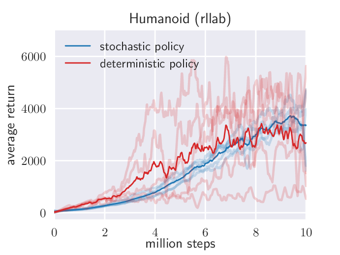
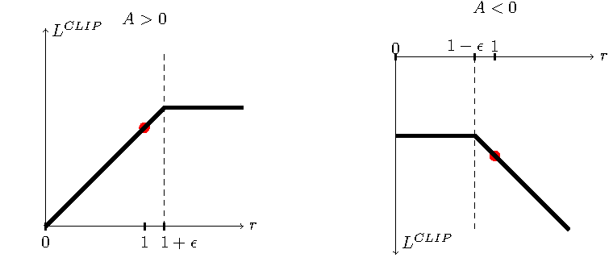
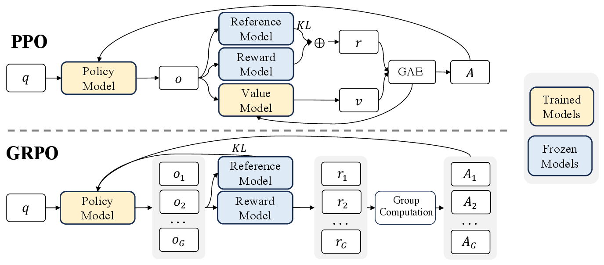
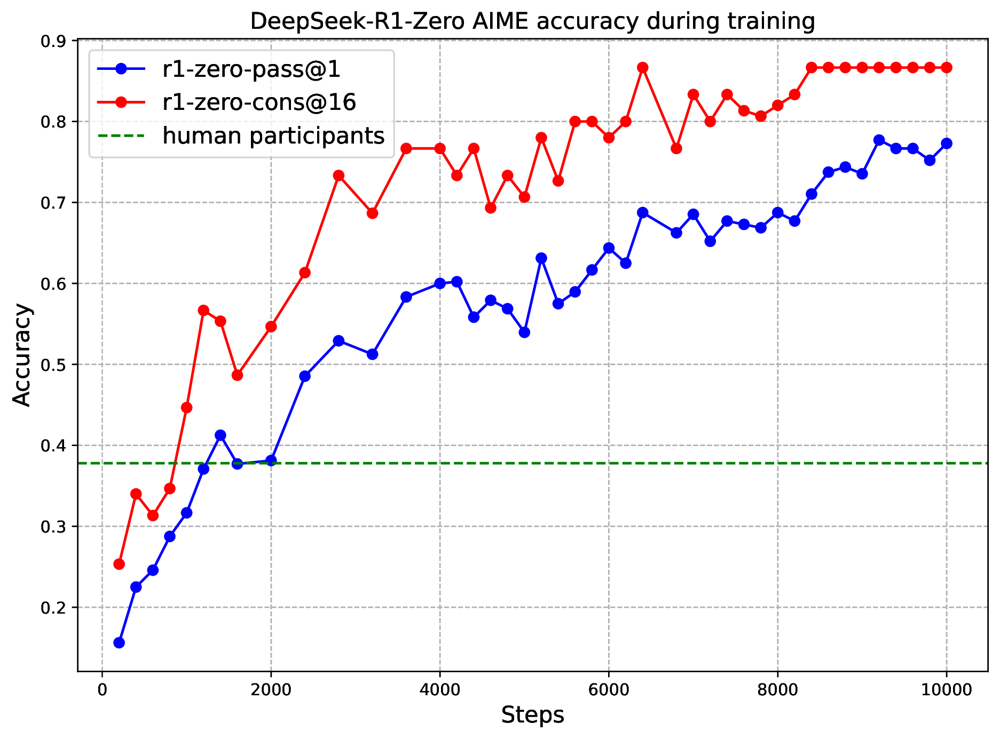
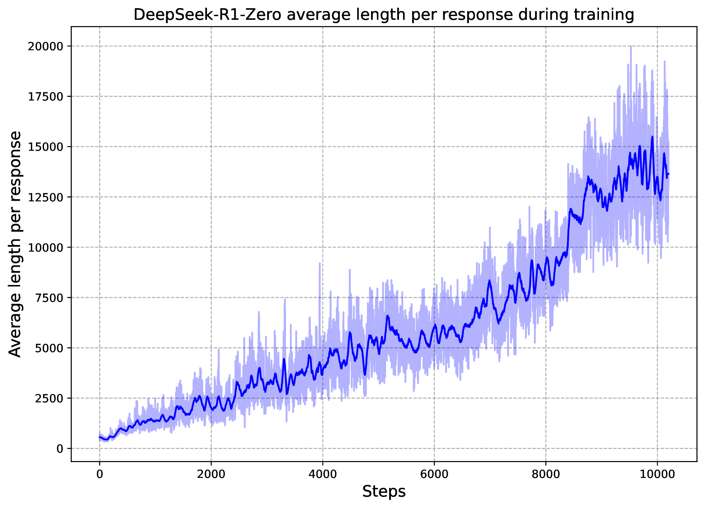
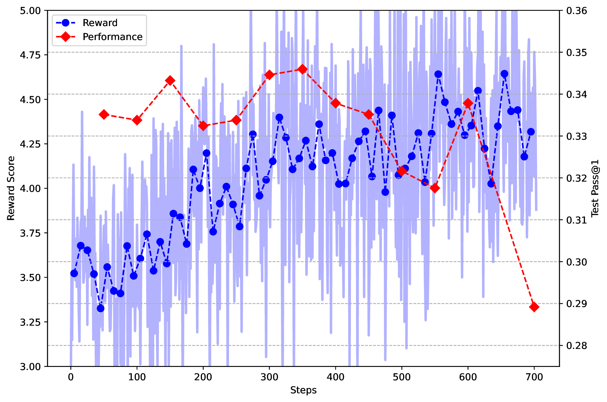
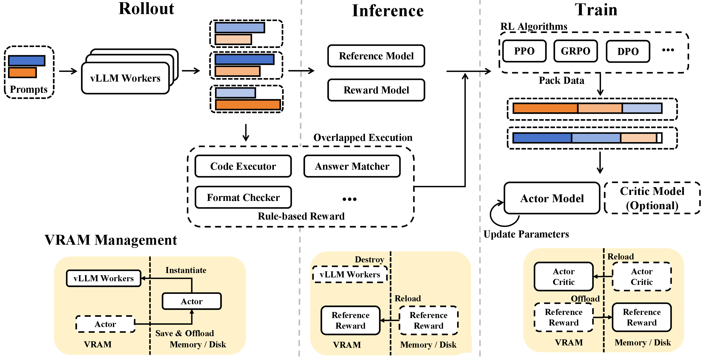

# Policy Gradient、PPO 与 GRPO

这篇只回答一个问题：**如果模型的动作来自采样，甚至是离散 token，为什么还能用梯度把它训练得更好？** Policy Gradient 给出“提高好采样概率、降低坏采样概率”的基本方法；Actor-Critic 用 value 降低方差；PPO 用概率比和 KL 控制更新幅度；GRPO 用同题多样本的相对奖励替代 critic。

大模型后训练、RLHF、RLVR、VLA 闭环优化和世界模型中的 actor learning 都绕不开这条链路。它们的差别主要在 reward 从哪里来、rollout 怎么采、baseline 怎么估、以及怎样防止 reward hacking。

## 为什么不能直接把 reward 当 loss

监督学习里，模型输出和标签通常能逐 token 或逐样本对齐。比如 SFT 里目标 token 是已知的，交叉熵可以直接告诉模型“这个位置应该更像哪个 token”。

RL 不一样。以 LLM 后训练为例：

```text
prompt -> policy 采样 response -> verifier/reward model 打分 -> 更新 policy
```

reward 往往只在完整回答之后出现。模型生成了很多 token，最后答案对了或错了，但 reward 本身不会告诉你“第 37 个 token 该怎样改”。更麻烦的是，采样动作是离散的：你不能对“已经采出的 token id”直接求导。

Policy Gradient 绕开的方式是：不对采样结果求导，而是对**采到这个结果的概率**求导。如果一个回答得分高，就提高这条采样轨迹的概率；得分低，就降低它的概率。

## Score Function Estimator：把奖励乘到 log prob 上

策略目标写成：

\[
J(\theta)=\mathbb{E}_{\tau\sim\pi_\theta}[R(\tau)]
\]

这里 \(\tau\) 是一条 trajectory，可以是一局游戏、一段机器人动作，也可以是从 prompt 到完整 response 的 token 序列。目标 \(J(\theta)\) 是当前策略平均能拿到多少奖励。

REINFORCE 的核心估计是：

\[
\nabla_\theta J(\theta)
\approx
\mathbb{E}
\left[
G_t\nabla_\theta\log\pi_\theta(a_t\mid s_t)
\right]
\]

这行公式可以分成两部分：

1. \(G_t\) 表示这次从第 \(t\) 步往后的结果好不好。
2. \(\nabla_\theta\log\pi_\theta(a_t\mid s_t)\) 表示怎样改参数才能提高当前动作的概率。

如果 \(G_t\) 高，更新会沿着“让这个动作更可能”的方向走；如果 \(G_t\) 低，更新会压低它。这个形式叫 score function estimator，优点是不需要 reward 对动作可导；缺点是方差很大，因为一次采样的好坏可能受很多随机因素影响。

## Baseline：更新的不是绝对分数，而是相对好坏

直接用 return 更新策略会很抖。一个回答得 85 分到底好不好，取决于这道题通常能得多少分。平均只有 50 分时，85 是好样本；平均 95 分时，85 反而差。

所以 policy gradient 通常减去 baseline：

\[
\nabla_\theta J(\theta)
\approx
\mathbb{E}
\left[
(G_t-b(s_t))\nabla_\theta\log\pi_\theta(a_t\mid s_t)
\right]
\]

baseline \(b(s_t)\) 只依赖状态，不依赖当前动作，因此不会改变期望梯度方向，但能降低方差。当 baseline 取 value function \(V(s_t)\) 时，就得到 advantage：

\[
A_t=G_t-V(s_t)
\]

Advantage 的含义是“这次动作比这个状态下的平均预期好多少”。PPO、A2C/A3C、GRPO、RLOO 等方法的很多差别，其实是在用不同方式估计这个相对好坏。

| 量 | 它回答的问题 | 在 LLM 后训练里的直觉 |
| --- | --- | --- |
| reward | 完整回答或动作结果好不好 | verifier 分数、reward model 分数、规则通过 |
| return | 从某个位置往后的累计结果 | response 后半段对最终结果的贡献 |
| value | 当前前缀一般能走到什么结果 | critic 估计这个 prompt/前缀的预期分 |
| advantage | 这条采样比预期好还是差 | 好于同题平均就提高概率，差于预期就降低概率 |

## Actor-Critic：actor 决策，critic 估分

Actor-Critic 把两个任务分开：

| 角色 | 学什么 | 典型失败 |
| --- | --- | --- |
| actor / policy | 在状态下选择动作或 token | 为了 reward 跑偏、过早坍缩、KL 过大 |
| critic / value model | 估计状态或前缀的未来回报 | value 偏高、方差大、bootstrap 错误 |

critic 不负责执行动作，它给 actor 提供 baseline。这样 actor 不用只凭一次 rollout 的绝对 reward 更新，而是看“这次是否比 critic 预期更好”。在机器人和世界模型里，critic 常常还承担长 horizon 的价值估计；在 LLM RLHF 里，critic 是显存、吞吐和稳定性的重要成本项。

## 探索：随机性不是噪声，而是发现更好行为的方式

如果策略太快变成确定性，它可能永远发现不了更好的动作。最大熵 RL 的思想是：在优化 reward 的同时保留一定 policy entropy，让策略不要过早只剩一条路径。

{ width="690" }

<small>图源：[Soft Actor-Critic](https://arxiv.org/abs/1801.01290)，Figure 4。原图表达：比较 SAC 与 deterministic variant 在 Humanoid (rllab) 上不同随机种子的稳定性。本站读法：随机策略不是“乱”，而是给训练保留多条合理行为路径，降低早期偶然高分把策略锁死的风险。</small>

LLM 的 sampling temperature、top-p、best-of-n、GRPO 组大小，本质上也在调探索和成本。采样更多候选能提供更好的相对比较，但 rollout token、reward 计算、reference logprob 和训练更新都会变贵。

## PPO：用概率比限制一次更新能走多远

朴素 policy gradient 的一个危险是：一次 batch 里某条样本得分高，模型可能把它概率推得太猛。PPO 通过新旧策略概率比控制更新幅度：

\[
r_t(\theta)=
\frac{\pi_\theta(a_t\mid s_t)}
{\pi_{\theta_{\text{old}}}(a_t\mid s_t)}
\]

如果 \(r_t=1.2\)，说明新策略把这个动作概率提高了 20%；如果 \(r_t=0.8\)，说明降低了 20%。PPO 的 clipped objective 是：

\[
L^{\text{CLIP}}(\theta)=
\mathbb{E}_t
\left[
\min\left(
r_t(\theta)A_t,
\mathrm{clip}(r_t(\theta),1-\epsilon,1+\epsilon)A_t
\right)
\right]
\]

它的机制是：

1. \(A_t>0\) 时，策略想提高好动作概率，但超过 \(1+\epsilon\) 后收益被截断。
2. \(A_t<0\) 时，策略想降低坏动作概率，但低于 \(1-\epsilon\) 后也不会鼓励更激进的变化。

{ width="760" }

<small>图源：[Proximal Policy Optimization Algorithms](https://arxiv.org/abs/1707.06347)，Figure 1。原图表达：clipped surrogate objective 在概率比偏离旧策略过多时截断收益。本站读法：clip 不是为了让模型学慢，而是防止一次采样 batch 把 policy 拉到不可信区域。</small>

PPO 的两层循环也很重要：

```text
外层：用当前 policy 采样 rollout
内层：在这批 rollout 上估计 advantage，做若干 minibatch 更新
然后：把 current policy 变成下一轮 old policy
```

它仍然是近似 on-policy 方法。rollout policy 和 update policy 差太远，old logprob、advantage 和 KL 都会变得不可信。这也是 RLHF 工程里要保存 old logprob、reference logprob、value、reward 和 response metadata 的原因。

## Reference/KL：学新行为，但别把底座模型扯坏

大模型后训练通常会保留 reference policy，常是 SFT 模型或旧策略。KL divergence 衡量当前 policy 和 reference 的距离：

\[
D_{\mathrm{KL}}(\pi_\theta\|\pi_{\mathrm{ref}})
=
\mathbb{E}_{a\sim\pi_\theta}
\left[
\log\pi_\theta(a\mid s)-\log\pi_{\mathrm{ref}}(a\mid s)
\right]
\]

在 RLHF 里，KL 经常作为 reward penalty：

\[
r^{\text{total}}=r^{\text{task}}-\beta D_{\mathrm{KL}}(\pi_\theta\|\pi_{\mathrm{ref}})
\]

任务奖励越高越好，但偏离 reference 太远要扣分。\(\beta\) 控制“学新行为”和“保留底座能力”的平衡。KL 太小不一定好，因为模型可能几乎没学到新能力；KL 太大也危险，因为模型可能为了 reward 牺牲语言质量、格式稳定性、事实性或安全边界。

## GRPO：同一个问题里比较多个回答

GRPO 的核心是：对同一个 prompt 采样多个输出：

\[
\{o_1,o_2,\ldots,o_G\}
\]

每个输出得到奖励 \(R_i\)，再用组内均值和标准差估计 advantage：

\[
A_i=
\frac{R_i-\mathrm{mean}(\{R_j\}_{j=1}^G)}
{\mathrm{std}(\{R_j\}_{j=1}^G)+\epsilon}
\]

这样做的直觉很清楚：同一道题的多个回答共享上下文，所以奖励可以直接组内比较。高于同题平均的回答 advantage 为正，低于平均的为负。GRPO 省掉显式 value model，降低 critic 的显存和训练成本，但代价是要为每个 prompt 采样多个候选，rollout 成本上升。

{ width="920" }

<small>图源：[DeepSeek-R1](https://arxiv.org/abs/2501.12948)，Supplementary Figure 1。原图表达：PPO 用 value model 辅助 advantage 估计；GRPO 省去 value model，用同一问题的一组 sampled outputs 的 reward scores 做相对 advantage。本站读法：GRPO 把“critic 成本”换成“多样本 rollout 成本”。</small>

## DeepSeek-R1：可验证奖励为什么能改变推理行为

DeepSeek-R1-Zero 的启发不只是“用了 GRPO”，而是：当 reward 足够可验证，策略可以从结果反馈中学出更长的推理、检查和回溯行为。

{ width="760" }

{ width="760" }

<small>图源：[DeepSeek-R1](https://arxiv.org/abs/2501.12948)，Figure 3。原图表达：R1-Zero 在 AIME 2024 上的表现和平均 response length 随 RL 训练增加。本站读法：outcome reward 不直接规定“必须写长推理”，但如果更长的检查和回溯提高正确率，policy gradient 会提高这类轨迹概率。</small>

这也是为什么 reward 设计是核心。数学题、代码测试、结构化状态预测等任务有较硬的可验证信号；通用 helpfulness reward 更软，更容易被模型钻空子。

{ width="760" }

<small>图源：[DeepSeek-R1](https://arxiv.org/abs/2501.12948)，Supplementary Figure 3。原图表达：训练中 reward 上升，但 CodeForces 表现下降。本站读法：reward 曲线升高不等于能力提升；policy 优化的是你给出的 reward，而不是你心里真正想要的目标。</small>

## rollout token 账：GRPO 为什么贵

假设一轮 GRPO 用 `8,192` 个 prompt，每题采样组大小 `G=8`，平均 response 长度 `512` tokens，response decode token 数是：

\[
8192\times8\times512\approx33.6\text{M tokens}
\]

如果平均 prompt 长度是 `1,024`，且 8 条候选各自独立 prefill，输入侧还有：

\[
8192\times8\times1024\approx67.1\text{M tokens}
\]

若 serving runtime 能对同一 prompt 做 prefix/KV 复用，prefill 更接近 \(8192\times1024\approx8.4\text{M}\) tokens，再分叉出 8 条 decode。算法看起来一样，系统成本完全不同。这就是为什么 vLLM、SGLang、KV 复用、reward worker、reference logprob 和训练 worker 的流水线设计，会直接影响 RL 是否可跑。

{ width="920" }

<small>图源：[DeepSeek-R1](https://arxiv.org/abs/2501.12948)，Supplementary Figure 2。原图表达：R1 的 RL framework 分成 rollout、inference、rule-based reward 和 training 模块。本站读法：RL 工程瓶颈不只是反向传播，生成、奖励、reference logprob、权重同步和 offloading 都在同一条成本链上。</small>

## PPO、GRPO、RLOO、ReMax、DPO 怎么分

| 方法 | 是否需要当前策略 rollout | 是否显式 reward | 是否需要 critic | 适合什么 |
| --- | --- | --- | --- | --- |
| PPO | 是 | 是 | 通常需要 | RLHF、reward model、连续策略改进 |
| GRPO | 是 | 是 | 通常不需要 | 可验证奖励、同题多样本比较 |
| RLOO | 是 | 是 | 不需要 | leave-one-out baseline，降低 critic 成本 |
| ReMax | 是 | 是 | 不需要 | 用额外 baseline generation 降方差 |
| DPO | 主要用偏好对 | 隐式 | 不需要 | 偏好数据稳定，想降低 RL 工程复杂度 |

DPO 不等于“过时 PPO 的替代品”，它解决的是不同工程取舍：如果你有高质量 chosen/rejected 偏好对，又想避免 rollout 集群和 critic，DPO 很适合；如果 reward 可以在线验证、需要搜索和试错，PPO/GRPO/RLOO 仍然有意义。

## 和世界模型、VLA 的连接

世界模型 RL 的轨迹不一定是文本 response，也可以是未来 latent、视频状态或机器人动作序列。只要有“采样候选 -> 评价后果 -> 提高高分候选概率”的结构，policy gradient 的语言就能用。

典型失败链是：

```text
reward 主要奖励未来帧像不像
-> 模型生成更平均、更顺滑的视频
-> MSE/LPIPS 下降
-> 但换动作时未来差异不明显
-> planner 无法比较候选动作
-> closed-loop success 不升反降
```

修复不是简单“多跑 RL”，而是把 reward 拆成 action sensitivity、risk recall、task success、temporal consistency 和真实回放校准。RL 会优化你定义的信号；信号不对，它只会更高效地错。

## 外部精读

- [OpenAI Spinning Up: Policy Gradient](https://spinningup.openai.com/en/latest/spinningup/rl_intro3.html)：从 score function estimator 到 policy gradient 的经典入门。
- [Proximal Policy Optimization Algorithms](https://arxiv.org/abs/1707.06347)：PPO clipped objective 的原论文。
- [Hugging Face: The N Implementation Details of RLHF with PPO](https://huggingface.co/blog/the_n_implementation_details_of_rlhf_with_ppo)：非常适合看 RLHF 工程细节、reward/value/logprob 的真实坑。
- [BAIR: Rethinking the Role of PPO in RLHF](https://bair.berkeley.edu/blog/2023/10/16/p3o/)：把 PPO 和偏好比较之间的张力讲得很清楚。
- [DeepSeek-R1](https://arxiv.org/abs/2501.12948)：GRPO、可验证奖励、reward hacking 和 RL infrastructure 的代表性技术报告。

## 阅读结论

Policy Gradient 的核心是对采样概率求导，而不是对离散采样结果求导。Baseline/critic 把绝对分数变成相对好坏，PPO 用概率比和 KL 约束一次更新的幅度，GRPO 用同题多样本比较省掉 critic。所有这些方法最后都受 reward 质量、rollout 成本和评测闭环约束。
