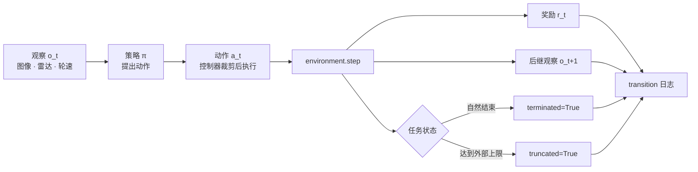

# Agent、环境与训练闭环

仓库机器人每隔一小段时间收到一组传感器读数，再给左右轮一个速度命令。命令执行完，环境返回新的读数、奖励和结束原因。训练代码真正要对齐的是这一行 transition：动作对应哪一次执行，后继观察来自 reset 前还是 reset 后，价值目标是否还可以 bootstrap。



图里的两个结束标志来自不同原因。它们都可能让采样器开始下一回合，却不能在价值目标里用同一个 mask 处理。

## 一条轨迹记录了什么

本文用 $r_t$ 表示执行 $a_t$ 后收到的奖励，轨迹写作

\[
\tau=(o_0,a_0,r_0,o_1,a_1,r_1,\ldots,o_T).
\]

有些教材将同一个奖励写作 $r_{t+1}$，二者只差索引约定。实际存储必须保证每行的动作、奖励和后继观察对应同一次环境调用。

| 对象 | 仓库机器人的具体含义 | 数据中应如何理解 |
| --- | --- | --- |
| observation $o_t$ | 此刻收到的图像、雷达和轮速 | 策略实际可访问的输入 |
| state $s_t$ | 机器人与障碍物位置、速度等完整环境信息 | 满足 Markov 假设所需的状态，未必可直接看到 |
| action $a_t$ | 本周期左右轮速度命令 | 必须同时说明单位、范围和持续时间 |
| reward $r_t$ | 到达目标、碰撞、耗时产生的数值反馈 | 属于执行该动作后的转移 |
| policy $\pi$ | 由观察或历史产生动作的规则 | 可以随机采样，也可以确定输出 |
| episode | 一次重置之后到结束之前的交互 | 定义任务统计与重置边界 |
| rollout | 为训练或评测收集的一段轨迹 | 可能只覆盖 episode 的一部分 |

教学奖励可以定义为到达目标 $+100$、不可恢复碰撞 $-100$、其他每步 $-0.01$。奖励规则决定偏好。例如同样成功的两条路径，折扣与步成本通常偏好较早完成；如果额外给“接近目标”奖励，却没有检查任务完成，机器人可能重复靠近再远离刷分。每个奖励分量都需要对应一个实际行为目的。

一次 environment step 的顺序如下，优化器通常在收集若干步后才运行。

```text
observation_t -> policy -> action_t -> environment.step
environment.step -> reward_t + observation_{t+1} + terminated + truncated
trajectory batch -> return / advantage / target -> loss -> policy update
```

## 跟踪一次仓库转弯

设机器人在同一路口两次看见叉车，当前距离都为 2 米。第一段历史中，0.2 秒前叉车还在 2.4 米，表示正在接近；第二段历史中，之前只有 1.6 米，表示正在远离。如果两次都只保存当前距离，策略收到相同输入，却要面对不同碰撞概率。

一次真实控制可以按下表记录。数值是教学示意，时间顺序比字段名称更重要。

| 时刻 | 发生了什么 | 记录的对象 |
| --- | --- | --- |
| 10.00 s | 采集图像与距离，叉车正在接近 | `observation_capture_time` 与历史 |
| 10.03 s | 策略提出左轮 0.1、右轮 0.2 m/s | `proposed_action` |
| 10.04 s | 控制器限制右轮为 0.15 m/s | `executed_action` |
| 10.14 s | 本周期结束，读取后继观察 | 与实际动作配对的 `next_observation` |
| 10.14 s | 未碰撞、未到目标 | 步奖励 −0.01，`terminated=False` |

如果采样器此时恰好收满一个 batch，只是结束了这段数据，机器人任务仍未结束。若随后 reset，必须把 10.14 秒的最后观察保留下来；新回合入口画面不能替代它。动作持续时间和实际执行值还会进入动力学监督，这与仅保存策略输出不同。

这些时间戳是建议的日志字段，并非某个环境 API 自动保证。Gymnasium 的 `step` 返回通常组织为 observation、reward、terminated、truncated、info，包装器怎样保存最后观察需要按实际版本检查。

## 为什么一张图像可能不够

前述两段叉车历史产生相似的当前图像，却需要不同的避障动作。若策略只看当前图像，同一个输入下的后果就像额外噪声。

完全状态的 Markov 条件是，给定 $s_t,a_t$ 后，下一状态与奖励不再依赖更早历史。机器人观察往往不满足该条件，因此可使用历史 $h_t=(o_{\le t},a_{<t})$，或用 belief 表示对隐藏状态的条件分布

\[
b_t(s)=p(s_t=s\mid h_t).
\]

在已知转移 $P$ 和观测模型 $O$ 时，belief 的更新先根据动作预测状态，再用新观察修正

\[
b_{t+1}(s')\propto O(o_{t+1}\mid s')\sum_sP(s'\mid s,a_t)b_t(s).
\]

循环网络、历史帧或记忆模块是在学习一个可供决策的历史摘要，并不自动等于精确 belief。是否足够，要看遮挡、延迟、速度变化等需要记忆的情形中，策略能否区分后果。[随机过程与马尔可夫性](../prerequisite-math/stochastic-processes-and-markov.md)给出条件独立的数学解释。

## 结束任务与停止采样是两回事

假设目标已到达，后续任务价值为零，`terminated=True`。如果只是采样器达到 1000 步上限，机器人仍可能继续完成任务，则是外部 `truncated=True`。两者都需要停止当前采样段或重置环境，价值目标却不同。

令奖励为 $1$，折扣 $0.9$，结束前真实后继状态的价值估计为 $6$。真实终止时目标为 $1$；外部截断时目标仍是 $1+0.9\times6=6.4$。这就是 bootstrap mask 通常使用 `1 - terminated` 的原因。

```python
reward, gamma, next_value = 1.0, 0.9, 6.0
terminal_target = reward
truncated_target = reward + gamma * next_value
assert terminal_target == 1.0
assert abs(truncated_target - 6.4) < 1e-12
```

这里的 `next_value` 必须来自截断前的最后观察，不能来自自动重置后新 episode 的初始观察。向量环境和自动重置包装器尤其需要核对 final observation 的接口。若任务本身规定“必须在 1000 步以内完成”，截止时刻属于真实任务终止；剩余时间也应进入状态，否则同一位置在不同剩余时间下的价值无法区分。[Gymnasium 的时间限制说明](https://gymnasium.farama.org/tutorials/gymnasium_basics/handling_time_limits/)详细区分了这些情况。

训练还需要第二种边界。GAE 的误差递推不能越过重置进入下一条轨迹，即使上一段因外部截断而保留了 value bootstrap。因此“是否继续估计未来价值”和“是否继续串接下一个采样误差”应分别记录，见 [GAE 与 PPO](policy-gradient-actor-critic-ppo-grpo.md)。

## 先把环境返回值变成统一 transition

研究代码经常在 Gymnasium、向量环境和自定义机器人接口之间切换。与其让每个算法文件自己解释 `done`，不如在环境边界统一产生一条 transition。下面的函数只表达数据合同，实际项目还要按环境是否自动 reset 检查 `next_observation` 的来源。

```python
def make_transition(observation, action, step_result, episode_id, step_id):
    next_observation, reward, terminated, truncated, info = step_result
    return {
        'episode_id': episode_id,
        'step_id': step_id,
        'observation': observation,
        'action': action,
        'reward': float(reward),
        'next_observation': next_observation,
        'terminated': bool(terminated),
        'truncated': bool(truncated),
        'bootstrap_mask': 0.0 if terminated else 1.0,
        'info': info,
    }
```

两个标志允许同时为真。例如机器人恰好在外部步数上限那一步到达目标，底层环境返回 `terminated=True`，外层 `TimeLimit` 又设置 `truncated=True`。官方 [TimeLimit 源码](https://gymnasium.farama.org/_modules/gymnasium/wrappers/common/#TimeLimit.step)会保留底层的终止标志，不能在转换函数里断言二者互斥。此时任务已经终止，bootstrap mask 仍为零。

```python
transition = make_transition(
    'before-goal', 'move',
    ('at-goal', 1.0, True, True, {}),
    episode_id=3, step_id=999,
)
assert transition['terminated'] and transition['truncated']
assert transition['bootstrap_mask'] == 0.0
```

算法读取 `bootstrap_mask` 来计算 value target，读取 `terminated or truncated` 来结束当前采样段。两种用途分开后，外部时间限制可以保留最后状态的价值估计，真实任务终止则不会从不存在的后继状态 bootstrap。若环境包装器在结束时自动返回新 episode 的初始观察，应另外保存结束前的 observation，并在这里传入它；新回合的第一帧不能冒充旧回合的 `next_observation`。

在机器人接口中，`action` 还应同时保存策略提出值和控制器实际执行值。例如策略提出角速度 0.4，安全层裁剪为 0.2，动力学转移由 0.2 产生。只保存 0.4 会让离线数据中的动作与后继观察不匹配，后续 world model 或 offline RL 可能把安全层造成的变化错误归因于策略。

## 一份能被重放和解释的数据

每次交互至少保留观察、实际执行动作、奖励、后继观察、终止原因、episode id 和时间顺序。On-policy 更新还需要采样策略的动作 log probability；动作经安全过滤器改变时，还要分开记录提出动作与执行动作。采样策略版本、奖励版本和环境版本会影响数据含义。

训练闭环随后分成两件工作。评估当前策略时保持参数不变，估计它在固定任务分布上的表现；改进策略时使用新的价值或梯度更新参数。混用训练探索动作和评测动作、在评测中继续更新、只报告未结束 episode 的部分回报，都会改变结论。[MDP 与 Bellman](mdp-value-bellman.md)把这种交互写成递推方程，[实践与算法选择](practice-and-algorithm-selection.md)解释如何读实验输出。

## 算法和环境依据

轨迹和 MDP 的对象沿用 [Sutton 与 Barto](http://incompleteideas.net/book/the-book-2nd.html)，`terminated` 与 `truncated` 的区分对照 [Gymnasium 时间限制说明](https://gymnasium.farama.org/tutorials/gymnasium_basics/handling_time_limits/)。仓库机器人、传感器、奖励和 1000 步边界是本站构造场景，用来说明环境包装器怎样改变 bootstrap，而不是某个真实导航任务的结果。

最小回放要打印自动 reset 前的 final observation、`terminated`、`truncated` 和 bootstrap mask。若把 reset 后的初始观察误当作上一条轨迹的后继，数值仍可能有限，却已经训练了错误的目标。
