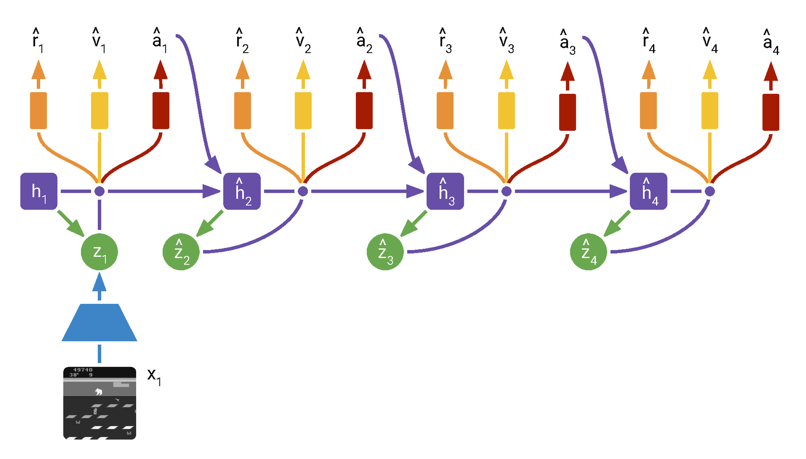
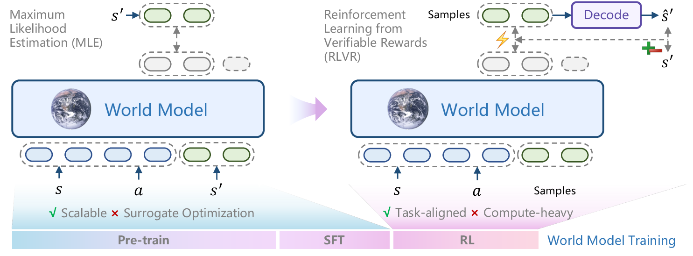
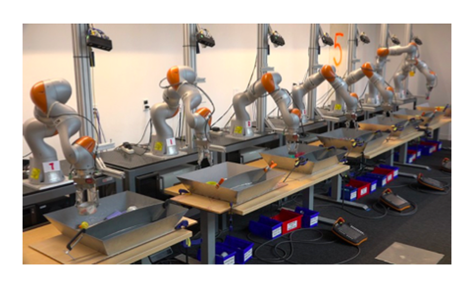

# 世界模型中的强化学习

世界模型不是“会生成未来画面”就够了。对决策系统来说，世界模型真正要回答的是：**如果我在当前状态做这个动作，未来会发生什么，这个未来是否值得执行。** 强化学习提供了三件工具：用 MDP/Bellman 表达长期后果，用 value/reward 判断候选未来，用 policy 或 planner 把高价值未来变成动作。

所以这篇不把 PlaNet、Dreamer、Decision Transformer、RLVR-World 当论文名堆起来，而是沿一条主线讲：从真实 transition 到 learned transition，再到 imagined rollout 和闭环策略优化。

## 世界模型补的是 transition

在 MDP 里，真实环境 transition 是：

\[
P(s_{t+1}\mid s_t,a_t)
\]

它表示：给定当前状态 \(s_t\) 和动作 \(a_t\)，真实环境会产生下一状态 \(s_{t+1}\) 的概率分布。世界模型学习的是一个近似：

\[
\hat P_\theta(s_{t+1}\mid s_t,a_t)
\]

帽子 \(\hat{}\) 很重要：这是模型预测，不是真实世界。世界模型越有用，不是因为它能把未来画得越漂亮，而是因为它的预测能保留决策变量：物体位置、速度、接触、遮挡、任务进度、风险和可恢复性。

很多实用世界模型还会同时预测：

\[
(\hat s_{t+1},\hat r_t,\hat d_t,\hat u_t)=f_\theta(s_t,a_t)
\]

这里 \(\hat r_t\) 是奖励或任务进展，\(\hat d_t\) 是终止/失败信号，\(\hat u_t\) 是不确定性或风险。强化学习需要这些量，是因为 Bellman backup 要把“当前动作的后果”递归成未来价值。

| 世界模型输出 | 对 RL 的作用 | 常见失败 |
| --- | --- | --- |
| 下一状态 \(\hat s_{t+1}\) | 让 planner 或 actor 比较动作后果 | 视觉像但物理错，接触和遮挡丢失 |
| reward \(\hat r_t\) | 给 imagined rollout 提供即时反馈 | reward 与真实任务错位 |
| done/failure \(\hat d_t\) | 判断任务结束、碰撞或不可恢复 | 失败边界过晚或过早触发 |
| uncertainty/risk \(\hat u_t\) | 惩罚模型不确定区域，减少 exploitation | 不确定性未校准，策略过保守或过冒险 |

## PlaNet：先学 latent dynamics，再在线规划

PlaNet 是理解 model-based RL 的好入口。它不在像素空间里直接规划，而是先把观测编码成 latent belief，再用 RSSM 预测 latent future，最后用 CEM 搜索未来动作序列。

{ width="860" }

<small>图源：[Learning Latent Dynamics for Planning from Pixels](https://arxiv.org/abs/1811.04551)，Figure 2。原图表达：比较 RNN、SSM 和 RSSM 三种 dynamics 结构；RSSM 同时保留 deterministic memory 和 stochastic latent state。本站读法：deterministic state 记历史，stochastic state 表达不确定性，二者合起来更适合部分可观测控制。</small>

PlaNet 的闭环可以写成：

```text
当前观测 -> 编码成 latent belief
  -> 采样多条未来 action sequences
  -> 用 RSSM 预测 latent future 和 reward
  -> 选择预测回报最高的动作序列
  -> 执行第一个动作
  -> 收到新观测后重新规划
```

这里的关键不是“模型会预测未来”，而是“每一步执行后重新观察并重新规划”。这会缓解模型误差累积：如果前一次预测错了，新 observation 可以把 belief 拉回真实状态附近。

PlaNet 的代价也很清楚：执行时要持续搜索。每个控制步都要比较多条候选动作序列，latency 和采样数量会限制它在高频机器人控制或大模型 rollout 服务中的使用。

## Dreamer：把在线搜索换成想象中训练 actor

Dreamer 保留 learned world model，但不再每一步都靠 CEM 在线搜索。它在 world model 里展开 imagined trajectories，用这些轨迹训练 actor 和 critic；执行时 actor 直接输出动作。

{ width="820" }

<small>图源：[Dream to Control: Learning Behaviors by Latent Imagination](https://arxiv.org/abs/1912.01603)，Algorithm 1。原图表达：Dreamer 交替进行 dynamics learning、behavior learning 和 environment interaction。本站读法：真实经验主要用于训练 world model，策略更新大量发生在 latent imagination 中。</small>

Dreamer 把训练拆成三层：

| 层 | 学什么 | 用什么数据 |
| --- | --- | --- |
| representation / transition | latent state 和 dynamics | replay buffer 中的真实 observation/action |
| reward / continue | imagined rollout 的即时反馈和终止 | 真实 reward/done 监督 |
| actor / critic | 哪些动作让 imagined return 更高 | world model 中展开的 imagined trajectories |

DreamerV2 的 actor-critic 图更直观：

{ width="860" }

<small>图源：[Mastering Atari with Discrete World Models](https://arxiv.org/abs/2010.02193)，Figure 3。原图表达：从真实 replay state 出发，在 learned world model 中展开 imagined trajectories，并用这些轨迹训练 actor 和 critic。本站读法：world model 提供 Bellman 里的下一状态和 reward，critic 估计未来价值，actor 选择让 imagined return 更高的动作。</small>

Dreamer 的效率来自“真实世界步数”被换成“latent rollout 步数”。如果机器人以 `20Hz` 收集真实交互，`245,760` 个真实 transition 需要：

\[
245{,}760 / 20 = 12{,}288s \approx 3.4h
\]

如果同样数量的 latent transition 在 GPU 上每步 `0.04ms`，只需约：

\[
245{,}760 \times 0.04\text{ms}\approx9.8s
\]

这就是 world model RL 的吸引力。但代价也在同一处：便宜 transition 是模型想象出来的，不是真实世界。如果每一步有 `1%` 的关键接触误判，15 步里至少一次误判的概率约为：

\[
1-0.99^{15}\approx14.0\%
\]

rollout 越长，actor 越可能学会利用模型漏洞。所以实践里常配合短 horizon、value bootstrap、不确定性惩罚、真实 replay 校准和闭环评测。

这就是 model exploitation。比如真实机器人推杯子时，杯子碰到桌沿会卡住；但世界模型没有学好接触边界，想象里杯子可以穿过桌沿继续前进。actor 在 imagined rollout 里会发现“猛推”得到高 reward，于是学出真实环境里会失败的动作。RL 给了世界模型很高的样本效率，也把模型错误变成了可被策略主动利用的漏洞。

## 为什么 open-loop 好看不等于能规划

世界模型有两种完全不同的评价方式：

| 评价方式 | 问的问题 | 不能证明什么 |
| --- | --- | --- |
| open-loop prediction | 未来帧、latent 或状态预测像不像真实数据 | planner 能不能用、动作是否真的影响未来 |
| closed-loop control | 接入策略或规划器后任务是否成功 | 预测图像一定自然、跨平台泛化 |

很多视频世界模型可以生成自然未来，但没有动作条件、reward/done 或 risk head。这样的模型可以是优秀的视频生成器或表征模型，却不能直接称为可规划世界模型。对决策最关键的是 action sensitivity：同一当前状态下，换不同动作，预测未来是否按动作改变。

一个典型失败链是：

```text
训练 loss 下降
-> 未来视频更平滑
-> open-loop 指标更好
-> 不同动作预测差异变小
-> planner 选不出真正更好的动作
-> closed-loop success 不升反降
```

所以世界模型论文至少要区分：是否有动作输入、是否预测 reward/done/risk、是否做 closed-loop eval、是否检查 model exploitation。

## Decision Transformer：把轨迹当序列建模

并不是所有 RL 都必须显式做 Bellman backup。Decision Transformer 把 return-to-go、state、action 交替组织成序列，让 Transformer 在目标回报条件下预测动作。

{ width="920" }

<small>图源：[Decision Transformer](https://arxiv.org/abs/2106.01345)，Figure 1。原图表达：把 return-to-go、state、action 交替输入 GPT decoder，用目标回报条件化动作预测。本站读法：轨迹可以被当成序列数据建模，但这并不自动解决分布外动作和真实闭环问题。</small>

这条路线对 VLA 和 action token 很有启发：如果动作、观测和目标都能 token 化，就可以用序列模型学习“给定目标回报时应该怎样行动”。但它依赖数据覆盖。离线数据里没有的动作组合，模型仍然很难可靠外推。

## RLVR-World：用可验证奖励训练世界模型本身

传统 world model 多用 MLE、重建 loss、latent prediction loss 或 reward/done supervised loss。RLVR-World 的问题意识是：这些 surrogate objective 可能和下游任务指标错位。比如视频 MSE 低，不一定代表状态预测更准；画面更自然，不一定代表 action consequence 更可靠。

{ width="920" }

<small>图源：[RLVR-World: Training World Models with Reinforcement Learning](https://arxiv.org/abs/2505.13934)，Figure 1。原图表达：左侧是用 MLE 等 surrogate objective 训练 world model，右侧是用 RLVR 直接优化 decoded prediction 的可验证任务指标。本站读法：RL 不只可以训练 policy，也可以用可验证指标反过来训练世界模型预测本身。</small>

这类训练可以抽成：

```text
状态 s + 动作 a
  -> 世界模型采样多个下一状态/未来预测
  -> 解码成结构化状态或视频
  -> 用 ground truth 和任务指标打分
  -> 用 PPO/GRPO 类方法提高高分预测概率
```

这里的关键仍然是 reward 是否真对应任务。如果 reward 只奖励像素相似，模型可能学会输出平均化未来；如果 reward 包含结构化状态、动作敏感性、风险和闭环成功，才更可能服务规划。

## 世界模型中的 RL 有五种增量

| 增量 | 它带来什么 | 主要风险 |
| --- | --- | --- |
| 数据收集闭环 | policy 把数据推向任务相关状态 | 数据分布变窄，失败样本不足 |
| 长期信用分配 | reward/value 把未来结果反馈到早期动作 | value target 错误沿 Bellman 放大 |
| 想象训练 | 用 latent rollout 减少真实试错 | model exploitation |
| 反事实规划 | 比较“如果换动作会怎样” | action sensitivity 不足 |
| 任务指标对齐 | 用可验证 reward 直接优化预测质量 | reward 只覆盖局部指标 |

## 和 VLA 的连接

VLA 学的是动作策略：

\[
\pi_\theta(a_t\mid o_{\le t},l)
\]

给定历史观测 \(o_{\le t}\) 和语言指令 \(l\)，输出动作 \(a_t\)。世界模型学的是动作后果：

\[
p_\theta(o_{t+1:t+H},r,d\mid o_{\le t},a_{t:t+H-1},l)
\]

给定历史观测、未来候选动作和语言指令，预测未来观测、奖励和终止信号。RL 把两者接起来：

1. 用 world model 预测候选动作后果。
2. 用 reward/value/risk 判断哪条未来更好。
3. 更新 policy，使它更偏向高回报低风险动作。
4. 用真实闭环数据修正 world model 的盲点。

机器人数据常常来自历史实验、遥操作或离线数据集，不能像游戏一样无限探索。Offline RL 的教训很直接：不要让 value 对数据里没支持的动作胡乱乐观；VLA + world model 也一样，需要 support 约束、失败回放、真实执行校准和安全门禁。

{ width="420" }

<small>图源：[Offline Reinforcement Learning: Tutorial, Review, and Perspectives on Open Problems](https://arxiv.org/abs/2005.01643)，Figure 7。原图表达：大规模机器人抓取数据收集与离线/在线训练设置。本站读法：真实机器人数据昂贵，所以世界模型和 offline RL 都必须认真处理数据覆盖与分布外动作。</small>

## 读论文时问这七个问题

| 问题 | 看哪里 |
| --- | --- |
| 模型预测的是 pixel、latent、state，还是 reward/done/risk | 模型结构图、loss、输出头 |
| 动作是否真的进入 transition | action-conditioned ablation、counterfactual action |
| imagined rollout 多长 | horizon ablation、value bootstrap、error accumulation |
| 是否有 closed-loop eval | 机器人/控制任务 success、cost per success |
| 是否检查 model exploitation | failure replay、uncertainty penalty、真实回放校准 |
| reward 是否和任务一致 | reward definition、verifier、分桶指标 |
| 系统成本是否可接受 | rollout latency、candidate 数、GPU-hour、batch/KV 复用 |

## 外部精读

- [World Models](https://worldmodels.github.io/)：Ha & Schmidhuber 的原始项目页，用很直观的方式说明用内部模型做控制。
- [Learning Latent Dynamics for Planning from Pixels](https://arxiv.org/abs/1811.04551)：PlaNet，理解 latent dynamics + online planning。
- [Dream to Control](https://arxiv.org/abs/1912.01603)：Dreamer，理解 latent imagination 训练 actor-critic。
- [Decision Transformer](https://arxiv.org/abs/2106.01345)：把 RL 轨迹组织成序列建模问题。
- [RLVR-World](https://arxiv.org/abs/2505.13934)：用可验证 reward 训练世界模型预测本身。

## 阅读结论

强化学习让世界模型从“预测器”变成“决策工具”：transition 预测动作后果，reward/value 衡量未来好坏，policy 或 planner 选择动作。真正的难点不在于生成未来，而在于预测必须 action-sensitive、reward 必须任务相关、rollout horizon 必须受控，最后还要用 closed-loop 证明它真的改善决策。
