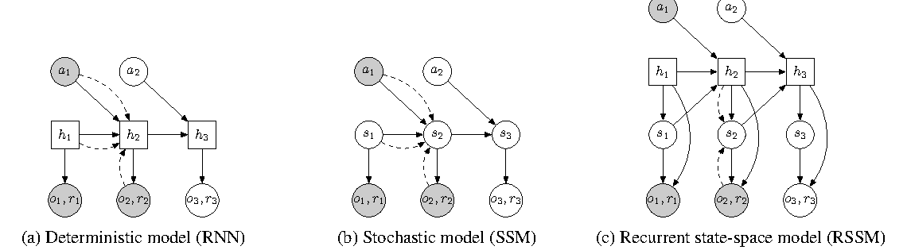
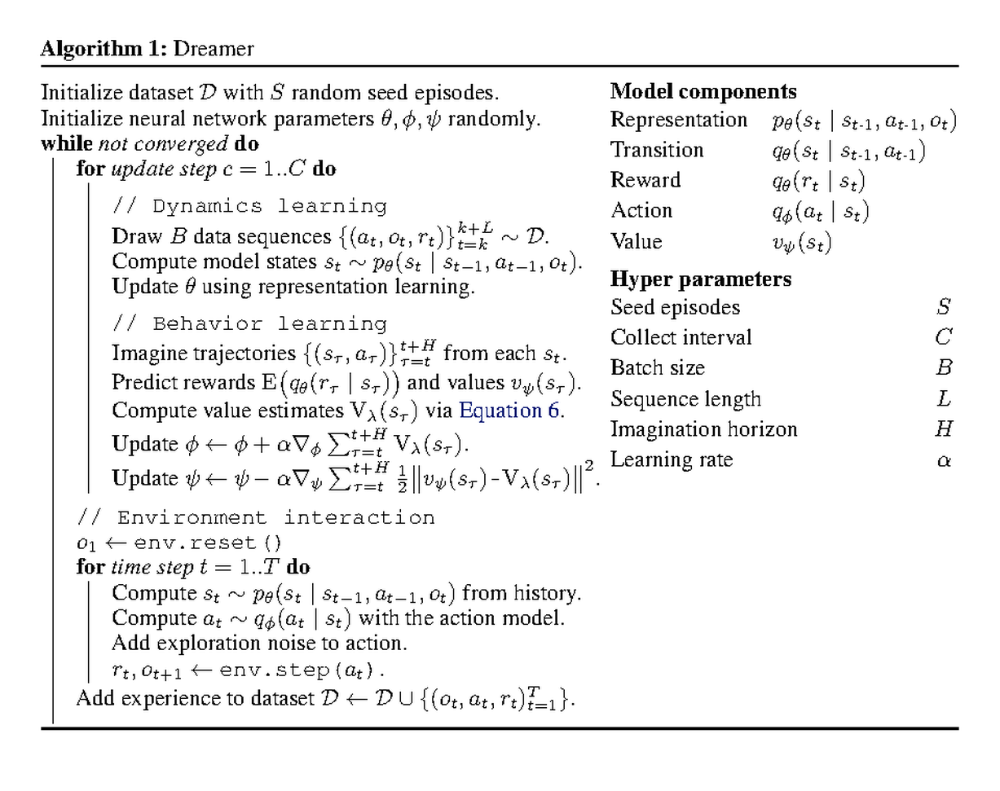

# Model-based RL 与世界模型

如果能预测“执行这个动作以后会怎样”，就能在真实执行前比较候选方案。Model-based RL 显式使用环境模型做规划、生成训练数据或训练策略。模型可以来自已知物理规则，也可以由交互日志学习；它的价值最终体现在决策后果，而不只在预测画面是否相似。

## 模型需要回答哪些问题

一个最小环境模型接收状态与动作，预测后继状态、奖励及继续概率

\[
\hat s_{t+1}\sim p_\phi(s'\mid s_t,a_t),\qquad
\hat r_t=r_\phi(s_t,a_t),\qquad
\hat c_t=p_\phi(\text{继续}\mid s_t,a_t).
\]

在部分可观测环境中，状态可能是由历史推断的 latent belief。模型输入必须包含动作，否则它只能猜测数据中常见的未来，无法区分控制器真正可选的后果。奖励与继续概率也很重要，预测画面接近却把碰撞奖励算错，规划器仍会选择错误动作。

从[MDP 与 Bellman](mdp-value-bellman.md)看，模型提供价值递推右侧的转移和奖励。它若已知且准确，可以直接求解；它若来自学习，则把模型误差也带进了目标。

## 一维小车上的规划计算

考虑教学系统 $x_{k+1}=x_k+a_k$，动作只能取 $-1,0,1$，目标位置为 $2$，每步奖励为 $-(x_{k+1}-2)^2$。起点 $x_0=0$，规划两步，暂取 $\gamma=1$ 且没有终止。

动作序列 $[1,1]$ 产生位置 $[1,2]$，回报为 $-1+0=-1$；$[0,1]$ 产生 $[0,1]$，回报为 $-4-1=-5$；$[-1,1]$ 产生 $[-1,0]$，回报为 $-9-4=-13$。穷举九种长度为二的序列，可以选出最佳的 $[1,1]$。

```python
from itertools import product

def score(actions):
    position, total = 0.0, 0.0
    for action in actions:
        position += action
        total -= (position - 2.0) ** 2
    return total

best = max(product((-1, 0, 1), repeat=2), key=score)
assert best == (1, 1) and score(best) == -1.0
assert score((0, 1)) == -5.0
```

MPC 只执行选中序列的第一个动作，再用真实新观察重算。如果执行 $1$ 后实际只到达 $0.7$，下一次规划从 $0.7$ 开始，避免继续假定已经到达 $1$。这种 receding horizon 能利用反馈修正状态，但不能消除模型对所有候选动作都存在的偏差。

若未来可能终止，奖励应只在仍然存活的轨迹前缀上累积。令 $w_0=1$、$w_{k+1}=w_k\hat c_k$，常见预测目标为

\[
\hat G=\sum_{k=0}^{H-1}\gamma^k w_k\hat r_k+\gamma^H w_H\hat V(\hat s_H).
\]

终止那一步的奖励保留，终止之后的奖励与尾部 value 则消失。把碰撞后的想象奖励继续加进去，会使规划器通过虚构未来抵消真实失败。

## 搜索预算与模型误差一起决定 horizon

动作数为 $A$、horizon 为 $H$ 时，离散穷举需要 $A^H$ 条候选。连续动作常用随机 shooting 或 CEM。CEM 先从动作序列分布采样，保留预测回报较好的候选，再拟合其均值与方差，重复若干轮后选择动作。它优化的是模型预测目标，搜索越充分并不保证真实结果越好。

假设实际系统每步位移为 $0.8a$，模型却认为是 $a$，连续执行五个 $a=1$ 时，模型位置为 $5$，真实位置为 $4$。更一般地，若一步误差至多 $\varepsilon$、动力学对状态的 Lipschitz 常数为 $L$，误差满足 $e_{k+1}\le Le_k+\varepsilon$。$L=1$ 时上界线性积累，$L>1$ 时可能更快增长。这个教学界需要相应局部假设，不能直接当作任意神经世界模型的误差保证。

模型还会被主动利用。假设普通动作真实与预测回报都是 $3$，极端动作真实回报 $-10$、模型误判为 $8$，更强的规划器会更稳定地选择极端动作。平均预测误差若被大量普通动作稀释，也可能看起来很好。因此要检查候选策略会访问的状态动作、奖励排序、终止校准和分布外不确定性，而不只看日志上的平均 reconstruction loss。

## 同一小车模型可以被谁使用

对一维小车，真实执行一次 $a=1$ 后发现只移动 0.8，可以用这条转移更新位移模型，再用更新后的模型生成其他位置的想象转移。Dyna 同时用真实转移更新价值和模型，再从模型生成 imagined transition 继续进行 Bellman 更新。模型生成样本节省真实交互，但共享同一模型偏差，不能当成同样数量的独立真实证据。真实步数、模型步数和优化器更新次数应分别报告。

如果小车位置来自图像且部分被遮挡，就不能直接把一个标量 x 当完整已知状态。PlaNet 从像素推断 latent belief，用 RSSM 组合确定性记忆与随机状态，然后在 latent dynamics 中使用 CEM 搜索动作序列。每次真实执行后重新接收观察并更新 belief。

{ width="860" }

<small>图源：[Learning Latent Dynamics for Planning from Pixels](https://arxiv.org/abs/1811.04551)，Figure 2。原图比较 RNN、SSM 与 RSSM dynamics。</small>

每次都对小车做 CEM 会支付在线搜索成本。另一种选择是先在模型内训练一个直接输出动作的 actor，Dreamer 将主要行为学习放到模型内。它从真实 replay 编码出的 latent state 开始展开想象，用预测奖励、继续信号和尾部价值训练 actor/critic；真实执行时 actor 直接产生动作。真实数据持续用于校准世界模型，想象数据服务策略改进，二者承担不同角色。

{ width="820" }

<small>图源：[Dream to Control](https://arxiv.org/abs/1912.01603)，Algorithm 1。原图展示 dynamics learning、behavior learning 与 environment interaction 的交替。</small>

更细的 latent 状态、posterior/prior 与训练损失见 [RSSM、Dreamer 与规划](../world-models/rssm-dreamer-and-planning.md)。Dyna 的原始来源是 [Integrated Architectures for Learning, Planning, and Reacting](https://dl.acm.org/doi/10.1145/122344.122377)，后续跨任务系统可阅读 [DreamerV3](https://arxiv.org/abs/2301.04104)。

## 使用环境模型，与用 RL 训练生成器怎样区分

| 路线 | 被优化的对象 | 评价时还缺什么 |
| --- | --- | --- |
| Model-based RL | 使用环境模型的 planner 或 actor | 真实闭环回报与模型校准 |
| [RLVR-World](https://arxiv.org/abs/2505.13934) | 通过可验证奖励优化世界预测器 | 预测改进能否改善动作后果判断 |
| [Decision Transformer](https://arxiv.org/abs/2106.01345) | 固定轨迹上的 return-conditioned action sequence model | 数据覆盖与部署闭环表现 |
| [DDPO](https://arxiv.org/abs/2305.13301)、[Flow-GRPO](https://arxiv.org/abs/2505.05470) | diffusion/flow 生成器的采样策略 | 各自采样轨迹与 logprob 定义、生成质量和目标偏差 |
| 可交互视频世界 | 可受控制输入影响的视觉环境 | 动作一致性、长期状态与目标任务有效性 |

生成器内部的去噪轨迹与环境时间不是同一条时间轴。用 RL 优化视频生成器，不自动让它成为环境动力学模型；[Sora](https://openai.com/index/video-generation-models-as-world-simulators/)与 [Genie 2](https://deepmind.google/discover/blog/genie-2-a-large-scale-foundation-world-model/)也应按各自公开接口和证据范围阅读。相关生成机制见[视频扩散](../diffusion/video-and-multimodal-diffusion.md)，策略目标见 [LLM 强化学习](llm-rlhf-rlvr-and-grpo.md)。

判断模型是否可用于控制，需要把一步预测、多步 rollout、反事实动作比较和真实 closed-loop return 连起来。已有日志之外的模型想象还受[离线数据支持](offline-reinforcement-learning.md)限制，机器人任务则要继续检查[闭环恢复](../vla/closed-loop-recovery-and-failure-analysis.md)与[世界模型失败模式](../world-models/evaluation-and-failure-modes.md)。
