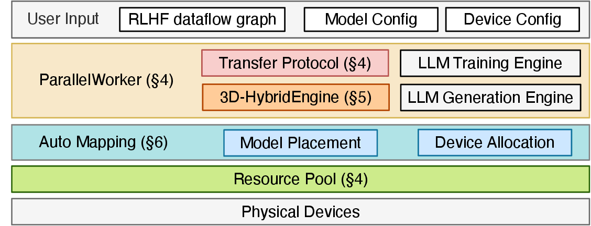
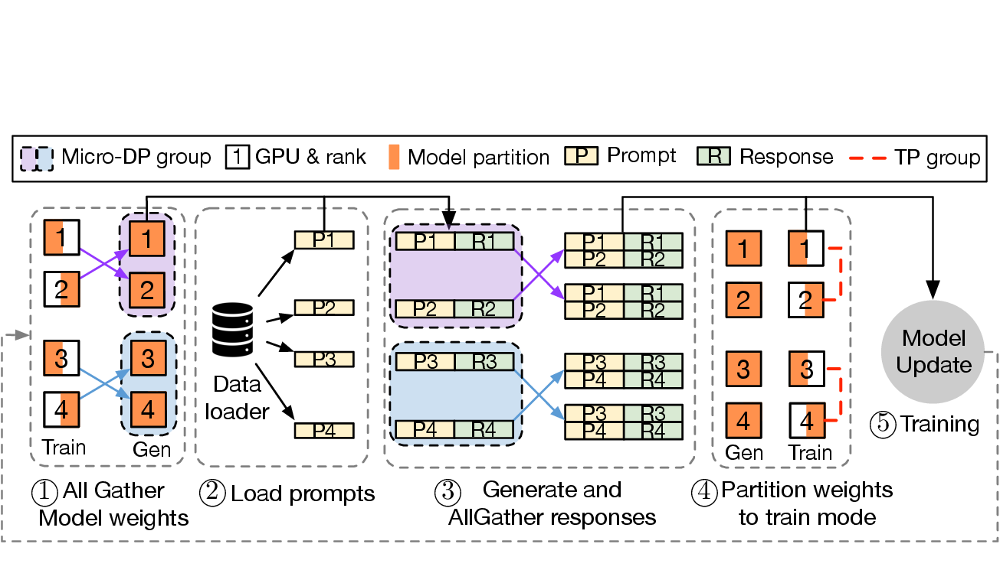

# verl 训练流程，从 rollout 到分布式更新

一次 LLM 强化学习迭代先生成回答，再评价回答，最后更新生成策略。同一个模型在两种计算形态之间切换，生成时需要高效 decode 和 KV cache，训练时需要梯度与 optimizer state。verl 把这些工作分配给不同角色，并传递计算策略目标所需的 token 字段。

下面的字段和调用关系固定对应 commit `e5687fce0516d31e1fdc4580499074a9bd94c751`。它是可复核的代码快照，不代表其他版本的 API。算法目标见 [LLM 强化学习](llm-rlhf-rlvr-and-grpo.md)与 [PPO](policy-gradient-actor-critic-ppo-grpo.md)。

## 一条回答怎样成为训练样本

输入 prompt batch 后，生成层产出 response token 与有效位置。Reward 路径给出分数，old/reference/critic 按配置补齐概率与价值，driver 再计算优势和 returns。Actor、critic 的 worker 分别执行自己的 minibatch 更新，新的权重最后同步给生成服务。

```text
prompts + attention_mask
  -> generate_sequences -> responses + response_mask + rollout_log_probs
  -> reward + old/reference logprob + optional values
  -> driver computes advantages / returns
  -> actor update + optional critic update
  -> synchronize weights -> next rollout
```

每个字段必须属于同一条 prompt-response、同一个 token 位置和明确的策略角色。即使全部 shape 一样，reward 或 logprob 错位一格也可能得到有限 loss，因此“程序跑起来”不足以验证目标正确。

## 沿同一个样本走到更新器

把一条样本标作 `sample_17`，prompt 长度 4，回答有效 token 长度 3，补齐到 5。生成服务返回 token 及对应的 `rollout_log_probs`，评分器给完整回答分数 2。为了让这一分数落到回答末尾，driver 对应的 token score 可组织为 `[0,0,2,0,0]`，后面的两个位置由 response mask 排除。

若这是 GRPO 的三个同题回答之一，driver 还要用同一 prompt 的 group id 找到另外两条回报，形成组内优势；不能按 minibatch 中恰好相邻的三行分组。随后 actor worker 使用同一 `responses` 重算当前 logprob，与固定 old 比较。分布式切分或重排前后，`sample_17` 的 token、score、mask、old 和 reference 必须一起移动。

这个例子没有规定仓库必须使用字面字段名 `sample_17`，它是追踪标识。实际排错时保留等价的稳定样本身份，比仅检查 shape 更有用。后文四策略与 ratio 都针对这条回答的同一个有效 token，便于逐项复算。

## 四种策略角色为什么要分开

| 角色 | 对应字段 | 固定到哪个时点 | 参与什么计算 |
| --- | --- | --- | --- |
| rollout policy | `rollout_log_probs` | 生成该回答时的采样行为 | 记录行为概率与 rollout correction 基准 |
| proximal old policy | `old_log_probs` | 本 data batch 的固定锚点 | PPO ratio 的分母 |
| current train policy | actor 当前重新计算的 logprob | 每个 minibatch 更新后的参数 | PPO ratio 的分子与梯度 |
| reference policy | `ref_log_prob` | 配置的 KL 参照 | reference KL 约束 |

Old 与 reference 的用途不同。Old 用来衡量本轮优化相对锚点的改变，reference 用来约束训练策略相对指定模型的偏移。Reference 是否启用，不决定 old 的产生方式。

Pinned [`ray_trainer.py`](https://github.com/verl-project/verl/blob/e5687fce0516d31e1fdc4580499074a9bd94c751/verl/trainer/ppo/ray_trainer.py#L1533-L1582)区分两条路径。Bypass 模式直接设 `old_log_probs = rollout_log_probs`；decoupled 模式由 actor 对该 batch 重算一次 old logprob，后续 minibatch 更新保持这个锚点不变。前者把 rollout 与 old 合并，后者允许两者不同。

## 用四个概率看清三种 ratio

对某个已采 token，假设 rollout 概率为 $0.2$，old 为 $0.25$，当前 actor 为 $0.3$，reference 为 $0.1$。则

\[
\frac{\pi_{\mathrm{old}}}{\pi_{\mathrm{rollout}}}=1.25,\qquad
\frac{\pi_\theta}{\pi_{\mathrm{old}}}=1.2,\qquad
\frac{\pi_\theta}{\pi_{\mathrm{rollout}}}=1.5.
\]

前两个比率相乘等于第三个，但它们服务不同计算。Decoupled rollout correction 使用 `exp(old - rollout)`；PPO 使用 `exp(current - old)`；current-vs-rollout 诊断使用 `exp(current - rollout)`。Reference 的 $0.1$ 不进入这三种 ratio，它会在相应 KL 项中出现，例如当前与 reference 的逐点 log-ratio 为 $\log3$。

```python
rollout, old, current, reference = 0.2, 0.25, 0.3, 0.1
correction, ppo_ratio = old / rollout, current / old
assert abs(correction - 1.25) < 1e-12
assert abs(ppo_ratio - 1.2) < 1e-12
assert abs(correction * ppo_ratio - current / rollout) < 1e-12
```

减法方向可直接核对 [`rollout_corr_helper.py` 847 行](https://github.com/verl-project/verl/blob/e5687fce0516d31e1fdc4580499074a9bd94c751/verl/trainer/ppo/rollout_corr_helper.py#L847)，PPO 方向见 [`core_algos.py` 1329 行](https://github.com/verl-project/verl/blob/e5687fce0516d31e1fdc4580499074a9bd94c751/verl/trainer/ppo/core_algos.py#L1329)。Bypass 将 old 与 rollout 合并，因此 actor loss 中 current-vs-rollout 关系可以按配置用于 PPO、rejection 或 IS，见[对应实现](https://github.com/verl-project/verl/blob/e5687fce0516d31e1fdc4580499074a9bd94c751/verl/trainer/ppo/core_algos.py#L2372-L2506)。

概率修正有前提。温度、top-p 等会改变实际采样分布，应核对返回的 logprob 对应的是采样变换前还是变换后概率。分母必须与所声明的行为分布一致，某动作在行为分布下概率为零时，也没有可以凭比率创造出来的样本支持。Correction 不能修复任意过期数据、错误 token 对齐或缺失的状态分布覆盖。

## Mask 决定哪些 token 真正参与训练

设 prompt 长度为 4，response 有效长度为 3，右侧再补 2 个 padding。完整序列的 `attention_mask` 为 `[1,1,1,1,1,1,1,0,0]`；response 维度上的 `response_mask` 为 `[1,1,1,0,0]`。前者给网络指出输入有效位置，后者给策略目标指出有效动作位置。两者不能互换。

若完整回答奖励为 $2$，一种 outcome-reward 表示是 response 上的 `token_level_scores=[0,0,2,0,0]`。GRPO 可把这个回答的组内优势赋给三个有效 response token；PPO/GAE 则按相应 reward 与 value 递推。广播方式由算法决定，不能因为形状一致就直接复制整条奖励到每个 token。

| 阶段 | 主要字段 | 对齐与含义 |
| --- | --- | --- |
| 输入 | `prompts`、`attention_mask` | tokenizer、padding 与 sample 对应关系 |
| 生成 | `responses`、`response_mask`、可选 `rollout_log_probs` | token、采样行为与有效动作位置 |
| 评分 | `token_level_scores` | 原始分数投放到具体 token |
| 奖励整合 | `token_level_rewards` | 可能在配置下加入 KL penalty |
| 概率与价值 | `old_log_probs`、`ref_log_prob`、可选 `values` | 分别对应各自策略角色与 value snapshot |
| 优势 | `advantages`、`returns` | 在 mask 与分组约定下生成的目标 |

这些字段的构造可核对[agent loop](https://github.com/verl-project/verl/blob/e5687fce0516d31e1fdc4580499074a9bd94c751/verl/experimental/agent_loop/agent_loop.py#L1047-L1060)和[driver reward/advantage 路径](https://github.com/verl-project/verl/blob/e5687fce0516d31e1fdc4580499074a9bd94c751/verl/trainer/ppo/ray_trainer.py#L1591-L1638)。多轮工具调用还需要检查工具输出是否属于策略动作，不能仅凭非 padding 就把它计入 actor loss。Rejection sampling 也可能进一步修改 response mask。

EOS、任务完成和最大长度停止 decode 都会结束某次生成，但它们对任务目标与 critic bootstrap 的语义未必相同。需要按任务定义保留结束原因，不能仅按服务返回的停止信号推断真正的环境终止。

## 哪个进程负责哪一步

Pinned trainer 的 driver 通过 RPC 组织计算，并在本地执行 `compute_advantage`。它调用 `actor_rollout_wg.update_actor` 进入 actor 训练，调用 `critic_wg.train_mini_batch` 进入 critic 训练；backward 与 optimizer 不由 driver 代做，调用点见 [`_update_actor` 与 `_update_critic`](https://github.com/verl-project/verl/blob/e5687fce0516d31e1fdc4580499074a9bd94c751/verl/trainer/ppo/ray_trainer.py#L1290-L1360)。

生成侧由 `LLMServerManager` 与 `AgentLoopManager` 建立服务及调度，再调用 `async_rollout_manager.generate_sequences`，见[初始化](https://github.com/verl-project/verl/blob/e5687fce0516d31e1fdc4580499074a9bd94c751/verl/trainer/ppo/ray_trainer.py#L927-L953)与[生成调用](https://github.com/verl-project/verl/blob/e5687fce0516d31e1fdc4580499074a9bd94c751/verl/trainer/ppo/ray_trainer.py#L1472-L1476)。Reward 与 reference 可按配置独立放置或共置，角色不同并不必然意味着独立进程。

{ width="920" }

<small>图源：[HybridFlow: A Flexible and Efficient RLHF Framework](https://arxiv.org/abs/2409.19256)，Architecture of HybridFlow。算法 dataflow、资源映射与 worker 通信应分别理解，具体后端以锁定版本为准。</small>

训练与推理的并行布局可能不同，权重需要聚合、重新切分或同步到生成副本。相关背景见[分布式训练](../training/distributed-training-and-checkpointing.md)与[推理运行时](../inference/serving-runtimes-vllm-sglang-and-tensorrt-llm.md)。

## 吞吐与样本新鲜度为何一起变化

假设生成服务每秒产生 10 条回答，队列平均积压 80 条，稳定流量下平均排队时间约为 $80/10=8$ 秒。如果 actor 每秒完成两次更新，样本排队期间可能跨过约 16 个 optimizer step。这个算例不估计某个真实部署性能，只说明队列容量不能孤立于 policy lag 分析。

Prefix/KV reuse 可以减少相同 prompt 的重复 prefill，不能免除每条 response 的 decode 和评分成本，也不能让不兼容权重版本共享 cache。频繁 weight sync 缩小延迟，却增加通信与暂停；扩大 rollout 并发也可能提高吞吐，同时增加旧样本积压。

{ width="920" }

<small>图源同上，3D-HybridEngine workflow in one RLHF iteration。权重同步与布局切换构成迭代成本，图示不承诺其他版本使用完全相同实现。</small>

定位故障时先沿一条样本查 prompt id、response token、mask、reward 位置与四种概率，再查优势与更新，最后分析多 worker 的等待与通信。保存代码 commit、模型/tokenizer/reward 版本、采样参数、重试计数和 actor step，可以区分字段错位与真实策略漂移。若增加 `policy_version_id`、`rollout_version_id`，应说明它们是应用层审计字段，不能假设它们已是该版本内置 keys。完整仓库入口见 [verl GitHub](https://github.com/verl-project/verl)。

## 算法和环境依据

正文严格对照 verl commit `e5687fce0516d31e1fdc4580499074a9bd94c751` 的 `ray_trainer.py`、`agent_loop.py`、`rollout_corr_helper.py` 和 `core_algos.py`，并用 [HybridFlow](https://arxiv.org/abs/2409.19256) 的架构图解释资源映射。队列 80/10、约 8 秒等待和 16 个 optimizer step 是教学算例，不是 verl 的吞吐报告；新增审计字段也不是该 commit 的内置字段。

复查新版本时，先锁 commit，再沿一条样本记录 response mask、old/current/reference logprob、reward、advantage、returns 和 policy version。最后用一个短 batch 对照 bypass 与 decoupled old-logprob 路径，确认差异来自配置而不是字段错位。
